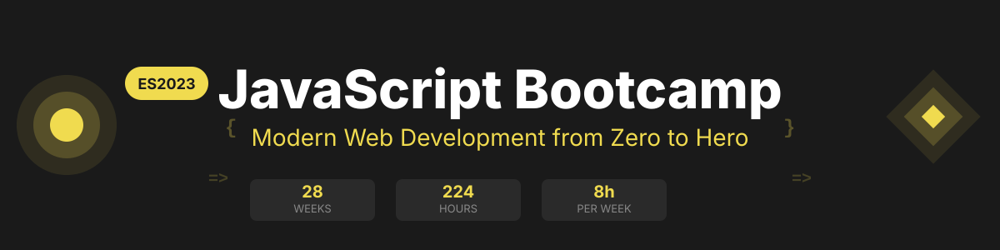

<p align="center">
  
</p>

<p align="center">
  <a href="https://github.com/ergrato-dev/bc-javascript-es2023/blob/main/LICENSE"></a>
  <a href="#"></a>
  <a href="#"></a>
  <a href="#"></a>
</p>

<p align="center">
  <a href="README.md"></a>
</p>

---

## 📋 Description

Intensive **28-week (7-month)** bootcamp focused on mastering modern JavaScript (ES2023). Designed to take students from zero to JavaScript Junior Developer, with emphasis on clean code, best practices, and real-world projects.

### 🎯 Objectives

Upon completion of the bootcamp, students will be able to:

- ✅ Master modern JavaScript features (ES2023)
- ✅ Work with asynchronous programming (Promises, async/await)
- ✅ Effectively manipulate the DOM and handle events
- ✅ Consume and work with REST APIs using Fetch API
- ✅ Apply functional programming and modern patterns
- ✅ Write automated tests with Vitest
- ✅ Implement clean code and best practices
- ✅ Build complete and complex applications with pure JavaScript

### 🚀 Why Modern JavaScript?

> **Modern JavaScript from day 1** - No pre-ES2023 history, only current best practices.

This bootcamp focuses exclusively on JavaScript ES2023 and modern features. We don't waste time on outdated syntax or obsolete patterns. Students learn directly the tools and techniques they'll use in the professional world.

---

## 🗓️ Bootcamp Structure

|          Stage          | Weeks | Hours | Main Topics                          |
| :---------------------: | :---: | :---: | ------------------------------------ |
| **Modern Fundamentals** | 1-12  |  96h  | ES2023, Modules, Modern Arrays/Objects |
|    **Intermediate**     | 13-24 |  96h  | Async, Fetch API, DOM, Storage       |
|      **Advanced**       | 25-28 |  32h  | Testing, Patterns, Clean Code        |

**Total: 28 weeks** | **224 hours** of intensive training

> 📌 **Status**: weeks 1-22 published; weeks 23-28 in progress. Details in the [bootcamp index](bootcamp/README.md) (Spanish).

---

## 📚 Weekly Content

Each week includes:

```
bootcamp/week-xx-main_topic/
├── README.md                 # Description and objectives
├── rubrica-evaluacion.md     # Evaluation criteria
├── checks.json               # Verifiable project requirements
├── 0-assets/                 # SVG diagrams
├── 1-teoria/                 # Theoretical material
├── 2-practicas/              # Guided labs (lab-NN-topic)
├── 3-proyecto/               # Weekly project
├── 4-recursos/               # Additional resources
│   ├── ebooks-free/
│   ├── videografia/
│   └── webgrafia/
└── 5-glosario/               # Key terms
```

### 🔑 Key Components

- 📖 **Theory**: Fundamental concepts with real-world examples
- 💻 **Practice**: Progressive exercises and hands-on projects
- 📝 **Assessment**: Evidence of knowledge, performance, and product
- 🎓 **Resources**: Glossaries, references, and complementary material

---

## 🛠️ Tech Stack

| Technology | Use |
| ---------- | --- |
| JavaScript ES2023 | Main language, no transpiling |
| Node.js LTS | Run labs and autograding |
| pnpm | Only package manager (`pnpm dlx` instead of `npx`; never npm or yarn) |
| Vitest | Testing and TDD (weeks 25-28) |
| Git | Version control |

Exact versions in [docs/stack-versions.md](docs/stack-versions.md).

---

## 🚀 Quick Start

### Prerequisites

- **Node.js** LTS and **pnpm** (versions in [docs/stack-versions.md](docs/stack-versions.md))
- **jq** for autograding (`./scripts/verificar-semana.sh --doctor` checks it)
- **Git** for version control
- **VS Code** (recommended) with included extensions
- Modern browser (Chrome, Firefox, Edge)

### 1. Clone the Repository

```bash
git clone https://github.com/ergrato-dev/bc-javascript-es2023.git
cd bc-javascript-es2023
```

### 2. Install VS Code Extensions

```bash
# Open in VS Code
code .

# Recommended extensions will appear automatically
# Or run: Ctrl+Shift+P → "Extensions: Show Recommended Extensions"
```

### 3. Navigate to Current Week

```bash
cd bootcamp/week-01-introduccion_javascript_moderno_es2023
```

### 4. Follow Instructions

Each week contains a `README.md` with detailed instructions. Before submitting the project, check it:

```bash
PROYECTO=path/to/your/project ./scripts/verificar-semana.sh 05
```

Details in [docs/autograding.md](docs/autograding.md).

---

## 📊 Learning Methodology

### Teaching Strategies

- 🎯 **Project-Based Learning (PBL)**
- 🧩 **Deliberate Practice**
- 🔄 **Coding Challenges**
- 👥 **Peer Code Review**
- 🎮 **Live Coding**

### Time Distribution (8h/week)

- **Theory**: 2 hours
- **Practice**: 3.5 hours
- **Project**: 2 hours
- **Resources**: 0.5 hours

### Assessment

Each week includes three types of evidence:

1. **Knowledge 🧠** (30%): Quizzes and theoretical assessments
2. **Performance 💪** (40%): Practical in-class exercises
3. **Product 📦** (30%): Deliverable assessments (functional projects)

**Passing criteria**: Minimum 70% in each type of evidence

---

## 📞 Support

- 💬 Discussions: [GitHub Discussions](https://github.com/ergrato-dev/bc-javascript-es2023/discussions)
- 🐛 Issues: [GitHub Issues](https://github.com/ergrato-dev/bc-javascript-es2023/issues)

---

## 📄 License

This project is licensed under [CC BY-NC-SA 4.0](LICENSE) (Creative Commons Attribution-NonCommercial-ShareAlike 4.0 International).

You may share and adapt the material for educational purposes, provided you give credit, do not use it commercially, and distribute under the same license.

---

## 🏆 Acknowledgments

- [MDN Web Docs](https://developer.mozilla.org/) - For the best JavaScript documentation
- [JavaScript.info](https://javascript.info/) - For excellent tutorials
- [TC39](https://tc39.es/) - For evolving JavaScript
- JavaScript Community - For resources and examples

---

## 📚 Additional Documentation

- [🤖 Copilot Instructions](.github/copilot-instructions.md)
- [🔒 Security Policy](SECURITY.md)

---

## ⚠️ Disclaimer

> **LEGAL NOTICE**: This project is open-source educational material distributed **"as is"** without warranty of any kind.

By using this repository and its contents, you agree to the following terms:

1. **Educational purpose**: This bootcamp is exclusively learning material. It does not guarantee, explicitly or implicitly, employment, official certification, or any specific level of competency upon completion.

2. **No warranty of results**: Learning outcomes depend on each student's individual effort, dedication, and circumstances. The authors and contributors are not responsible for any student's progress or results.

3. **Content accuracy**: While reasonable effort is made to keep content up to date and accurate, the JavaScript ecosystem evolves constantly. The authors do not guarantee that all examples, exercises, or references are error-free or applicable to future versions.

4. **Third-party resources**: Links, books, videos, and external tools referenced herein belong to their respective owners. The authors of this repository are not responsible for the availability, accuracy, or content of such resources.

5. **Use of code**: Code examples are provided for pedagogical purposes. Their use in production environments is solely the responsibility of the user. The authors assume no liability for direct, indirect, or consequential damages arising from the use of these materials.

6. **Intellectual property**: The original content of this repository is licensed under [CC BY-NC-SA 4.0](LICENSE). Students are responsible for respecting the copyright of any external resources used.

---

<p align="center">
  <strong>🎓 Modern JavaScript Bootcamp (ES2023)</strong><br>
  <em>From zero to JavaScript Junior Developer in 7 months</em>
</p>

<p align="center">
  <a href="bootcamp/week-01-introduccion_javascript_moderno_es2023">Start Week 1</a> •
  <a href="docs">View Documentation</a> •
  <a href="https://github.com/ergrato-dev/bc-javascript-es2023/issues">Report Issue</a>
</p>

<p align="center">
  Made with ❤️ for the developer community
</p>
