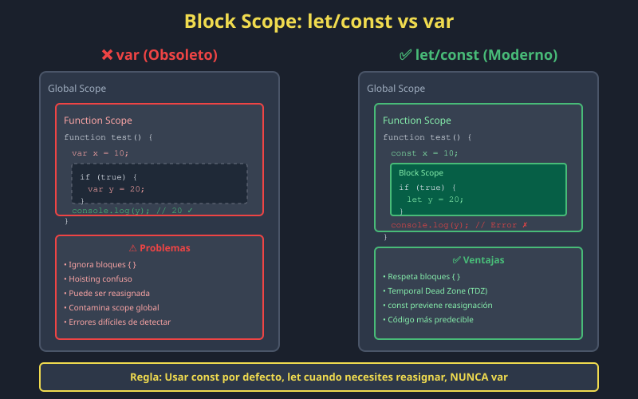

# 🔒 let y const - Variables Modernas

## 🎯 Objetivos

- Comprender las diferencias entre `var`, `let` y `const`
- Dominar el concepto de **block scope**
- Saber cuándo usar `let` vs `const`
- Evitar errores comunes con variables
- Aplicar mejores prácticas modernas

---

## 📖 Introducción

En JavaScript moderno, **olvidamos `var`** y usamos únicamente:

- **`const`**: Para valores que no cambiarán (por defecto)
- **`let`**: Para valores que sí cambiarán

> **🎯 Regla de oro**: Usa `const` por defecto. Solo usa `let` si necesitas reasignar.

---

## 🆚 var vs let vs const



### Tabla Comparativa

| Característica         | var      | let       | const     |
| ---------------------- | -------- | --------- | --------- |
| **Scope**              | Function | Block     | Block     |
| **Reasignable**        | ✅ Sí     | ✅ Sí      | ❌ No      |
| **Redeclarable**       | ✅ Sí     | ❌ No      | ❌ No      |
| **Hoisting**           | ✅ Sí     | ⚠️ Parcial | ⚠️ Parcial |
| **Global Object**      | ✅ Sí     | ❌ No      | ❌ No      |
| **Temporal Dead Zone** | ❌ No     | ✅ Sí      | ✅ Sí      |
| **Uso moderno**        | ❌ Nunca  | ✅ A veces | ✅ Siempre |

---

## 🔍 const - Constantes (Usa esto por defecto)

### Sintaxis

```javascript
const variableName = value;
```

### Características

- ✅ **No se puede reasignar** después de la inicialización
- ✅ **Block scope** (alcance de bloque)
- ✅ **Debe inicializarse** al momento de declaración
- ⚠️ Para objetos/arrays, el **contenido sí puede cambiar**

### Ejemplos Básicos

```javascript
// ✅ CORRECTO
const PI = 3.14159;
const appName = 'MyApp';
const maxUsers = 100;

// ❌ ERROR: No se puede reasignar
const age = 25;
age = 26;  // TypeError: Assignment to constant variable
```

### const con Objetos y Arrays

```javascript
// ✅ CORRECTO: El contenido puede cambiar
const user = {
  name: 'Juan',
  age: 25
};

user.age = 26;           // ✅ OK
user.city = 'Madrid';    // ✅ OK

// ❌ ERROR: No puedes reasignar el objeto completo
user = {                 // ❌ TypeError
  name: 'Pedro'
};

// ✅ CORRECTO: Arrays también pueden modificarse
const numbers = [1, 2, 3];

numbers.push(4);         // ✅ OK: [1, 2, 3, 4]
numbers[0] = 10;         // ✅ OK: [10, 2, 3, 4]

// ❌ ERROR: No puedes reasignar el array
numbers = [5, 6, 7];     // ❌ TypeError
```

### ¿Por qué usar const?

- ✅ **Previene bugs**: No puedes reasignar accidentalmente
- ✅ **Intención clara**: Indica que el valor no cambiará
- ✅ **Mejor rendimiento**: El motor JS puede optimizar
- ✅ **Estándar moderno**: Es la práctica recomendada

---

## 🔄 let - Variables Reasignables

### Sintaxis

```javascript
let variableName = value;
```

### Características

- ✅ **Sí se puede reasignar** después de la inicialización
- ✅ **Block scope** (alcance de bloque)
- ✅ **Puede declararse sin inicializar** (será `undefined`)

### Ejemplos Básicos

```javascript
// ✅ CORRECTO
let counter = 0;
counter = 1;        // ✅ OK
counter++;          // ✅ OK: counter = 2

let userName;       // ✅ OK: undefined
userName = 'Ana';   // ✅ OK
```

### Cuándo Usar let

```javascript
// ✅ Contadores en loops
for (let i = 0; i < 5; i++) {
  console.log(i);
}

// ✅ Variables que cambiarán
let score = 0;
score += 10;
score += 5;

// ✅ Valores condicionales
let message;
if (isLoggedIn) {
  message = 'Welcome back!';
} else {
  message = 'Please log in';
}
```

### let vs const en Loops

```javascript
// ✅ CORRECTO: let en loop (cambia en cada iteración)
for (let i = 0; i < 3; i++) {
  console.log(i);  // 0, 1, 2
}

// ❌ ERROR: const en loop tradicional
for (const i = 0; i < 3; i++) {  // ❌ TypeError
  console.log(i);
}

// ✅ CORRECTO: const con forEach (nueva variable cada vez)
const numbers = [1, 2, 3];
numbers.forEach(num => {
  console.log(num);  // ✅ OK
});
```

---

## 📦 Block Scope (Alcance de Bloque)

### ¿Qué es Block Scope?

Las variables `let` y `const` solo existen dentro del bloque `{}` donde fueron declaradas.

```javascript
// ✅ Ejemplo de block scope
{
  const inside = 'I exist here';
  console.log(inside);  // ✅ 'I exist here'
}

console.log(inside);  // ❌ ReferenceError: inside is not defined
```

### Scope en if/else

```javascript
const globalVar = 'I am global';

if (true) {
  const blockVar = 'I am in block';
  console.log(globalVar);   // ✅ 'I am global'
  console.log(blockVar);    // ✅ 'I am in block'
}

console.log(globalVar);     // ✅ 'I am global'
console.log(blockVar);      // ❌ ReferenceError
```

### Scope en Loops

```javascript
// ✅ let crea nueva variable en cada iteración
for (let i = 0; i < 3; i++) {
  setTimeout(() => console.log(i), 100);
}
// Output: 0, 1, 2 ✅

// ❌ var comparte la misma variable
for (var j = 0; j < 3; j++) {
  setTimeout(() => console.log(j), 100);
}
// Output: 3, 3, 3 ❌
```

---

## 🚫 Por Qué NO Usar var

### Problemas con var

#### 1. Function Scope (No Block Scope)

```javascript
// ❌ PROBLEMA: var ignora block scope
if (true) {
  var x = 10;
}
console.log(x);  // 10 (¡se escapa del bloque!)

// ✅ SOLUCIÓN: let respeta block scope
if (true) {
  let y = 10;
}
console.log(y);  // ❌ ReferenceError (como debería ser)
```

#### 2. Redeclaración Permitida (Confuso)

```javascript
// ❌ PROBLEMA: var permite redeclarar
var userName = 'Juan';
var userName = 'Ana';  // ✅ No da error (¡pero es confuso!)
console.log(userName);  // 'Ana'

// ✅ SOLUCIÓN: let/const no permiten redeclaración
let userId = 1;
let userId = 2;  // ❌ SyntaxError: Identifier 'userId' has already been declared
```

#### 3. Hoisting Confuso

```javascript
// ❌ PROBLEMA: var se "eleva" al inicio
console.log(userName);  // undefined (¿?)
var userName = 'Juan';

// ✅ SOLUCIÓN: let/const dan error claro
console.log(userAge);   // ❌ ReferenceError: Cannot access before initialization
let userAge = 25;
```

#### 4. Contamina el Objeto Global

```javascript
// ❌ PROBLEMA: var en scope global crea propiedad en window
var globalVar = 'value';
console.log(window.globalVar);  // 'value' (¡contamina window!)

// ✅ SOLUCIÓN: let/const no contaminan window
let globalLet = 'value';
console.log(window.globalLet);  // undefined
```

---

## 🎯 Mejores Prácticas

### Regla #1: const por Defecto

```javascript
// ✅ BUENA PRÁCTICA
const userName = 'Juan';
const userAge = 25;
const isActive = true;
const config = { theme: 'dark' };
```

### Regla #2: let Solo Cuando Sea Necesario

```javascript
// ✅ OK: Necesitamos reasignar
let counter = 0;
counter++;

let total = 0;
for (let i = 0; i < numbers.length; i++) {
  total += numbers[i];
}
```

### Regla #3: Nunca Usar var

```javascript
// ❌ NUNCA HAGAS ESTO
var oldStyle = 'bad practice';

// ✅ SIEMPRE HAZ ESTO
const modernStyle = 'best practice';
```

### Regla #4: Declarar al Principio del Scope

```javascript
// ✅ BUENA PRÁCTICA
const calculateTotal = items => {
  const taxRate = 0.21;
  let total = 0;

  items.forEach(item => {
    total += item.price;
  });

  return total * (1 + taxRate);
};

// ❌ MALA PRÁCTICA
const calculateTotal = items => {
  let total = 0;

  items.forEach(item => {
    total += item.price;
  });

  const taxRate = 0.21;  // ❌ Declarar después de usar
  return total * (1 + taxRate);
};
```

---

## 💡 Casos de Uso Comunes

### Configuración y Constantes

```javascript
// ✅ Constantes de configuración
const API_URL = 'https://api.example.com';
const MAX_RETRIES = 3;
const TIMEOUT_MS = 5000;

// ✅ Constantes calculadas
const TAX_RATE = 0.21;
const DISCOUNT_RATE = 0.15;
const FINAL_PRICE = basePrice * (1 + TAX_RATE) * (1 - DISCOUNT_RATE);
```

### Datos de Usuario

```javascript
// ✅ Datos que no cambiarán
const user = {
  id: '123',
  name: 'Ana',
  email: 'ana@example.com'
};

// Pero podemos modificar propiedades
user.lastLogin = new Date();
user.preferences = { theme: 'dark' };
```

### Contadores y Acumuladores

```javascript
// ✅ Variables que sí cambian
let totalClicks = 0;
let currentPage = 1;
let isLoading = false;

const incrementClicks = () => {
  totalClicks++;
};

const nextPage = () => {
  currentPage++;
  isLoading = true;
  // ... fetch data
};
```

### Arrays que se Modifican

```javascript
// ✅ const con array que cambia
const todoList = [];

const addTodo = item => {
  todoList.push(item);
};

const removeTodo = index => {
  todoList.splice(index, 1);
};
```

---

## ⚠️ Errores Comunes

### Error 1: Intentar Reasignar const

```javascript
// ❌ ERROR
const age = 25;
age = 26;  // TypeError: Assignment to constant variable
```

### Error 2: No Inicializar const

```javascript
// ❌ ERROR
const userName;  // SyntaxError: Missing initializer in const declaration

// ✅ CORRECTO
const userName = 'Juan';
```

### Error 3: Confundir Inmutabilidad

```javascript
// ⚠️ CUIDADO: const NO hace objetos inmutables
const config = { theme: 'dark' };
config.theme = 'light';  // ✅ OK (¡esto sí funciona!)

// Si quieres inmutabilidad real, usa Object.freeze()
const frozenConfig = Object.freeze({ theme: 'dark' });
frozenConfig.theme = 'light';  // ❌ Error en strict mode
```

### Error 4: Usar var en Código Moderno

```javascript
// ❌ MAL
var counter = 0;

// ✅ BIEN
let counter = 0;
```

---

## 🧪 Ejercicios Prácticos

### Ejercicio 1: Identificar Errores

```javascript
// ¿Qué está mal aquí?
const score = 100;
score = 150;

let userName = 'Juan';
let userName = 'Ana';

const items;
items = [1, 2, 3];
```

<details>
<summary>Ver solución</summary>

```javascript
// Error 1: No puedes reasignar const
let score = 100;  // Cambiar a let
score = 150;

// Error 2: No puedes redeclarar let
let userName = 'Juan';
userName = 'Ana';  // Quitar 'let'

// Error 3: const debe inicializarse
const items = [1, 2, 3];  // Inicializar en la declaración
```

</details>

### Ejercicio 2: const vs let

```javascript
// Decide si usar const o let en cada caso

// 1. Configuración de API
_____ API_KEY = 'abc123';

// 2. Contador en loop
for (_____ i = 0; i < 5; i++) {
  console.log(i);
}

// 3. Lista de usuarios
_____ users = ['Ana', 'Juan'];
users.push('Pedro');

// 4. Score que cambia
_____ currentScore = 0;
currentScore += 10;
```

<details>
<summary>Ver solución</summary>

```javascript
// 1. const (no cambiará)
const API_KEY = 'abc123';

// 2. let (cambia en cada iteración)
for (let i = 0; i < 5; i++) {
  console.log(i);
}

// 3. const (el array sigue siendo el mismo, solo cambia su contenido)
const users = ['Ana', 'Juan'];
users.push('Pedro');

// 4. let (se reasigna)
let currentScore = 0;
currentScore += 10;
```

</details>

---

## 🎓 Conceptos Clave

| Término                | Definición                                         |
| ---------------------- | -------------------------------------------------- |
| **Block Scope**        | Alcance limitado al bloque `{}` donde se declara   |
| **Function Scope**     | Alcance limitado a la función donde se declara     |
| **Hoisting**           | Elevación de declaraciones al inicio del scope     |
| **Temporal Dead Zone** | Periodo donde variable existe pero no es accesible |
| **Reasignación**       | Cambiar el valor de una variable                   |
| **Inmutabilidad**      | Valores que no pueden cambiar                      |

---

## ✅ Checklist de Verificación

Antes de continuar, asegúrate de:

- [ ] Entender la diferencia entre `const` y `let`
- [ ] Saber por qué NO usar `var`
- [ ] Comprender block scope
- [ ] Poder decidir cuándo usar `const` vs `let`
- [ ] Saber que `const` con objetos/arrays permite modificar contenido
- [ ] Recordar usar `const` por defecto

---

## 🔗 Recursos Adicionales

- [MDN: const](https://developer.mozilla.org/es/docs/Web/JavaScript/Reference/Statements/const)
- [MDN: let](https://developer.mozilla.org/es/docs/Web/JavaScript/Reference/Statements/let)
- [JavaScript.info: Variables](https://javascript.info/variables)

<!-- nav -->
---

## 🔗 Navegación

| Anterior | Siguiente |
|---|---|
| ← [Teoría — 🚀 Introducción a JavaScript Moderno (ES2023)](01-introduccion-es6.md) | [Teoría — 📝 Template Literals - Strings Modernos](03-template-literals.md) → |

[↑ Semana 01](../README.md)
