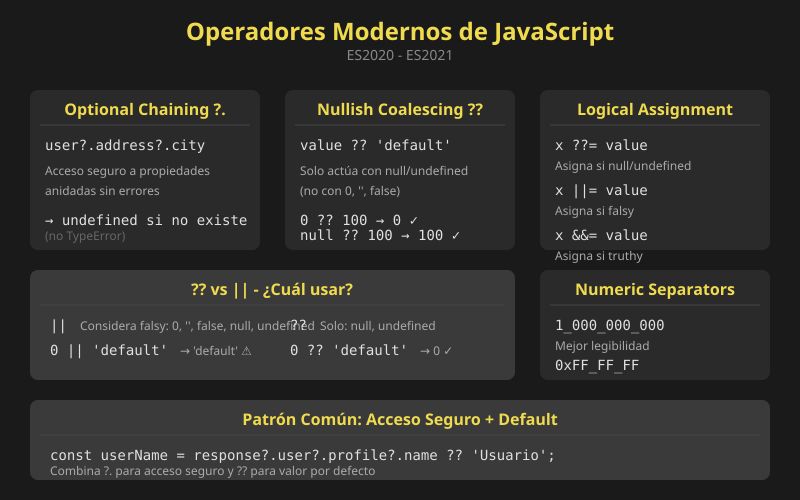

# 🔧 Operadores Modernos de JavaScript

## 🎯 Objetivos

- Comprender el optional chaining (`?.`)
- Dominar el nullish coalescing (`??`)
- Aplicar logical assignment operators (`??=`, `||=`, `&&=`)
- Usar numeric separators para mejor legibilidad

---

## 📋 Contenido



### 1. Optional Chaining (`?.`) - ES2020

El **optional chaining** permite acceder a propiedades anidadas de objetos sin verificar manualmente si cada nivel existe.

#### ❌ Antes (código defensivo verbose)

```javascript
// Verificación manual tediosa
const street = user && user.address && user.address.street;

// O con ternarios anidados
const city = user ? (user.address ? user.address.city : undefined) : undefined;
```

#### ✅ Ahora con Optional Chaining

```javascript
// Simple y elegante
const street = user?.address?.street;
const city = user?.address?.city;

// Si user, address o street no existen, retorna undefined (no error)
```

#### Casos de Uso

```javascript
const user = {
  name: 'Ana',
  contact: {
    email: 'ana@email.com'
    // phone no existe
  }
};

// Acceso a propiedades
console.log(user?.contact?.email);    // 'ana@email.com'
console.log(user?.contact?.phone);    // undefined (no error)
console.log(user?.address?.street);   // undefined (no error)

// Con arrays
const users = [{ name: 'Ana' }, { name: 'Bob' }];
console.log(users?.[0]?.name);        // 'Ana'
console.log(users?.[5]?.name);        // undefined

// Con funciones/métodos
const result = obj?.method?.();       // Llama si method existe
console.log(user?.getName?.());       // undefined si getName no existe
```

#### ⚠️ Importante

```javascript
// Optional chaining retorna undefined, NO null
const value = null?.property;  // undefined

// Solo protege de null/undefined, no de otros errores
const num = 42;
// num?.toFixed(2)  ✅ Funciona (42.00)
// num?.foo?.bar    ✅ undefined
```

---

### 2. Nullish Coalescing (`??`) - ES2020

El operador **nullish coalescing** retorna el operando derecho cuando el izquierdo es `null` o `undefined` (y SOLO esos valores).

#### Diferencia con `||`

```javascript
// || considera "falsy": 0, '', false, null, undefined, NaN
const a = 0 || 'default';      // 'default' ❌ (0 es válido pero falsy)
const b = '' || 'default';     // 'default' ❌ ('' puede ser válido)
const c = false || 'default';  // 'default' ❌ (false puede ser intencional)

// ?? solo considera null y undefined
const a2 = 0 ?? 'default';     // 0 ✅
const b2 = '' ?? 'default';    // '' ✅
const c2 = false ?? 'default'; // false ✅
const d2 = null ?? 'default';  // 'default' ✅
const e2 = undefined ?? 'default'; // 'default' ✅
```

#### Casos de Uso Prácticos

```javascript
// Configuración con valores por defecto
const config = {
  timeout: 0,        // 0ms es válido
  retries: null,     // No configurado
  debug: false       // Desactivado intencionalmente
};

// ❌ Con || perdemos valores válidos
const timeout = config.timeout || 3000;  // 3000 (incorrecto, 0 era válido)
const debug = config.debug || true;      // true (incorrecto, false era intencional)

// ✅ Con ?? respetamos null/undefined
const timeout2 = config.timeout ?? 3000; // 0 (correcto)
const retries = config.retries ?? 3;     // 3 (correcto, era null)
const debug2 = config.debug ?? true;     // false (correcto)
```

#### Combinando con Optional Chaining

```javascript
const user = {
  settings: {
    theme: 'dark',
    fontSize: 0  // 0 es válido (tamaño mínimo)
  }
};

// Patrón muy común: acceder y dar default
const theme = user?.settings?.theme ?? 'light';      // 'dark'
const fontSize = user?.settings?.fontSize ?? 16;     // 0 (no 16)
const language = user?.settings?.language ?? 'es';   // 'es'
```

---

### 3. Logical Assignment Operators - ES2021

Combinan operadores lógicos con asignación para código más conciso.

#### `||=` (OR Assignment)

Asigna si el valor actual es **falsy**.

```javascript
// Equivalente a: a = a || b
let name = '';
name ||= 'Anonymous';  // 'Anonymous' ('' es falsy)

let count = 0;
count ||= 10;          // 10 (0 es falsy) ⚠️

let active = false;
active ||= true;       // true (false es falsy) ⚠️
```

#### `??=` (Nullish Assignment)

Asigna **solo** si el valor actual es `null` o `undefined`.

```javascript
// Equivalente a: a = a ?? b
let name = '';
name ??= 'Anonymous';  // '' (no es null/undefined)

let count = 0;
count ??= 10;          // 0 ✅ (no es null/undefined)

let value = null;
value ??= 'default';   // 'default' ✅

let data = undefined;
data ??= {};           // {} ✅
```

#### `&&=` (AND Assignment)

Asigna **solo** si el valor actual es **truthy**.

```javascript
// Equivalente a: a = a && b
let user = { name: 'Ana' };
user &&= { ...user, verified: true };  // { name: 'Ana', verified: true }

let empty = null;
empty &&= { data: 'test' };  // null (no asigna porque es falsy)
```

#### Casos de Uso Prácticos

```javascript
// Inicializar propiedades faltantes
const config = {};
config.timeout ??= 3000;
config.retries ??= 3;
config.debug ??= false;
// config = { timeout: 3000, retries: 3, debug: false }

// Actualizar solo si existe
let response = { data: [1, 2, 3] };
response.data &&= response.data.map(x => x * 2);
// response.data = [2, 4, 6]

// Asignar default a string vacío
let input = '';
input ||= 'Sin valor';  // 'Sin valor'
```

---

### 4. Numeric Separators - ES2021

Usa guiones bajos (`_`) para hacer números grandes más legibles.

```javascript
// ❌ Difícil de leer
const billion = 1000000000;
const bytes = 1048576;
const price = 9999.99;

// ✅ Con separadores (mismo valor, más legible)
const billion2 = 1_000_000_000;     // Mil millones
const bytes2 = 1_048_576;           // 1 MB en bytes
const price2 = 9_999.99;            // Precio

// Funciona con cualquier base
const binary = 0b1010_0001_1000_0101;  // Binario
const hex = 0xFF_EC_DE_5E;              // Hexadecimal
const octal = 0o123_456;                // Octal

// BigInt también
const bigNum = 9_007_199_254_740_991n;
```

#### ⚠️ Reglas

```javascript
// ❌ No permitido
const bad1 = _1000;        // No al inicio
const bad2 = 1000_;        // No al final
const bad3 = 1__000;       // No consecutivos
const bad4 = 1_.0;         // No junto al punto decimal
const bad5 = 1._0;         // No junto al punto decimal

// ✅ Permitido
const good1 = 1_000;
const good2 = 1_000_000;
const good3 = 0.000_001;
const good4 = 1_000.123_456;
```

---

## 🎯 Resumen de Operadores

| Operador | Nombre | Actúa cuando | Ejemplo |
|----------|--------|--------------|---------|
| `?.` | Optional Chaining | Propiedad puede no existir | `user?.address?.city` |
| `??` | Nullish Coalescing | Valor es `null`/`undefined` | `value ?? 'default'` |
| `??=` | Nullish Assignment | Valor es `null`/`undefined` | `x ??= 10` |
| `\|\|=` | OR Assignment | Valor es falsy | `x \|\|= 'default'` |
| `&&=` | AND Assignment | Valor es truthy | `x &&= newValue` |
| `_` | Numeric Separator | Siempre (legibilidad) | `1_000_000` |

---

## 💡 Patrones Comunes

### Acceso Seguro a APIs

```javascript
const response = await fetch('/api/user');
const data = await response.json();

// Acceso seguro con defaults
const userName = data?.user?.profile?.name ?? 'Usuario';
const avatar = data?.user?.profile?.avatar ?? '/default-avatar.png';
const followers = data?.user?.stats?.followers ?? 0;
```

### Configuración de Objetos

```javascript
const createConfig = (options = {}) => {
  // Usar ??= para valores por defecto
  options.timeout ??= 5_000;
  options.retries ??= 3;
  options.debug ??= false;

  return options;
};

createConfig({ timeout: 0 });  // { timeout: 0, retries: 3, debug: false }
```

### Encadenamiento Seguro de Métodos

```javascript
const result = data
  ?.filter(item => item.active)
  ?.map(item => item.value)
  ?.reduce((sum, val) => sum + val, 0)
  ?? 0;
```

---

## ✅ Checklist de Verificación

- [ ] Entiendo la diferencia entre `?.` y el acceso directo
- [ ] Sé cuándo usar `??` en lugar de `||`
- [ ] Puedo aplicar `??=` para inicializar valores
- [ ] Uso numeric separators en números grandes
- [ ] Combino `?.` y `??` para acceso seguro con defaults

---

## 📚 Recursos Adicionales

- [MDN - Optional Chaining](https://developer.mozilla.org/en-US/docs/Web/JavaScript/Reference/Operators/Optional_chaining)
- [MDN - Nullish Coalescing](https://developer.mozilla.org/en-US/docs/Web/JavaScript/Reference/Operators/Nullish_coalescing)
- [MDN - Logical Assignment](https://developer.mozilla.org/en-US/docs/Web/JavaScript/Reference/Operators/Logical_AND_assignment)

<!-- nav -->
---

## 🔗 Navegación

| Anterior | Siguiente |
|---|---|
| ← [Teoría — 🎁 Destructuring Básico - Extraer Valores Fácilmente](05-destructuring-basico.md) | [Índice de labs](../2-practicas/README.md) → |

[↑ Semana 01](../README.md)
