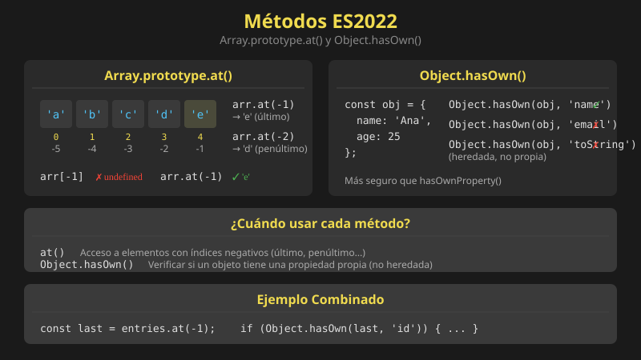

# 📚 Métodos Modernos ES2022



## 🎯 Objetivos

- Comprender y utilizar `Array.prototype.at()` para acceso por índice
- Dominar `Object.hasOwn()` como alternativa moderna a `hasOwnProperty()`
- Aplicar estos métodos en situaciones prácticas

---

## 1. Array.prototype.at()

### ¿Qué es?

El método `at()` permite acceder a elementos de un array usando **índices positivos o negativos**. Los índices negativos cuentan desde el final del array.

### Sintaxis

```javascript
array.at(index)
```

### El Problema que Resuelve

Antes de ES2022, acceder al último elemento de un array era incómodo:

```javascript
const fruits = ['🍎', '🍌', '🍇', '🍊', '🍋'];

// ❌ Forma antigua - verbosa y propensa a errores
const last = fruits[fruits.length - 1];  // '🍋'
const secondLast = fruits[fruits.length - 2];  // '🍊'

// ✅ Forma moderna con at() - clara y concisa
const lastModern = fruits.at(-1);  // '🍋'
const secondLastModern = fruits.at(-2);  // '🍊'
```

### Índices Positivos y Negativos

```javascript
const colors = ['red', 'green', 'blue', 'yellow', 'purple'];
//   Índices:     0       1        2        3         4
//   Negativos:  -5      -4       -3       -2        -1

// Índices positivos (igual que notación de corchetes)
colors.at(0);   // 'red'
colors.at(2);   // 'blue'

// Índices negativos (cuenta desde el final)
colors.at(-1);  // 'purple' (último)
colors.at(-2);  // 'yellow' (penúltimo)
colors.at(-5);  // 'red' (primero, contando desde el final)

// Fuera de rango
colors.at(10);  // undefined
colors.at(-10); // undefined
```

### Comparación: at() vs Corchetes

| Característica | `array[index]` | `array.at(index)` |
|----------------|----------------|-------------------|
| Índices positivos | ✅ Funciona | ✅ Funciona |
| Índices negativos | ❌ No funciona | ✅ Funciona |
| Último elemento | `arr[arr.length - 1]` | `arr.at(-1)` |
| Legibilidad | Menos clara | Más clara |

### Casos de Uso Prácticos

#### 1. Obtener el Último Elemento

```javascript
const transactions = [100, -50, 200, -30, 150];

// Última transacción
const lastTransaction = transactions.at(-1);  // 150

// Últimas 3 transacciones (con slice)
const last3 = transactions.slice(-3);  // [-30, 150] ❌ Solo 2!
// at() es para un solo elemento, slice() para rangos
```

#### 2. Navegación Circular

```javascript
const carousel = ['img1.jpg', 'img2.jpg', 'img3.jpg'];

const getImage = index => {
  // Normalizar índice para navegación circular
  const normalizedIndex = ((index % carousel.length) + carousel.length) % carousel.length;
  return carousel.at(normalizedIndex);
};

getImage(0);   // 'img1.jpg'
getImage(3);   // 'img1.jpg' (vuelve al inicio)
getImage(-1);  // 'img3.jpg' (último)
```

#### 3. Procesamiento de Rutas

```javascript
const getFileName = path => {
  const parts = path.split('/');
  return parts.at(-1);  // Último segmento
};

getFileName('/home/user/documents/report.pdf');  // 'report.pdf'
getFileName('images/logo.png');  // 'logo.png'
```

#### 4. Historial de Acciones

```javascript
const actionHistory = ['create', 'edit', 'save', 'edit', 'publish'];

const getLastAction = () => actionHistory.at(-1);
const getPreviousAction = () => actionHistory.at(-2);

console.log(`Última acción: ${getLastAction()}`);      // 'publish'
console.log(`Acción anterior: ${getPreviousAction()}`); // 'edit'
```

### at() en Strings

El método `at()` también funciona con strings:

```javascript
const message = 'JavaScript';

message.at(0);   // 'J'
message.at(-1);  // 't'
message.at(-4);  // 'r'
```

---

## 2. Object.hasOwn()

### ¿Qué es?

`Object.hasOwn()` es un método estático que verifica si un objeto tiene una propiedad **propia** (no heredada).

### Sintaxis

```javascript
Object.hasOwn(obj, prop)
```

### El Problema que Resuelve

Antes de ES2022, usábamos `hasOwnProperty()`, pero tenía problemas:

```javascript
const user = {
  name: 'Ana',
  age: 25
};

// ❌ Forma antigua - puede fallar en casos especiales
user.hasOwnProperty('name');  // true

// Problema 1: Objetos creados con Object.create(null)
const config = Object.create(null);
config.debug = true;
// config.hasOwnProperty('debug');  // ❌ TypeError: no es una función

// Problema 2: Propiedad sobrescrita
const malicious = {
  hasOwnProperty: () => false  // Alguien sobrescribió el método
};
malicious.secret = 'data';
// malicious.hasOwnProperty('secret');  // false (¡incorrecto!)

// ✅ Forma moderna - siempre funciona
Object.hasOwn(config, 'debug');     // true
Object.hasOwn(malicious, 'secret'); // true
```

### Comparación de Métodos

```javascript
const person = { name: 'Carlos' };

// Tres formas de verificar propiedades propias:

// 1. hasOwnProperty (antiguo, problemático)
person.hasOwnProperty('name');  // true

// 2. Object.prototype.hasOwnProperty.call (seguro pero verboso)
Object.prototype.hasOwnProperty.call(person, 'name');  // true

// 3. Object.hasOwn (moderno, recomendado)
Object.hasOwn(person, 'name');  // true ✅
```

### Propiedades Propias vs Heredadas

```javascript
const animal = {
  breathe: true
};

const dog = Object.create(animal);
dog.bark = true;

// Propiedades propias
Object.hasOwn(dog, 'bark');     // true ✅
Object.hasOwn(dog, 'breathe');  // false (heredada)

// 'in' operator incluye heredadas
'bark' in dog;      // true
'breathe' in dog;   // true (¡incluye heredadas!)
```

### Casos de Uso Prácticos

#### 1. Validación de Configuración

```javascript
const validateConfig = config => {
  const required = ['apiKey', 'baseUrl', 'timeout'];

  const missing = required.filter(key => !Object.hasOwn(config, key));

  if (missing.length > 0) {
    throw new Error(`Missing config: ${missing.join(', ')}`);
  }

  return true;
};

const config = {
  apiKey: 'abc123',
  baseUrl: 'https://api.example.com'
  // falta timeout
};

// validateConfig(config);  // Error: Missing config: timeout
```

#### 2. Merge Seguro de Objetos

```javascript
const safeMerge = (target, source) => {
  for (const key in source) {
    if (Object.hasOwn(source, key)) {
      target[key] = source[key];
    }
  }
  return target;
};

const defaults = { theme: 'dark', lang: 'es' };
const userPrefs = { theme: 'light' };

const settings = safeMerge({}, defaults);
safeMerge(settings, userPrefs);
// { theme: 'light', lang: 'es' }
```

#### 3. Contar Propiedades Propias

```javascript
const countOwnProperties = obj => {
  let count = 0;
  for (const key in obj) {
    if (Object.hasOwn(obj, key)) {
      count++;
    }
  }
  return count;
};

// Alternativa moderna más simple:
const countOwn = obj => Object.keys(obj).length;
```

#### 4. Filtrar Propiedades

```javascript
const users = {
  user1: { name: 'Ana', active: true },
  user2: { name: 'Bob', active: false },
  user3: { name: 'Carlos', active: true }
};

const getActiveUsers = data => {
  const active = {};

  for (const key in data) {
    if (Object.hasOwn(data, key) && data[key].active) {
      active[key] = data[key];
    }
  }

  return active;
};

console.log(getActiveUsers(users));
// { user1: {...}, user3: {...} }
```

---

## 3. Combinando at() y Object.hasOwn()

### Ejemplo: Sistema de Historial

```javascript
const createHistory = () => {
  const entries = [];
  const metadata = Object.create(null);  // Sin prototype

  return {
    add(action, data = {}) {
      const entry = {
        id: entries.length + 1,
        action,
        timestamp: Date.now(),
        ...data
      };
      entries.push(entry);
      return entry;
    },

    getLast() {
      return entries.at(-1) ?? null;
    },

    getRecent(count = 5) {
      return entries.slice(-count);
    },

    setMeta(key, value) {
      metadata[key] = value;
    },

    hasMeta(key) {
      return Object.hasOwn(metadata, key);
    },

    getMeta(key) {
      return Object.hasOwn(metadata, key) ? metadata[key] : undefined;
    }
  };
};

// Uso
const history = createHistory();

history.add('login', { userId: 1 });
history.add('view', { page: '/dashboard' });
history.add('edit', { document: 'report.pdf' });

history.setMeta('version', '1.0');

console.log(history.getLast());
// { id: 3, action: 'edit', timestamp: ..., document: 'report.pdf' }

console.log(history.hasMeta('version'));  // true
console.log(history.hasMeta('author'));   // false
```

---

## 📋 Resumen

| Método | Uso | Ventaja |
|--------|-----|---------|
| `array.at(index)` | Acceder a elementos por índice | Soporta índices negativos |
| `Object.hasOwn(obj, prop)` | Verificar propiedad propia | Seguro en todos los casos |

### Cuándo Usar

- **`at()`**: Cuando necesites acceder al último elemento o usar índices negativos
- **`Object.hasOwn()`**: Siempre que necesites verificar si una propiedad existe en un objeto (reemplaza `hasOwnProperty`)

---

## 🔗 Recursos Adicionales

- [MDN: Array.prototype.at()](https://developer.mozilla.org/es/docs/Web/JavaScript/Reference/Global_Objects/Array/at)
- [MDN: Object.hasOwn()](https://developer.mozilla.org/es/docs/Web/JavaScript/Reference/Global_Objects/Object/hasOwn)
- [TC39: at() Proposal](https://github.com/tc39/proposal-relative-indexing-method)
- [TC39: Object.hasOwn() Proposal](https://github.com/tc39/proposal-accessible-object-hasownproperty)

---

## ✅ Checklist de Verificación

- [ ] Puedo usar `at()` con índices negativos
- [ ] Entiendo la diferencia entre `at()` y notación de corchetes
- [ ] Sé cuándo usar `Object.hasOwn()` vs `in` operator
- [ ] Puedo verificar propiedades propias vs heredadas
- [ ] Conozco los problemas de `hasOwnProperty()` que `Object.hasOwn()` resuelve

<!-- nav -->
---

## 🔗 Navegación

| Anterior | Siguiente |
|---|---|
| ← [Teoría — ✨ Object Enhancements (Mejoras de Objetos ES2023)](05-object-enhancements.md) | [Índice de labs](../2-practicas/README.md) → |

[↑ Semana 02](../README.md)
