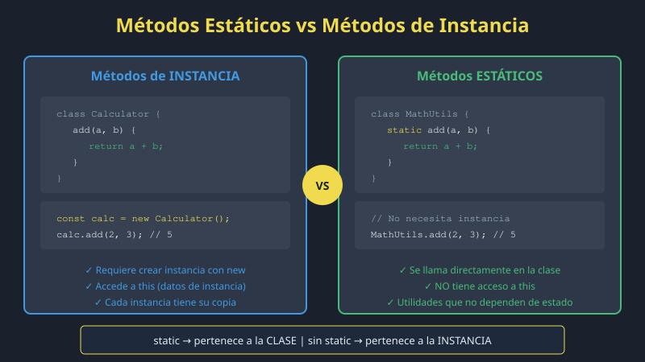

# 📘 Métodos Estáticos en JavaScript ES2023

## 🎯 Objetivos

- Comprender la diferencia entre métodos de instancia y estáticos
- Crear métodos estáticos para utilidades y factories
- Usar propiedades estáticas para datos compartidos
- Aplicar patrones comunes con métodos estáticos

---

## �️ Diagrama



---

## �📋 Contenido

### 1. ¿Qué son los Métodos Estáticos?

Los **métodos estáticos** pertenecen a la clase misma, no a las instancias. Se llaman directamente sobre la clase sin necesidad de crear un objeto.

```javascript
class MathUtils {
  // Método estático - se llama sobre la clase
  static add(a, b) {
    return a + b;
  }

  static multiply(a, b) {
    return a * b;
  }
}

// Llamada correcta - sobre la clase
console.log(MathUtils.add(5, 3));      // 8
console.log(MathUtils.multiply(4, 2)); // 8

// ❌ Error - no existe en instancias
const utils = new MathUtils();
// utils.add(5, 3); // TypeError: utils.add is not a function
```

### 2. Métodos de Instancia vs Estáticos

| Característica | Instancia | Estático |
|---------------|-----------|----------|
| Acceso | `objeto.metodo()` | `Clase.metodo()` |
| Acceso a `this` | Sí (la instancia) | Sí (la clase) |
| Necesita instancia | Sí | No |
| Uso típico | Operar sobre datos del objeto | Utilidades, factories |

```javascript
class User {
  constructor(name, email) {
    this.name = name;
    this.email = email;
  }

  // Método de INSTANCIA - opera sobre this
  getDisplayName() {
    return `${this.name} <${this.email}>`;
  }

  // Método ESTÁTICO - utilidad independiente
  static isValidEmail(email) {
    return /^[^\s@]+@[^\s@]+\.[^\s@]+$/.test(email);
  }

  // Método ESTÁTICO - factory
  static createGuest() {
    return new User('Guest', 'guest@example.com');
  }
}

// Uso de método de instancia
const user = new User('Ana', 'ana@email.com');
console.log(user.getDisplayName()); // "Ana <ana@email.com>"

// Uso de métodos estáticos
console.log(User.isValidEmail('test@email.com')); // true
const guest = User.createGuest();
console.log(guest.name); // "Guest"
```

### 3. Propiedades Estáticas

Las propiedades estáticas almacenan datos compartidos entre todas las instancias:

```javascript
class Product {
  // Propiedades estáticas
  static count = 0;
  static categories = ['Electronics', 'Clothing', 'Food', 'Books'];

  constructor(name, category, price) {
    this.id = ++Product.count; // Acceso a propiedad estática
    this.name = name;
    this.category = category;
    this.price = price;
  }

  // Método estático para acceder a categorías
  static getCategories() {
    return [...Product.categories]; // Retorna copia
  }

  static addCategory(category) {
    if (!Product.categories.includes(category)) {
      Product.categories.push(category);
    }
  }

  static getTotalProducts() {
    return Product.count;
  }
}

const p1 = new Product('Laptop', 'Electronics', 999);
const p2 = new Product('T-Shirt', 'Clothing', 29);
const p3 = new Product('JavaScript Book', 'Books', 45);

console.log(Product.getTotalProducts()); // 3
console.log(Product.getCategories());    // ['Electronics', 'Clothing', 'Food', 'Books']
```

### 4. Factory Methods (Patrón Factory)

Los métodos estáticos son ideales para crear instancias de formas específicas:

```javascript
class Date2 {
  constructor(year, month, day) {
    this.year = year;
    this.month = month;
    this.day = day;
  }

  // Factory: crear desde string ISO
  static fromISO(isoString) {
    const [year, month, day] = isoString.split('-').map(Number);
    return new Date2(year, month, day);
  }

  // Factory: crear desde timestamp
  static fromTimestamp(timestamp) {
    const date = new Date(timestamp);
    return new Date2(
      date.getFullYear(),
      date.getMonth() + 1,
      date.getDate()
    );
  }

  // Factory: fecha actual
  static today() {
    const now = new Date();
    return new Date2(
      now.getFullYear(),
      now.getMonth() + 1,
      now.getDate()
    );
  }

  toString() {
    return `${this.year}-${String(this.month).padStart(2, '0')}-${String(this.day).padStart(2, '0')}`;
  }
}

// Múltiples formas de crear instancias
const date1 = new Date2(2024, 12, 25);
const date2 = Date2.fromISO('2024-12-25');
const date3 = Date2.fromTimestamp(1735084800000);
const date4 = Date2.today();

console.log(date1.toString()); // "2024-12-25"
console.log(date2.toString()); // "2024-12-25"
```

### 5. Métodos de Validación Estáticos

```javascript
class Validator {
  static isEmail(value) {
    return /^[^\s@]+@[^\s@]+\.[^\s@]+$/.test(value);
  }

  static isURL(value) {
    try {
      new URL(value);
      return true;
    } catch {
      return false;
    }
  }

  static isPhoneNumber(value, country = 'US') {
    const patterns = {
      US: /^\+?1?\d{10}$/,
      MX: /^\+?52?\d{10}$/,
      ES: /^\+?34?\d{9}$/
    };
    return patterns[country]?.test(value.replace(/\D/g, '')) ?? false;
  }

  static isStrongPassword(value) {
    // Al menos 8 caracteres, mayúscula, minúscula, número y especial
    return /^(?=.*[a-z])(?=.*[A-Z])(?=.*\d)(?=.*[@$!%*?&])[A-Za-z\d@$!%*?&]{8,}$/.test(value);
  }

  static isInRange(value, min, max) {
    return value >= min && value <= max;
  }
}

// Uso
console.log(Validator.isEmail('test@email.com'));     // true
console.log(Validator.isURL('https://google.com'));   // true
console.log(Validator.isStrongPassword('Abc123!@')); // true
console.log(Validator.isInRange(5, 1, 10));          // true
```

### 6. Patrón Singleton con Métodos Estáticos

```javascript
class Database {
  static #instance = null;

  constructor() {
    if (Database.#instance) {
      throw new Error('Use Database.getInstance() instead');
    }
    this.connection = null;
    this.queries = [];
  }

  static getInstance() {
    if (!Database.#instance) {
      Database.#instance = new Database();
    }
    return Database.#instance;
  }

  connect(connectionString) {
    this.connection = connectionString;
    console.log(`Connected to: ${connectionString}`);
  }

  query(sql) {
    this.queries.push(sql);
    return `Executing: ${sql}`;
  }
}

// Uso del singleton
const db1 = Database.getInstance();
const db2 = Database.getInstance();

console.log(db1 === db2); // true - misma instancia

db1.connect('mongodb://localhost:27017');
console.log(db2.connection); // "mongodb://localhost:27017"
```

### 7. Métodos de Conversión Estáticos

```javascript
class Temperature {
  constructor(celsius) {
    this.celsius = celsius;
  }

  // Factories para diferentes unidades
  static fromFahrenheit(fahrenheit) {
    return new Temperature((fahrenheit - 32) * 5/9);
  }

  static fromKelvin(kelvin) {
    return new Temperature(kelvin - 273.15);
  }

  // Conversiones de instancia
  toFahrenheit() {
    return this.celsius * 9/5 + 32;
  }

  toKelvin() {
    return this.celsius + 273.15;
  }

  toString() {
    return `${this.celsius.toFixed(1)}°C`;
  }

  // Utilidades estáticas
  static compare(temp1, temp2) {
    return temp1.celsius - temp2.celsius;
  }

  static average(...temperatures) {
    const sum = temperatures.reduce((acc, t) => acc + t.celsius, 0);
    return new Temperature(sum / temperatures.length);
  }
}

const boiling = new Temperature(100);
const freezing = Temperature.fromFahrenheit(32);
const absolute = Temperature.fromKelvin(0);

console.log(boiling.toFahrenheit());  // 212
console.log(freezing.toString());     // "0.0°C"
console.log(absolute.toString());     // "-273.2°C"

const avg = Temperature.average(boiling, freezing);
console.log(avg.toString()); // "50.0°C"
```

### 8. Ejemplo Completo: Clase ID Generator

```javascript
class IdGenerator {
  // Estado compartido
  static #counters = new Map();
  static #prefix = 'ID';

  // Configuración
  static setPrefix(prefix) {
    IdGenerator.#prefix = prefix;
  }

  // Generar ID secuencial por categoría
  static generate(category = 'default') {
    const current = IdGenerator.#counters.get(category) ?? 0;
    IdGenerator.#counters.set(category, current + 1);
    return `${IdGenerator.#prefix}-${category.toUpperCase()}-${String(current + 1).padStart(4, '0')}`;
  }

  // Generar UUID
  static uuid() {
    return crypto.randomUUID();
  }

  // Generar ID corto (base36)
  static short() {
    return Date.now().toString(36) + Math.random().toString(36).substring(2, 7);
  }

  // Generar slug desde texto
  static slug(text) {
    return text
      .toLowerCase()
      .normalize('NFD')
      .replace(/[\u0300-\u036f]/g, '')
      .replace(/[^a-z0-9]+/g, '-')
      .replace(/^-|-$/g, '');
  }

  // Resetear contador
  static reset(category = 'default') {
    IdGenerator.#counters.set(category, 0);
  }

  // Ver estado actual
  static getStats() {
    return Object.fromEntries(IdGenerator.#counters);
  }
}

// Uso
IdGenerator.setPrefix('PRD');

console.log(IdGenerator.generate('user'));    // "PRD-USER-0001"
console.log(IdGenerator.generate('user'));    // "PRD-USER-0002"
console.log(IdGenerator.generate('product')); // "PRD-PRODUCT-0001"

console.log(IdGenerator.uuid());  // "550e8400-e29b-41d4-a716-446655440000"
console.log(IdGenerator.short()); // "m5x7k2abc"
console.log(IdGenerator.slug('Hola Mundo! ¿Cómo estás?')); // "hola-mundo-como-estas"

console.log(IdGenerator.getStats()); // { user: 2, product: 1 }
```

---

## 💡 Cuándo Usar Métodos Estáticos

### ✅ Usar Estáticos Para

```javascript
// 1. Funciones de utilidad
class StringUtils {
  static capitalize(str) { }
  static truncate(str, length) { }
}

// 2. Factory methods
class User {
  static fromJSON(json) { }
  static createAdmin(name) { }
}

// 3. Validadores
class Validator {
  static isEmail(value) { }
}

// 4. Constantes y configuración
class Config {
  static API_URL = 'https://api.example.com';
  static getEndpoint(path) { }
}
```

### ❌ No Usar Estáticos Para

```javascript
class User {
  // ❌ Necesita datos de instancia
  static getName() {
    return this.name; // this es la clase, no la instancia
  }

  // ✅ Correcto - método de instancia
  getName() {
    return this.name;
  }
}
```

---

## 🧪 Ejercicios Rápidos

### Ejercicio 1: ArrayUtils

Crea una clase `ArrayUtils` con métodos estáticos:
- `sum(array)` - suma de elementos
- `average(array)` - promedio
- `unique(array)` - elementos únicos
- `shuffle(array)` - mezclar aleatoriamente

### Ejercicio 2: Color Factory

Crea una clase `Color` con:
- Constructor que reciba r, g, b
- `static fromHex(hex)` - crear desde hexadecimal
- `static fromHSL(h, s, l)` - crear desde HSL
- `static random()` - color aleatorio
- `toHex()` - convertir a hexadecimal

---

## 📚 Recursos Adicionales

- [MDN: static](https://developer.mozilla.org/es/docs/Web/JavaScript/Reference/Classes/static)
- [JavaScript.info: Static properties and methods](https://javascript.info/static-properties-methods)
- [Refactoring Guru: Factory Method](https://refactoring.guru/design-patterns/factory-method)

---

## ✅ Checklist de Verificación

- [ ] Entiendo la diferencia entre métodos de instancia y estáticos
- [ ] Puedo crear métodos estáticos con `static`
- [ ] Sé usar propiedades estáticas para datos compartidos
- [ ] Puedo implementar el patrón Factory
- [ ] Entiendo cuándo es apropiado usar métodos estáticos
- [ ] Puedo crear clases de utilidades con solo métodos estáticos

<!-- nav -->
---

## 🔗 Navegación

| Anterior | Siguiente |
|---|---|
| ← [Teoría — 📘 Clases Básicas en JavaScript ES2023](01-clases-basicas.md) | [Teoría — 📘 Herencia en JavaScript ES2023](03-herencia.md) → |

[↑ Semana 03](../README.md)
