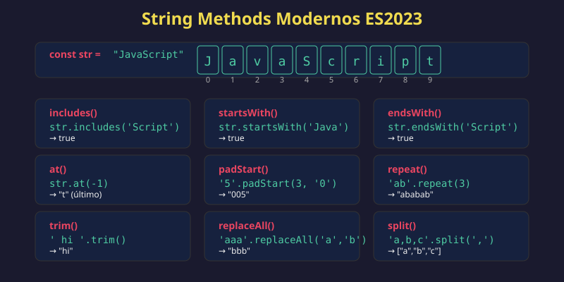

# 📝 Métodos Modernos de Strings



## 🎯 Objetivos

- Dominar los métodos de búsqueda modernos
- Usar métodos de transformación de strings
- Aplicar padding y repetición
- Entender normalización de texto

## 📋 Contenido

### 1. Métodos de Búsqueda

#### `includes(searchString, position)`

Verifica si un string contiene otro string.

```javascript
const text = 'JavaScript es genial';

// Búsqueda simple
console.log(text.includes('Script'));  // true
console.log(text.includes('script'));  // false (case-sensitive)
console.log(text.includes('Python'));  // false

// Búsqueda desde posición
console.log(text.includes('Java', 0));   // true
console.log(text.includes('Java', 1));   // false (empieza después de 'J')

// Caso de uso: filtrar elementos
const products = ['iPhone', 'iPad', 'MacBook', 'Apple Watch'];
const appleProducts = products.filter(p => p.includes('i'));
console.log(appleProducts); // ['iPhone', 'iPad']
```

#### `startsWith(searchString, position)`

Verifica si el string comienza con determinado texto.

```javascript
const filename = 'documento.pdf';
const url = 'https://api.example.com';

console.log(filename.startsWith('doc'));     // true
console.log(filename.startsWith('DOC'));     // false
console.log(url.startsWith('https'));        // true
console.log(url.startsWith('http://'));      // false

// Desde posición específica
const path = '/users/admin/documents';
console.log(path.startsWith('users', 1));    // true (ignora el primer /)

// Caso de uso: validar protocolo
const isSecure = url => url.startsWith('https://');
console.log(isSecure('https://google.com')); // true
console.log(isSecure('http://google.com'));  // false
```

#### `endsWith(searchString, length)`

Verifica si el string termina con determinado texto.

```javascript
const file = 'image.png';

console.log(file.endsWith('.png'));  // true
console.log(file.endsWith('.jpg'));  // false
console.log(file.endsWith('.PNG'));  // false

// Con longitud (verifica hasta esa posición)
const text = 'Hello World';
console.log(text.endsWith('Hello', 5));  // true (solo primeros 5 chars)

// Caso de uso: validar extensión de archivo
const isImage = filename => {
  const extensions = ['.jpg', '.jpeg', '.png', '.gif', '.webp'];
  return extensions.some(ext => filename.toLowerCase().endsWith(ext));
};

console.log(isImage('photo.JPG'));   // true
console.log(isImage('doc.pdf'));     // false
```

### 2. Métodos de Transformación

#### `repeat(count)`

Repite el string un número determinado de veces.

```javascript
const star = '⭐';
console.log(star.repeat(5));  // '⭐⭐⭐⭐⭐'

const dash = '-';
console.log(dash.repeat(20)); // '--------------------'

// Caso de uso: crear separadores
const separator = char => char.repeat(40);
console.log(separator('='));

// Caso de uso: mostrar rating
const showRating = (rating, max = 5) => {
  const filled = '★'.repeat(rating);
  const empty = '☆'.repeat(max - rating);
  return filled + empty;
};

console.log(showRating(3));  // '★★★☆☆'
console.log(showRating(5));  // '★★★★★'
```

#### `padStart(targetLength, padString)` y `padEnd(targetLength, padString)`

Rellena el string hasta alcanzar una longitud determinada.

```javascript
// padStart - rellena al inicio
const num = '7';
console.log(num.padStart(2, '0'));   // '07'
console.log(num.padStart(4, '0'));   // '0007'

// padEnd - rellena al final
const price = '99';
console.log(price.padEnd(5, '0'));   // '99000'

// Caso de uso: formatear hora
const formatTime = (h, m, s) => {
  return [h, m, s]
    .map(n => String(n).padStart(2, '0'))
    .join(':');
};
console.log(formatTime(9, 5, 3));    // '09:05:03'

// Caso de uso: IDs con prefijo
const formatId = id => String(id).padStart(6, '0');
console.log(formatId(42));           // '000042'
console.log(formatId(12345));        // '012345'

// Caso de uso: tabla alineada
const align = (text, width) => text.padEnd(width);
console.log(align('Name', 15) + 'Age');
console.log(align('Alice', 15) + '25');
console.log(align('Bob', 15) + '30');
```

#### `trim()`, `trimStart()`, `trimEnd()`

Elimina espacios en blanco de los extremos.

```javascript
const input = '   hello world   ';

console.log(input.trim());       // 'hello world'
console.log(input.trimStart());  // 'hello world   '
console.log(input.trimEnd());    // '   hello world'

// También elimina otros whitespace
const withTabs = '\t\n  texto  \n\t';
console.log(withTabs.trim());    // 'texto'

// Caso de uso: limpiar input de usuario
const cleanInput = input => input.trim().toLowerCase();
console.log(cleanInput('  EMAIL@Example.com  ')); // 'email@example.com'
```

### 3. Métodos de Acceso

#### `at(index)`

Accede a caracteres por índice (soporta índices negativos).

```javascript
const str = 'JavaScript';

// Índices positivos
console.log(str.at(0));   // 'J'
console.log(str.at(4));   // 'S'

// Índices negativos (desde el final)
console.log(str.at(-1));  // 't'
console.log(str.at(-2));  // 'p'

// Comparación con bracket notation
console.log(str[str.length - 1]);  // 't' (forma antigua)
console.log(str.at(-1));           // 't' (forma moderna)

// Caso de uso: obtener extensión de archivo
const getExtension = filename => {
  const lastDot = filename.lastIndexOf('.');
  return lastDot > 0 ? filename.slice(lastDot) : '';
};
console.log(getExtension('photo.jpg')); // '.jpg'
```

### 4. Conversión y Splitting

#### `split(separator, limit)`

Divide un string en un array.

```javascript
const csv = 'apple,banana,orange';
console.log(csv.split(','));       // ['apple', 'banana', 'orange']
console.log(csv.split(',', 2));    // ['apple', 'banana']

const sentence = 'Hello World';
console.log(sentence.split(' '));  // ['Hello', 'World']
console.log(sentence.split(''));   // ['H','e','l','l','o',' ','W','o','r','l','d']

// Con RegExp
const text = 'one1two2three3';
console.log(text.split(/\d/));     // ['one', 'two', 'three', '']

// Caso de uso: parsear path
const path = '/users/john/documents/file.txt';
const parts = path.split('/').filter(Boolean);
console.log(parts); // ['users', 'john', 'documents', 'file.txt']
```

### 5. Normalización

#### `normalize(form)`

Normaliza caracteres Unicode a forma canónica.

```javascript
// Diferentes representaciones del mismo carácter
const cafe1 = 'café';           // 'é' como un carácter
const cafe2 = 'cafe\u0301';     // 'e' + acento combinado

console.log(cafe1 === cafe2);   // false
console.log(cafe1.normalize() === cafe2.normalize()); // true

console.log(cafe1.length);      // 4
console.log(cafe2.length);      // 5
console.log(cafe2.normalize().length); // 4

// Caso de uso: comparar strings con acentos
const compareNormalized = (str1, str2) => {
  return str1.normalize() === str2.normalize();
};
```

### 6. Métodos de Reemplazo

#### `replace()` y `replaceAll()`

```javascript
const text = 'foo bar foo baz foo';

// replace: solo primera ocurrencia (sin RegExp global)
console.log(text.replace('foo', 'XXX'));    // 'XXX bar foo baz foo'

// replaceAll: todas las ocurrencias
console.log(text.replaceAll('foo', 'XXX')); // 'XXX bar XXX baz XXX'

// Con función de reemplazo
const result = 'hello'.replace(/[aeiou]/g, char => char.toUpperCase());
console.log(result); // 'hEllO'

// Caso de uso: sanitizar HTML
const escapeHtml = str => {
  return str
    .replaceAll('&', '&amp;')
    .replaceAll('<', '&lt;')
    .replaceAll('>', '&gt;')
    .replaceAll('"', '&quot;');
};
console.log(escapeHtml('<script>alert("xss")</script>'));
// '&lt;script&gt;alert(&quot;xss&quot;)&lt;/script&gt;'
```

## 💡 Cuándo Usar Cada Método

| Necesidad | Método |
|-----------|--------|
| ¿Contiene texto? | `includes()` |
| ¿Empieza con...? | `startsWith()` |
| ¿Termina con...? | `endsWith()` |
| Repetir texto | `repeat()` |
| Agregar padding | `padStart()`, `padEnd()` |
| Eliminar espacios | `trim()`, `trimStart()`, `trimEnd()` |
| Acceder desde el final | `at(-n)` |
| Dividir en array | `split()` |
| Reemplazar todo | `replaceAll()` |

## ✅ Checklist de Verificación

- [ ] Conozco la diferencia entre `includes` y `indexOf`
- [ ] Sé cuándo usar `startsWith` vs `endsWith`
- [ ] Puedo formatear números con `padStart`
- [ ] Entiendo el uso de `at()` con índices negativos
- [ ] Sé cuándo usar `replaceAll` vs `replace` con RegExp

## 🔗 Recursos

- [MDN - String](https://developer.mozilla.org/es/docs/Web/JavaScript/Reference/Global_Objects/String)

<!-- nav -->
---

## 🔗 Navegación

| Anterior | Siguiente |
|---|---|
| ← [Semana 06 - Strings y RegExp Modernos](../README.md) | [Teoría — 🏷️ Template Literals Avanzados](02-template-literals-avanzados.md) → |

[↑ Semana 06](../README.md)
