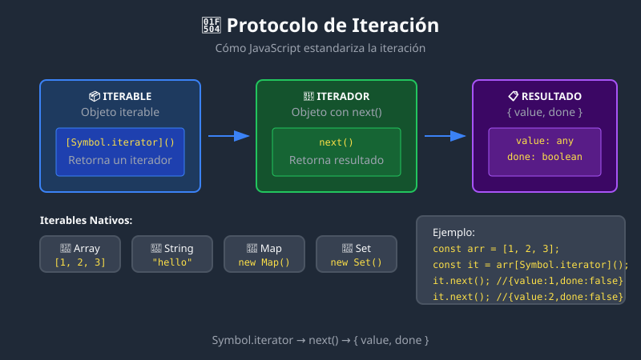

# 🔄 Protocolo de Iteración



## 🎯 Objetivos

- Comprender qué es un iterable y un iterador
- Conocer el protocolo de iteración de JavaScript
- Entender Symbol.iterator y el método next()
- Identificar iterables nativos en JavaScript

---

## 📖 ¿Qué es la Iteración?

La **iteración** es el proceso de recorrer elementos de una colección uno por uno. En JavaScript ES2023, este proceso está estandarizado mediante el **protocolo de iteración**.

```javascript
// Iteración simple sobre un array
const colors = ['red', 'green', 'blue'];

for (const color of colors) {
  console.log(color);
}
// 'red'
// 'green'
// 'blue'
```

---

## 🔑 Conceptos Clave

### Iterable

Un **iterable** es cualquier objeto que implementa el método `[Symbol.iterator]`. Este método retorna un **iterador**.

```javascript
// Arrays son iterables nativos
const numbers = [1, 2, 3];

// Verificar si es iterable
console.log(typeof numbers[Symbol.iterator]); // 'function'
```

### Iterador

Un **iterador** es un objeto que implementa el método `next()`, el cual retorna un objeto con dos propiedades:

- `value`: El valor actual
- `done`: Boolean que indica si la iteración terminó

```javascript
const numbers = [1, 2, 3];

// Obtener el iterador
const iterator = numbers[Symbol.iterator]();

// Llamar next() manualmente
console.log(iterator.next()); // { value: 1, done: false }
console.log(iterator.next()); // { value: 2, done: false }
console.log(iterator.next()); // { value: 3, done: false }
console.log(iterator.next()); // { value: undefined, done: true }
```

---

## 📊 Diagrama del Protocolo

```
┌─────────────────────────────────────────────────────────┐
│                    ITERABLE                             │
│  (objeto con [Symbol.iterator])                         │
│                                                         │
│    [Symbol.iterator]() → retorna ITERADOR               │
└─────────────────────────────────────────────────────────┘
                          │
                          ▼
┌─────────────────────────────────────────────────────────┐
│                    ITERADOR                             │
│  (objeto con método next())                             │
│                                                         │
│    next() → { value: any, done: boolean }               │
└─────────────────────────────────────────────────────────┘
                          │
                          ▼
┌─────────────────────────────────────────────────────────┐
│               RESULTADO DE ITERACIÓN                    │
│                                                         │
│    { value: 1, done: false }  ← hay más valores         │
│    { value: 2, done: false }  ← hay más valores         │
│    { done: true }             ← iteración completada    │
└─────────────────────────────────────────────────────────┘
```

---

## 🏗️ Iterables Nativos en JavaScript

JavaScript incluye varios iterables nativos:

| Tipo | Ejemplo | Itera sobre |
|------|---------|-------------|
| **Array** | `[1, 2, 3]` | Elementos |
| **String** | `'hello'` | Caracteres |
| **Map** | `new Map()` | Pares [key, value] |
| **Set** | `new Set()` | Valores únicos |
| **TypedArray** | `new Uint8Array()` | Elementos |
| **arguments** | `arguments` | Argumentos de función |
| **NodeList** | `document.querySelectorAll()` | Nodos DOM |

```javascript
// String es iterable
const str = 'JS';
const strIterator = str[Symbol.iterator]();

console.log(strIterator.next()); // { value: 'J', done: false }
console.log(strIterator.next()); // { value: 'S', done: false }
console.log(strIterator.next()); // { value: undefined, done: true }

// Set es iterable
const set = new Set([1, 2, 3]);
const setIterator = set[Symbol.iterator]();

console.log(setIterator.next()); // { value: 1, done: false }

// Map es iterable
const map = new Map([['a', 1], ['b', 2]]);
const mapIterator = map[Symbol.iterator]();

console.log(mapIterator.next()); // { value: ['a', 1], done: false }
```

---

## 🔧 Consumidores de Iterables

Varias construcciones de JavaScript consumen iterables:

### for...of

```javascript
const fruits = ['apple', 'banana', 'cherry'];

for (const fruit of fruits) {
  console.log(fruit);
}
```

### Spread Operator

```javascript
const nums = [1, 2, 3];
const copy = [...nums]; // [1, 2, 3]

const str = 'ABC';
const chars = [...str]; // ['A', 'B', 'C']
```

### Destructuring

```javascript
const [first, second] = [10, 20, 30];
console.log(first);  // 10
console.log(second); // 20

const [a, ...rest] = 'hello';
console.log(a);    // 'h'
console.log(rest); // ['e', 'l', 'l', 'o']
```

### Array.from()

```javascript
const set = new Set([1, 2, 3]);
const arr = Array.from(set); // [1, 2, 3]

const str = 'ABC';
const chars = Array.from(str); // ['A', 'B', 'C']
```

### Constructores de Map y Set

```javascript
// Map acepta iterable de pares [key, value]
const map = new Map([['a', 1], ['b', 2]]);

// Set acepta cualquier iterable
const set = new Set('hello'); // Set { 'h', 'e', 'l', 'o' }
```

### Promise.all() y Promise.race()

```javascript
const promises = [
  Promise.resolve(1),
  Promise.resolve(2),
  Promise.resolve(3)
];

Promise.all(promises).then(console.log); // [1, 2, 3]
```

---

## 🛠️ Crear un Iterador Manual

Podemos crear objetos iterables implementando `[Symbol.iterator]`:

```javascript
const countdown = {
  start: 5,
  end: 1,

  // Implementar Symbol.iterator
  [Symbol.iterator]() {
    let current = this.start;
    const end = this.end;

    // Retornar objeto iterador
    return {
      next() {
        if (current >= end) {
          return { value: current--, done: false };
        }
        return { done: true };
      }
    };
  }
};

// Ahora podemos usar for...of
for (const num of countdown) {
  console.log(num);
}
// 5, 4, 3, 2, 1

// Y spread operator
const nums = [...countdown]; // [5, 4, 3, 2, 1]
```

---

## 📝 Iterador con Estado Compartido

Un iterador mantiene su propio estado:

```javascript
const range = {
  from: 1,
  to: 3,

  [Symbol.iterator]() {
    return {
      current: this.from,
      last: this.to,

      next() {
        if (this.current <= this.last) {
          return { value: this.current++, done: false };
        }
        return { done: true };
      }
    };
  }
};

// Cada iteración crea un nuevo iterador
console.log([...range]); // [1, 2, 3]
console.log([...range]); // [1, 2, 3] - funciona de nuevo
```

---

## ⚠️ Objetos NO son Iterables por Defecto

Los objetos planos no implementan el protocolo de iteración:

```javascript
const user = { name: 'John', age: 30 };

// ❌ ERROR: user is not iterable
// for (const prop of user) { }

// ✅ Soluciones:

// 1. Usar Object.keys()
for (const key of Object.keys(user)) {
  console.log(key); // 'name', 'age'
}

// 2. Usar Object.values()
for (const value of Object.values(user)) {
  console.log(value); // 'John', 30
}

// 3. Usar Object.entries()
for (const [key, value] of Object.entries(user)) {
  console.log(`${key}: ${value}`);
}
```

---

## 🎯 Resumen

| Concepto | Descripción |
|----------|-------------|
| **Iterable** | Objeto con `[Symbol.iterator]` que retorna un iterador |
| **Iterador** | Objeto con método `next()` |
| **next()** | Retorna `{ value, done }` |
| **done: false** | Hay más valores por iterar |
| **done: true** | Iteración completada |

```javascript
// Patrón completo
const myIterable = {
  data: [1, 2, 3],

  [Symbol.iterator]() {
    let index = 0;
    const data = this.data;

    return {
      next() {
        if (index < data.length) {
          return { value: data[index++], done: false };
        }
        return { done: true };
      }
    };
  }
};
```

---

## 📚 Recursos

- [MDN: Iteration protocols](https://developer.mozilla.org/en-US/docs/Web/JavaScript/Reference/Iteration_protocols)
- [JavaScript.info: Iterables](https://javascript.info/iterable)

<!-- nav -->
---

## 🔗 Navegación

| Anterior | Siguiente |
|---|---|
| ← [Semana 08 - Iteradores y Generadores](../README.md) | [Teoría — 🔀 for...of vs for...in](02-for-of-vs-for-in.md) → |

[↑ Semana 08](../README.md)
