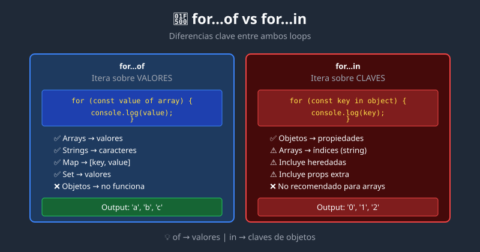

# 🔀 for...of vs for...in



## 🎯 Objetivos

- Diferenciar claramente `for...of` y `for...in`
- Saber cuándo usar cada tipo de loop
- Evitar errores comunes al iterar
- Conocer alternativas modernas

---

## 📖 Introducción

JavaScript tiene dos formas de loop similares en sintaxis pero muy diferentes en comportamiento:

- **`for...of`**: Itera sobre **valores** de iterables
- **`for...in`**: Itera sobre **claves enumerables** de objetos

```javascript
const arr = ['a', 'b', 'c'];

// for...of → valores
for (const value of arr) {
  console.log(value); // 'a', 'b', 'c'
}

// for...in → índices (como strings)
for (const index in arr) {
  console.log(index); // '0', '1', '2'
}
```

---

## 🔵 for...of

### Sintaxis

```javascript
for (const element of iterable) {
  // usar element
}
```

### Características

- ✅ Itera sobre **valores**
- ✅ Funciona con **iterables** (arrays, strings, Maps, Sets, etc.)
- ❌ NO funciona con objetos planos
- ✅ Respeta el orden de inserción

### Ejemplos con Arrays

```javascript
const colors = ['red', 'green', 'blue'];

for (const color of colors) {
  console.log(color);
}
// 'red'
// 'green'
// 'blue'

// Con destructuring
const users = [
  { name: 'Alice', age: 25 },
  { name: 'Bob', age: 30 }
];

for (const { name, age } of users) {
  console.log(`${name} is ${age}`);
}
// 'Alice is 25'
// 'Bob is 30'
```

### Ejemplos con Strings

```javascript
const word = 'Hello';

for (const char of word) {
  console.log(char);
}
// 'H', 'e', 'l', 'l', 'o'

// Maneja correctamente emojis y caracteres Unicode
const emoji = '👨‍👩‍👧';
console.log([...emoji]); // Caracteres del emoji
```

### Ejemplos con Map

```javascript
const userRoles = new Map([
  ['alice', 'admin'],
  ['bob', 'user'],
  ['charlie', 'guest']
]);

// Itera sobre pares [key, value]
for (const [user, role] of userRoles) {
  console.log(`${user}: ${role}`);
}
// 'alice: admin'
// 'bob: user'
// 'charlie: guest'

// Solo claves
for (const key of userRoles.keys()) {
  console.log(key);
}

// Solo valores
for (const value of userRoles.values()) {
  console.log(value);
}
```

### Ejemplos con Set

```javascript
const uniqueNumbers = new Set([1, 2, 3, 2, 1]);

for (const num of uniqueNumbers) {
  console.log(num);
}
// 1, 2, 3
```

---

## 🟠 for...in

### Sintaxis

```javascript
for (const key in object) {
  // usar key
}
```

### Características

- ✅ Itera sobre **claves enumerables**
- ✅ Funciona con **objetos**
- ⚠️ También funciona con arrays (pero no es recomendado)
- ⚠️ Incluye propiedades heredadas del prototype

### Ejemplos con Objetos

```javascript
const person = {
  name: 'John',
  age: 30,
  city: 'NYC'
};

for (const key in person) {
  console.log(`${key}: ${person[key]}`);
}
// 'name: John'
// 'age: 30'
// 'city: NYC'
```

### ⚠️ Problema: Propiedades Heredadas

```javascript
const parent = { inherited: true };
const child = Object.create(parent);
child.own = 'property';

for (const key in child) {
  console.log(key);
}
// 'own'
// 'inherited' ← ¡incluye propiedad heredada!

// Solución: hasOwnProperty
for (const key in child) {
  if (child.hasOwnProperty(key)) {
    console.log(key); // Solo 'own'
  }
}

// Mejor solución: Object.keys()
for (const key of Object.keys(child)) {
  console.log(key); // Solo 'own'
}
```

### ⚠️ Por qué NO usar for...in con Arrays

```javascript
const arr = ['a', 'b', 'c'];

// Problema 1: Las claves son strings
for (const i in arr) {
  console.log(typeof i); // 'string', no 'number'
}

// Problema 2: Puede iterar propiedades adicionales
arr.customProp = 'oops';

for (const i in arr) {
  console.log(i);
}
// '0', '1', '2', 'customProp' ← ¡incluye la propiedad!

// Problema 3: Orden no garantizado en algunos casos
```

---

## 📊 Tabla Comparativa

| Aspecto | for...of | for...in |
|---------|----------|----------|
| **Itera sobre** | Valores | Claves |
| **Tipo de claves** | N/A | Strings |
| **Arrays** | ✅ Recomendado | ❌ No recomendado |
| **Objetos** | ❌ No funciona | ✅ Recomendado |
| **Strings** | ✅ Caracteres | ⚠️ Índices |
| **Map/Set** | ✅ Valores | ❌ No útil |
| **Propiedades heredadas** | N/A | ⚠️ Las incluye |
| **Orden garantizado** | ✅ Sí | ⚠️ Parcialmente |

---

## ✅ Reglas de Uso

### Usa for...of cuando:

```javascript
// ✅ Iterar valores de un array
for (const item of items) { }

// ✅ Iterar caracteres de un string
for (const char of str) { }

// ✅ Iterar entries de Map/Set
for (const [key, val] of map) { }

// ✅ Iterar cualquier iterable
for (const item of iterable) { }
```

### Usa for...in cuando:

```javascript
// ✅ Iterar propiedades de un objeto
for (const key in obj) { }

// Pero considera estas alternativas:
Object.keys(obj).forEach(key => { });
Object.entries(obj).forEach(([k, v]) => { });
```

---

## 🔄 Alternativas Modernas

### Para Arrays

```javascript
const nums = [1, 2, 3];

// forEach
nums.forEach((num, index) => {
  console.log(index, num);
});

// map (cuando necesitas transformar)
const doubled = nums.map(n => n * 2);

// for...of con entries() para índice + valor
for (const [index, value] of nums.entries()) {
  console.log(index, value);
}
```

### Para Objetos

```javascript
const obj = { a: 1, b: 2, c: 3 };

// Object.keys()
Object.keys(obj).forEach(key => {
  console.log(key, obj[key]);
});

// Object.values()
Object.values(obj).forEach(value => {
  console.log(value);
});

// Object.entries() - ¡La más versátil!
Object.entries(obj).forEach(([key, value]) => {
  console.log(key, value);
});

// for...of con Object.entries()
for (const [key, value] of Object.entries(obj)) {
  console.log(`${key}: ${value}`);
}
```

---

## 🎮 Ejemplos Prácticos

### Contar frecuencia de caracteres

```javascript
const countChars = str => {
  const freq = {};

  for (const char of str) {
    freq[char] = (freq[char] || 0) + 1;
  }

  return freq;
};

console.log(countChars('hello'));
// { h: 1, e: 1, l: 2, o: 1 }
```

### Validar objeto completo

```javascript
const isComplete = obj => {
  for (const key in obj) {
    if (obj[key] === null || obj[key] === undefined) {
      return false;
    }
  }
  return true;
};

console.log(isComplete({ a: 1, b: 2 }));     // true
console.log(isComplete({ a: 1, b: null })); // false
```

### Procesar configuración

```javascript
const config = {
  theme: 'dark',
  language: 'es',
  notifications: true
};

const processConfig = cfg => {
  const result = [];

  for (const [key, value] of Object.entries(cfg)) {
    result.push(`${key}=${value}`);
  }

  return result.join('&');
};

console.log(processConfig(config));
// 'theme=dark&language=es&notifications=true'
```

---

## ⚡ Control de Flujo

Ambos loops soportan `break` y `continue`:

```javascript
// break - salir del loop
for (const num of [1, 2, 3, 4, 5]) {
  if (num === 3) break;
  console.log(num);
}
// 1, 2

// continue - saltar iteración
for (const num of [1, 2, 3, 4, 5]) {
  if (num === 3) continue;
  console.log(num);
}
// 1, 2, 4, 5
```

---

## 🎯 Resumen

```javascript
// for...of = VALORES de ITERABLES
const arr = [10, 20, 30];
for (const value of arr) {
  console.log(value); // 10, 20, 30
}

// for...in = CLAVES de OBJETOS
const obj = { a: 1, b: 2 };
for (const key in obj) {
  console.log(key); // 'a', 'b'
}

// Regla simple:
// - of → "of values" → para arrays/iterables
// - in → "in object" → para objetos
```

---

## 📚 Recursos

- [MDN: for...of](https://developer.mozilla.org/en-US/docs/Web/JavaScript/Reference/Statements/for...of)
- [MDN: for...in](https://developer.mozilla.org/en-US/docs/Web/JavaScript/Reference/Statements/for...in)

<!-- nav -->
---

## 🔗 Navegación

| Anterior | Siguiente |
|---|---|
| ← [Teoría — 🔄 Protocolo de Iteración](01-iteration-protocol.md) | [Teoría — ⚡ Generadores Básicos](03-generators-basics.md) → |

[↑ Semana 08](../README.md)
