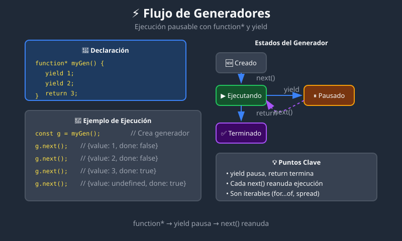

# ⚡ Generadores Básicos



## 🎯 Objetivos

- Comprender qué son las funciones generadoras
- Dominar la sintaxis `function*` y `yield`
- Entender el flujo de ejecución pausado
- Aplicar generadores en casos prácticos

---

## 📖 ¿Qué es un Generador?

Un **generador** es una función especial que puede pausar su ejecución y reanudarla después. A diferencia de las funciones normales que se ejecutan de principio a fin, los generadores pueden "ceder" (yield) valores múltiples veces.

```javascript
// Función normal - ejecuta todo de una vez
function normalFunc() {
  console.log('Paso 1');
  console.log('Paso 2');
  console.log('Paso 3');
  return 'fin';
}

// Generador - puede pausar en cada yield
function* generatorFunc() {
  console.log('Paso 1');
  yield 1;
  console.log('Paso 2');
  yield 2;
  console.log('Paso 3');
  return 'fin';
}
```

---

## 🔧 Sintaxis Básica

### Declaración de Generador

```javascript
// function* declaration
function* myGenerator() {
  yield 1;
  yield 2;
  yield 3;
}

// El asterisco puede estar en diferentes posiciones (todas válidas)
function* gen1() { }  // Recomendado
function *gen2() { }  // Válido
function * gen3() { } // Válido

// Generator expression
const genExpr = function* () {
  yield 'a';
  yield 'b';
};

// Como método de objeto
const obj = {
  *generator() {
    yield 1;
  }
};

// En una clase
class MyClass {
  *values() {
    yield 1;
    yield 2;
  }
}
```

### Crear y Usar un Generador

```javascript
function* countToThree() {
  yield 1;
  yield 2;
  yield 3;
}

// Llamar a un generador retorna un objeto iterador
const gen = countToThree();

// El generador NO se ejecuta hasta llamar next()
console.log(gen.next()); // { value: 1, done: false }
console.log(gen.next()); // { value: 2, done: false }
console.log(gen.next()); // { value: 3, done: false }
console.log(gen.next()); // { value: undefined, done: true }
```

---

## 🔄 Flujo de Ejecución

### Ejecución Paso a Paso

```javascript
function* demo() {
  console.log('Inicio');
  yield 'A';
  console.log('Después de A');
  yield 'B';
  console.log('Después de B');
  return 'Fin';
}

const gen = demo();

console.log('Creado el generador');
// Output: 'Creado el generador'
// (Nota: 'Inicio' aún no aparece)

console.log(gen.next());
// Output: 'Inicio'
// Output: { value: 'A', done: false }

console.log(gen.next());
// Output: 'Después de A'
// Output: { value: 'B', done: false }

console.log(gen.next());
// Output: 'Después de B'
// Output: { value: 'Fin', done: true }
```

### Diagrama de Estados

```
┌──────────────────────────────────────────────────────────┐
│                  ESTADOS DEL GENERADOR                   │
├──────────────────────────────────────────────────────────┤
│                                                          │
│   [Creado] ──next()──> [Ejecutando] ──yield──> [Pausado] │
│                             │                      │     │
│                             │                      │     │
│                           return              next()     │
│                             │                      │     │
│                             ▼                      │     │
│                        [Terminado] <───────────────┘     │
│                                                          │
└──────────────────────────────────────────────────────────┘
```

---

## 🎯 yield vs return

| Aspecto | yield | return |
|---------|-------|--------|
| **Pausa ejecución** | ✅ Sí | ❌ No (termina) |
| **Puede usarse múltiples veces** | ✅ Sí | ❌ Solo una vez |
| **done en resultado** | `false` | `true` |
| **Reanuda después** | ✅ Sí | ❌ No |

```javascript
function* yieldVsReturn() {
  yield 1;        // { value: 1, done: false }
  yield 2;        // { value: 2, done: false }
  return 3;       // { value: 3, done: true }
  yield 4;        // ¡Nunca se ejecuta!
}

const gen = yieldVsReturn();
console.log([...gen]); // [1, 2] - return no se incluye en spread
```

---

## 🔁 Generadores como Iterables

Los generadores implementan automáticamente el protocolo de iteración:

```javascript
function* fruits() {
  yield 'apple';
  yield 'banana';
  yield 'cherry';
}

// for...of
for (const fruit of fruits()) {
  console.log(fruit);
}
// 'apple', 'banana', 'cherry'

// Spread operator
const arr = [...fruits()];
console.log(arr); // ['apple', 'banana', 'cherry']

// Array.from
const arr2 = Array.from(fruits());
console.log(arr2); // ['apple', 'banana', 'cherry']

// Destructuring
const [first, second] = fruits();
console.log(first, second); // 'apple', 'banana'
```

---

## 🎮 Ejemplos Prácticos

### Secuencia Infinita

```javascript
function* infiniteCounter() {
  let n = 0;
  while (true) {
    yield n++;
  }
}

const counter = infiniteCounter();

console.log(counter.next().value); // 0
console.log(counter.next().value); // 1
console.log(counter.next().value); // 2
// ... puede continuar infinitamente

// Tomar solo los primeros N valores
function* take(iterable, n) {
  let count = 0;
  for (const item of iterable) {
    if (count >= n) return;
    yield item;
    count++;
  }
}

console.log([...take(infiniteCounter(), 5)]); // [0, 1, 2, 3, 4]
```

### Generador de IDs Únicos

```javascript
function* idGenerator(prefix = 'id') {
  let id = 1;
  while (true) {
    yield `${prefix}-${id++}`;
  }
}

const userIds = idGenerator('user');
const productIds = idGenerator('prod');

console.log(userIds.next().value);    // 'user-1'
console.log(userIds.next().value);    // 'user-2'
console.log(productIds.next().value); // 'prod-1'
console.log(userIds.next().value);    // 'user-3'
```

### Range Generator

```javascript
function* range(start, end, step = 1) {
  for (let i = start; i <= end; i += step) {
    yield i;
  }
}

console.log([...range(1, 5)]);     // [1, 2, 3, 4, 5]
console.log([...range(0, 10, 2)]); // [0, 2, 4, 6, 8, 10]
console.log([...range(5, 1, -1)]); // [] (necesita ajuste)

// Versión mejorada
function* rangeImproved(start, end, step = 1) {
  if (step > 0) {
    for (let i = start; i <= end; i += step) yield i;
  } else {
    for (let i = start; i >= end; i += step) yield i;
  }
}

console.log([...rangeImproved(5, 1, -1)]); // [5, 4, 3, 2, 1]
```

### Fibonacci Generator

```javascript
function* fibonacci() {
  let [prev, curr] = [0, 1];

  while (true) {
    yield curr;
    [prev, curr] = [curr, prev + curr];
  }
}

const fib = fibonacci();

// Primeros 10 números de Fibonacci
const first10 = [];
for (let i = 0; i < 10; i++) {
  first10.push(fib.next().value);
}
console.log(first10);
// [1, 1, 2, 3, 5, 8, 13, 21, 34, 55]
```

---

## 📤 Pasar Valores a Generadores

`next()` puede recibir un valor que se convierte en el resultado del `yield`:

```javascript
function* conversation() {
  const name = yield '¿Cuál es tu nombre?';
  const hobby = yield `Hola ${name}, ¿cuál es tu hobby?`;
  return `${name} disfruta de ${hobby}`;
}

const talk = conversation();

console.log(talk.next().value);        // '¿Cuál es tu nombre?'
console.log(talk.next('Ana').value);   // 'Hola Ana, ¿cuál es tu hobby?'
console.log(talk.next('leer').value);  // 'Ana disfruta de leer'
```

### Acumulador con Input

```javascript
function* accumulator() {
  let total = 0;
  while (true) {
    const value = yield total;
    if (value === null) break;
    total += value;
  }
  return total;
}

const acc = accumulator();

console.log(acc.next().value);     // 0 (total inicial)
console.log(acc.next(10).value);   // 10
console.log(acc.next(5).value);    // 15
console.log(acc.next(20).value);   // 35
console.log(acc.next(null).value); // 35 (terminado)
```

---

## 🛑 Métodos del Generador

### next(value)

Continúa la ejecución, opcionalmente pasando un valor.

```javascript
function* gen() {
  const x = yield 1;
  console.log('Recibido:', x);
}

const g = gen();
g.next();        // { value: 1, done: false }
g.next('hello'); // logs: 'Recibido: hello'
```

### return(value)

Termina el generador con un valor específico.

```javascript
function* gen() {
  yield 1;
  yield 2;
  yield 3;
}

const g = gen();
console.log(g.next());      // { value: 1, done: false }
console.log(g.return(99));  // { value: 99, done: true }
console.log(g.next());      // { value: undefined, done: true }
```

### throw(error)

Lanza un error dentro del generador.

```javascript
function* gen() {
  try {
    yield 1;
    yield 2;
  } catch (e) {
    console.log('Error capturado:', e);
  }
  yield 3;
}

const g = gen();
console.log(g.next());              // { value: 1, done: false }
console.log(g.throw('¡Error!'));    // Error capturado: ¡Error!
                                     // { value: 3, done: false }
```

---

## 🎯 Resumen

```javascript
// 1. Declarar con function*
function* myGen() {
  yield 'value1';
  yield 'value2';
  return 'final';
}

// 2. Crear instancia
const gen = myGen();

// 3. Iterar con next()
gen.next(); // { value: 'value1', done: false }
gen.next(); // { value: 'value2', done: false }
gen.next(); // { value: 'final', done: true }

// 4. O usar como iterable
for (const val of myGen()) {
  console.log(val); // 'value1', 'value2'
}

// 5. Características clave:
// - Ejecución pausable
// - Lazy evaluation
// - Memoria eficiente
// - Iterables por defecto
```

---

## 📚 Recursos

- [MDN: function*](https://developer.mozilla.org/en-US/docs/Web/JavaScript/Reference/Statements/function*)
- [JavaScript.info: Generators](https://javascript.info/generators)

<!-- nav -->
---

## 🔗 Navegación

| Anterior | Siguiente |
|---|---|
| ← [Teoría — 🔀 for...of vs for...in](02-for-of-vs-for-in.md) | [Teoría — 🔗 yield y Delegación de Generadores](04-yield-delegation.md) → |

[↑ Semana 08](../README.md)
