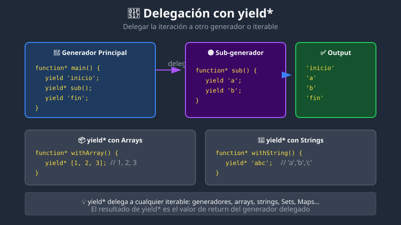

# 🔗 yield y Delegación de Generadores



## 🎯 Objetivos

- Dominar el uso avanzado de `yield`
- Comprender `yield*` para delegación
- Combinar múltiples generadores
- Aplicar patrones de composición

---

## 📖 yield en Profundidad

### yield como Expresión

`yield` no solo produce valores, también puede recibir valores cuando se reanuda:

```javascript
function* bidirectional() {
  const a = yield 'Primer yield';
  console.log('Recibí:', a);

  const b = yield 'Segundo yield';
  console.log('Recibí:', b);

  return 'Fin';
}

const gen = bidirectional();

console.log(gen.next());        // { value: 'Primer yield', done: false }
console.log(gen.next('Hola'));  // Recibí: Hola
                                 // { value: 'Segundo yield', done: false }
console.log(gen.next('Mundo')); // Recibí: Mundo
                                 // { value: 'Fin', done: true }
```

### Flujo de Datos Bidireccional

```
┌─────────────────────────────────────────────────────────┐
│              FLUJO BIDIRECCIONAL                        │
├─────────────────────────────────────────────────────────┤
│                                                         │
│   Código externo          Generador                     │
│        │                      │                         │
│        │    next()            │                         │
│        │─────────────────────>│                         │
│        │                      │ ejecuta hasta yield     │
│        │    { value }         │                         │
│        │<─────────────────────│                         │
│        │                      │                         │
│        │    next(input)       │                         │
│        │─────────────────────>│                         │
│        │                      │ input = resultado yield │
│        │    { value }         │                         │
│        │<─────────────────────│                         │
│                                                         │
└─────────────────────────────────────────────────────────┘
```

---

## ⭐ yield* - Delegación

`yield*` permite delegar la iteración a otro iterable o generador:

### Sintaxis Básica

```javascript
function* delegating() {
  yield 1;
  yield* [2, 3, 4];  // Delega a un array
  yield 5;
}

console.log([...delegating()]); // [1, 2, 3, 4, 5]
```

### Delegar a Arrays

```javascript
function* withArray() {
  yield 'start';
  yield* ['a', 'b', 'c'];
  yield 'end';
}

for (const val of withArray()) {
  console.log(val);
}
// 'start', 'a', 'b', 'c', 'end'
```

### Delegar a Strings

```javascript
function* withString() {
  yield 'Numbers:';
  yield* '123';
  yield 'Done';
}

console.log([...withString()]);
// ['Numbers:', '1', '2', '3', 'Done']
```

### Delegar a Otros Generadores

```javascript
function* inner() {
  yield 'inner-1';
  yield 'inner-2';
}

function* outer() {
  yield 'outer-start';
  yield* inner();  // Delega al generador inner
  yield 'outer-end';
}

console.log([...outer()]);
// ['outer-start', 'inner-1', 'inner-2', 'outer-end']
```

---

## 🔄 yield vs yield*

| Aspecto | yield | yield* |
|---------|-------|--------|
| **Produce** | Un valor | Todos los valores del iterable |
| **Pausa** | Una vez | Una vez por cada valor delegado |
| **Argumento** | Cualquier valor | Debe ser iterable |

```javascript
function* comparison() {
  // yield produce el array como un solo valor
  yield [1, 2, 3];

  // yield* produce cada elemento del array
  yield* [4, 5, 6];
}

const results = [...comparison()];
console.log(results);
// [[1, 2, 3], 4, 5, 6]
//  ↑ array    ↑ valores individuales
```

---

## 🏗️ Composición de Generadores

### Encadenamiento Simple

```javascript
function* numbers() {
  yield 1;
  yield 2;
  yield 3;
}

function* letters() {
  yield 'a';
  yield 'b';
  yield 'c';
}

function* combined() {
  yield* numbers();
  yield* letters();
}

console.log([...combined()]);
// [1, 2, 3, 'a', 'b', 'c']
```

### Intercalado

```javascript
function* interleave(...iterables) {
  const iterators = iterables.map(it => it[Symbol.iterator]());

  while (iterators.length > 0) {
    for (let i = 0; i < iterators.length; i++) {
      const { value, done } = iterators[i].next();
      if (done) {
        iterators.splice(i, 1);
        i--;
      } else {
        yield value;
      }
    }
  }
}

console.log([...interleave([1, 2, 3], ['a', 'b', 'c'])]);
// [1, 'a', 2, 'b', 3, 'c']
```

### Recursión con Generadores

```javascript
// Recorrer árbol en profundidad
function* traverseTree(node) {
  yield node.value;

  if (node.children) {
    for (const child of node.children) {
      yield* traverseTree(child);  // Recursión con delegación
    }
  }
}

const tree = {
  value: 'root',
  children: [
    {
      value: 'child1',
      children: [
        { value: 'grandchild1' },
        { value: 'grandchild2' }
      ]
    },
    { value: 'child2' }
  ]
};

console.log([...traverseTree(tree)]);
// ['root', 'child1', 'grandchild1', 'grandchild2', 'child2']
```

---

## 📤 Retorno de yield*

`yield*` retorna el valor de `return` del generador delegado:

```javascript
function* inner() {
  yield 1;
  yield 2;
  return 'inner done';  // Este valor se retorna a yield*
}

function* outer() {
  const result = yield* inner();
  console.log('Inner returned:', result);
  yield 3;
}

const gen = outer();
console.log(gen.next()); // { value: 1, done: false }
console.log(gen.next()); // { value: 2, done: false }
console.log(gen.next()); // Inner returned: inner done
                          // { value: 3, done: false }
```

---

## 🎮 Patrones Avanzados

### Pipeline de Procesamiento

```javascript
function* filter(iterable, predicate) {
  for (const item of iterable) {
    if (predicate(item)) {
      yield item;
    }
  }
}

function* map(iterable, transform) {
  for (const item of iterable) {
    yield transform(item);
  }
}

function* take(iterable, n) {
  let count = 0;
  for (const item of iterable) {
    if (count >= n) return;
    yield item;
    count++;
  }
}

// Crear pipeline
const numbers = function* () {
  let n = 1;
  while (true) yield n++;
}();

const result = take(
  map(
    filter(numbers, n => n % 2 === 0),  // Solo pares
    n => n * 10                          // Multiplicar por 10
  ),
  5                                       // Tomar 5
);

console.log([...result]);
// [20, 40, 60, 80, 100]
```

### Flatten Profundo

```javascript
function* flatten(iterable, depth = Infinity) {
  for (const item of iterable) {
    if (
      depth > 0 &&
      typeof item !== 'string' &&
      item[Symbol.iterator]
    ) {
      yield* flatten(item, depth - 1);
    } else {
      yield item;
    }
  }
}

const nested = [1, [2, [3, [4, [5]]]]];

console.log([...flatten(nested)]);
// [1, 2, 3, 4, 5]

console.log([...flatten(nested, 2)]);
// [1, 2, 3, [4, [5]]]
```

### Merge Ordenado

```javascript
function* mergeSorted(...iterables) {
  const iterators = iterables.map(it => {
    const iterator = it[Symbol.iterator]();
    const { value, done } = iterator.next();
    return { iterator, value, done };
  });

  while (true) {
    // Filtrar los que no han terminado
    const active = iterators.filter(it => !it.done);
    if (active.length === 0) break;

    // Encontrar el menor
    let minIndex = 0;
    for (let i = 1; i < active.length; i++) {
      if (active[i].value < active[minIndex].value) {
        minIndex = i;
      }
    }

    yield active[minIndex].value;

    // Avanzar el iterador del menor
    const { value, done } = active[minIndex].iterator.next();
    active[minIndex].value = value;
    active[minIndex].done = done;
  }
}

const list1 = [1, 4, 7, 10];
const list2 = [2, 5, 8];
const list3 = [3, 6, 9];

console.log([...mergeSorted(list1, list2, list3)]);
// [1, 2, 3, 4, 5, 6, 7, 8, 9, 10]
```

---

## 🔧 Propagación de Errores

Los errores se propagan a través de `yield*`:

```javascript
function* inner() {
  yield 1;
  throw new Error('¡Error en inner!');
  yield 2;
}

function* outer() {
  try {
    yield* inner();
  } catch (e) {
    console.log('Capturado en outer:', e.message);
    yield 'recovered';
  }
}

const gen = outer();
console.log(gen.next()); // { value: 1, done: false }
console.log(gen.next()); // Capturado en outer: ¡Error en inner!
                          // { value: 'recovered', done: false }
```

---

## 🎯 Resumen

```javascript
// yield - produce un valor
function* basic() {
  yield 1;
  yield 2;
}

// yield* - delega a un iterable
function* delegated() {
  yield* [1, 2];      // Array
  yield* 'ab';         // String
  yield* basic();      // Otro generador
}

// Valor de retorno de yield*
function* withReturn() {
  const result = yield* (function* () {
    yield 1;
    return 'done';
  })();
  console.log(result); // 'done'
}

// Composición recursiva
function* recurse(arr) {
  for (const item of arr) {
    if (Array.isArray(item)) {
      yield* recurse(item);
    } else {
      yield item;
    }
  }
}
```

---

## 📚 Recursos

- [MDN: yield*](https://developer.mozilla.org/en-US/docs/Web/JavaScript/Reference/Operators/yield*)
- [JavaScript.info: Generator composition](https://javascript.info/generators#generator-composition)

<!-- nav -->
---

## 🔗 Navegación

| Anterior | Siguiente |
|---|---|
| ← [Teoría — ⚡ Generadores Básicos](03-generators-basics.md) | [Teoría — 🛠️ Iterables Personalizados](05-custom-iterables.md) → |

[↑ Semana 08](../README.md)
