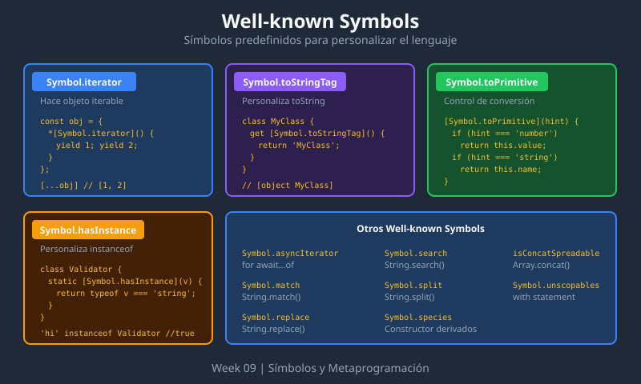

# ⚡ Well-known Symbols



## 🎯 Objetivos

- Conocer los Well-known Symbols de JavaScript
- Implementar Symbol.iterator para objetos iterables
- Personalizar objetos con Symbol.toStringTag
- Usar Symbol.toPrimitive para conversiones
- Entender otros símbolos importantes

---

## 📖 ¿Qué son los Well-known Symbols?

Los **Well-known Symbols** son símbolos predefinidos que JavaScript usa internamente para personalizar el comportamiento de objetos.

```javascript
// Algunos well-known symbols
Symbol.iterator      // Protocolo de iteración
Symbol.toStringTag   // Personalizar [object Type]
Symbol.toPrimitive   // Conversión a primitivos
Symbol.hasInstance   // Personalizar instanceof
Symbol.species       // Constructor para métodos derivados
```

### Lista de Well-known Symbols

| Symbol | Propósito |
|--------|-----------|
| `Symbol.iterator` | Define iterador para for...of |
| `Symbol.asyncIterator` | Define iterador asíncrono |
| `Symbol.toStringTag` | Personaliza Object.prototype.toString |
| `Symbol.toPrimitive` | Conversión a primitivo |
| `Symbol.hasInstance` | Personaliza instanceof |
| `Symbol.isConcatSpreadable` | Comportamiento en Array.concat |
| `Symbol.species` | Constructor para métodos derivados |
| `Symbol.match` | Comportamiento en String.match |
| `Symbol.replace` | Comportamiento en String.replace |
| `Symbol.search` | Comportamiento en String.search |
| `Symbol.split` | Comportamiento en String.split |
| `Symbol.unscopables` | Excluir props de with |

---

## 🔄 Symbol.iterator

Ya lo vimos en la semana 08. Permite hacer un objeto iterable:

```javascript
const range = {
  from: 1,
  to: 5,

  [Symbol.iterator]() {
    let current = this.from;
    const last = this.to;

    return {
      next() {
        if (current <= last) {
          return { value: current++, done: false };
        }
        return { done: true };
      }
    };
  }
};

// Ahora funciona con for...of
for (const num of range) {
  console.log(num); // 1, 2, 3, 4, 5
}

// Y con spread
console.log([...range]); // [1, 2, 3, 4, 5]
```

---

## 🏷️ Symbol.toStringTag

Personaliza lo que retorna `Object.prototype.toString.call()`:

```javascript
// Por defecto
const obj = {};
console.log(Object.prototype.toString.call(obj)); // '[object Object]'

// Con Symbol.toStringTag personalizado
const myObj = {
  [Symbol.toStringTag]: 'MyCustomType'
};
console.log(Object.prototype.toString.call(myObj)); // '[object MyCustomType]'
```

### Ejemplo Práctico: Clase Personalizada

```javascript
class Database {
  constructor(name) {
    this.name = name;
  }

  get [Symbol.toStringTag]() {
    return 'Database';
  }
}

const db = new Database('users');

console.log(Object.prototype.toString.call(db)); // '[object Database]'
console.log(db.toString());                       // '[object Database]'

// Útil para debugging
console.log(db); // Database { name: 'users' }
```

### Tipos Nativos con toStringTag

```javascript
// JavaScript ya usa toStringTag internamente
console.log(Object.prototype.toString.call(new Map()));     // '[object Map]'
console.log(Object.prototype.toString.call(new Set()));     // '[object Set]'
console.log(Object.prototype.toString.call(new Promise(() => {}))); // '[object Promise]'
console.log(Object.prototype.toString.call(function*(){})); // '[object GeneratorFunction]'
```

---

## 🔢 Symbol.toPrimitive

Controla cómo se convierte un objeto a primitivo:

```javascript
const user = {
  name: 'Alice',
  age: 30,

  [Symbol.toPrimitive](hint) {
    console.log(`hint: ${hint}`);

    switch (hint) {
      case 'number':
        return this.age;
      case 'string':
        return this.name;
      default: // 'default'
        return `${this.name} (${this.age})`;
    }
  }
};

// Contexto numérico
console.log(+user);      // hint: number → 30
console.log(user * 2);   // hint: number → 60

// Contexto string
console.log(`${user}`);  // hint: string → 'Alice'
console.log(String(user)); // hint: string → 'Alice'

// Contexto default (operaciones ambiguas)
console.log(user + '');  // hint: default → 'Alice (30)'
console.log(user == 30); // hint: default → false
```

### Los Tres Hints

| Hint | Cuándo se usa |
|------|---------------|
| `'number'` | Operaciones matemáticas, comparaciones numéricas |
| `'string'` | Template literals, String(), contexto string |
| `'default'` | Operadores binarios +, ==, etc. |

---

## 🔍 Symbol.hasInstance

Personaliza el comportamiento de `instanceof`:

```javascript
class MyArray {
  static [Symbol.hasInstance](instance) {
    return Array.isArray(instance);
  }
}

console.log([] instanceof MyArray);     // true
console.log([1, 2] instanceof MyArray); // true
console.log({} instanceof MyArray);     // false
console.log('hi' instanceof MyArray);   // false
```

### Ejemplo: Validador de Tipos

```javascript
class Numeric {
  static [Symbol.hasInstance](value) {
    return typeof value === 'number' && !isNaN(value);
  }
}

console.log(42 instanceof Numeric);      // true
console.log(3.14 instanceof Numeric);    // true
console.log(NaN instanceof Numeric);     // false
console.log('42' instanceof Numeric);    // false
```

---

## 📦 Symbol.isConcatSpreadable

Controla si un objeto se "aplana" en `Array.concat()`:

```javascript
const arr = [1, 2];
const notSpreadable = {
  0: 'a',
  1: 'b',
  length: 2,
  [Symbol.isConcatSpreadable]: false
};

const spreadable = {
  0: 'x',
  1: 'y',
  length: 2,
  [Symbol.isConcatSpreadable]: true
};

console.log(arr.concat(notSpreadable)); // [1, 2, { 0: 'a', 1: 'b', length: 2 }]
console.log(arr.concat(spreadable));    // [1, 2, 'x', 'y']

// También funciona para desactivar arrays
const noSpreadArr = [3, 4];
noSpreadArr[Symbol.isConcatSpreadable] = false;
console.log(arr.concat(noSpreadArr));   // [1, 2, [3, 4]]
```

---

## 🏭 Symbol.species

Define qué constructor usar para métodos que crean instancias derivadas:

```javascript
class MyArray extends Array {
  // Sin species: map() retorna MyArray
  // Con species: map() retorna Array
  static get [Symbol.species]() {
    return Array;
  }
}

const myArr = new MyArray(1, 2, 3);
console.log(myArr instanceof MyArray); // true

const mapped = myArr.map(x => x * 2);
console.log(mapped instanceof MyArray); // false (sería true sin species)
console.log(mapped instanceof Array);   // true
```

---

## 🔤 Símbolos de String Methods

### Symbol.match, Symbol.replace, Symbol.search, Symbol.split

Permiten que objetos actúen como patrones en métodos de String:

```javascript
const caseInsensitive = {
  [Symbol.search](str) {
    const target = this.target.toLowerCase();
    const source = str.toLowerCase();
    return source.indexOf(target);
  },
  target: ''
};

// Factory function
const ci = (target) => ({ ...caseInsensitive, target });

console.log('Hello World'.search(ci('WORLD'))); // 6
console.log('Hello World'.search(ci('xyz')));   // -1
```

### Symbol.replace

```javascript
const censored = {
  [Symbol.replace](str, replacement) {
    return str.split(this.word).join(replacement);
  },
  word: ''
};

const censor = (word) => ({ ...censored, word });

console.log('Hello bad world'.replace(censor('bad'), '***')); // 'Hello *** world'
```

---

## 🔄 Symbol.asyncIterator

Para iteradores asíncronos (se verá en detalle en semanas posteriores):

```javascript
const asyncRange = {
  from: 1,
  to: 3,

  [Symbol.asyncIterator]() {
    let current = this.from;
    const last = this.to;

    return {
      async next() {
        // Simular operación async
        await new Promise(r => setTimeout(r, 100));

        if (current <= last) {
          return { value: current++, done: false };
        }
        return { done: true };
      }
    };
  }
};

// Uso con for await...of
(async () => {
  for await (const num of asyncRange) {
    console.log(num); // 1, 2, 3 (con delay)
  }
})();
```

---

## 💻 Ejemplo Completo: Objeto Personalizado

```javascript
class Money {
  constructor(amount, currency = 'USD') {
    this.amount = amount;
    this.currency = currency;
  }

  // Personalizar tipo
  get [Symbol.toStringTag]() {
    return 'Money';
  }

  // Personalizar conversión a primitivo
  [Symbol.toPrimitive](hint) {
    switch (hint) {
      case 'number':
        return this.amount;
      case 'string':
        return `${this.currency} ${this.amount.toFixed(2)}`;
      default:
        return this.amount;
    }
  }

  // Hacer iterable (por ejemplo, para dividir en centavos)
  *[Symbol.iterator]() {
    const cents = Math.floor(this.amount * 100);
    for (let i = 0; i < cents; i++) {
      yield 0.01;
    }
  }
}

const price = new Money(5.50, 'EUR');

// toStringTag
console.log(Object.prototype.toString.call(price)); // '[object Money]'

// toPrimitive
console.log(`Price: ${price}`);   // 'Price: EUR 5.50'
console.log(price * 2);           // 11
console.log(price + 10);          // 15.5

// iterator
console.log([...price].length);   // 550 (centavos)
```

---

## ✅ Checklist de Verificación

- [ ] Conozco los Well-known Symbols principales
- [ ] Puedo implementar Symbol.iterator
- [ ] Sé personalizar tipos con Symbol.toStringTag
- [ ] Entiendo Symbol.toPrimitive y los hints
- [ ] Conozco Symbol.hasInstance para instanceof
- [ ] Sé que existen símbolos para métodos de String

---

## 📚 Recursos Adicionales

- [MDN: Well-known Symbols](https://developer.mozilla.org/en-US/docs/Web/JavaScript/Reference/Global_Objects/Symbol#well-known_symbols)
- [JavaScript.info: Symbol](https://javascript.info/symbol)

<!-- nav -->
---

## 🔗 Navegación

| Anterior | Siguiente |
|---|---|
| ← [Teoría — 🌐 Symbol.for y Registro Global](02-symbol-for-registry.md) | [Teoría — 🔒 Símbolos como Claves Privadas](04-symbols-as-keys.md) → |

[↑ Semana 09](../README.md)
