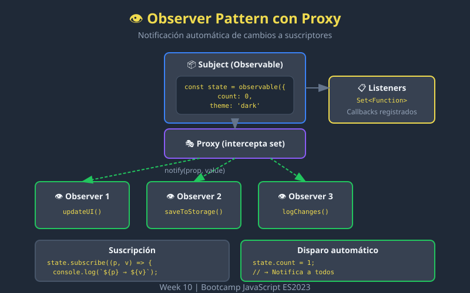

# 👁️ Patrón Observer con Proxies



## 🎯 Objetivos

- Implementar el patrón Observer usando Proxies
- Crear sistemas reactivos de suscripción
- Manejar cambios de estado automáticamente
- Construir un mini sistema de data binding

---

## 📖 ¿Qué es el Patrón Observer?

El **patrón Observer** permite que objetos (observers/listeners) se suscriban a cambios en otro objeto (subject/observable). Cuando el subject cambia, notifica automáticamente a todos sus observers.

```javascript
// Concepto básico
subject.subscribe(observer);
subject.value = 'new'; // Notifica automáticamente a observer
```

---

## 🔧 Observable Básico

### Implementación Simple

```javascript
const observable = (initialValue) => {
  const listeners = new Set();

  const proxy = new Proxy({ value: initialValue }, {
    set(target, prop, value, receiver) {
      const oldValue = target[prop];
      const result = Reflect.set(target, prop, value, receiver);

      if (prop === 'value' && oldValue !== value) {
        listeners.forEach(fn => fn(value, oldValue));
      }

      return result;
    }
  });

  proxy.subscribe = (fn) => {
    listeners.add(fn);
    return () => listeners.delete(fn); // Retorna función de unsubscribe
  };

  return proxy;
};

// Uso
const counter = observable(0);

const unsubscribe = counter.subscribe((newVal, oldVal) => {
  console.log(`Counter changed: ${oldVal} → ${newVal}`);
});

counter.value = 1; // Log: Counter changed: 0 → 1
counter.value = 2; // Log: Counter changed: 1 → 2

unsubscribe(); // Dejar de escuchar

counter.value = 3; // Sin log
```

---

## 🏗️ Store Reactivo

Un store completo que observa múltiples propiedades:

```javascript
const createStore = (initialState) => {
  const listeners = new Map(); // prop -> Set de listeners
  const globalListeners = new Set();

  const notify = (prop, newValue, oldValue) => {
    // Notificar listeners específicos
    if (listeners.has(prop)) {
      listeners.get(prop).forEach(fn => fn(newValue, oldValue, prop));
    }

    // Notificar listeners globales
    globalListeners.forEach(fn => fn(prop, newValue, oldValue));
  };

  const proxy = new Proxy({ ...initialState }, {
    set(target, prop, value, receiver) {
      const oldValue = target[prop];

      if (oldValue === value) return true; // Sin cambios

      const result = Reflect.set(target, prop, value, receiver);
      notify(prop, value, oldValue);
      return result;
    }
  });

  // Suscribirse a una propiedad específica
  proxy.watch = (prop, fn) => {
    if (!listeners.has(prop)) {
      listeners.set(prop, new Set());
    }
    listeners.get(prop).add(fn);
    return () => listeners.get(prop).delete(fn);
  };

  // Suscribirse a todos los cambios
  proxy.subscribe = (fn) => {
    globalListeners.add(fn);
    return () => globalListeners.delete(fn);
  };

  // Obtener estado actual
  proxy.getState = () => ({ ...proxy });

  return proxy;
};

// Uso
const store = createStore({
  user: null,
  theme: 'light',
  count: 0
});

// Observar propiedad específica
store.watch('theme', (newTheme, oldTheme) => {
  console.log(`Theme: ${oldTheme} → ${newTheme}`);
  document.body.className = newTheme;
});

// Observar todos los cambios
store.subscribe((prop, newVal, oldVal) => {
  console.log(`[Store] ${prop}: ${oldVal} → ${newVal}`);
});

store.theme = 'dark'; // Ambos listeners se activan
store.count = 1;      // Solo el global se activa
```

---

## 🔄 Computed Properties

Propiedades que se calculan automáticamente basadas en otras:

```javascript
const createReactive = (initialState, computeds = {}) => {
  const listeners = new Map();

  const state = { ...initialState };

  const notify = (prop) => {
    if (listeners.has(prop)) {
      listeners.get(prop).forEach(fn => fn(proxy[prop]));
    }

    // Notificar computeds que dependen de esta prop
    Object.entries(computeds).forEach(([computedName, config]) => {
      if (config.deps.includes(prop) && listeners.has(computedName)) {
        listeners.get(computedName).forEach(fn => fn(proxy[computedName]));
      }
    });
  };

  const proxy = new Proxy(state, {
    get(target, prop, receiver) {
      // Si es una computed property
      if (computeds[prop]) {
        return computeds[prop].get(target);
      }
      return Reflect.get(target, prop, receiver);
    },

    set(target, prop, value, receiver) {
      if (computeds[prop]) {
        throw new Error(`Cannot set computed property: ${prop}`);
      }

      const result = Reflect.set(target, prop, value, receiver);
      notify(prop);
      return result;
    }
  });

  proxy.watch = (prop, fn) => {
    if (!listeners.has(prop)) {
      listeners.set(prop, new Set());
    }
    listeners.get(prop).add(fn);
    return () => listeners.get(prop).delete(fn);
  };

  return proxy;
};

// Uso
const cart = createReactive(
  {
    items: [],
    taxRate: 0.21
  },
  {
    subtotal: {
      deps: ['items'],
      get: (state) => state.items.reduce((sum, item) => sum + item.price, 0)
    },
    tax: {
      deps: ['items', 'taxRate'],
      get: (state) => {
        const subtotal = state.items.reduce((sum, item) => sum + item.price, 0);
        return subtotal * state.taxRate;
      }
    },
    total: {
      deps: ['items', 'taxRate'],
      get: (state) => {
        const subtotal = state.items.reduce((sum, item) => sum + item.price, 0);
        return subtotal * (1 + state.taxRate);
      }
    }
  }
);

cart.watch('total', (total) => {
  console.log(`Total updated: $${total.toFixed(2)}`);
});

cart.items = [
  { name: 'Book', price: 20 },
  { name: 'Pen', price: 5 }
];
// Log: Total updated: $30.25

console.log(cart.subtotal); // 25
console.log(cart.tax);      // 5.25
console.log(cart.total);    // 30.25
```

---

## 🎯 Event Emitter con Proxy

```javascript
const createEventEmitter = () => {
  const events = new Map();

  return new Proxy({}, {
    get(target, event) {
      return {
        emit: (...args) => {
          if (events.has(event)) {
            events.get(event).forEach(fn => fn(...args));
          }
        },
        on: (fn) => {
          if (!events.has(event)) {
            events.set(event, new Set());
          }
          events.get(event).add(fn);
          return () => events.get(event).delete(fn);
        },
        once: (fn) => {
          const wrapper = (...args) => {
            fn(...args);
            events.get(event).delete(wrapper);
          };
          if (!events.has(event)) {
            events.set(event, new Set());
          }
          events.get(event).add(wrapper);
        }
      };
    }
  });
};

// Uso
const emitter = createEventEmitter();

emitter.userLoggedIn.on((user) => {
  console.log(`Welcome, ${user.name}!`);
});

emitter.userLoggedIn.once((user) => {
  console.log(`First login bonus for ${user.name}!`);
});

emitter.userLoggedIn.emit({ name: 'Alice' });
// Log: Welcome, Alice!
// Log: First login bonus for Alice!

emitter.userLoggedIn.emit({ name: 'Alice' });
// Log: Welcome, Alice!
// (once ya no se ejecuta)
```

---

## 🖼️ Data Binding Simple

Conectar datos con el DOM:

```javascript
const createBoundState = (initialState) => {
  const bindings = new Map(); // prop -> Set of DOM elements

  const updateDOM = (prop, value) => {
    if (bindings.has(prop)) {
      bindings.get(prop).forEach(element => {
        if (element.tagName === 'INPUT' || element.tagName === 'TEXTAREA') {
          element.value = value;
        } else {
          element.textContent = value;
        }
      });
    }
  };

  const proxy = new Proxy({ ...initialState }, {
    set(target, prop, value, receiver) {
      const result = Reflect.set(target, prop, value, receiver);
      updateDOM(prop, value);
      return result;
    }
  });

  // Vincular elemento DOM a propiedad
  proxy.bind = (prop, element) => {
    if (!bindings.has(prop)) {
      bindings.set(prop, new Set());
    }
    bindings.get(prop).add(element);

    // Valor inicial
    updateDOM(prop, proxy[prop]);

    // Si es input, escuchar cambios
    if (element.tagName === 'INPUT' || element.tagName === 'TEXTAREA') {
      element.addEventListener('input', (e) => {
        proxy[prop] = e.target.value;
      });
    }

    return () => bindings.get(prop).delete(element);
  };

  return proxy;
};

// Uso en HTML:
// <input id="nameInput" />
// <p id="nameDisplay"></p>

const state = createBoundState({ name: '' });

// Vincular elementos
state.bind('name', document.getElementById('nameInput'));
state.bind('name', document.getElementById('nameDisplay'));

// Ahora el input y el párrafo están sincronizados
state.name = 'Alice'; // Actualiza ambos elementos
```

---

## 🔗 Observable Array

Arrays que notifican cambios:

```javascript
const observableArray = (initialArray = []) => {
  const listeners = new Set();

  const notify = (type, ...args) => {
    listeners.forEach(fn => fn({ type, args, array: [...proxy] }));
  };

  const proxy = new Proxy([...initialArray], {
    get(target, prop, receiver) {
      const value = Reflect.get(target, prop, receiver);

      // Interceptar métodos mutadores
      if (typeof value === 'function') {
        const mutators = ['push', 'pop', 'shift', 'unshift', 'splice', 'sort', 'reverse'];

        if (mutators.includes(prop)) {
          return (...args) => {
            const result = value.apply(target, args);
            notify(prop, ...args);
            return result;
          };
        }
      }

      return value;
    },

    set(target, prop, value, receiver) {
      const result = Reflect.set(target, prop, value, receiver);

      if (prop !== 'length') {
        notify('set', prop, value);
      }

      return result;
    }
  });

  proxy.subscribe = (fn) => {
    listeners.add(fn);
    return () => listeners.delete(fn);
  };

  return proxy;
};

// Uso
const todos = observableArray([]);

todos.subscribe(({ type, args, array }) => {
  console.log(`[${type}]`, args, '→', array);
});

todos.push({ text: 'Learn Proxy', done: false });
// Log: [push] [{ text: 'Learn Proxy', done: false }] → [...]

todos.push({ text: 'Build app', done: false });
// Log: [push] [{ text: 'Build app', done: false }] → [...]

todos[0].done = true;
// Log: [set] ['0', { ... }] → [...]
```

---

## 🏢 Mini Sistema Reactivo

Combinando todo en un sistema completo:

```javascript
const createReactiveSystem = () => {
  const state = {};
  const computeds = {};
  const watchers = new Map();
  let currentEffect = null;

  const track = (prop) => {
    if (currentEffect && !watchers.has(prop)) {
      watchers.set(prop, new Set());
    }
    if (currentEffect) {
      watchers.get(prop).add(currentEffect);
    }
  };

  const trigger = (prop) => {
    if (watchers.has(prop)) {
      watchers.get(prop).forEach(effect => effect());
    }
  };

  const reactive = (obj) => {
    return new Proxy(obj, {
      get(target, prop, receiver) {
        track(prop);
        return Reflect.get(target, prop, receiver);
      },
      set(target, prop, value, receiver) {
        const result = Reflect.set(target, prop, value, receiver);
        trigger(prop);
        return result;
      }
    });
  };

  const effect = (fn) => {
    currentEffect = fn;
    fn(); // Ejecutar para registrar dependencias
    currentEffect = null;
  };

  const computed = (getter) => {
    let cached;
    let dirty = true;

    effect(() => {
      if (dirty) {
        cached = getter();
        dirty = false;
      }
    });

    return {
      get value() {
        return cached;
      }
    };
  };

  return { reactive, effect, computed };
};

// Uso
const { reactive, effect, computed } = createReactiveSystem();

const user = reactive({
  firstName: 'John',
  lastName: 'Doe',
  age: 30
});

// Efecto que se ejecuta cuando cambian las dependencias
effect(() => {
  console.log(`User: ${user.firstName} ${user.lastName}`);
});

// Propiedad computada
const fullName = computed(() => `${user.firstName} ${user.lastName}`);

user.firstName = 'Jane';
// Log: User: Jane Doe

console.log(fullName.value); // 'Jane Doe'
```

---

## 💡 Buenas Prácticas

### 1. Siempre Proporciona Unsubscribe

```javascript
// ✅ BIEN
const subscribe = (fn) => {
  listeners.add(fn);
  return () => listeners.delete(fn); // Cleanup
};

// ❌ MAL - sin forma de desuscribirse
const subscribe = (fn) => {
  listeners.add(fn);
};
```

### 2. Evita Notificaciones Innecesarias

```javascript
// ✅ BIEN - solo notifica si hay cambio real
set(target, prop, value) {
  if (target[prop] === value) return true;
  target[prop] = value;
  notify(prop);
  return true;
}
```

### 3. Maneja Errores en Listeners

```javascript
// ✅ BIEN - un listener con error no rompe los demás
const notify = (data) => {
  listeners.forEach(fn => {
    try {
      fn(data);
    } catch (error) {
      console.error('Listener error:', error);
    }
  });
};
```

---

## 📚 Recursos

- [Observer Pattern](https://refactoring.guru/design-patterns/observer)
- [Vue.js Reactivity](https://vuejs.org/guide/extras/reactivity-in-depth.html)
- [Proxy-based Reactivity](https://javascript.info/proxy)

<!-- nav -->
---

## 🔗 Navegación

| Anterior | Siguiente |
|---|---|
| ← [Teoría — ✅ Validación Reactiva](04-validacion-reactiva.md) | [Índice de labs](../2-practicas/README.md) → |

[↑ Semana 10](../README.md)
