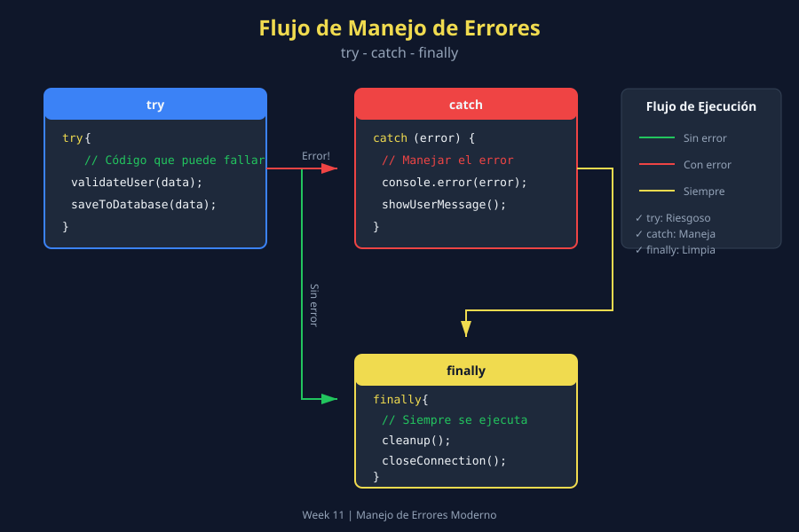

# 🛡️ try...catch...finally

## 🎯 Objetivos de Aprendizaje

- Comprender la estructura completa de manejo de errores
- Dominar el flujo de ejecución en cada bloque
- Usar `finally` para cleanup de recursos
- Aplicar re-throw para propagar errores

---

## 📖 Introducción

El manejo de errores es fundamental para crear aplicaciones robustas. JavaScript proporciona la estructura `try...catch...finally` para capturar y manejar errores de forma controlada.



---

## 1️⃣ Estructura Básica

### Sintaxis

```javascript
try {
  // Code that might throw an error
} catch (error) {
  // Handle the error
} finally {
  // Always runs (optional)
}
```

### Flujo de Ejecución

```javascript
// Without error
try {
  console.log('1. Trying...');
  const result = 10 / 2;
  console.log('2. Success:', result);
} catch (error) {
  console.log('3. Error caught'); // NOT executed
} finally {
  console.log('4. Finally runs'); // ALWAYS executes
}

// Output:
// 1. Trying...
// 2. Success: 5
// 4. Finally runs
```

```javascript
// With error
try {
  console.log('1. Trying...');
  JSON.parse('invalid json');
  console.log('2. This never runs');
} catch (error) {
  console.log('3. Error caught:', error.message);
} finally {
  console.log('4. Finally runs');
}

// Output:
// 1. Trying...
// 3. Error caught: Unexpected token 'i', "invalid json" is not valid JSON
// 4. Finally runs
```

---

## 2️⃣ El Objeto Error

### Propiedades Estándar

```javascript
try {
  throw new Error('Something went wrong');
} catch (error) {
  console.log(error.name);    // "Error"
  console.log(error.message); // "Something went wrong"
  console.log(error.stack);   // Full stack trace
}
```

### Tipos de Error Nativos

```javascript
// SyntaxError - Invalid syntax (usually at parse time)
JSON.parse('{invalid}');

// TypeError - Wrong type operation
null.toString();

// ReferenceError - Undefined variable
console.log(undefinedVar);

// RangeError - Value out of range
new Array(-1);

// URIError - Invalid URI
decodeURIComponent('%');
```

### Identificando Tipos de Error

```javascript
try {
  // Some risky operation
  JSON.parse(userInput);
} catch (error) {
  if (error instanceof SyntaxError) {
    console.log('Invalid JSON format');
  } else if (error instanceof TypeError) {
    console.log('Type mismatch');
  } else {
    console.log('Unknown error:', error.message);
  }
}
```

---

## 3️⃣ El Bloque finally

### ¿Cuándo se Ejecuta?

`finally` **SIEMPRE** se ejecuta, sin importar:

```javascript
// 1. Even with return in try
const getValue = () => {
  try {
    return 'from try';
  } finally {
    console.log('Finally runs!');
  }
};

getValue(); // Logs "Finally runs!", returns "from try"

// 2. Even with return in catch
const getValueWithError = () => {
  try {
    throw new Error('Oops');
  } catch (error) {
    return 'from catch';
  } finally {
    console.log('Finally still runs!');
  }
};

getValueWithError(); // Logs "Finally still runs!", returns "from catch"

// 3. Even when re-throwing
const reThrow = () => {
  try {
    throw new Error('Original');
  } catch (error) {
    throw error; // Re-throw
  } finally {
    console.log('Finally runs before propagation!');
  }
};
```

### Uso Principal: Cleanup

```javascript
const processFile = async filePath => {
  let fileHandle = null;

  try {
    fileHandle = await openFile(filePath);
    const content = await fileHandle.read();
    return processContent(content);
  } catch (error) {
    console.error('Failed to process file:', error.message);
    return null;
  } finally {
    // Always close the file, even if error occurred
    if (fileHandle) {
      await fileHandle.close();
      console.log('File handle closed');
    }
  }
};
```

---

## 4️⃣ Lanzar Errores (throw)

### Sintaxis Básica

```javascript
// Throw an Error object
throw new Error('Something went wrong');

// Throw with specific type
throw new TypeError('Expected a string');

// You can throw anything (but don't)
throw 'error string';  // ❌ Bad practice
throw 42;              // ❌ Bad practice
throw { msg: 'err' };  // ❌ Bad practice
```

### Validación con Errores

```javascript
const divide = (a, b) => {
  if (typeof a !== 'number' || typeof b !== 'number') {
    throw new TypeError('Both arguments must be numbers');
  }

  if (b === 0) {
    throw new RangeError('Cannot divide by zero');
  }

  return a / b;
};

// Usage
try {
  console.log(divide(10, 2));  // 5
  console.log(divide(10, 0));  // Throws RangeError
} catch (error) {
  console.error(`${error.name}: ${error.message}`);
}
```

---

## 5️⃣ Re-throw (Propagar Errores)

### ¿Cuándo Re-lanzar?

Cuando no puedes manejar el error completamente:

```javascript
const parseUserData = jsonString => {
  try {
    return JSON.parse(jsonString);
  } catch (error) {
    // Log for debugging
    console.error('Failed to parse user data:', error.message);

    // Re-throw with more context
    throw new Error(`Invalid user data format: ${error.message}`);
  }
};
```

### Manejo Selectivo

```javascript
const fetchUserData = async userId => {
  try {
    const response = await fetch(`/api/users/${userId}`);

    if (!response.ok) {
      throw new Error(`HTTP ${response.status}`);
    }

    return await response.json();
  } catch (error) {
    // Only handle network errors here
    if (error.message.includes('Failed to fetch')) {
      console.log('Network error, using cached data');
      return getCachedUser(userId);
    }

    // Re-throw other errors
    throw error;
  }
};
```

---

## 6️⃣ try...catch sin finally

Es válido omitir `finally`:

```javascript
const safeParseJSON = jsonString => {
  try {
    return JSON.parse(jsonString);
  } catch (error) {
    console.error('Invalid JSON:', error.message);
    return null;
  }
};
```

---

## 7️⃣ try...finally sin catch

Útil para garantizar cleanup sin manejar el error:

```javascript
const withTimer = fn => {
  console.time('execution');
  try {
    return fn();
  } finally {
    console.timeEnd('execution'); // Always logs timing
  }
};

// Error still propagates, but timing is logged
withTimer(() => {
  throw new Error('Oops');
});
```

---

## 8️⃣ Nested try...catch

```javascript
const processData = data => {
  try {
    // Outer try
    const parsed = JSON.parse(data);

    try {
      // Inner try for specific operation
      return transformData(parsed);
    } catch (transformError) {
      console.error('Transform failed, using raw data');
      return parsed;
    }
  } catch (parseError) {
    console.error('Parse failed completely');
    return null;
  }
};
```

---

## 9️⃣ Errores Comunes

### ❌ Catch Vacío (Silent Catch)

```javascript
// BAD - Errors are silenced
try {
  riskyOperation();
} catch (error) {
  // Empty catch - never do this!
}

// GOOD - At least log it
try {
  riskyOperation();
} catch (error) {
  console.error('Operation failed:', error);
}
```

### ❌ Catch Demasiado Amplio

```javascript
// BAD - Catches everything including programming errors
try {
  doSomething();
  doSomethingElse();
  doYetAnotherThing();
} catch (error) {
  console.log('Something failed');
}

// GOOD - Specific try blocks
try {
  doSomething();
} catch (error) {
  handleSomethingError(error);
}

try {
  doSomethingElse();
} catch (error) {
  handleSomethingElseError(error);
}
```

### ❌ Usar Errores para Control de Flujo

```javascript
// BAD - Using exceptions for normal flow
const findUser = id => {
  try {
    return users.find(u => u.id === id) || throwNotFound();
  } catch {
    return createDefaultUser();
  }
};

// GOOD - Use conditionals for expected cases
const findUser = id => {
  const user = users.find(u => u.id === id);
  return user ?? createDefaultUser();
};
```

---

## 🔟 Patrones Útiles

### Safe Execute Pattern

```javascript
const safeExecute = (fn, fallback = null) => {
  try {
    return fn();
  } catch (error) {
    console.error('Safe execute caught:', error.message);
    return fallback;
  }
};

// Usage
const config = safeExecute(
  () => JSON.parse(localStorage.getItem('config')),
  { theme: 'light' }
);
```

### With Error Logging

```javascript
const withErrorLogging = fn => {
  return (...args) => {
    try {
      return fn(...args);
    } catch (error) {
      console.error(`Error in ${fn.name}:`, error);
      throw error; // Re-throw after logging
    }
  };
};

// Usage
const riskyFn = withErrorLogging(data => {
  return JSON.parse(data);
});
```

---

## 1️⃣1️⃣ Optional Catch Binding (ES2019)

Desde ES2019, puedes omitir el parámetro `error` si no lo necesitas:

```javascript
// Antes de ES2019 - obligatorio declarar error aunque no se use
try {
  JSON.parse(data);
} catch (error) {  // 'error' declarado pero no usado
  return defaultValue;
}

// ES2019+ - Optional catch binding
try {
  JSON.parse(data);
} catch {  // Sin parámetro
  return defaultValue;
}
```

### Casos de Uso

```javascript
// 1. Cuando solo te importa si falló, no por qué
const isValidJSON = str => {
  try {
    JSON.parse(str);
    return true;
  } catch {
    return false;
  }
};

// 2. Cleanup silencioso
const safeDelete = key => {
  try {
    localStorage.removeItem(key);
  } catch {
    // localStorage might not be available (SSR, private mode)
  }
};

// 3. Feature detection
const supportsWebGL = () => {
  try {
    return !!document.createElement('canvas').getContext('webgl');
  } catch {
    return false;
  }
};
```

### ⚠️ Cuándo NO Usarlo

```javascript
// ❌ Cuando necesitas información del error
try {
  await fetch(url);
} catch {
  // No sabemos qué falló - ¿red? ¿servidor? ¿CORS?
}

// ✅ Mejor: captura y usa el error
try {
  await fetch(url);
} catch (error) {
  if (error.name === 'AbortError') {
    console.log('Request cancelled');
  } else {
    console.error('Network error:', error.message);
  }
}
```

---

## 1️⃣2️⃣ Error Cause (ES2022)

ES2022 introduce la opción `cause` para **encadenar errores**, preservando el error original:

```javascript
// Sintaxis
throw new Error('High-level message', { cause: originalError });
```

### El Problema que Resuelve

```javascript
// ❌ Antes de ES2022 - Se pierde el error original
const loadUserData = async userId => {
  try {
    const response = await fetch(`/api/users/${userId}`);
    return await response.json();
  } catch (error) {
    // El error original (network, parse, etc.) se pierde
    throw new Error('Failed to load user data');
  }
};
```

### La Solución con cause

```javascript
// ✅ ES2022 - Preserva la cadena de errores
const loadUserData = async userId => {
  try {
    const response = await fetch(`/api/users/${userId}`);
    return await response.json();
  } catch (error) {
    throw new Error('Failed to load user data', { cause: error });
  }
};

// Uso
try {
  await loadUserData(123);
} catch (error) {
  console.log(error.message);       // "Failed to load user data"
  console.log(error.cause);         // Error original (TypeError, SyntaxError, etc.)
  console.log(error.cause?.message); // Mensaje del error original
}
```

### Cadena de Errores Múltiples

```javascript
const fetchData = async url => {
  try {
    const response = await fetch(url);
    if (!response.ok) {
      throw new Error(`HTTP ${response.status}`);
    }
    return response;
  } catch (error) {
    throw new Error(`Network request failed: ${url}`, { cause: error });
  }
};

const parseUserData = async url => {
  try {
    const response = await fetchData(url);
    return await response.json();
  } catch (error) {
    throw new Error('Failed to parse user data', { cause: error });
  }
};

const loadUser = async id => {
  try {
    return await parseUserData(`/api/users/${id}`);
  } catch (error) {
    throw new Error(`Cannot load user ${id}`, { cause: error });
  }
};

// Función helper para mostrar toda la cadena
const getErrorChain = error => {
  const chain = [];
  let current = error;

  while (current) {
    chain.push({
      name: current.name,
      message: current.message
    });
    current = current.cause;
  }

  return chain;
};

// Uso
try {
  await loadUser(123);
} catch (error) {
  console.log(getErrorChain(error));
  // [
  //   { name: 'Error', message: 'Cannot load user 123' },
  //   { name: 'Error', message: 'Failed to parse user data' },
  //   { name: 'Error', message: 'Network request failed: /api/users/123' },
  //   { name: 'TypeError', message: 'Failed to fetch' }
  // ]
}
```

### Con Errores Personalizados

```javascript
class AppError extends Error {
  constructor(message, options = {}) {
    super(message, { cause: options.cause });
    this.name = 'AppError';
    this.code = options.code ?? 'UNKNOWN';
  }
}

class DatabaseError extends AppError {
  constructor(operation, originalError) {
    super(`Database ${operation} failed`, {
      code: 'DB_ERROR',
      cause: originalError
    });
    this.name = 'DatabaseError';
    this.operation = operation;
  }
}

// Uso
try {
  await db.query('SELECT * FROM users');
} catch (error) {
  throw new DatabaseError('query', error);
}
```

### Logging con cause

```javascript
const logError = error => {
  const entry = {
    timestamp: new Date().toISOString(),
    error: {
      name: error.name,
      message: error.message,
      stack: error.stack
    }
  };

  // Include cause chain if present
  if (error.cause) {
    entry.cause = logError(error.cause); // Recursive
  }

  return entry;
};

try {
  await someOperation();
} catch (error) {
  console.log(JSON.stringify(logError(error), null, 2));
}
```

---

## ✅ Checklist de Verificación

- [ ] Entiendo el flujo try → catch → finally
- [ ] Sé que finally SIEMPRE se ejecuta
- [ ] Puedo identificar tipos de error con instanceof
- [ ] Uso throw para lanzar errores
- [ ] Comprendo cuándo re-lanzar un error
- [ ] Nunca dejo catch blocks vacíos
- [ ] Uso finally para cleanup de recursos
- [ ] Uso optional catch binding (ES2019) cuando no necesito el error
- [ ] Uso Error cause (ES2022) para preservar errores originales

---

## 📚 Recursos Adicionales

- [MDN: try...catch](https://developer.mozilla.org/en-US/docs/Web/JavaScript/Reference/Statements/try...catch)
- [MDN: Error](https://developer.mozilla.org/en-US/docs/Web/JavaScript/Reference/Global_Objects/Error)
- [JavaScript.info: Error handling](https://javascript.info/try-catch)

---

## 🔗 Navegación

| ⬅️ Anterior | 🏠 Índice | Siguiente ➡️ |
|:------------|:--------:|-------------:|
| [README](../README.md) | [Teoría](../README.md) | [02 - Errores Personalizados](./02-errores-personalizados.md) |
