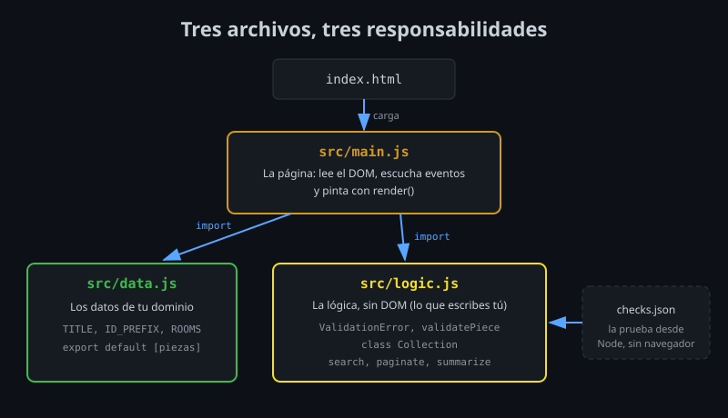
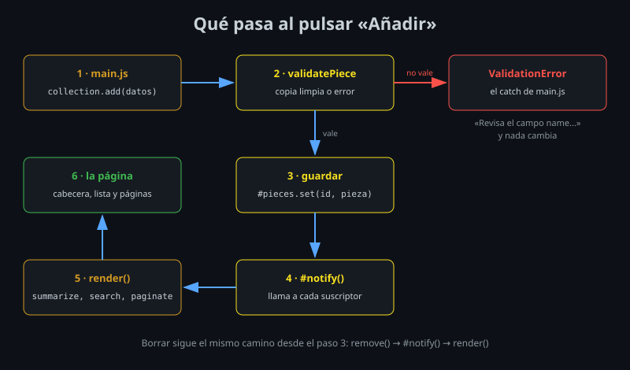

# Arquitectura del proyecto

## Objetivo

Entender cómo se reparte el trabajo entre los archivos del proyecto y por qué. No hay nada nuevo: es la misma separación entre `data.js`, `logic.js` y `main.js` de las semanas anteriores, más una clase que guarda el estado y avisa cuando cambia.

---

## Tres archivos, tres responsabilidades



| Archivo | Responsabilidad | Sabe del DOM |
|---|---|---|
| `src/data.js` | Los datos de tu dominio: título, prefijo de los ids, salas y piezas de ejemplo | No |
| `src/logic.js` | Las reglas: qué pieza es válida, cómo se guardan, cómo se buscan, se paginan y se resumen | No |
| `src/main.js` | La página: lee el formulario y los filtros, escucha los clics y pinta | Sí |

- **Qué:** cada archivo solo importa lo que necesita. `main.js` importa de `data.js` y de `logic.js`; `logic.js` no importa nada de la página.
- **Para qué:** las reglas se pueden probar desde Node sin abrir un navegador, que es lo que hace `scripts/verificar-semana.sh`. Y cambiar de dominio solo toca `data.js`.
- **Impacto:** si una función de `logic.js` necesitara `document`, dejaría de funcionar en Node y las comprobaciones fallarían. Todo lo que toca el DOM se queda en `main.js`.

---

## Un solo dueño del estado

Las piezas viven en una instancia de `Collection`, en un campo privado `#pieces`. Nadie más guarda una copia que pueda quedar desactualizada:

```javascript
const collection = new Collection(ID_PREFIX, ROOMS);
collection.add({ name: 'Mapa lunar', room: 'Sala Lunar', value: 3200 });
collection.remove('PLA-001');
```

`add` es la única puerta de entrada y siempre valida. `remove` es la única de salida. Como los campos son privados, `collection.#pieces.clear()` desde fuera es un `SyntaxError`, no un despiste que pasa desapercibido. Las piezas que devuelve `add` están congeladas con `Object.freeze`, así que tampoco se pueden cambiar por la espalda.

## Avisar en lugar de acordarse

La colección guarda en un `Set` las funciones que quieren enterarse de sus cambios y las llama después de cada `add` o `remove`. Es el patrón *observer* del [lab 02](../2-practicas/lab-02-observer/README.md):

```javascript
collection.subscribe(render);
```

Con esa línea, `main.js` no tiene que llamar a `render()` después de cada cambio: la colección avisa. Si mañana otra parte de la página también necesitara enterarse (un contador en la pestaña, un registro de cambios), se suscribiría igual, sin tocar el formulario ni el botón de borrar.



1. El formulario llama a `collection.add(datos)`.
2. `add` llama a `validatePiece`. Si un dato no vale, sale un `ValidationError` y el `catch` de `main.js` muestra qué campo corregir. La colección no cambia.
3. Si vale, la pieza recibe su id y se guarda en el `Map`.
4. `#notify()` llama a cada suscriptor.
5. `render()` pide el resumen, la búsqueda y las páginas a `logic.js`.
6. La página muestra el resultado.

## Funciones que calculan sin guardar

`search`, `paginate` y `summarize` no guardan nada ni modifican lo que reciben: devuelven un resultado nuevo cada vez. Aceptan cualquier iterable de piezas, así que funcionan igual con un array de prueba que con la colección:

```javascript
search(collection, { text: 'luna' });
search([{ name: 'Mapa lunar', room: 'A', value: 1 }], { text: 'luna' });
```

Los filtros de la página tampoco se guardan en la colección: `render()` los lee del formulario cada vez. Así la colección solo sabe de piezas, no de lo que la persona está mirando.

---

## Cuándo crecería esta arquitectura

Para un proyecto de este tamaño, tres archivos bastan. Si `logic.js` creciera mucho, se partiría en carpetas con un `index.js` que re-exporta, como en el [lab 03](../2-practicas/lab-03-modulos/README.md). No hace falta hacerlo antes de necesitarlo.

<!-- nav -->
---

## 🔗 Navegación

| Anterior | Siguiente |
|---|---|
| ← [Teoría — Repaso de las semanas 1 a 11](01-revision-conceptos.md) | [Teoría — ✨ Clean Code y Refactoring](03-clean-code.md) → |

[↑ Semana 12](../README.md)
