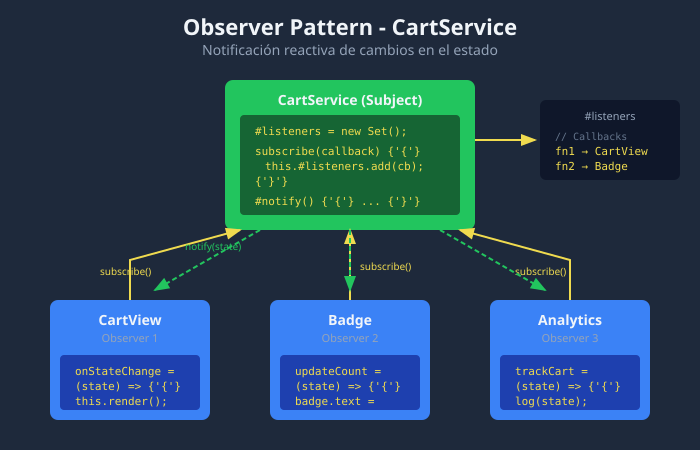

# Lab 02 — Patrón observer

## Objetivo

Construir paso a paso un objeto que avisa a otras partes del programa cuando cambia: guarda las funciones interesadas en un `Set` ([semana 07](../../../week-07-sets_maps/README.md)), las llama con `notify` y deja darse de baja. Es la idea que usa `Collection` en el proyecto.

**Tiempo:** 45 min · **Teoría:** [02 - Arquitectura del proyecto](../../1-teoria/02-arquitectura-aplicacion.md)



## Cómo trabajar

El archivo [`starter/index.js`](starter/index.js) tiene 4 pasos. En cada uno, descomenta el código del paso (selecciónalo y pulsa `Ctrl+/`, o `Cmd+/` en macOS) y ejecuta:

```bash
cd bootcamp/week-12-proyecto_integrador_fundamentos/2-practicas/lab-02-observer
node starter/index.js
```

Cada paso funciona solo, sin los anteriores. Las salidas de este README se obtuvieron con Node 24.

---

## Paso 1: un `Set` de suscriptores

`subscribe` añade la función al `Set` privado `#listeners`. Un `Set` no guarda dos veces el mismo valor, así que suscribir dos veces la misma función no la duplica.

```text
--- Paso 1: Set para Listeners ---
Listener A suscrito
Listener B suscrito
Total listeners: 2
Después de duplicado: 2
```

## Paso 2: `notify`

`notify(data)` recorre el `Set` con `forEach` y llama a cada función con el dato. El objeto que avisa no sabe qué hace cada suscriptor: solo que es una función.

```text
--- Paso 2: Notify ---
Observer 1 recibió: Primer mensaje
Observer 2 recibió: Primer mensaje
Observer 1 recibió: Segundo mensaje
Observer 2 recibió: Segundo mensaje
```

## Paso 3: darse de baja

`subscribe` devuelve una función que borra al suscriptor del `Set`. Quien se suscribe la guarda y la llama cuando ya no quiere enterarse.

```text
--- Paso 3: Unsubscribe ---
Antes de unsubscribe: 2 listeners
Observer 1: Mensaje de prueba
Observer 2: Mensaje de prueba
Después de unsubscribe Observer 1: 1 listener
Observer 2: Otro mensaje
```

## Paso 4: un servicio que avisa

`CartService` aplica el patrón: guarda los artículos en un campo privado y, después de cada `addItem` o `removeItem`, llama a `#notify()`, que pasa el estado nuevo a los tres suscriptores. Este `subscribe` además llama al suscriptor en cuanto se apunta, con el estado actual: por eso las tres primeras líneas salen con 0 artículos.

```text
--- Paso 4: CartService con Observer ---
[CartView] Renderizando 0 items, total: $0.00
[Badge] Actualizando contador: 0
[Logger] Cart updated: 0 items

[CartView] Renderizando 1 items, total: $999.99
[Badge] Actualizando contador: 1
[Logger] Cart updated: 1 items

[CartView] Renderizando 2 items, total: $1049.98
[Badge] Actualizando contador: 2
[Logger] Cart updated: 2 items

✅ Lab completado.
```

---

## Comprobación

1. En el paso 4, ¿cuántas líneas imprimiría `cart.addItem(...)` con cinco suscriptores en lugar de tres? ¿Hay que cambiar algo de `addItem` para que el cuarto y el quinto se enteren?
2. En el paso 3, cambia el `Set` por un array (`#listeners = []`, `push` y `filter`). ¿Qué pasa ahora si suscribes dos veces la misma función y llamas a `notify`?
3. La `Collection` del proyecto no llama al suscriptor al apuntarse, a diferencia de `CartService`. ¿Qué tendría que hacer `main.js` para pintar la página la primera vez si la colección empezara vacía?

<!-- nav -->
---

## 🔗 Navegación

| Anterior | Siguiente |
|---|---|
| ← [Lab 01 — Clases y encapsulación](../lab-01-clases/README.md) | [Lab 03 — Módulos ES](../lab-03-modulos/README.md) → |

[↑ Semana 12](../../README.md)
