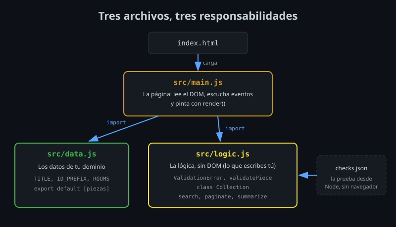
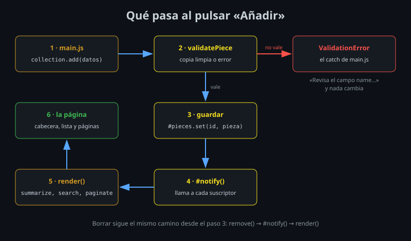

# 🎯 Proyecto Semana 12: Aplicación de Gestión Integral

> **🎯 ÚNICO ENTREGABLE**: Este proyecto es el **único entregable obligatorio** para aprobar la semana.

## 🏛️ Política de Dominios Únicos

**Tu dominio fue asignado por el instructor al inicio del trimestre.** Este proyecto INTEGRADOR debe implementarse completamente usando tu dominio asignado, aplicando todos los conceptos de ES2023 de las semanas 1-11.

### Ejemplos de Adaptación

| Dominio | Aplicación | Catálogo | Operaciones |
|---------|-----------|----------|-------------|
| **Planetario 🔭** | SkyManager | Cuerpos celestes | Reserva de sesiones de observación |
| **Acuario 🐠** | AquaLife | Especies marinas | Reserva de tours/alimentaciones |
| **Museo 🏛️** | ArtGallery | Obras de arte | Reserva de visitas guiadas |

---

## 🎯 Objetivo

Construir una aplicación de gestión integral aplicando todos los conceptos de ES2023 aprendidos en las semanas 1-11.

---

## 📋 Descripción

Esta aplicación simula un sistema de gestión con las siguientes funcionalidades:

- **Catálogo de entidades** con filtros, búsqueda y ordenamiento
- **Sistema de reservas/operaciones** con CRUD completo
- **Sistema de usuarios** con autenticación simulada
- **Persistencia** en localStorage

---

## 💡 Adaptación por Dominio

### Ejemplo: Planetario 🔭

**SkyManager** - Gestión de observaciones astronómicas:

- **Catálogo**: Cuerpos celestes (estrellas, planetas, galaxias, nebulosas)
- **Reservas**: Sesiones de observación con telescopio
- **Usuarios**: Observadores (amateur, avanzado, profesional)
- **Operaciones**: Agendar, cancelar, reprogramar observaciones

```javascript
// Modelo adaptado al dominio
class CelestialBody {
  #internalData;  // Campos privados (semana 3)

  constructor({ name, type, constellation, magnitude, coordinates }) {
    this.id = crypto.randomUUID();
    this.name = name;
    this.type = type;  // 'star' | 'planet' | 'galaxy' | 'nebula'
    this.constellation = constellation;
    this.magnitude = magnitude;
    this.coordinates = coordinates;
    this.#internalData = { discoveryDate: new Date() };
  }
}

class ObservationSession {
  constructor({ userId, targetId, date, duration, telescope }) {
    this.id = crypto.randomUUID();
    this.userId = userId;
    this.targetId = targetId;
    this.date = date;
    this.duration = duration;  // minutos
    this.telescope = telescope;
    this.status = 'scheduled';
  }
}
```

### Tu Dominio

Adapta TODA la aplicación a tu dominio:
- Renombra clases y servicios según tu contexto
- Define las entidades principales de tu catálogo
- Implementa operaciones propias del dominio
- Crea validaciones específicas

---

## 📁 Estructura

```
3-proyecto/
├── index.html              # Estructura HTML
├── styles.css              # Estilos globales
├── README.md               # Este archivo
│
├── starter/                # Tu código (con TODOs)
│   └── js/
│       ├── main.js         # Entry point
│       ├── app.js          # Aplicación principal
│       ├── config.js       # Configuración
│       ├── models/         # Modelos adaptados a tu dominio
│       ├── services/       # Servicios de negocio
│       └── ui/             # Componentes de interfaz
│
└── solution/               # Solución completa
    └── js/
        └── ... (misma estructura)
```

---

## 🚀 Instrucciones

### 1. Analiza los requisitos (30 min)

Lee este README completo y comprende:
- Qué debe hacer cada módulo adaptado a tu dominio
- Cómo se relacionan las clases
- El flujo de datos

### 2. Planifica la arquitectura (30 min)

Estudia los diagramas de arquitectura:





Comprende:
- Cómo se organizan las capas (Models → Services → UI)
- Relaciones entre Services
- Flujo de eventos en UI

### 3. Implementa los Models (1h)

```javascript
// starter/js/models/Product.js
// TODO: Implementar clase Product con:
// - Campos privados (#id)
// - Constructor con destructuring
// - Getters necesarios
// - Método toJSON()
```

### 4. Implementa los Services (1.5h)

```javascript
// starter/js/services/ProductService.js
// TODO: Implementar:
// - getAll(), getById(), filter()
// - Carga desde datos iniciales
// - Búsqueda y filtrado
```

### 5. Implementa la UI (2h)

```javascript
// starter/js/ui/ProductList.js
// TODO: Implementar:
// - render() para mostrar productos
// - Event handlers para agregar al carrito
// - Actualización reactiva
```

### 6. Integra todo (30 min)

```javascript
// starter/js/app.js
// TODO: Conectar todos los componentes
// Inicializar servicios y UI
```

---

## ✅ Requisitos Funcionales

### Catálogo de Productos

- [ ] Mostrar lista de productos con imagen, nombre, precio
- [ ] Filtrar por categoría
- [ ] Buscar por nombre
- [ ] Ordenar por precio (asc/desc), nombre, popularidad
- [ ] Mostrar badge "Sin stock" cuando corresponda

### Carrito de Compras

- [ ] Agregar productos al carrito
- [ ] Ver productos en el carrito
- [ ] Modificar cantidad (+/-)
- [ ] Eliminar productos individuales
- [ ] Vaciar carrito completo
- [ ] Calcular subtotal por item
- [ ] Calcular total del carrito
- [ ] Mostrar cantidad de items en header

### Sistema de Usuarios

- [ ] Formulario de login (email/password)
- [ ] Formulario de registro
- [ ] Validación de campos (email válido, password mínimo)
- [ ] Estado de sesión (logueado/no logueado)
- [ ] Mostrar nombre de usuario cuando está logueado

### Persistencia

- [ ] Guardar carrito en localStorage
- [ ] Recuperar carrito al cargar la página
- [ ] Guardar sesión de usuario
- [ ] Manejar errores de storage

---

## 📊 Datos Iniciales

```javascript
// config.js
export const INITIAL_PRODUCTS = [
  {
    id: '1',
    name: 'MacBook Pro 14"',
    price: 1999,
    category: 'laptops',
    image: '💻',
    stock: 10,
    rating: 4.8
  },
  {
    id: '2',
    name: 'iPhone 15 Pro',
    price: 999,
    category: 'phones',
    image: '📱',
    stock: 25,
    rating: 4.9
  },
  // ... más productos
];

export const CATEGORIES = ['laptops', 'phones', 'tablets', 'accessories'];
```

---

## 🎯 Conceptos ES2023 a Aplicar

| Concepto | Dónde Aplicarlo |
|----------|-----------------|
| Classes | Product, User, Cart, CartItem |
| Private fields (#) | IDs, tokens, datos sensibles |
| Static methods | Product.create(), User.validate() |
| Herencia | Si necesitas tipos especiales |
| Modules (import/export) | Todos los archivos |
| Destructuring | Constructores, parámetros |
| Spread/Rest | Copiar arrays, combinar objetos |
| Array methods | filter, map, reduce, find |
| Set | Categorías únicas |
| Map | Items del carrito (opcional) |
| Optional chaining | Acceso seguro a propiedades |
| Nullish coalescing | Valores por defecto |
| Template literals | Renderizado de HTML |
| Arrow functions | Callbacks, métodos cortos |
| try/catch | Manejo de errores |
| Custom errors | ValidationError, etc. |

---

## 📈 Criterios de Evaluación

| Criterio | Puntos |
|----------|--------|
| Uso correcto de ES2023 | 25 |
| Arquitectura modular | 25 |
| Funcionalidad completa | 30 |
| Clean code | 20 |
| **Total** | **100** |

---

## 💡 Tips

1. **Empieza por los Models** - Son independientes y fáciles de probar
2. **Luego los Services** - Dependen de Models pero no de UI
3. **UI al final** - Cuando la lógica esté lista
4. **Prueba cada parte** - No esperes al final para probar
5. **Usa la consola** - `console.log` para debug durante desarrollo
6. **Revisa la solución** - Si te atascas, consulta solution/

---

## 🔗 Navegación

| ⬅️ Teoría | 🏠 Semana |
|:----------|:---------:|
| [1-teoria](../1-teoria/) | [README](../README.md) |
