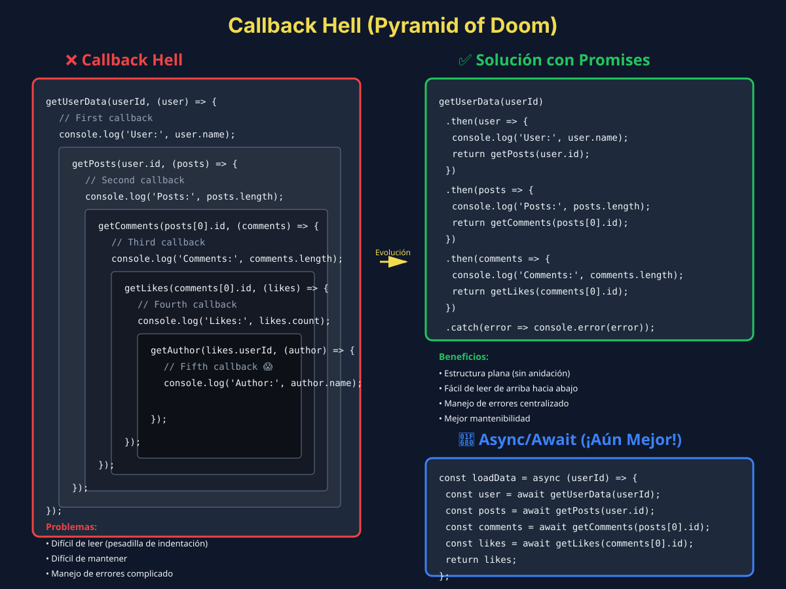

# 🔗 Callbacks y sus Problemas

## 🎯 Objetivos

Al finalizar este tema, comprenderás:

- ✅ Qué es un callback en JavaScript
- ✅ Cómo se utilizan los callbacks para operaciones asíncronas
- ✅ El problema del "Callback Hell" o "Pyramid of Doom"
- ✅ Dificultades del manejo de errores con callbacks
- ✅ Por qué surgieron las Promises como solución

---

## 📋 Contenido



---

### 1. ¿Qué es un Callback?

Un **callback** es simplemente una **función que se pasa como argumento** a otra función para ser ejecutada más tarde.

#### Ejemplo Simple

```javascript
// ============================================
// CALLBACK BÁSICO
// ============================================

// Función que recibe un callback
const greet = (name, callback) => {
  console.log(`Hola, ${name}!`);
  callback(); // Ejecuta el callback
};

// Uso
greet('Ana', () => {
  console.log('¿Cómo estás?');
});

// Output:
// Hola, Ana!
// ¿Cómo estás?
```

#### Callbacks Síncronos

Algunos callbacks se ejecutan **inmediatamente**:

```javascript
// ============================================
// CALLBACKS SÍNCRONOS
// ============================================

// Array methods usan callbacks síncronos
const numbers = [1, 2, 3, 4, 5];

numbers.forEach(num => {
  console.log(num * 2);
});

const doubled = numbers.map(num => num * 2);
console.log(doubled); // [2, 4, 6, 8, 10]

const evens = numbers.filter(num => num % 2 === 0);
console.log(evens); // [2, 4]
```

#### Callbacks Asíncronos

Otros se ejecutan **después** de que ocurre un evento:

```javascript
// ============================================
// CALLBACKS ASÍNCRONOS
// ============================================

// setTimeout
setTimeout(() => {
  console.log('Ejecutado después de 2 segundos');
}, 2000);

// Event listeners
document.querySelector('#btn').addEventListener('click', () => {
  console.log('Button clicked!');
});

// Simular petición HTTP
const fetchUser = (userId, callback) => {
  setTimeout(() => {
    const user = { id: userId, name: 'Ana' };
    callback(user);
  }, 1000);
};

fetchUser(123, user => {
  console.log('Usuario recibido:', user);
});
```

---

### 2. El Problema: Callback Hell 😈

Cuando necesitas ejecutar múltiples operaciones asíncronas **en secuencia**, los callbacks se anidan, creando lo que se conoce como **"Callback Hell"** o **"Pyramid of Doom"**.

#### Ejemplo: Cargando Datos Relacionados

```javascript
// ============================================
// CALLBACK HELL - EL PROBLEMA
// ============================================

// Simular funciones asíncronas
const getUser = (userId, callback) => {
  setTimeout(() => {
    console.log('✅ Usuario obtenido');
    callback({ id: userId, name: 'Ana García' });
  }, 1000);
};

const getPosts = (userId, callback) => {
  setTimeout(() => {
    console.log('✅ Posts obtenidos');
    callback([
      { id: 1, title: 'Post 1' },
      { id: 2, title: 'Post 2' }
    ]);
  }, 1000);
};

const getComments = (postId, callback) => {
  setTimeout(() => {
    console.log('✅ Comentarios obtenidos');
    callback([
      { id: 1, text: 'Great post!' },
      { id: 2, text: 'Thanks for sharing' }
    ]);
  }, 1000);
};

const getLikes = (commentId, callback) => {
  setTimeout(() => {
    console.log('✅ Likes obtenidos');
    callback({ count: 42 });
  }, 1000);
};

// 😱 CALLBACK HELL
getUser(123, user => {
  console.log('User:', user);

  getPosts(user.id, posts => {
    console.log('Posts:', posts);

    getComments(posts[0].id, comments => {
      console.log('Comments:', comments);

      getLikes(comments[0].id, likes => {
        console.log('Likes:', likes);

        // ¿Y si necesitas más niveles? 😰
      });
    });
  });
});

// Pirámide de la perdición ⬇️
//          getUser(...)
//              getPosts(...)
//                  getComments(...)
//                      getLikes(...)
//                          ...
```

#### Problemas de Callback Hell

❌ **Difícil de leer**: El código crece horizontalmente
❌ **Difícil de mantener**: Cambios requieren tocar múltiples niveles
❌ **Difícil de debuggear**: Los errores se pierden en la anidación
❌ **Difícil de testear**: Complica los unit tests
❌ **Scope pollution**: Variables de niveles superiores contaminan

---

### 3. Manejo de Errores con Callbacks

El patrón tradicional de Node.js es "error-first callbacks", pero puede ser tedioso:

#### Error-First Callbacks

```javascript
// ============================================
// ERROR-FIRST CALLBACKS
// ============================================

const fetchData = (url, callback) => {
  setTimeout(() => {
    const random = Math.random();

    if (random > 0.5) {
      // Éxito: primer parámetro null, segundo el resultado
      callback(null, { data: 'Success!' });
    } else {
      // Error: primer parámetro el error
      callback(new Error('Failed to fetch'), null);
    }
  }, 1000);
};

// Uso
fetchData('https://api.example.com', (error, data) => {
  if (error) {
    console.error('Error:', error.message);
    return;
  }

  console.log('Data:', data);
});
```

#### Problema: Repetición de Manejo de Errores

```javascript
// ============================================
// MANEJO DE ERRORES EN CALLBACK HELL
// ============================================

const getUserWithError = (userId, callback) => {
  setTimeout(() => {
    const random = Math.random();
    if (random > 0.3) {
      callback(null, { id: userId, name: 'Ana' });
    } else {
      callback(new Error('User not found'), null);
    }
  }, 1000);
};

const getPostsWithError = (userId, callback) => {
  setTimeout(() => {
    const random = Math.random();
    if (random > 0.3) {
      callback(null, [{ id: 1, title: 'Post 1' }]);
    } else {
      callback(new Error('Posts not found'), null);
    }
  }, 1000);
};

// 😰 Manejo de errores repetitivo
getUserWithError(123, (error, user) => {
  if (error) {
    console.error('Error getting user:', error.message);
    return;
  }

  getPostsWithError(user.id, (error, posts) => {
    if (error) {
      console.error('Error getting posts:', error.message);
      return;
    }

    // Y continúa la anidación con más if (error)...
    console.log('Posts:', posts);
  });
});
```

---

### 4. Más Problemas con Callbacks

#### 🔴 Problema 1: Control de Flujo

Es difícil ejecutar callbacks **en paralelo** o esperar que **todos terminen**:

```javascript
// ============================================
// EJECUTAR CALLBACKS EN PARALELO
// ============================================

const loadResource1 = callback => {
  setTimeout(() => callback(null, 'Resource 1'), 1000);
};

const loadResource2 = callback => {
  setTimeout(() => callback(null, 'Resource 2'), 1500);
};

const loadResource3 = callback => {
  setTimeout(() => callback(null, 'Resource 3'), 800);
};

// ¿Cómo esperar a que TODOS terminen? 🤔
// Necesitas un contador manual...
let completed = 0;
const results = [];

const checkComplete = () => {
  completed++;
  if (completed === 3) {
    console.log('All resources loaded:', results);
  }
};

loadResource1((err, data) => {
  results.push(data);
  checkComplete();
});

loadResource2((err, data) => {
  results.push(data);
  checkComplete();
});

loadResource3((err, data) => {
  results.push(data);
  checkComplete();
});

// 😰 Muy complicado y propenso a errores
```

#### 🔴 Problema 2: Cancelación

No hay forma estándar de **cancelar** una operación asíncrona con callbacks:

```javascript
const longRunningTask = callback => {
  const timerId = setTimeout(() => {
    callback('Task completed');
  }, 5000);

  // ¿Cómo cancelar esto desde fuera? 🤔
  // Necesitarías devolver timerId y manejarlo manualmente
};
```

#### 🔴 Problema 3: No Retornan Valores

Los callbacks no pueden usar `return` de forma útil:

```javascript
// ❌ ESTO NO FUNCIONA
const getUser = userId => {
  setTimeout(() => {
    return { id: userId, name: 'Ana' }; // ❌ Este return no sirve
  }, 1000);
};

const user = getUser(123); // undefined
console.log(user); // undefined

// ✅ Debes usar callbacks
const getUserCorrect = (userId, callback) => {
  setTimeout(() => {
    callback({ id: userId, name: 'Ana' });
  }, 1000);
};

getUserCorrect(123, user => {
  console.log(user); // ✅ Funciona
});
```

---

### 5. Intentos de Solución

Antes de las Promises, se intentaron varias soluciones:

#### Named Functions (Funciones Nombradas)

```javascript
// ============================================
// SOLUCIÓN 1: NAMED FUNCTIONS
// ============================================

// En lugar de funciones anónimas, usar funciones nombradas
const handleLikes = likes => {
  console.log('Likes:', likes);
};

const handleComments = comments => {
  console.log('Comments:', comments);
  getLikes(comments[0].id, handleLikes);
};

const handlePosts = posts => {
  console.log('Posts:', posts);
  getComments(posts[0].id, handleComments);
};

const handleUser = user => {
  console.log('User:', user);
  getPosts(user.id, handlePosts);
};

// Uso
getUser(123, handleUser);

// 👍 Más legible, pero sigue siendo complicado
```

#### Librerías de Control de Flujo

```javascript
// ============================================
// SOLUCIÓN 2: LIBRERÍAS (async.js, etc.)
// ============================================

// Ejemplo con async.js (antes de Promises)
async.waterfall([
  callback => {
    getUser(123, (err, user) => callback(err, user));
  },
  (user, callback) => {
    getPosts(user.id, (err, posts) => callback(err, posts));
  },
  (posts, callback) => {
    getComments(posts[0].id, (err, comments) => callback(err, comments));
  }
], (err, result) => {
  if (err) {
    console.error(err);
  } else {
    console.log('Final result:', result);
  }
});

// 👍 Mejor, pero requiere librería externa
```

---

### 6. La Solución Moderna: Promises

Las **Promises** fueron introducidas para resolver estos problemas:

```javascript
// ============================================
// PREVIEW: PROMISES (próximo tema)
// ============================================

// Con Promises, el callback hell desaparece
getUser(123)
  .then(user => {
    console.log('User:', user);
    return getPosts(user.id);
  })
  .then(posts => {
    console.log('Posts:', posts);
    return getComments(posts[0].id);
  })
  .then(comments => {
    console.log('Comments:', comments);
    return getLikes(comments[0].id);
  })
  .then(likes => {
    console.log('Likes:', likes);
  })
  .catch(error => {
    console.error('Error:', error);
  });

// 🎉 Código plano, fácil de leer y mantener
```

---

## 🎯 Comparación: Callbacks vs Promises

| Característica | Callbacks | Promises |
|----------------|-----------|----------|
| **Legibilidad** | ❌ Difícil (pyramid of doom) | ✅ Fácil (código plano) |
| **Manejo de errores** | ❌ Repetitivo (`if (error)`) | ✅ Centralizado (`.catch()`) |
| **Composición** | ❌ Complicada | ✅ Sencilla (`.then()`) |
| **Paralelismo** | ❌ Manual | ✅ `Promise.all()` |
| **Cancelación** | ❌ No estándar | ⚠️ Mejor (AbortController) |
| **Retorno de valores** | ❌ No posible | ✅ Posible |

---

## ✅ Checklist de Verificación

Antes de continuar, asegúrate de comprender:

- [ ] Qué es un callback y cómo funciona
- [ ] La diferencia entre callbacks síncronos y asíncronos
- [ ] Qué es el "Callback Hell" y por qué es un problema
- [ ] Dificultades del manejo de errores con callbacks
- [ ] Por qué los callbacks no pueden retornar valores
- [ ] Cómo las Promises solucionan estos problemas

---

## 💡 Lecciones Aprendidas

🎯 **Los callbacks NO son malos**: Son perfectos para casos simples (event listeners, array methods)

🎯 **El problema es la anidación**: Múltiples callbacks asíncronos crean código difícil de mantener

🎯 **Promises son la solución**: Código más legible, mejor manejo de errores

---

## 📚 Recursos Adicionales

- 📖 [Callback Hell - callbackhell.com](http://callbackhell.com/)
- 📘 [JavaScript.info: Callbacks](https://javascript.info/callbacks)
- 🎥 [Callback Hell and How to Rescue It](https://www.youtube.com/watch?v=QRq2zMHlBz4)

<!-- nav -->
---

## 🔗 Navegación

| Anterior | Siguiente |
|---|---|
| ← [Teoría — 🔄 Introducción a la Programación Asincrónica](01-introduccion-asincronia.md) | [Teoría — 🎁 Promises: Fundamentos](03-promises-fundamentos.md) → |

[↑ Semana 13](../README.md)
