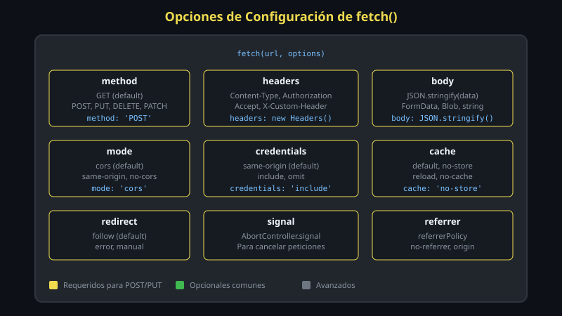

# ⚙️ Headers y Configuración

## 🎯 Objetivos

Al finalizar este tema, serás capaz de:

- Configurar headers de petición correctamente
- Entender Content-Type y Accept
- Implementar autenticación con headers
- Configurar opciones avanzadas de fetch (mode, credentials, cache)

---

## 📋 Contenido

### 1. Configurando peticiones con fetch

El segundo argumento de `fetch()` es un objeto de opciones:

```javascript
// ============================================
// Estructura completa de opciones de fetch
// ============================================

const response = await fetch('https://api.example.com/data', {
  // Método HTTP
  method: 'POST',           // GET, POST, PUT, DELETE, PATCH, etc.

  // Headers de la petición
  headers: {
    'Content-Type': 'application/json',
    'Accept': 'application/json',
    'Authorization': 'Bearer token123'
  },

  // Body de la petición (para POST, PUT, PATCH)
  body: JSON.stringify({ name: 'Usuario' }),

  // Modo CORS
  mode: 'cors',             // cors, no-cors, same-origin

  // Credenciales (cookies)
  credentials: 'same-origin', // omit, same-origin, include

  // Control de caché
  cache: 'default',         // default, no-store, reload, no-cache, force-cache

  // Política de redirect
  redirect: 'follow',       // follow, error, manual

  // Referrer
  referrer: '',
  referrerPolicy: 'no-referrer-when-downgrade',

  // Señal para abortar
  signal: abortController.signal
});
```

---

### 2. Headers esenciales

#### Content-Type

Indica el tipo de contenido que envías:

```javascript
// ============================================
// Content-Type comunes
// ============================================

// JSON (más común en APIs REST)
const jsonRequest = await fetch('/api/users', {
  method: 'POST',
  headers: {
    'Content-Type': 'application/json'
  },
  body: JSON.stringify({ name: 'Usuario', email: 'user@example.com' })
});

// Form URL encoded (formularios tradicionales)
const formRequest = await fetch('/api/login', {
  method: 'POST',
  headers: {
    'Content-Type': 'application/x-www-form-urlencoded'
  },
  body: 'username=user&password=pass123'
});

// FormData (archivos y formularios multipart)
const formData = new FormData();
formData.append('file', fileInput.files[0]);
formData.append('name', 'documento');

// ⚠️ NO pongas Content-Type manualmente con FormData
// El navegador lo configura automáticamente con el boundary
const uploadRequest = await fetch('/api/upload', {
  method: 'POST',
  body: formData  // Content-Type se agrega automáticamente
});
```

#### Accept

Indica el tipo de contenido que esperas recibir:

```javascript
// ============================================
// Accept header
// ============================================

// Solicitar JSON
const jsonResponse = await fetch('/api/data', {
  headers: {
    'Accept': 'application/json'
  }
});

// Solicitar HTML
const htmlResponse = await fetch('/page', {
  headers: {
    'Accept': 'text/html'
  }
});

// Aceptar múltiples tipos con preferencia
const flexibleResponse = await fetch('/api/report', {
  headers: {
    'Accept': 'application/json, text/plain, */*'
  }
});
```

---

### 3. Autenticación con Headers

```javascript
// ============================================
// Bearer Token (JWT, OAuth2)
// ============================================

const token = localStorage.getItem('authToken');

const response = await fetch('/api/protected', {
  headers: {
    'Authorization': `Bearer ${token}`,
    'Content-Type': 'application/json'
  }
});
```

```javascript
// ============================================
// Basic Authentication
// ============================================

const username = 'user';
const password = 'pass123';

// Base64 encode de "username:password"
const credentials = btoa(`${username}:${password}`);

const response = await fetch('/api/auth', {
  headers: {
    'Authorization': `Basic ${credentials}`
  }
});
```

```javascript
// ============================================
// API Key
// ============================================

const API_KEY = 'tu-api-key-aqui';

// En header (más seguro)
const response1 = await fetch('/api/data', {
  headers: {
    'X-API-Key': API_KEY
  }
});

// En query parameter (menos seguro, visible en logs)
const response2 = await fetch(`/api/data?api_key=${API_KEY}`);
```

---

### 4. Objeto Headers

Puedes crear y manipular headers con el constructor `Headers`:

```javascript
// ============================================
// Crear y manipular Headers
// ============================================

// Crear desde objeto
const headers = new Headers({
  'Content-Type': 'application/json',
  'Accept': 'application/json'
});

// Agregar header
headers.append('X-Custom-Header', 'valor');

// Modificar header existente
headers.set('Content-Type', 'text/plain');

// Verificar si existe
console.log(headers.has('Accept')); // true

// Obtener valor
console.log(headers.get('Content-Type')); // "text/plain"

// Eliminar header
headers.delete('X-Custom-Header');

// Iterar
for (const [name, value] of headers) {
  console.log(`${name}: ${value}`);
}

// Usar con fetch
const response = await fetch('/api/data', {
  method: 'POST',
  headers: headers,
  body: '{"test": true}'
});
```

---

### 5. Mode (CORS)

Controla cómo se manejan las peticiones cross-origin:

```javascript
// ============================================
// Modos de CORS
// ============================================

// "cors" (por defecto) - Peticiones cross-origin con CORS
const corsResponse = await fetch('https://api.example.com/data', {
  mode: 'cors'  // El servidor debe enviar headers CORS apropiados
});

// "same-origin" - Solo mismo origen
const sameOriginResponse = await fetch('/api/data', {
  mode: 'same-origin'  // Error si la URL es de otro origen
});

// "no-cors" - Cross-origin sin CORS (respuesta opaca)
const noCorsResponse = await fetch('https://otro-sitio.com/image.jpg', {
  mode: 'no-cors'
});
// ⚠️ No puedes leer la respuesta, solo usarla como recurso
```

---

### 6. Credentials (Cookies)

Controla si se envían cookies con la petición:

```javascript
// ============================================
// Manejo de Cookies/Credentials
// ============================================

// "same-origin" (por defecto) - Cookies solo para mismo origen
const response1 = await fetch('/api/profile', {
  credentials: 'same-origin'
});

// "include" - Siempre enviar cookies (incluso cross-origin)
const response2 = await fetch('https://api.example.com/user', {
  credentials: 'include'  // El servidor debe permitirlo con CORS
});

// "omit" - Nunca enviar cookies
const response3 = await fetch('/api/public', {
  credentials: 'omit'
});
```

---

### 7. Cache

Controla el comportamiento de caché del navegador:

```javascript
// ============================================
// Control de Caché
// ============================================

// "default" - Comportamiento normal de caché
const cached = await fetch('/api/data', { cache: 'default' });

// "no-store" - No usar caché en absoluto
const fresh = await fetch('/api/realtime', { cache: 'no-store' });

// "reload" - Ignorar caché, actualizar caché con respuesta
const reloaded = await fetch('/api/data', { cache: 'reload' });

// "no-cache" - Verificar con servidor antes de usar caché
const validated = await fetch('/api/data', { cache: 'no-cache' });

// "force-cache" - Usar caché aunque esté expirado
const forceCached = await fetch('/api/data', { cache: 'force-cache' });

// "only-if-cached" - Solo usar caché, error si no existe
// ⚠️ Solo funciona con mode: 'same-origin'
const onlyCached = await fetch('/api/data', {
  cache: 'only-if-cached',
  mode: 'same-origin'
});
```

---

### 8. AbortController

Permite cancelar peticiones en vuelo:

```javascript
// ============================================
// Cancelar peticiones con AbortController
// ============================================

const controller = new AbortController();
const signal = controller.signal;

// Iniciar petición
const fetchPromise = fetch('/api/large-data', { signal });

// Cancelar después de 5 segundos
const timeoutId = setTimeout(() => {
  controller.abort();
  console.log('Petición cancelada por timeout');
}, 5000);

try {
  const response = await fetchPromise;
  clearTimeout(timeoutId); // Limpiar timeout si fue exitoso
  const data = await response.json();
} catch (error) {
  if (error.name === 'AbortError') {
    console.log('La petición fue abortada');
  } else {
    console.error('Error de red:', error);
  }
}
```

```javascript
// ============================================
// Wrapper con timeout automático
// ============================================

const fetchWithTimeout = async (url, options = {}, timeout = 10000) => {
  const controller = new AbortController();
  const timeoutId = setTimeout(() => controller.abort(), timeout);

  try {
    const response = await fetch(url, {
      ...options,
      signal: controller.signal
    });
    return response;
  } finally {
    clearTimeout(timeoutId);
  }
};

// Uso
try {
  const response = await fetchWithTimeout('/api/data', {}, 5000);
  const data = await response.json();
} catch (error) {
  if (error.name === 'AbortError') {
    console.error('Timeout: la petición tardó demasiado');
  }
}
```

Hoy la plataforma trae ese wrapper hecho: `AbortSignal.timeout(ms)` crea una señal que se cancela sola pasado ese tiempo, sin `setTimeout` ni `clearTimeout`. El error se llama `TimeoutError` en lugar de `AbortError`, así que puedes distinguir un tiempo agotado de una cancelación que haces tú con `controller.abort()`:

```javascript
try {
  const response = await fetch('/api/data', { signal: AbortSignal.timeout(5000) });
  const data = await response.json();
} catch (error) {
  if (error.name === 'TimeoutError') {
    console.error('Timeout: la petición tardó más de 5 s');
  } else if (error.name === 'AbortError') {
    console.error('Petición cancelada');
  }
}
```

Es la forma que usan el [lab 03](../2-practicas/lab-03-headers-config/README.md) y el proyecto de la semana.

---

## 📊 Diagrama: Configuración de Fetch



---

## ✅ Checklist de Aprendizaje

- [ ] Sé configurar Content-Type para diferentes tipos de body
- [ ] Entiendo la diferencia entre Accept y Content-Type
- [ ] Puedo implementar autenticación con Bearer tokens
- [ ] Comprendo los modos de CORS (cors, same-origin, no-cors)
- [ ] Sé controlar credentials para cookies
- [ ] Puedo cancelar peticiones con AbortController

---

## 🔗 Recursos

- [MDN: Fetch API - Headers](https://developer.mozilla.org/es/docs/Web/API/Fetch_API/Using_Fetch#headers)
- [MDN: AbortController](https://developer.mozilla.org/es/docs/Web/API/AbortController)
- [MDN: CORS](https://developer.mozilla.org/es/docs/Web/HTTP/CORS)

<!-- nav -->
---

## 🔗 Navegación

| Anterior | Siguiente |
|---|---|
| ← [Teoría — 📦 Objetos Request y Response](02-request-response.md) | [Teoría — 🛡️ Manejo de Errores en Fetch](04-error-handling.md) → |

[↑ Semana 15](../README.md)
