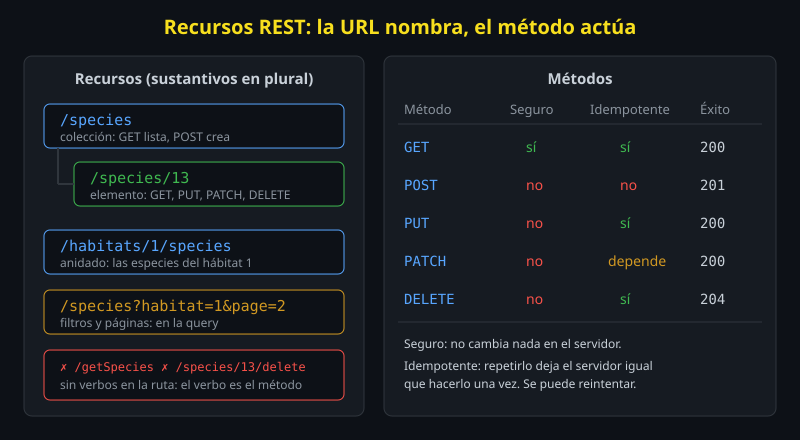

# 🧭 Diseño de una API REST

## 🎯 Objetivos

- Explicar qué hace que una API sea REST: recursos con URL, métodos HTTP con significado fijo y peticiones independientes.
- Distinguir colecciones, elementos y recursos anidados, y reconocer una ruta mal diseñada.
- Saber qué métodos son seguros e idempotentes y por qué importa al reintentar.
- Elegir el código de estado adecuado (`201`, `204`, `400`, `401`, `403`, `404`, `405`, `409`, `422`...) y reaccionar a cada uno desde el cliente.

En la [semana 15](../../week-15-fetch_api/README.md) usaste `fetch` con los cinco métodos HTTP contra una API ya hecha. Esta semana miras la API desde el otro lado: por qué sus rutas, métodos y estados son como son. No vas a programar un servidor, pero entender su diseño te dice qué esperar de cualquier API y cómo tratar cada respuesta.

---

## 📋 Contenido

### 1. Qué es REST

REST (*Representational State Transfer*) es un estilo para diseñar APIs sobre HTTP. No es una librería ni un estándar con normas exactas: es un conjunto de ideas que casi todas las APIs públicas siguen en mayor o menor medida.

- **Recursos:** todo lo que la API ofrece (una especie, un hábitat, una nota) es un recurso con su propia URL.
- **Representaciones:** el servidor no envía el recurso, sino una representación suya, casi siempre en JSON. La cabecera `Content-Type` dice en qué formato.
- **Interfaz uniforme:** los métodos HTTP significan lo mismo en todas las rutas. `GET` siempre lee y `DELETE` siempre borra.
- **Sin estado (*stateless*):** cada petición trae todo lo que el servidor necesita para responderla, también quién la hace (el token, en la [teoría 03](03-autenticacion.md)). El servidor no recuerda la petición anterior.

- **Qué:** una forma común de organizar URLs, métodos y respuestas.
- **Para qué:** quien conoce una API REST sabe usar casi cualquier otra sin leer toda su documentación.
- **Impacto:** el cliente puede escribir una sola función para todas las peticiones (como `request` en la semana 15), porque todas siguen las mismas reglas.

### 2. Recursos y URLs

Una URL REST se lee como una ruta de carpetas: de lo general a lo concreto.

| URL | Qué es | Ejemplo de uso |
|---|---|---|
| `/species` | La **colección** de especies | `GET` para listar, `POST` para crear |
| `/species/13` | Un **elemento** de la colección | `GET`, `PUT`, `PATCH`, `DELETE` |
| `/habitats/1/species` | Un recurso **anidado**: las especies del hábitat 1 | `GET` para listar |
| `/species?habitat=1&sort=name` | La colección **filtrada y ordenada** | `GET` |

Las reglas que siguen casi todas las APIs:

1. **Sustantivos en plural**, en minúsculas y con guiones si hacen falta: `/species`, `/feeding-logs`.
2. **Sin verbos en la ruta.** El verbo es el método: no `/getSpecies` ni `/species/13/delete`, sino `GET /species` y `DELETE /species/13`.
3. **El id va en la ruta**, porque identifica el recurso. Los filtros, el orden y la página van en la *query* (después de `?`), porque son opciones sobre una colección.
4. **Un nivel de anidamiento basta.** `/habitats/1/species` se entiende; `/habitats/1/species/4/notes/2` es difícil de usar, y la nota 2 ya tiene su propia URL: `/notes/2`.



### 3. Métodos seguros e idempotentes

Dos propiedades de los métodos que el cliente necesita conocer:

- **Seguro:** no cambia nada en el servidor. Solo `GET` (y `HEAD`, que es un `GET` sin cuerpo). Un navegador puede pedir por adelantado un enlace `GET` sin que pase nada.
- **Idempotente:** repetir la petición deja el servidor igual que hacerla una vez. Lo son `GET`, `PUT` y `DELETE`. `POST` no: dos `POST` iguales crean dos recursos.

| Método | Seguro | Idempotente | Cuerpo de la petición | Respuesta típica |
|---|---|---|---|---|
| `GET` | Sí | Sí | No | `200` con el recurso |
| `POST` | No | No | Sí | `201` con el recurso creado y `Location` |
| `PUT` | No | Sí | Sí, el recurso entero | `200` con el recurso |
| `PATCH` | No | Depende | Sí, solo los cambios | `200` con el recurso |
| `DELETE` | No | Sí | No | `204` sin cuerpo |

`PATCH` es idempotente si envía valores (`{ "name": "Pez luna" }`) y no lo es si envía operaciones (`{ "moons": "+1" }`): repetir «suma una» suma dos.

Idempotente habla del **estado del servidor**, no de la respuesta. El primer `DELETE /species/12` da `204` y el segundo `404`, pero después de los dos la especie 12 no existe, igual que después de uno.

- **Qué:** saber si repetir una petición cambia el resultado.
- **Para qué:** decidir qué se puede reintentar sin preguntar. Si un `PUT` se queda sin respuesta porque se cae la red, reintentarlo es seguro; reintentar un `POST` puede crear el recurso dos veces.
- **Impacto:** el reintento automático de la [semana 15](../../week-15-fetch_api/1-teoria/04-error-handling.md) es razonable para `GET`, `PUT` y `DELETE`. Para `POST`, mejor avisar a quien usa la página o usar una clave de idempotencia (una cabecera `Idempotency-Key` con un id único que el servidor recuerda), si la API la ofrece.

### 4. Códigos de estado

La semana 15 los agrupó por familias (`2xx`, `4xx`, `5xx`). Una API bien diseñada elige el código concreto, y cada uno pide al cliente una reacción distinta:

| Código | Nombre | Cuándo lo usa la API | Qué hace el cliente |
|---|---|---|---|
| `200` | OK | Lectura o cambio correcto, con cuerpo | Mostrar los datos |
| `201` | Created | `POST` que crea; la cabecera `Location` da la URL del recurso nuevo | Mostrar la ficha nueva |
| `204` | No Content | Correcto y sin cuerpo (típico de `DELETE`) | No leer el cuerpo |
| `400` | Bad Request | La petición está mal formada: JSON roto, un parámetro imposible (`page=0`) | Es un fallo del cliente: revisar el código |
| `401` | Unauthorized | No hay credencial, o no vale (falta el token o ha caducado) | Pedir que inicie sesión |
| `403` | Forbidden | Hay credencial válida, pero sin permiso para esto | Avisar; volver a iniciar sesión no lo arregla |
| `404` | Not Found | El recurso o la ruta no existen | Avisar de que no existe |
| `405` | Method Not Allowed | La ruta existe, pero no admite ese método; la cabecera `Allow` dice cuáles sí | Fallo del cliente: revisar el método |
| `409` | Conflict | Datos válidos que chocan con el estado del servidor: un nombre repetido, una versión antigua | Pedir otro valor o recargar |
| `422` | Unprocessable Content | JSON correcto, pero con datos que no cumplen las reglas: un campo vacío, un id que no existe | Marcar los campos que fallan |
| `500` | Internal Server Error | Fallo inesperado del servidor | Avisar e intentarlo más tarde |
| `503` | Service Unavailable | El servidor está caído o saturado | Reintentar más tarde |

Algunas APIs usan `400` también para los datos no válidos, en lugar de `422`. Lo importante es que la documentación lo diga y que el cuerpo explique el error.

### 5. Errores con una forma estable

Un código de estado dice qué tipo de error ha ocurrido; el cuerpo dice cuál. Si todas las respuestas de error tienen la misma forma, el cliente las trata con una sola función. La API de los labs usa esta:

```json
{
  "error": "Datos no válidos",
  "fields": { "name": "Obligatorio", "habitatId": "No existe el hábitat 9" }
}
```

- `error` siempre está: es el mensaje que puede ver la persona.
- `fields` aparece en los `422`: un mensaje por cada campo del formulario que hay que corregir.

Existe un estándar para esto, *Problem Details* (RFC 9457), con el tipo `application/problem+json` y los campos `type`, `title`, `status` y `detail`. Lo usan APIs grandes; la idea es la misma.

### 6. Del diseño al cliente: una reacción por estado

Con los códigos bien elegidos, el cliente decide qué hacer mirando solo el estado y el cuerpo. El orden de los `if` importa: los casos concretos van antes que las familias.

```javascript
const reactTo = ({ status, body }) => {
  if (status === 201) return 'Mostrar la ficha nueva';
  if (status >= 200 && status < 300) return 'Mostrar los datos';
  if (status === 401) return 'Pedir que inicie sesión';
  if (status === 403) return 'Avisar de que no tiene permiso';
  if (status === 404) return 'Avisar de que no existe';
  if (status === 409) return `Pedir otro valor: ${body.error}`;
  if (status === 422) return `Marcar los campos: ${Object.keys(body.fields).join(', ')}`;
  if (status >= 500) return 'Reintentar más tarde';
  return `Error ${status}: ${body.error}`;
};
```

Es el paso 7 del [lab 01](../2-practicas/lab-01-diseno-rest/README.md), con su salida real contra la API de prácticas.

---

## 🧪 Pruébalo

El [lab 01](../2-practicas/lab-01-diseno-rest/README.md) recorre cada sección de este archivo con peticiones reales: recursos anidados, `201` y `Location`, `422` frente a `409`, idempotencia, `405` y la reacción por estado.

## ✅ Checklist de aprendizaje

- [ ] Sé distinguir una colección, un elemento y un recurso anidado por su URL.
- [ ] Sé por qué `/species/13/delete` es una mala ruta y cómo se escribe bien.
- [ ] Puedo explicar qué es un método idempotente con el ejemplo de dos `DELETE`.
- [ ] Sé qué método puedo reintentar sin riesgo y cuál no.
- [ ] Distingo `400` de `422`, `401` de `403` y `404` de `405`.
- [ ] Sé para qué sirven las cabeceras `Location` y `Allow`.

<!-- nav -->
---

## 🔗 Navegación

| Anterior | Siguiente |
|---|---|
| ← [Semana 16 - APIs REST y CRUD](../README.md) | [Teoría — 📑 Paginación, filtros y orden](02-paginacion-filtros.md) → |

[↑ Semana 16](../README.md)
