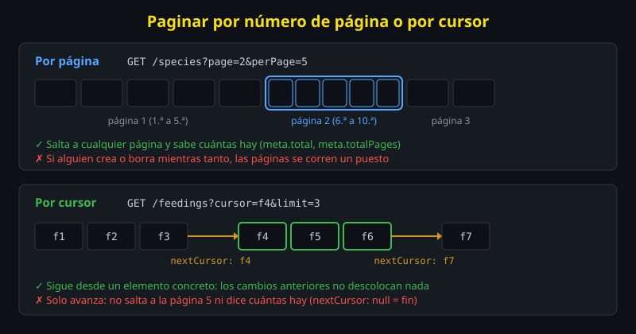

# 📑 Paginación, filtros y orden

## 🎯 Objetivos

- Explicar por qué una API devuelve las colecciones grandes por partes.
- Pedir una colección filtrada, ordenada y paginada con parámetros en la URL.
- Leer los metadatos de una página (`page`, `perPage`, `total`, `totalPages`) en el cuerpo o en las cabeceras.
- Recorrer todas las páginas con un bucle o con un generador asíncrono.
- Elegir entre paginar por número de página y paginar por cursor.

---

## 📋 Contenido

### 1. Por qué paginar

Un `GET /species` que devolviera todas las especies funciona con 12. Con 50 000, la respuesta tarda, ocupa megas, gasta la memoria del navegador y la página no puede pintar tantas tarjetas. Además, casi nadie las quiere todas: busca unas pocas.

Por eso las APIs devuelven las colecciones por **páginas**: trozos de tamaño fijo, y el cliente pide el siguiente cuando hace falta.

- **Qué:** dividir una colección en partes y pedirlas por separado.
- **Para qué:** respuestas rápidas y pequeñas, sea cual sea el tamaño de la colección.
- **Impacto:** el cliente tiene que saber cuántas páginas hay, pasar de una a otra y aceptar que nunca tiene la colección entera.

### 2. Filtros, búsqueda y orden

Las opciones sobre una colección van en la *query* de la URL, y se construyen con `URL` y `searchParams` como en la [semana 15](../../week-15-fetch_api/1-teoria/01-fetch-basics.md):

| Parámetro | Para qué | Ejemplo |
|---|---|---|
| Filtro por campo | Solo los que cumplen una condición | `habitat=1` |
| Búsqueda de texto | Los que contienen un texto | `search=pez` |
| Orden | Por qué campo y en qué sentido | `sort=name` (A-Z), `sort=-name` (Z-A) |
| Página | Qué trozo y de qué tamaño | `page=2&perPage=5` |

El `-` delante del campo para el orden descendente es una convención muy extendida, pero no universal: otras APIs usan `sort=name&order=desc`. La documentación de cada API lo dice.

```javascript
const url = new URL('/species', 'http://localhost:3000');
url.searchParams.set('habitat', 1);
url.searchParams.set('sort', '-name');
url.searchParams.set('page', 2);
console.log(url.href);
// http://localhost:3000/species?habitat=1&sort=-name&page=2
```

**Filtra en el servidor, no en el cliente.** Si el cliente pide la página 1 y después filtra lo que le llega, solo filtra esas 5 especies: las que cumplen el filtro en otras páginas no aparecen, y la página puede quedar casi vacía. El servidor filtra primero y pagina después, así que `total` y `totalPages` cuentan solo lo que pasa el filtro.

### 3. Paginación por número de página

La más común. El cliente pide `page` (qué página, empezando en 1) y `perPage` (cuántos elementos por página). El servidor calcula qué elementos tocan:

```javascript
const page = 2;
const perPage = 5;
const total = 12;
console.log((page - 1) * perPage); // 5: se salta los 5 primeros (el offset)
console.log(Math.ceil(total / perPage)); // 3 páginas: 5 + 5 + 2
```

Algunas APIs usan `offset` (cuántos saltar) y `limit` (cuántos devolver) en lugar de `page` y `perPage`. Es lo mismo con otros nombres: `offset = (page - 1) * perPage`.

Para pintar la paginación («Página 2 de 3», botones Anterior y Siguiente) el cliente necesita el total. Las APIs lo dan de tres formas:

| Dónde | Ejemplo | Quién lo usa |
|---|---|---|
| Un **sobre** (*envelope*) en el cuerpo | `{ "data": [...], "meta": { "page": 2, "perPage": 5, "total": 12, "totalPages": 3 } }` | La API de los labs y la del proyecto |
| La cabecera `X-Total-Count` | `X-Total-Count: 12` y el cuerpo es el array | APIs que no quieren cambiar la forma del cuerpo |
| La cabecera `Link` | `</species?page=3>; rel="next", </species?page=1>; rel="prev"` | GitHub y otras; la última página no tiene `rel="next"` |

Una página después de la última no es un error: la API responde `200` con `data` vacío. Un `page=0` o un `perPage` de 10 000 sí lo son, y la API responde `400`.

### 4. Recorrer todas las páginas

A veces el cliente sí necesita todo (exportar un listado, por ejemplo). El bucle no sabe al principio cuántas páginas hay: supone una y actualiza `totalPages` con la primera respuesta.

```javascript
let page = 1;
let totalPages = 1;
while (page <= totalPages) {
  const { data, meta } = await getPage({ page, perPage: 5 });
  totalPages = meta.totalPages;
  console.log(data);
  page += 1;
}
```

Con un **generador asíncrono** ([semana 14](../../week-14-async_await/README.md)), quien recorre las especies no tiene que saber nada de páginas: `yield*` las entrega una a una y la siguiente página solo se pide cuando alguien quiere más.

```javascript
async function* allSpecies() {
  let page = 1;
  let totalPages = 1;
  while (page <= totalPages) {
    const { data, meta } = await getPage({ page, perPage: 5 });
    totalPages = meta.totalPages;
    yield* data;
    page += 1;
  }
}

for await (const item of allSpecies()) {
  if (item.name.startsWith('C')) break; // no se piden más páginas
}
```

El [lab 02](../2-practicas/lab-02-paginacion/README.md), paso 6, cuenta las peticiones: `Array.fromAsync(allSpecies())` hace 3 y el `for await` con `break` solo las que necesita.

### 5. Paginación por cursor

El número de página tiene un punto débil: la página 2 son «los elementos del 6.º al 10.º» **en el momento de pedirla**. Si entre la página 1 y la 2 alguien crea un elemento que va delante, todo se corre un puesto y uno sale repetido; si alguien borra uno, otro no sale en ninguna página. Lo ves en el [lab 02](../2-practicas/lab-02-paginacion/README.md), paso 7.

La paginación por **cursor** lo evita: cada respuesta trae una marca, `nextCursor`, que señala dónde seguir, y la siguiente petición la envía. El servidor continúa desde ese elemento, haya cambiado lo que haya cambiado antes.

```javascript
let cursor;
do {
  const { data, nextCursor } = await getFeedings(cursor ? { cursor, limit: 3 } : { limit: 3 });
  console.log(data);
  cursor = nextCursor;
} while (cursor); // nextCursor: null significa que no hay más
```

El cursor es un valor **opaco**: el cliente no debe interpretarlo ni construirlo, solo devolverlo tal cual. A menudo es un texto codificado que el servidor entiende.



| | Por página | Por cursor |
|---|---|---|
| Saltar a la página 5 | Sí | No: solo avanza |
| Saber cuántas páginas hay | Sí (`totalPages`) | Normalmente no |
| Datos que cambian mientras se recorre | Repetidos u omitidos | Sin problemas |
| Encaja en | Tablas con números de página | Listas infinitas, «Cargar más», historiales |

---

## 🧪 Pruébalo

El [lab 02](../2-practicas/lab-02-paginacion/README.md) pide páginas con `meta`, filtra y ordena, sigue la cabecera `Link`, recorre la colección con un generador y compara el desplazamiento con el cursor.

## ✅ Checklist de aprendizaje

- [ ] Sé construir una URL con filtros, orden y página con `searchParams`.
- [ ] Sé calcular el *offset* y el número de páginas a partir de `page`, `perPage` y `total`.
- [ ] Conozco tres formas de recibir el total: sobre, `X-Total-Count` y `Link`.
- [ ] Sé por qué filtrar en el cliente una página recibida da resultados incompletos.
- [ ] Sé recorrer todas las páginas con un generador asíncrono y parar cuando ya no hace falta.
- [ ] Sé explicar qué problema resuelve el cursor y qué se pierde con él.

<!-- nav -->
---

## 🔗 Navegación

| Anterior | Siguiente |
|---|---|
| ← [Teoría — 🧭 Diseño de una API REST](01-diseno-rest.md) | [Teoría — 🔐 Autenticación con token](03-autenticacion.md) → |

[↑ Semana 16](../README.md)
