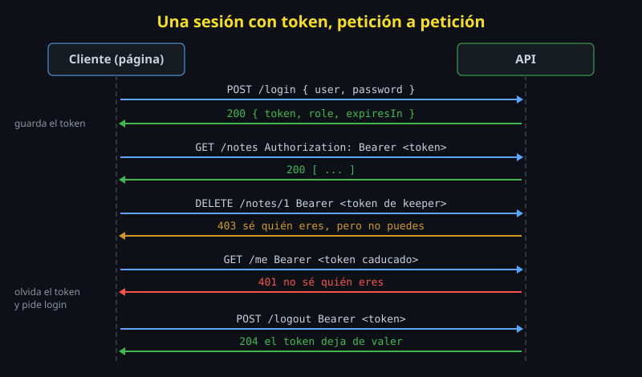

# 🔐 Autenticación con token

## 🎯 Objetivos

- Distinguir autenticación (quién eres) de autorización (qué puedes hacer), y `401` de `403`.
- Recorrer una sesión con token: inicio de sesión, token en cada petición, caducidad y cierre.
- Saber qué hay dentro de un token (opaco o JWT) y qué no debe haber.
- Elegir dónde guardar el token en el navegador y conocer el riesgo de cada opción.
- Centralizar el token en el cliente para no repetirlo en cada petición.

En la [semana 15](../../week-15-fetch_api/1-teoria/03-headers-config.md) enviaste una cabecera `Authorization` con un token que ya tenías. Esta semana ves de dónde sale ese token, cuánto dura, dónde se guarda y qué hace el cliente cuando deja de valer.

---

## 📋 Contenido

### 1. Autenticación y autorización

Son dos preguntas distintas que la API se hace en cada petición protegida:

| | Pregunta | Si falla | Ejemplo |
|---|---|---|---|
| **Autenticación** | ¿Quién eres? | `401 Unauthorized` | No hay token, está mal escrito o ha caducado |
| **Autorización** | ¿Puedes hacer esto? | `403 Forbidden` | El token es de ana, con rol `keeper`, y borrar notas es cosa de `admin` |

El nombre `401 Unauthorized` es confuso por motivos históricos: significa «no autenticado». La reacción del cliente es distinta en cada caso: ante un `401`, pedir que inicie sesión; ante un `403`, avisar de que no tiene permiso, porque volver a iniciar sesión con la misma cuenta no lo arregla.

### 2. Una sesión con token

Como las APIs REST no tienen estado ([teoría 01](01-diseno-rest.md)), el servidor no recuerda que ya te identificaste. La solución es un **token**: un texto que el servidor da al iniciar sesión y que el cliente envía en cada petición.



1. **Inicio de sesión.** `POST /login` con el usuario y la contraseña en el cuerpo JSON. Si son correctos, la respuesta trae el token y cuánto dura (`expiresIn`, en segundos).
2. **Peticiones.** Cada petición protegida lleva la cabecera `Authorization: Bearer <token>`. *Bearer* significa «portador»: quien lleve el token tiene acceso, igual que quien lleva una entrada de concierto.
3. **Caducidad.** Pasado `expiresIn`, el token deja de valer y la API responde `401`. El cliente olvida el token y pide iniciar sesión otra vez.
4. **Cierre de sesión.** `POST /logout` con el token. El servidor lo invalida: aunque alguien lo hubiera copiado, ya no sirve. Después, el cliente lo borra.

- **Qué:** una credencial temporal en lugar de la contraseña.
- **Para qué:** la contraseña viaja una sola vez; el resto de peticiones llevan algo que caduca y se puede revocar.
- **Impacto:** si roban un token, el daño dura hasta que caduca o se cierra la sesión. Si robaran la contraseña, duraría hasta que la cambiaras.

Muchas APIs añaden un segundo token, el *refresh token*, que dura más y solo sirve para pedir un token nuevo sin volver a escribir la contraseña. La idea es la misma, con un paso más.

### 3. Qué hay dentro de un token

Hay dos tipos:

- **Opaco:** un texto aleatorio (como `3f9c2b6e-...`) sin significado. El servidor guarda a qué sesión corresponde. Es el que usa el servidor del proyecto, con `crypto.randomUUID()`.
- **JWT** (*JSON Web Token*): tres partes en Base64URL separadas por puntos: cabecera, datos (*payload*) y firma. El servidor no necesita guardarlo, porque la firma demuestra que lo emitió él.

Los datos de un JWT **se leen sin ninguna clave**: van codificados, no cifrados.

```javascript
const token = 'eyJhbGciOiJIUzI1NiIsInR5cCI6IkpXVCJ9.eyJzdWIiOiJhbmEiLCJyb2xlIjoia2VlcGVyIiwiZXhwIjoxNzk4NzYxNjAwfQ.firma';
const [, payload] = token.split('.');
console.log(JSON.parse(atob(payload.replaceAll('-', '+').replaceAll('_', '/'))));
// { sub: 'ana', role: 'keeper', exp: 1798761600 }
```

`atob` decodifica Base64; los `replaceAll` pasan de Base64URL (que usa `-` y `_` para poder ir en URLs) a Base64. `exp` es la fecha de caducidad en segundos desde 1970: `new Date(1798761600 * 1000)` es el 1 de enero de 2027.

- **Qué:** el cliente puede leer un JWT, pero no cambiarlo sin romper la firma.
- **Para qué:** mostrar el nombre o saber cuándo caduca sin preguntar a la API.
- **Impacto:** un JWT nunca debe llevar datos secretos (contraseñas, datos personales sensibles), porque cualquiera que lo vea puede leerlos.

### 4. Otras formas de autenticarse

| Forma | Cabecera | Cuándo se usa |
|---|---|---|
| Token *Bearer* | `Authorization: Bearer <token>` | Lo habitual en APIs con usuarios que inician sesión |
| Autenticación básica | `Authorization: Basic <usuario:contraseña en Base64>` | Herramientas internas y pruebas; envía la contraseña en **cada** petición |
| Clave de API | `X-API-Key: <clave>` (el nombre varía) | Servicios que se usan desde un servidor, no desde el navegador |
| Cookie de sesión | `Cookie: session=...`, que pone y envía el navegador | Webs clásicas y APIs en el mismo dominio que la página |

La autenticación básica no cifra nada: Base64 se deshace con `atob`.

```javascript
console.log(btoa('ana:coral'));
// YW5hOmNvcmFs
```

Una clave de API en el código de una página la puede ver cualquiera con las DevTools: si una API pide clave, la llamada se hace desde un servidor propio, nunca desde el navegador.

### 5. Dónde guardar el token en el navegador

| Dónde | Dura | Riesgo |
|---|---|---|
| Una **variable** en memoria | Hasta recargar la página | El más bajo: ningún otro script la ve. Recargar obliga a iniciar sesión otra vez |
| `sessionStorage` | Hasta cerrar la pestaña | Cualquier script de la página puede leerlo |
| `localStorage` | Para siempre, hasta borrarlo | Cualquier script de la página puede leerlo, también días después |
| Cookie `HttpOnly` | Lo que diga el servidor | JavaScript no puede leerla; el navegador la envía sola (con `credentials: 'include'` en `fetch`). El servidor debe protegerse de peticiones falsificadas desde otras webs (CSRF) |

El riesgo de `localStorage` se llama **XSS** (*Cross-Site Scripting*): si un atacante consigue ejecutar JavaScript en tu página (por ejemplo, porque pintas con `innerHTML` un texto que no has escapado), ese código puede leer el token y enviarlo fuera. Por eso el `main.js` del proyecto escapa todo lo que pinta y guarda el token solo en una variable.

Reglas que valen en cualquier caso:

1. **Siempre HTTPS.** Sin cifrado, cualquiera en la misma red ve el token y la contraseña.
2. **Nunca en la URL** (`?token=...`): las URLs se guardan en el historial, en los registros de los servidores y en la cabecera `Referer`.
3. **Nunca en el código ni en el repositorio**, ni en `console.log`.
4. **Mensajes de inicio de sesión genéricos:** «Usuario o contraseña incorrectos», sin decir cuál de los dos falla, para no ayudar a quien prueba contraseñas.

### 6. Un solo sitio para el token

Si cada petición añade la cabecera a mano, tarde o temprano una se olvida. Lo habitual es una función que hace todas las peticiones y lee el token en el momento de enviar:

```javascript
const headers = { Accept: 'application/json' };
const token = getToken(); // se lee en cada petición: puede haber cambiado
if (token) headers.Authorization = `Bearer ${token}`;
```

La misma función es el sitio natural para reaccionar a un `401`: olvidar el token y avisar a la página para que muestre el formulario de inicio de sesión. El [lab 03](../2-practicas/lab-03-autenticacion/README.md), paso 7, lo hace con un cliente que guarda el token en una clausura, y el proyecto lo hace con `createApi`, que recibe `getToken` y `onUnauthorized` como opciones.

---

## 🧪 Pruébalo

El [lab 03](../2-practicas/lab-03-autenticacion/README.md) inicia sesión, usa el token, provoca un `403`, escribe mal la cabecera, deja caducar un token y cierra la sesión.

## ✅ Checklist de aprendizaje

- [ ] Sé explicar la diferencia entre `401` y `403` y qué hace el cliente en cada caso.
- [ ] Sé enviar un token con `Authorization: Bearer`.
- [ ] Sé por qué la contraseña va en el cuerpo de `POST /login` y nunca en la URL.
- [ ] Sé leer el *payload* de un JWT y por qué no debe llevar secretos.
- [ ] Conozco el riesgo de guardar el token en `localStorage` y qué alternativas hay.
- [ ] Sé por qué conviene que una sola función añada el token a todas las peticiones.

<!-- nav -->
---

## 🔗 Navegación

| Anterior | Siguiente |
|---|---|
| ← [Teoría — 📑 Paginación, filtros y orden](02-paginacion-filtros.md) | [Teoría — ⏳ Estados de carga](04-estados-carga.md) → |

[↑ Semana 16](../README.md)
