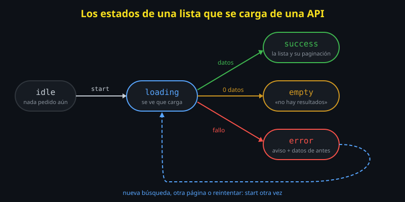

# ⏳ Estados de carga

## 🎯 Objetivos

- Guardar el estado de una petición en un solo objeto con un campo `status`, en lugar de varios booleanos.
- Describir los estados `idle`, `loading`, `success`, `empty` y `error`, y qué muestra la página en cada uno.
- Calcular el estado siguiente con una función pura (un reductor).
- Evitar los envíos dobles y las condiciones de carrera entre peticiones.
- Decidir entre una actualización optimista y una pesimista, y deshacer la optimista si falla.

Una petición tarda: unos milisegundos en tu equipo, varios segundos en un móvil con mala cobertura. Durante ese tiempo la página tiene que decir algo, y cuando la respuesta llega (o no llega) tiene que mostrar lo correcto. Este archivo trata de cómo organizar eso sin que la interfaz se contradiga.

---

## 📋 Contenido

### 1. Un estado, no varios booleanos

Una forma habitual de empezar es con banderas sueltas:

```javascript
let isLoading = false;
let hasError = false;
let items = [];
```

Con dos booleanos hay cuatro combinaciones, y una no tiene sentido: `isLoading` y `hasError` a la vez. Basta con olvidar un `hasError = false` en algún sitio para que la página muestre el indicador de carga y un error al mismo tiempo.

La alternativa es un objeto con un campo `status` que solo puede tener un valor a la vez:

```javascript
let state = { status: 'idle', data: [], error: null };
```

| `status` | Qué ha pasado | Qué muestra la página |
|---|---|---|
| `idle` | Todavía no se ha pedido nada | El formulario de búsqueda, sin resultados |
| `loading` | Hay una petición en curso | Un indicador de carga; el botón deshabilitado; la lista anterior, atenuada |
| `success` | Han llegado datos | La lista y su paginación |
| `empty` | La petición ha ido bien, pero sin resultados | «No hay especies con ese nombre» |
| `error` | La petición ha fallado | El mensaje de error y, si los había, los datos de antes |



- **Qué:** un solo campo decide qué se ve.
- **Para qué:** las combinaciones imposibles dejan de existir, y `render()` se reduce a mirar `status`.
- **Impacto:** cada cambio en la página pasa por un cambio de estado que se puede imprimir y comprobar, como hace el [lab 04](../2-practicas/lab-04-estados-carga/README.md).

Dos detalles que separan una buena interfaz de una regular:

- **`empty` no es `error`.** Una búsqueda sin resultados respondió `200`: merece un mensaje propio, no una lista en blanco ni un aviso rojo.
- **`error` conserva los datos.** Si falla la recarga, la lista de antes sigue siendo útil. Vaciarla obliga a quien usa la página a empezar de nuevo.

### 2. El estado siguiente, con una función pura

Si el estado se cambia en muchos sitios (`state.status = 'loading'` aquí, `state.data = ...` allí), es fácil dejarlo a medias. Un **reductor** concentra todos los cambios en una función pura que recibe el estado actual y un **evento** (qué ha pasado) y devuelve el estado nuevo, sin modificar el anterior:

```javascript
// Estado de un formulario de contacto: idle → sending → sent o error.
const reduceForm = (state, event) => {
  switch (event.type) {
    case 'submit':
      return { ...state, status: 'sending', error: null };
    case 'sent':
      return { ...state, status: 'sent' };
    case 'failed':
      return { ...state, status: 'error', error: event.message };
    default:
      return state;
  }
};

let form = { status: 'idle', error: null };
form = reduceForm(form, { type: 'submit' });
form = reduceForm(form, { type: 'failed', message: 'Sin conexión' });
```

- El `{ ...state, ... }` (semana 04) copia el estado y cambia solo lo necesario: el anterior queda intacto.
- Un evento desconocido devuelve el **mismo** estado: no hay cambio.
- Como no toca el DOM ni hace peticiones, el reductor se prueba con Node pasándole estados y eventos. Es lo que hacen las comprobaciones del proyecto con su `reduce`.

Este patrón es el corazón de librerías como Redux y del `useReducer` de React. Aquí lo usas sin ninguna librería.

### 3. Evitar los envíos dobles

Un doble clic en «Guardar» lanza dos `POST`, y `POST` no es idempotente ([teoría 01](01-diseno-rest.md)): se crean dos fichas. Dos defensas, mejor juntas:

1. **Deshabilitar el botón** mientras dura la petición (`button.disabled = true`, y `false` en el `finally`). Se ve, y el navegador ignora los clics.
2. **Comprobar el estado** al empezar: si ya está en `loading`, no hacer nada.

```javascript
const save = async () => {
  if (state.status === 'loading') return;
  // ...
};
```

### 4. Condiciones de carrera

Un buscador que pide resultados mientras escribes lanza una petición por tecla. Las respuestas no tienen por qué llegar en el orden en que salieron: si la de `"pe"` tarda más que la de `"pez l"`, llega después y sobrescribe la lista buena. El campo dice `"pez l"` y la lista es la de `"pe"`. Esto es una **condición de carrera**: el resultado depende de qué termina antes, algo que el código no controla.

Hay dos soluciones:

**Cancelar la petición anterior** con `AbortController` ([semana 15](../../week-15-fetch_api/1-teoria/03-headers-config.md)). Cada búsqueda aborta la anterior; la vieja se rechaza con un `AbortError`, que se ignora. Además ahorra red: el servidor deja de enviar una respuesta que nadie quiere.

```javascript
let controller = null;
const search = async (text) => {
  controller?.abort();
  controller = new AbortController();
  try {
    const data = await fetchSpecies({ search: text }, controller.signal);
    render(data);
  } catch (error) {
    if (error.name !== 'AbortError') showError(error);
  }
};
```

**Ignorar las respuestas viejas** con un contador. Cada búsqueda guarda su número; cuando llega la respuesta, solo se usa si sigue siendo la última. Sirve cuando la petición no se puede cancelar.

```javascript
let lastRequest = 0;
const search = async (text) => {
  lastRequest += 1;
  const current = lastRequest;
  const data = await fetchSpecies({ search: text });
  if (current !== lastRequest) return; // llegó tarde: ya hay otra búsqueda más nueva
  render(data);
};
```

Para no lanzar una petición por tecla, muchas páginas esperan además a que se deje de escribir un momento (*debounce*):

```javascript
let timer;
input.addEventListener('input', () => {
  clearTimeout(timer);
  timer = setTimeout(() => search(input.value), 300); // solo si pasan 300 ms sin teclear
});
```

El *debounce* reduce las peticiones, pero no evita la carrera: dos búsquedas separadas por más de 300 ms también pueden llegar al revés. Hace falta una de las dos soluciones anteriores.

### 5. Actualizaciones optimistas y pesimistas

Al borrar una ficha, la página puede hacer dos cosas:

| | Pesimista | Optimista |
|---|---|---|
| Qué hace | Espera la respuesta y después quita la ficha | Quita la ficha al instante y después envía la petición |
| Cómo se siente | Lenta: un instante de espera en cada acción | Inmediata |
| Si la API falla | No hay nada que deshacer: se muestra el error | Hay que **deshacer**: devolver la ficha y explicar por qué |
| Encaja en | Pagos, envíos, acciones que no se pueden deshacer | Borrar de una lista, marcar favoritos, reordenar: cosas que casi siempre salen bien |

La actualización optimista necesita guardar el estado de antes para poder volver a él:

```javascript
const previous = state.data;
setState({ data: previous.filter((item) => item.id !== id) });
const response = await fetch(`${API}/species/${id}`, { method: 'DELETE' });
if (!response.ok) setState({ data: previous, error: 'No se pudo borrar' });
```

Si `fetch` se rechaza (sin conexión), este código no llega al `if`. En una página real va dentro de un `try`/`catch` que también deshace el cambio; el [lab 04](../2-practicas/lab-04-estados-carga/README.md) lo deja como pregunta de comprobación.

### 6. Estados accesibles

Un indicador de carga que solo se ve no llega a quien usa un lector de pantalla. Tres atributos HTML lo arreglan:

- `role="status"` en el elemento de los mensajes: el lector anuncia sus cambios sin mover el foco.
- `aria-busy="true"` en la lista mientras carga, y `false` al terminar.
- `disabled` en los botones que no se pueden usar, en lugar de solo cambiarles el color.

---

## 🧪 Pruébalo

El [lab 04](../2-practicas/lab-04-estados-carga/README.md) imprime cada cambio de estado de una lista: carga, vacío, error con datos, doble clic, condición de carrera y su arreglo, y un borrado optimista que vuelve atrás.

## ✅ Checklist de aprendizaje

- [ ] Sé qué combinación imposible aparece con `isLoading` y `hasError`, y cómo la evita `status`.
- [ ] Sé qué muestra la página en cada uno de los cinco estados.
- [ ] Sé escribir un reductor que no modifica el estado que recibe.
- [ ] Sé dos formas de evitar un envío doble.
- [ ] Sé explicar una condición de carrera entre búsquedas y dos formas de evitarla.
- [ ] Sé cuándo conviene una actualización optimista y qué hay que guardar para deshacerla.

<!-- nav -->
---

## 🔗 Navegación

| Anterior | Siguiente |
|---|---|
| ← [Teoría — 🔐 Autenticación con token](03-autenticacion.md) | [Índice de labs](../2-practicas/README.md) → |

[↑ Semana 16](../README.md)
