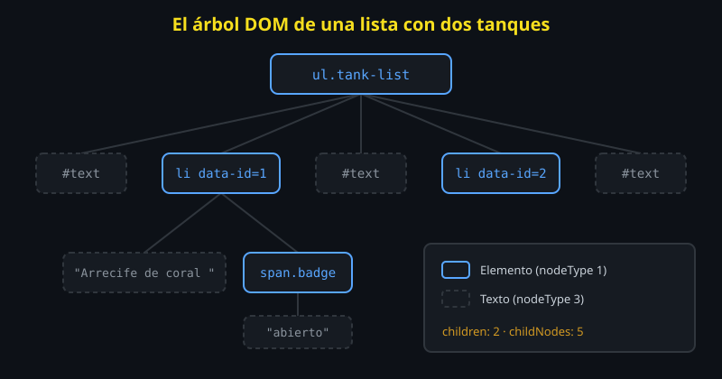

# 🌳 El árbol y la selección

## 🎯 Objetivos

- Explicar qué es el DOM y cómo convierte el navegador el HTML en un árbol de nodos.
- Distinguir nodos de elementos, y colecciones estáticas de colecciones vivas.
- Seleccionar elementos con `querySelector` y `querySelectorAll`, dentro de la página o de un elemento.
- Moverte por el árbol con `parentElement`, `children`, los hermanos, `closest` y `matches`.
- Guardar y leer datos propios en el HTML con `data-*` y `dataset`.

Hasta ahora, el `main.js` de los proyectos venía hecho: tú completabas `logic.js` y él pintaba el resultado en la página. Esta semana aprendes lo que hace `main.js`. El primer paso es encontrar los elementos que quieres cambiar.

---

## 📋 Contenido

### 1. Qué es el DOM

Cuando el navegador carga una página, lee el HTML y construye en memoria un árbol de objetos: el **DOM** (*Document Object Model*). Cada etiqueta es un objeto con propiedades y métodos, y JavaScript puede leerlo y cambiarlo. Si cambias el DOM, la página cambia en pantalla: no tocas el archivo HTML, sino el árbol que el navegador construyó a partir de él.

```html
<ul class="tank-list">
  <li class="tank" data-id="1">Arrecife de coral <span class="badge">abierto</span></li>
  <li class="tank is-closed" data-id="2">Océano abierto <span class="badge">cerrado</span></li>
</ul>
```



En JavaScript del navegador hay una variable global, `document`, que es la raíz de ese árbol. Desde ella llegas a cualquier elemento: `document.documentElement` es `<html>`, y `document.body`, el `<body>`.

### 2. Nodos y elementos

Todo lo que hay en el árbol es un **nodo**, y hay varios tipos. Los que más vas a ver:

| Tipo | `nodeType` | Qué es |
|---|---|---|
| Elemento | `1` | Una etiqueta: `<li>`, `<span>` |
| Texto | `3` | El texto de dentro de una etiqueta, también los espacios y saltos de línea entre etiquetas |
| Comentario | `8` | Un `<!-- comentario -->` |

Como el HTML tiene saltos de línea entre los `<li>`, la lista del diagrama tiene más nodos que elementos. Por eso hay dos familias de propiedades:

| Todos los nodos | Solo elementos |
|---|---|
| `childNodes` | `children` |
| `firstChild`, `lastChild` | `firstElementChild`, `lastElementChild` |
| `previousSibling`, `nextSibling` | `previousElementSibling`, `nextElementSibling` |
| `parentNode` | `parentElement` |

Casi siempre quieres las de la columna de la derecha. El [lab 01](../2-practicas/lab-01-arbol-seleccion/README.md) cuenta 7 nodos y 3 elementos en una lista de 3 `<li>`.

### 3. `querySelector` y `querySelectorAll`

Los dos reciben un **selector CSS**, el mismo que escribirías en una hoja de estilos:

```js
document.querySelector('.tank');                            // el primero con clase tank
document.querySelector('#tanks');                           // el de id="tanks"
document.querySelector('[data-id="2"]');                    // por atributo
document.querySelector('.tank:not(.is-closed)');            // tank, pero sin is-closed
document.querySelector('#tanks h2');                        // un h2 dentro de #tanks
document.querySelectorAll('.tank');                         // todos los que tienen clase tank
```

- `querySelector` devuelve el primer elemento que encaja, en el orden del HTML, o `null` si no hay ninguno.
- `querySelectorAll` devuelve una `NodeList` con todos, vacía si no hay ninguno. Tiene `length`, `forEach` y se puede recorrer con `for...of`, pero no tiene `map` ni `filter`: conviértela en array con `Array.from(lista)` o `[...lista]` (semana 05).

Los dos se pueden llamar sobre cualquier elemento, y entonces solo buscan dentro de él. Es más rápido y evita encontrar un elemento de otra parte de la página que tenga la misma clase:

```js
const section = document.querySelector('#tanks');
const title = section.querySelector('h2');
```

Hay métodos más antiguos que buscan por un solo criterio: `getElementById('tanks')` (sin `#`), `getElementsByClassName('tank')` y `getElementsByTagName('li')`. `getElementById` sigue siendo habitual; para lo demás, `querySelector` cubre todos los casos con la misma sintaxis.

### 4. Colecciones estáticas y vivas

La `NodeList` de `querySelectorAll` es **estática**: una foto del momento en que la pides. Si después añades o quitas elementos, no cambia. `getElementsByClassName` y `children` devuelven una `HTMLCollection` **viva**, que se actualiza sola.

| Devuelve | Colección | Se actualiza sola |
|---|---|---|
| `querySelectorAll(...)` | `NodeList` | No |
| `childNodes` | `NodeList` | Sí |
| `children`, `getElementsByClassName(...)` | `HTMLCollection` | Sí |

Una colección viva sorprende al recorrerla mientras quitas elementos: cada vez que quitas uno, los demás cambian de posición y te saltas alguno. Si vas a cambiar la página dentro del bucle, recorre una lista estática o un array.

### 5. Moverse por el árbol

Desde un elemento llegas a sus vecinos sin volver a buscar en todo el documento:

```js
const ocean = document.querySelector('[data-id="2"]');
ocean.parentElement;           // el <ul>
ocean.previousElementSibling;  // el <li> de data-id="1"
ocean.firstElementChild;       // su <span class="badge">
```

Dos métodos sirven para preguntar con un selector:

- `elemento.matches(selector)` dice si el elemento encaja: `ocean.matches('.is-closed')` es `true`.
- `elemento.closest(selector)` sube desde el elemento, **empezando por él mismo**, por sus antepasados hasta el primero que encaja, o `null`. Desde el `<span>` de un tanque, `closest('.tank')` da el `<li>` que lo contiene.

`closest` es la forma habitual de pasar de «el elemento donde se ha hecho clic» a «la ficha a la que pertenece». La [semana 18](../../week-18-event_handling_avanzado/README.md) lo usa para la delegación de eventos.

### 6. `data-*` y `dataset`

Los atributos que empiezan por `data-` son para tus propios datos: el HTML los permite en cualquier elemento y el navegador no hace nada con ellos. Sirven para guardar en cada elemento el `id` del dato que representa.

`dataset` los da sin el prefijo y con los guiones pasados a *camelCase*:

| HTML | JavaScript |
|---|---|
| `data-id="1"` | `element.dataset.id` |
| `data-last-check="2026-11-02"` | `element.dataset.lastCheck` |

Todo lo que se lee de `dataset` es texto, aunque escribas un número: `dataset.id` es `'1'`, no `1`. Para compararlo con el `id` de un objeto, conviértelo con `Number(element.dataset.id)`.

Una ventaja más: un selector por atributo (`[data-id="2"]`) no se rompe si cambias las clases, que suelen cambiar por razones de estilo.

### 7. Cuándo existe el árbol

Un `<script>` normal en el `<head>` se ejecuta en cuanto el navegador lo encuentra, antes de leer el `<body>`. En ese momento `document.querySelector('.tank')` da `null`. Hay tres formas de evitarlo:

| Forma | Qué hace |
|---|---|
| `<script src="main.js" defer>` | Descarga el script en paralelo y lo ejecuta cuando el HTML ya está leído |
| `<script type="module" src="main.js">` | Los módulos ES se comportan como `defer` sin escribirlo |
| `<script>` al final del `<body>` | Cuando llega, el resto de la página ya está leída |

Los labs usan `defer`; los proyectos usan `type="module"`, que además permite `import` (semana 04). Un módulo no carga desde un archivo abierto con doble clic: necesita un servidor (`file://` frente a `http://`), por eso el proyecto se abre con `node server.js`.

### 8. Selección sin sorpresas

`querySelector` devuelve `null` en silencio, y el error aparece más tarde, en otra línea: `Cannot read properties of null (reading 'textContent')`. Tres costumbres lo evitan:

- **Selecciona una vez**, al principio del archivo, y guarda cada elemento en una constante con nombre (`const list = document.querySelector('#list')`).
- **Comprueba lo que es obligatorio**: una función como `must(selector)` del lab 01 lanza un error con el selector que ha fallado.
- **Usa `form.elements`** para los campos de un formulario: `form.elements.q` es el campo con `name="q"`.

---

## 🧪 Pruébalo

El [lab 01](../2-practicas/lab-01-arbol-seleccion/README.md) recorre este archivo sobre la página de un acuario: nodos y elementos, `querySelector` dentro de una sección, una `NodeList` frente a una `HTMLCollection`, `closest` y `dataset`.

## ✅ Checklist de aprendizaje

- [ ] Sé explicar qué es el DOM y por qué cambiarlo cambia la página.
- [ ] Sé por qué `childNodes` y `children` dan longitudes distintas.
- [ ] Escribo un selector por clase, por id, por atributo y dentro de otro elemento.
- [ ] Sé qué devuelve `querySelector` cuando no encuentra nada y cómo convertir una `NodeList` en array.
- [ ] Distingo una colección estática de una viva.
- [ ] Uso `closest` para llegar desde un elemento a la ficha que lo contiene.
- [ ] Leo y escribo `data-*` con `dataset` y sé que sus valores son texto.

<!-- nav -->
---

## 🔗 Navegación

| Anterior | Siguiente |
|---|---|
| ← [Semana 17 - DOM Manipulation Moderna](../README.md) | [Teoría — 🧱 Crear, insertar y quitar nodos](02-crear-insertar.md) → |

[↑ Semana 17](../README.md)
