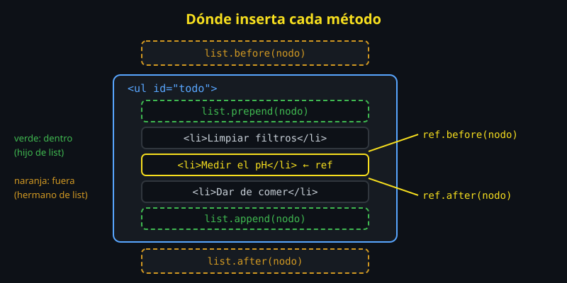

# 🧱 Crear, insertar y quitar nodos

## 🎯 Objetivos

- Crear elementos con `createElement` y darles contenido y atributos antes de insertarlos.
- Elegir el método de inserción según el sitio: `append`, `prepend`, `before`, `after`.
- Entender que insertar un nodo que ya está en la página lo mueve, y copiarlo con `cloneNode` cuando quieres dos.
- Quitar y sustituir con `remove`, `replaceWith` y `replaceChildren`.
- Insertar muchos nodos con un solo cambio con `DocumentFragment` o `replaceChildren(...nodos)`.

---

## 📋 Contenido

### 1. Crear un elemento

`document.createElement(etiqueta)` crea un elemento vacío. Existe en memoria pero no en la página: no se ve hasta que lo insertas dentro de un elemento que sí está en ella.

```js
const item = document.createElement('li');
item.textContent = 'Dar de comer';
item.dataset.id = '7';
item.classList.add('task');

document.querySelector('#todo').append(item);
```

Lo normal es prepararlo entero (texto, atributos y clases) y después insertarlo: así la página cambia una sola vez. Encapsular esos pasos en una función que devuelve el elemento, como `makeItem(text)` en el [lab 02](../2-practicas/lab-02-crear-insertar/README.md), permite crear muchos iguales.

`document.createTextNode('texto')` crea un nodo de texto suelto. Casi nunca hace falta: `textContent` y `append('texto')` crean el nodo de texto por ti.

### 2. Dónde insertar

Cuatro métodos cubren las cuatro posiciones alrededor de un elemento. Los dos primeros insertan **dentro**; los otros dos, **al lado**, como hermanos:



```js
list.prepend(a);       // primer hijo de list
list.append(b);        // último hijo de list
reference.before(c);   // justo antes de reference
reference.after(d);    // justo después de reference
```

Los cuatro aceptan varios argumentos y textos además de nodos: `list.append(a, b, 'texto')`. Son los métodos modernos. En código antiguo verás `appendChild(nodo)` (uno solo, devuelve el nodo) e `insertBefore(nodo, referencia)`, que se llama sobre el padre.

Existe también `insertAdjacentHTML(posición, html)`, que inserta HTML escrito como texto. Tiene el mismo problema de seguridad que `innerHTML` ([teoría 03](03-contenido-clases.md)).

### 3. Un nodo solo está en un sitio

Si insertas un nodo que ya está en la página, el navegador lo **mueve**: lo quita de donde estaba y lo pone en el sitio nuevo. No hay copia.

```js
done.append(todo.firstElementChild); // pasa de la lista todo a la lista done
```

Esto sirve para reordenar sin crear nada: para ordenar una lista, puedes ordenar sus elementos en un array y volver a hacer `append` de cada uno en el orden nuevo.

Mover tiene un efecto que se nota: durante el movimiento, el nodo sale un momento de la página y pierde el foco si lo tenía. El [lab 04](../2-practicas/lab-04-plantillas-render/README.md) lo mide.

### 4. Copiar con `cloneNode`

Para tener el mismo elemento dos veces hay que copiarlo:

| Llamada | Copia |
|---|---|
| `element.cloneNode()` | El elemento y sus atributos, sin hijos (ni su texto) |
| `element.cloneNode(true)` | El elemento, sus atributos y todo lo que tiene dentro |

La copia es un nodo nuevo, fuera de la página hasta que la insertas. No copia los listeners de eventos ni las propiedades inventadas que le hayas puesto desde JavaScript (`item.tank = tank`). Y duplica los `id`: si el original tenía uno, cámbialo en la copia, porque un `id` tiene que ser único.

### 5. Quitar y sustituir

```js
item.remove();                     // lo saca de la página
item.replaceWith(otherItem);       // pone otro en su lugar
list.replaceChildren();            // vacía la lista
list.replaceChildren(a, b, c);     // la lista pasa a tener solo a, b y c
```

Un nodo quitado no se destruye: si conservas una variable que apunta a él, puedes volver a insertarlo. El navegador libera la memoria cuando ya nada lo usa.

Antes de `remove` y `replaceChildren` se escribía `parent.removeChild(child)`, o un bucle `while (list.firstChild) list.firstChild.remove()` para vaciar. Y verás mucho `list.innerHTML = ''` para vaciar: funciona, pero `replaceChildren()` dice lo que hace y no pasa por el intérprete de HTML.

### 6. Muchos nodos de una vez

Cada vez que cambias la página, el navegador tiene que recalcular qué se ve. Con unos pocos cambios no importa; con cientos, insertar de uno en uno puede hacer que la página tarde en responder. Dos herramientas agrupan los cambios:

- **`DocumentFragment`**: un contenedor que no está en la página. Montas todo dentro y lo insertas con un `append`. Al insertarlo, sus hijos se mueven a la página y el fragmento queda vacío.

  ```js
  const fragment = document.createDocumentFragment();
  for (const task of tasks) fragment.append(makeItem(task));
  list.append(fragment); // un solo cambio
  ```

- **`replaceChildren(...nodos)`**: con *spread* (`...`) le pasas un array de nodos, y sustituye todo el contenido en un solo cambio. Es la forma más corta de pintar una lista a partir de un array:

  ```js
  list.replaceChildren(...tasks.map(makeItem));
  ```

El lab 02 lo comprueba con un `MutationObserver`, un objeto que anota cada cambio en un elemento: tres `append` son 3 cambios; el fragmento o `replaceChildren`, 1.

---

## 🧪 Pruébalo

El [lab 02](../2-practicas/lab-02-crear-insertar/README.md) usa dos listas de tareas para crear, insertar en cada posición, mover entre listas, copiar, quitar y sustituir, y contar los cambios con y sin fragmento.

## ✅ Checklist de aprendizaje

- [ ] Creo un elemento completo (texto, clase y `data-*`) antes de insertarlo.
- [ ] Sé qué hacen `append`, `prepend`, `before` y `after` y sobre qué elemento se llama cada uno.
- [ ] Sé qué pasa al hacer `append` de un elemento que ya está en la página.
- [ ] Distingo `cloneNode()` de `cloneNode(true)` y sé qué no copia ninguno de los dos.
- [ ] Vacío o sustituyo el contenido de un contenedor con `replaceChildren`.
- [ ] Sé cuándo compensa un `DocumentFragment`.

<!-- nav -->
---

## 🔗 Navegación

| Anterior | Siguiente |
|---|---|
| ← [Teoría — 🌳 El árbol y la selección](01-arbol-seleccion.md) | [Teoría — 🎨 Contenido, atributos y clases](03-contenido-clases.md) → |

[↑ Semana 17](../README.md)
