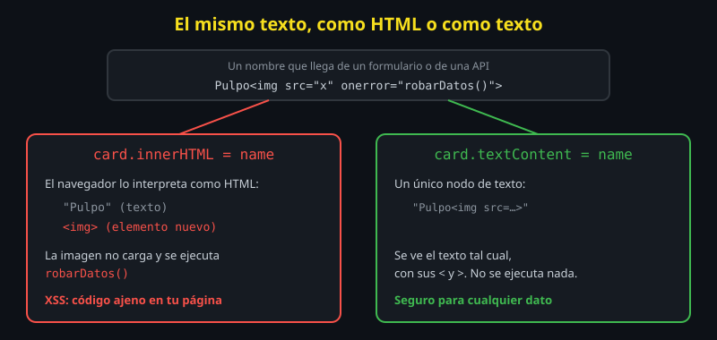

# 🎨 Contenido, atributos y clases

## 🎯 Objetivos

- Elegir entre `textContent`, `innerText` e `innerHTML` para leer y escribir el contenido de un elemento.
- Explicar qué es un ataque XSS y por qué un texto que no has escrito tú nunca va en `innerHTML`.
- Distinguir un atributo de una propiedad, sobre todo en los campos de formulario.
- Pintar estados con `classList`, `hidden` y atributos `aria-*`, a partir de un único dato.
- Cambiar estilos desde JavaScript con clases y variables CSS en lugar de `style`.

---

## 📋 Contenido

### 1. Tres formas de leer el contenido

| Propiedad | Devuelve | Ojo |
|---|---|---|
| `textContent` | Todo el texto de dentro, también el de elementos ocultos y los espacios del HTML | Es la más rápida |
| `innerText` | El texto tal como se ve en pantalla | Tiene que calcular los estilos para saber qué está oculto |
| `innerHTML` | El HTML de dentro, como texto con etiquetas | |

Para leer o escribir texto, usa `textContent`. `innerText` solo cuando necesitas exactamente lo que ve quien usa la página.

### 2. Escribir: texto o HTML

```js
note.textContent = 'Come <b>cangrejos</b>'; // se ve tal cual: Come <b>cangrejos</b>
note.innerHTML = 'Come <b>cangrejos</b>';   // se ve: Come cangrejos, con «cangrejos» en negrita
```

Asignar a `textContent` sustituye todo el contenido por un único nodo de texto. Los caracteres `<`, `>` y `&` no tienen ningún significado: se ven como son. Asignar a `innerHTML` pasa el texto por el intérprete de HTML del navegador, que crea los elementos que describe.

### 3. Inyección de HTML (XSS)

Si el texto viene de fuera (un formulario, una API, la URL, el `localStorage`), alguien puede haber escrito HTML con código dentro:



```js
const name = 'Pulpo';
card.innerHTML = name;    // crea un  y, al fallar la imagen, ejecuta robarDatos()
card.textContent = name;  // muestra el texto entero; no se ejecuta nada
```

Esto es un ataque **XSS** (*Cross-Site Scripting*): código ajeno que se ejecuta dentro de tu página, con acceso a todo lo que ella ve, como un token guardado en `localStorage` ([semana 16](../../week-16-apis_rest_crud/1-teoria/03-autenticacion.md)). Una etiqueta `<script>` insertada con `innerHTML` no se ejecuta, pero hay muchas otras formas, como el `onerror` del ejemplo.

La regla: **un dato nunca entra en `innerHTML`**. Para cada dato, `textContent`, `dataset` o `setAttribute`. Si necesitas una estructura con etiquetas, créala con `createElement` o con una plantilla ([teoría 04](04-plantillas-render.md)) y mete los datos con `textContent`.

Si alguna vez tienes que generar HTML como texto (para copiarlo, para un correo), **escapa** cada dato: sustituye los cinco caracteres con significado en HTML por su entidad, que se ve igual pero no se interpreta.

```js
const escapeHtml = (text) => String(text)
  .replaceAll('&', '&amp;')
  .replaceAll('<', '&lt;')
  .replaceAll('>', '&gt;')
  .replaceAll('"', '&quot;')
  .replaceAll("'", '&#39;');
```

El `&` va el primero: si fuera el último, también sustituiría el `&` de los `&lt;` ya puestos. El proyecto de la semana escribe una función así.

### 4. Atributos y propiedades

El **atributo** es lo que pone en el HTML (`<input value="Pulpo">`). La **propiedad** es el valor que tiene ahora el objeto en JavaScript (`input.value`). En la mayoría de atributos van sincronizados: `element.id`, `element.title` o `link.href` leen y escriben el atributo.

En los campos de formulario, no. El atributo guarda el valor inicial y la propiedad, el actual:

| Lo que hay ahora | El valor inicial |
|---|---|
| `input.value` | `input.getAttribute('value')` o `input.defaultValue` |
| `checkbox.checked` | `checkbox.hasAttribute('checked')` o `checkbox.defaultChecked` |
| `select.value` | La `<option selected>` del HTML |

Para saber qué ha escrito o elegido alguien, lee siempre la propiedad.

Para el resto de atributos: `getAttribute(nombre)`, `setAttribute(nombre, valor)`, `hasAttribute(nombre)`, `removeAttribute(nombre)` y `toggleAttribute(nombre, force)`, que pone o quita un atributo sin valor como `disabled` o `hidden`. `setAttribute` convierte el valor en texto: `setAttribute('aria-pressed', true)` escribe `"true"`.

### 5. `classList`

Las clases son la forma de cambiar cómo se ve un elemento: el CSS dice qué aspecto tiene `.is-featured` y JavaScript decide qué elemento la lleva.

```js
card.classList.add('is-featured', 'is-new');
card.classList.remove('is-new');
card.classList.contains('is-featured');           // true
card.classList.toggle('is-closed');               // alterna; devuelve si ha quedado puesta
card.classList.toggle('is-closed', tank.closed);  // la pone si tank.closed es true, la quita si es false
card.classList.replace('is-closed', 'is-open');
```

`className = '...'` sustituye todas las clases a la vez y es fácil borrar alguna sin querer. `classList` cambia una sin tocar las demás.

El `toggle` con segundo argumento (*force*) es el importante: **pinta una clase a partir de un dato**, en lugar de alternarla. Llamarlo dos veces con el mismo dato deja el mismo resultado, así que puedes volver a pintar siempre que quieras sin saber cómo estaba antes.

### 6. Estados accesibles

Una clase cambia lo que se ve, pero un lector de pantalla no lee el CSS. Si el estado importa (un botón activado, un panel abierto, una sección cargando), díselo también con atributos:

| Estado | Atributo |
|---|---|
| Elemento oculto para todos | `hidden` (propiedad `element.hidden = true`) |
| Botón que se activa y desactiva | `aria-pressed="true"` / `"false"` |
| Botón que abre y cierra un panel | `aria-expanded="true"` / `"false"` |
| Zona que se está actualizando | `aria-busy="true"` (semana 16) |
| Control que no se puede usar | `disabled` |

Lo seguro es una función que pinta todo a partir de un único dato, para que la clase, el atributo y el texto no se contradigan:

```js
const setFeatured = (featured) => {
  card.classList.toggle('is-featured', featured);
  button.setAttribute('aria-pressed', String(featured));
  button.textContent = featured ? 'Quitar destacado' : 'Destacar';
};
```

Ojo con `hidden`: una regla CSS con `display` (por ejemplo, `.card { display: flex }`) gana al atributo `hidden` y el elemento sigue viéndose. Si te pasa, añade `[hidden] { display: none !important; }` a la hoja de estilos.

### 7. Estilos desde JavaScript

`element.style` lee y escribe **solo** el atributo `style` del propio elemento: `style.color` está vacío aunque la hoja de estilos le dé color. El valor que se ve de verdad lo da `getComputedStyle(element).color`.

Tres opciones, de más a menos recomendable:

1. **Una clase**, cuando el estado es uno de unos pocos posibles (destacado, cerrado, con error).
2. **Una variable CSS** con `style.setProperty('--accent', color)`, cuando el valor sale de un dato (el color de una categoría, el porcentaje de una barra). El CSS ya sabe dónde usarla: `border-color: var(--accent)`.
3. **`style.propiedad`** directamente, para un caso suelto que no tiene sentido en la hoja de estilos.

---

## 🧪 Pruébalo

El [lab 03](../2-practicas/lab-03-contenido-clases/README.md) lee una ficha con las tres propiedades, provoca una inyección de HTML que cambia el título de la pestaña, compara atributos y propiedades de un formulario, y pinta estados con `classList`, `aria-pressed` y una variable CSS.

## ✅ Checklist de aprendizaje

- [ ] Sé qué devuelve cada una de `textContent`, `innerText` e `innerHTML`.
- [ ] Sé explicar un ataque XSS con un ejemplo y qué propiedad lo evita.
- [ ] Sé escapar un texto para meterlo en HTML y por qué el `&` va primero.
- [ ] Sé por qué `input.value` y `input.getAttribute('value')` pueden dar valores distintos.
- [ ] Uso `classList.toggle(clase, force)` para pintar una clase a partir de un dato.
- [ ] Acompaño los estados visibles con `hidden`, `aria-pressed` o `aria-expanded`.
- [ ] Sé cuándo usar una clase, una variable CSS o `style`.

<!-- nav -->
---

## 🔗 Navegación

| Anterior | Siguiente |
|---|---|
| ← [Teoría — 🧱 Crear, insertar y quitar nodos](02-crear-insertar.md) | [Teoría — 🧩 Plantillas y render](04-plantillas-render.md) → |

[↑ Semana 17](../README.md)
