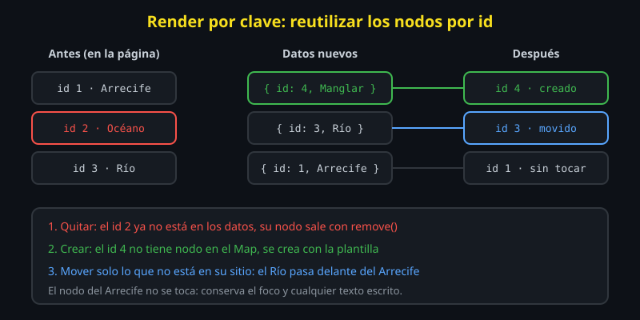

# 🧩 Plantillas y render

## 🎯 Objetivos

- Escribir el HTML de un componente repetido en un `<template>` y clonarlo para cada dato.
- Pintar la página a partir de los datos con una función `render`, sin cambiar la página a mano en otros sitios.
- Saber qué se pierde al volver a crear todos los nodos (foco, texto escrito, listeners) y cuándo importa.
- Reutilizar los nodos existentes con un render por clave.
- Separar la descripción de la interfaz, que es lógica pura y se prueba con Node, del código que toca el DOM.

---

## 📋 Contenido

### 1. Tres formas de construir un componente

Una ficha con un título, un texto y un botón se puede construir de tres maneras:

| Forma | Ventaja | Problema |
|---|---|---|
| `createElement` para cada etiqueta | Seguro: cada dato entra con `textContent` | Muchas líneas; la estructura no se ve |
| Un *template literal* con `innerHTML` | Se lee como HTML | Cada dato sin escapar es un XSS ([teoría 03](03-contenido-clases.md)) |
| Un `<template>` que se clona | Estructura en el HTML y datos con `textContent` | Hay que buscar dentro de la copia cada sitio que se rellena |

La tercera junta lo mejor de las otras dos y es la que usan los labs y el proyecto.

### 2. El elemento `<template>`

```html
<template id="tank-template">
  <li class="tank">
    <h3 class="name"></h3>
    <p class="detail"></p>
    <button type="button" class="feature" aria-pressed="false">Destacar</button>
  </li>
</template>
```

El navegador lee el HTML de un `<template>`, pero no lo muestra ni lo mete en la página: sus imágenes no se cargan, sus scripts no se ejecutan y `document.querySelector('.tank')` no lo encuentra. Lo deja en `template.content`, un `DocumentFragment` (teoría 02).

Para usarlo, se clona y se rellena la copia:

```js
const template = document.querySelector('#tank-template');

const createTank = (tank) => {
  const item = template.content.firstElementChild.cloneNode(true);
  item.dataset.id = tank.id;
  item.querySelector('.name').textContent = tank.name;
  item.querySelector('.detail').textContent = `${tank.species} especies`;
  return item;
};
```

`firstElementChild` es el `<li>`. Clonar el elemento y no el fragmento entero te devuelve el `<li>` directamente, listo para `dataset` y para insertarlo. La plantilla no cambia nunca: cada llamada saca una copia nueva.

### 3. Pintar desde los datos

Si cada botón cambia la página por su cuenta (uno añade un `<li>`, otro quita una clase, otro cambia un texto), en poco tiempo la página y los datos dejan de coincidir. La alternativa es una sola regla:

> Los datos son la única fuente de verdad. Para cambiar la página, cambias los datos y llamas a `render`.

```js
let tanks = [/* ... */];

const render = () => {
  list.replaceChildren(...tanks.map(createTank));
  empty.hidden = tanks.length > 0;
};

const removeTank = (id) => {
  tanks = tanks.filter((tank) => tank.id !== id);
  render();
};
```

`render` no sabe qué ha cambiado ni le hace falta: pinta el estado completo, siempre igual. Es la misma idea que el reductor de la semana 16: un cambio de datos, un render.

### 4. Lo que se pierde al rehacerlo todo

`replaceChildren(...tanks.map(createTank))` crea todos los nodos en cada render y descarta los anteriores. Con unas decenas de elementos es lo bastante rápido, pero los nodos viejos se llevan su estado:

- el **foco**: si el botón con el foco se sustituye, el foco vuelve al `<body>` y quien usa el teclado pierde su sitio;
- el **texto escrito** en un campo que aún no está en los datos;
- la **posición de scroll** de un elemento con scroll propio;
- los **listeners** que se añadieron a mano a los nodos viejos.

Si la lista no tiene nada de eso (solo texto que se lee), rehacerla entera es lo más simple y está bien.

### 5. Render por clave

Cuando importa, reutiliza los nodos. Guarda el nodo de cada dato en un `Map` con una **clave** estable, el `id` del dato, y en cada render:



1. Quita los nodos cuyos `id` ya no están en los datos.
2. Para cada dato, reutiliza su nodo (o crea uno si es nuevo) y actualiza lo que puede haber cambiado.
3. Mueve el nodo a su posición solo si no está ya en ella: mover un elemento lo saca un momento de la página y le quita el foco.

La clave tiene que ser el `id`, no la posición en el array. Si un elemento nuevo entra el primero, todas las posiciones cambian y los nodos se asignarían a datos que no son los suyos.

Es lo que hacen por dentro las librerías de interfaz como React o Vue (la propiedad `key` de sus listas). Aquí lo haces a mano para entender qué problema resuelven.

### 6. Comportamiento en cada nodo

Un botón necesita un *listener*: `addEventListener('click', función)` ejecuta la función cada vez que se hace clic en él. Si los nodos se crean en `createTank`, ahí es donde se añade, así cada nodo nuevo lo trae:

```js
const button = item.querySelector('.feature');
button.addEventListener('click', () => toggleFeatured(tank.id));
```

Funciona, con dos límites: `cloneNode` no copia listeners, y con mil elementos tienes mil listeners. La [semana 18](../../week-18-event_handling_avanzado/README.md) lo resuelve con uno solo en la lista, la delegación de eventos, usando `closest` y `dataset` de la teoría 01.

### 7. Describir antes de montar

Todo lo anterior toca el DOM, que solo existe en el navegador: no se puede probar con Node. Hay una forma de separar la parte que sí se puede probar. En lugar de crear nodos directamente, una función pura **describe** la interfaz con objetos normales:

```js
const cardSpec = (tank) => ({
  tag: 'li',
  props: { class: 'tank', dataset: { id: String(tank.id) } },
  children: [
    { tag: 'h3', props: {}, children: [tank.name] },
    { tag: 'p', props: {}, children: [`${tank.species} especies`] },
  ],
});
```

Y una sola función, `mount(spec)`, convierte cualquier descripción en nodos reales con `createElement`, `textContent`, `classList` y `dataset`. La descripción se puede comparar en una prueba de Node, convertir en HTML escapado o usar para decidir qué nodos han cambiado. Es la idea del proyecto de la semana: tú escribes las descripciones en `logic.js` y `main.js` las monta.

---

## 🧪 Pruébalo

El [lab 04](../2-practicas/lab-04-plantillas-render/README.md) clona una plantilla, pinta una lista desde un array, mide cómo se pierde el foco al rehacerla entera, lo conserva con un render por clave y añade un listener a cada nodo nuevo.

## ✅ Checklist de aprendizaje

- [ ] Sé por qué el contenido de un `<template>` no aparece en la página y dónde está.
- [ ] Clono una plantilla y la relleno con `textContent` y `dataset`.
- [ ] Escribo una función `render` que pinta la página entera a partir de los datos.
- [ ] Sé qué se pierde al volver a crear todos los nodos y cuándo da igual.
- [ ] Sé explicar un render por clave y por qué la clave es el `id` y no la posición.
- [ ] Sé por qué los nodos que ya existían no tienen el listener que añado después.

<!-- nav -->
---

## 🔗 Navegación

| Anterior | Siguiente |
|---|---|
| ← [Teoría — 🎨 Contenido, atributos y clases](03-contenido-clases.md) | [Índice de labs](../2-practicas/README.md) → |

[↑ Semana 17](../README.md)
