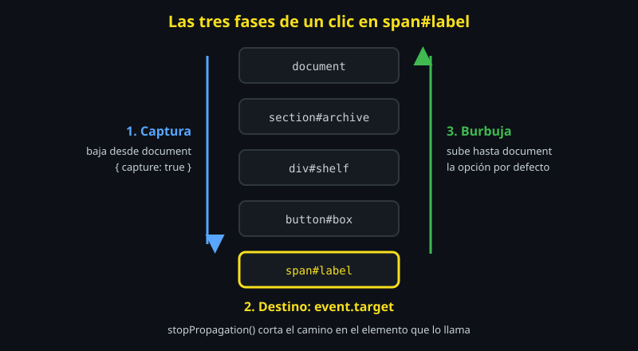

# 🌊 Propagación

## 🎯 Objetivos

- Describir el camino de un evento por el árbol: captura, destino y burbuja.
- Escuchar en la fase de captura y saber cuándo compensa.
- Distinguir `event.target` de `event.currentTarget`.
- Parar la propagación con `stopPropagation` y `stopImmediatePropagation`, y saber por qué casi nunca conviene.
- Reconocer los eventos que no suben y usar sus alternativas.

Un clic en un botón no es solo un clic en el botón. El botón está dentro de un formulario, que está dentro de una sección, que está dentro de `<body>`: el clic también ha ocurrido en todos ellos. Esta teoría explica cómo reparte el navegador un evento entre un elemento y sus antepasados.

---

## 📋 Contenido

### 1. El camino de un evento

Cuando ocurre un evento, el navegador calcula el camino desde `window` hasta el elemento donde ha ocurrido, el **destino** (`event.target`), y lo recorre dos veces:

1. **Captura:** baja desde `window` y `document` hasta el padre del destino.
2. **Destino:** llega al propio elemento.
3. **Burbuja:** sube desde el padre del destino hasta `document` y `window`.



En cada elemento del camino, el navegador llama a los listeners de esa fase. `event.eventPhase` dice en cuál está: `1` captura, `2` destino y `3` burbuja.

### 2. Burbuja: la fase por defecto

Un listener añadido sin opciones escucha en la burbuja. Con este HTML:

```html
<section id="dome">
  <div id="seats">
    <button id="seat" type="button">Butaca <span id="number">14</span></button>
  </div>
</section>
```

Si pones un listener de `click` en los cuatro elementos y haces clic en el número, se ejecutan en este orden: `span` (destino), `button`, `div` y `section`. Si el clic cae en el borde del `div`, fuera del botón, solo lo oyen el `div` y la `section`: un evento sube hacia los antepasados, nunca baja hacia los hijos.

**Qué:** cada antepasado oye los eventos de todo lo que tiene dentro. **Para qué:** un elemento puede atender los eventos de muchos hijos con un solo listener. **Impacto:** es la base de la delegación de la [teoría 03](03-delegacion.md).

### 3. Captura

Con `{ capture: true }`, el listener escucha en la fase de captura, que ocurre antes que la burbuja:

```js
document.addEventListener('click', logClick, { capture: true });
```

Ese listener de `document` se ejecuta **antes** que cualquier listener del botón. La captura sirve cuando un antepasado tiene que enterarse antes que nadie; por ejemplo, para medir todos los clics de la página aunque algún listener pare la burbuja. Para quitar un listener de captura, `removeEventListener` también necesita `{ capture: true }`: para el navegador, el de captura y el de burbuja son dos listeners distintos.

En el destino no hay fases: sus listeners de captura y de burbuja se ejecutan todos en la fase `2`, primero los de captura.

### 4. `target` y `currentTarget`

En un listener de un antepasado, `event.target` y `event.currentTarget` ya no son el mismo elemento:

- `target`: dónde ocurrió el evento. Es el mismo durante todo el camino.
- `currentTarget`: quién está escuchando ahora. Cambia en cada paso.

```js
seats.addEventListener('click', (event) => {
  console.log(event.target.id);        // 'number' si el clic fue en el número
  console.log(event.currentTarget.id); // siempre 'seats'
});
```

El `target` es el elemento más profundo bajo el puntero: si el botón tiene un `<span>` dentro, puede ser el `<span>`. Para llegar al botón desde ahí, `event.target.closest('button')` sube desde el destino hasta el primer botón ([semana 17](../../week-17-dom_manipulation_moderna/1-teoria/01-arbol-seleccion.md)).

### 5. Parar la propagación

`event.stopPropagation()` para el evento en el elemento actual: los siguientes elementos del camino no lo oyen. Los demás listeners del mismo elemento sí se ejecutan. `event.stopImmediatePropagation()` además salta los listeners del mismo elemento que faltaban.

Parece útil, pero rompe código que no ves. Muchas páginas cierran los menús abiertos con un listener de `click` en `document`; si un botón para la burbuja, sus clics no llegan a `document` y el menú se queda abierto. El fallo aparece lejos del `stopPropagation` que lo causa, y en otra parte del código.

Casi siempre hay una alternativa mejor:

- **Mirar dónde fue el clic.** El listener de `document` puede ignorar los clics de dentro del menú con `if (menu.contains(event.target)) return;`.
- **Marcar el evento como atendido.** Un listener llama a `event.preventDefault()` y los demás miran `event.defaultPrevented` ([teoría 04](04-acciones-eventos-propios.md)).

`stopPropagation` no cancela la acción por defecto: un enlace con `stopPropagation` sigue navegando. Eso lo hace `preventDefault`.

### 6. Eventos que no suben

No todos los eventos tienen fase de burbuja. `event.bubbles` dice si la tiene.

| No sube | Alternativa que sí sube |
|---|---|
| `focus` y `blur` | `focusin` y `focusout` |
| `mouseenter` y `mouseleave` | `mouseover` y `mouseout` (también saltan al pasar entre hijos) |
| `load` y `error` de una imagen | Escuchar en captura |

La captura funciona con todos: un listener de `focus` con `{ capture: true }` en un antepasado sí se entera, porque la captura baja por el camino aunque el evento no suba después. `focusin` es la opción habitual para saber, desde un contenedor, qué hijo tiene el foco.

---

## 🧪 Pruébalo

El [lab 02](../2-practicas/lab-02-propagacion/README.md) pone listeners en todos los elementos del camino de un clic, en burbuja y en captura, compara `target` con `currentTarget`, para la propagación de dos formas y compara `focus` con `focusin`.

## ✅ Checklist de aprendizaje

- [ ] Sé en qué orden oyen un clic el destino y sus antepasados, en captura y en burbuja.
- [ ] Sé por qué un clic en un elemento no llega a sus hijos.
- [ ] Distingo `target` de `currentTarget` en un listener de un antepasado.
- [ ] Sé qué rompe `stopPropagation` y qué usar en su lugar.
- [ ] Sé qué eventos no suben y cómo oírlos desde un contenedor.

<!-- nav -->
---

## 🔗 Navegación

| Anterior | Siguiente |
|---|---|
| ← [Teoría — 🎧 Escuchar eventos](01-escuchar-eventos.md) | [Teoría — 🎯 Delegación](03-delegacion.md) → |

[↑ Semana 18](../README.md)
