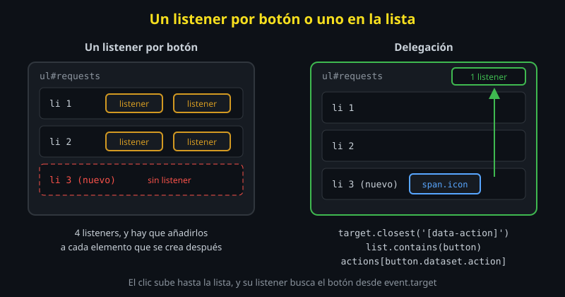

# 🎯 Delegación

## 🎯 Objetivos

- Explicar qué problema tienen los listeners en cada elemento de una lista que cambia.
- Atender los eventos de muchos elementos con un solo listener en su contenedor.
- Encontrar el elemento que importa con `closest` y comprobar que es del contenedor con `contains`.
- Elegir la acción por su nombre con `data-action` y una tabla de funciones.
- Saber qué eventos se pueden delegar y qué hace falta para que funcione con el teclado.

En el [proyecto de la semana 17](../../week-17-dom_manipulation_moderna/3-proyecto/README.md), `createCard` añadía un listener a cada botón de cada ficha. Funcionaba, pero solo porque cada ficha nueva pasaba por `createCard`. Esta teoría aplica la burbuja de la [teoría 02](02-propagacion.md) para quitarse ese trabajo.

---

## 📋 Contenido

### 1. El problema

Una lista con un listener en cada botón tiene tres problemas:

- **Los elementos nuevos no tienen listener.** El bucle que añadió los listeners solo vio los botones que había entonces. Cada vez que el código cree un botón, tiene que acordarse de añadirle el suyo.
- **Los listeners se multiplican.** 200 avisos con 3 botones son 600 funciones guardadas.
- **Un render que rehace la lista** crea botones nuevos en cada llamada, y hay que volver a añadirlos todos.

### 2. La idea

Un clic en cualquier botón sube hasta la lista que lo contiene. Basta con **un listener en la lista** que mire dónde fue el clic: eso es la **delegación**.



```js
const list = document.querySelector('#notice-list');

list.addEventListener('click', (event) => {
  const button = event.target.closest('[data-action]');
  if (!button || !list.contains(button)) return;
  console.log(button.dataset.action);
});
```

**Qué:** el listener está en un elemento que no cambia; los botones pueden ir y venir. **Para qué:** los botones creados después funcionan sin hacer nada, y hay un listener en lugar de cientos. **Impacto:** el listener tiene que averiguar qué botón se pulsó, que es lo que hacen las dos líneas siguientes.

### 3. Encontrar el elemento

`event.target` es el elemento más profundo donde cayó el clic. Si el botón tiene un icono dentro, puede ser el icono, que no tiene `data-action`. Por eso no se lee `event.target.dataset` directamente:

1. **`event.target.closest('[data-action]')`** sube desde el destino, empezando por él mismo, hasta el primer elemento con `data-action`. Si el clic cayó fuera de cualquier botón, devuelve `null`.
2. **`list.contains(button)`** comprueba que ese elemento está dentro de la lista. `closest` no se para en la lista: si un antepasado de la lista también tiene `data-action`, por ejemplo un panel que se pliega, un clic en el hueco entre dos botones lo encuentra a él.

Las dos comprobaciones van juntas en la misma línea: `if (!button || !list.contains(button)) return;`.

### 4. Los datos en el HTML

El listener necesita saber qué hacer y con qué elemento. Los dos datos viajan en atributos `data-*`:

```html
<li data-id="4">
  <p>Cúpula cerrada por limpieza del proyector</p>
  <button type="button" data-action="toggle-read">Marcar leído</button>
  <button type="button" data-action="dismiss">Cerrar</button>
</li>
```

- `button.dataset.action` dice qué hacer.
- `button.closest('[data-id]').dataset.id` dice a qué aviso. Llega como texto: conviértelo con `Number` antes de compararlo con los `id` de tus datos.

Con muchas acciones, una cadena de `if` crece sin parar. Un objeto con una función por acción la sustituye:

```js
const actions = {
  'toggle-read': (id) => toggleRead(id),
  dismiss: (id) => dismiss(id),
};

const { action } = button.dataset;
if (Object.hasOwn(actions, action)) actions[action](Number(item.dataset.id));
```

`Object.hasOwn` comprueba que la acción es una propiedad del propio objeto. Sin esa comprobación, un `data-action="toString"` encontraría el `toString` que todos los objetos heredan. En el proyecto, `parseAction` hace esta comprobación con `includes` sobre una lista de acciones válidas.

### 5. Qué eventos se delegan

Se delega cualquier evento que suba: `click`, `input`, `change`, `keydown`, `submit`, `focusin` y `focusout`. Un formulario puede atender todos sus campos con un listener de `input`, y una lista puede saber qué fila tiene el foco con `focusin`. No se delegan `focus`, `blur`, `mouseenter` ni `mouseleave`, porque no suben; para ellos están las alternativas de la teoría 02.

### 6. Delegación y teclado

La delegación escucha clics, así que el elemento tiene que recibir clics también desde el teclado. Un `<button>` lanza `click` al pulsar `Enter` o la barra espaciadora, y se puede alcanzar con `Tab`. Un `<div data-action>` no hace ninguna de las dos cosas: solo funciona con ratón. Usa siempre `<button type="button">` para las acciones.

### 7. Límites

- **El contenedor tiene que existir** cuando añades el listener y no cambiar después. Delega en la lista, no en algo que el render sustituye.
- **Un `stopPropagation`** en un elemento de dentro impide que el clic llegue al contenedor. Es otra razón para no usarlo ([teoría 02](02-propagacion.md)).
- **Los eventos muy frecuentes**, como `pointermove` o `scroll`, hacen que el listener del contenedor se ejecute cientos de veces por segundo por cualquier movimiento, aunque no le interese. Ahí compensa escuchar solo en los elementos que lo necesitan.

---

## 🧪 Pruébalo

El [lab 03](../2-practicas/lab-03-delegacion/README.md) compara un listener por botón con uno en la lista, hace clic en un icono dentro de un botón, provoca el fallo de `closest` sin `contains`, elige la acción con una tabla y delega el foco con `focusin`.

## ✅ Checklist de aprendizaje

- [ ] Sé por qué un botón creado después no tiene el listener de un bucle anterior.
- [ ] Escribo un listener delegado con `closest` y `contains`.
- [ ] Sé por qué no basta con `event.target.dataset`.
- [ ] Guardo la acción y el id en `data-*` y elijo la función con `Object.hasOwn`.
- [ ] Sé qué eventos se pueden delegar y por qué las acciones van en `<button>`.

<!-- nav -->
---

## 🔗 Navegación

| Anterior | Siguiente |
|---|---|
| ← [Teoría — 🌊 Propagación](02-propagacion.md) | [Teoría — 🚦 Acciones por defecto y eventos propios](04-acciones-eventos-propios.md) → |

[↑ Semana 18](../README.md)
