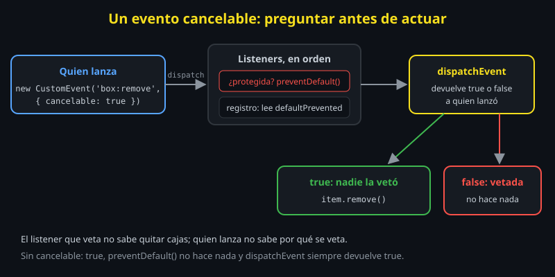

# 🚦 Acciones por defecto y eventos propios

## 🎯 Objetivos

- Cancelar la acción por defecto de un evento con `preventDefault` y saber cuándo se puede.
- Explicar qué promete un listener `passive` y por qué existe.
- Crear y lanzar eventos con `Event`, `CustomEvent` y `dispatchEvent`.
- Usar un evento propio cancelable para que otra parte del código pueda vetar una acción.
- Avisar de cambios con un `EventTarget` que no es un elemento, y decidir cuándo compensa.

Hasta ahora, los eventos venían del navegador. Esta teoría trata de dos cosas que los completan: impedir lo que el navegador hace después de un evento, e inventar eventos propios para que las partes de tu código se avisen sin conocerse.

---

## 📋 Contenido

### 1. La acción por defecto

Muchos eventos tienen una **acción por defecto**: lo que hace el navegador cuando terminan los listeners.

| Evento | Acción por defecto |
|---|---|
| `click` en un enlace | Navegar a su `href` |
| `click` en una casilla | Marcarla o desmarcarla |
| `submit` de un formulario | Enviarlo y cargar otra página |
| `keydown` en un campo | Escribir la letra |
| `keydown` de una flecha | Desplazar la página |
| `contextmenu` | Abrir el menú del botón derecho |

`event.preventDefault()` la cancela, y después `event.defaultPrevented` vale `true`:

```js
form.addEventListener('submit', (event) => {
  event.preventDefault(); // la página no se recarga
  addNotice(form.elements.title.value);
});
```

Es lo que hacían los formularios de los proyectos de las semanas 16 y 17. La [semana 20](../../week-20-formularios_validacion/README.md) estudia los formularios a fondo.

**Qué:** el listener decide si el navegador hace lo suyo. **Para qué:** sustituir el comportamiento del navegador por el de tu código: enviar con `fetch` sin recargar, usar las flechas para moverse por una lista. **Impacto:** si cancelas una acción, tienes que dar a cambio una que haga lo que la persona esperaba.

### 2. Cuándo se puede cancelar

- **Solo los eventos cancelables.** `event.cancelable` dice si lo es. `click`, `submit` o `keydown` lo son; `input`, `change`, `focus` o `scroll` no, porque cuando ocurren la acción ya se ha hecho.
- **Antes de que termine el evento.** En una casilla, el navegador cambia `checked` **antes** de llamar a los listeners de `click`, para que lean el valor nuevo. Si uno cancela, el navegador lo deshace al terminar y no lanza `change`.
- **Nunca en un listener `passive`.** Con `{ passive: true }`, el listener promete no llamar a `preventDefault`. Con esa promesa, el navegador puede desplazar la página al girar la rueda o mover el dedo sin esperar a que termine el listener. Chrome trata como `passive` los listeners de `wheel`, `touchstart` y `touchmove` que se añaden a `window`, `document` o `body`. Si un listener `passive` llama a `preventDefault`, el navegador lo ignora y Chromium escribe un aviso en la consola.

`preventDefault` no para la propagación, y `stopPropagation` no cancela la acción: son cosas distintas.

### 3. Crear y lanzar eventos

`new Event(tipo, opciones)` crea un evento, y `elemento.dispatchEvent(evento)` lo lanza en ese elemento:

```js
const event = new Event('refresh', { bubbles: true, cancelable: true });
const notCancelled = list.dispatchEvent(event);
```

- **Es síncrono.** `dispatchEvent` llama a todos los listeners antes de volver, como `click()`.
- **Devuelve** `false` si algún listener llamó a `preventDefault` en un evento cancelable, y `true` en cualquier otro caso.
- **Por defecto**, un evento creado así no sube (`bubbles: false`) ni se puede cancelar (`cancelable: false`). Hay que pedirlo en las opciones.
- `isTrusted` es `false`: el navegador sabe que no lo provocó una persona.

Hay un constructor para cada familia (`MouseEvent`, `KeyboardEvent`...), con sus propiedades. El [lab 01](../2-practicas/lab-01-escuchar-eventos/README.md) usa `new KeyboardEvent('keydown', { key: 'r' })` para simular una tecla.

### 4. Eventos propios con `CustomEvent`

Un **evento propio** tiene un tipo que inventas tú. `CustomEvent` añade la opción `detail`, que llega al listener en `event.detail` y puede ser cualquier valor:

```js
item.dispatchEvent(new CustomEvent('notice:pin', {
  bubbles: true,
  detail: { id: 4 },
}));

document.addEventListener('notice:pin', (event) => {
  console.log('Fijado el aviso', event.detail.id);
});
```

Un prefijo en el nombre (`notice:`) evita choques con eventos del navegador, presentes o futuros, y agrupa los eventos de una misma parte de la página. Con `bubbles: true`, el evento sube como un clic y se puede delegar.

### 5. Un evento que se puede vetar

Si el evento propio es cancelable, quien lo lanza puede **preguntar antes de actuar**: lanza el evento y solo actúa si `dispatchEvent` devuelve `true`.



```js
const dismiss = (item) => {
  const event = new CustomEvent('notice:dismiss', { bubbles: true, cancelable: true, detail: { id: Number(item.dataset.id) } });
  if (item.dispatchEvent(event)) item.remove();
};

list.addEventListener('notice:dismiss', (event) => {
  if (isPinned(event.detail.id)) event.preventDefault();
});
```

El listener que veta no sabe cerrar avisos, y `dismiss` no sabe por qué se vetan. Es el mismo trato que la acción por defecto de un enlace, pero con una acción que escribe tu código. Para que otro listener sepa si alguien vetó el evento, puede leer `event.defaultPrevented`, siempre que se añada después del que veta.

### 6. `EventTarget` sin elementos

Los elementos, `document` y `window` tienen `addEventListener` y `dispatchEvent` porque son **`EventTarget`**. `new EventTarget()` crea uno que no está en la página, al que cualquier parte del código se puede suscribir:

```js
const bus = new EventTarget();

bus.addEventListener('notice:add', (event) => updateCounter(event.detail));
bus.addEventListener('notice:add', (event) => writeLog(event.detail));

bus.dispatchEvent(new CustomEvent('notice:add', { detail: { id: 9 } }));
```

Es un **bus de eventos**: quien lanza no sabe quién escucha, y los que escuchan no se conocen entre ellos. Añadir un efecto nuevo, como un sonido para los avisos urgentes, es añadir un listener, sin tocar el código que lanza. Como no tiene antepasados, `bubbles` no cambia nada.

`EventTarget`, `Event` y `CustomEvent` también existen en Node. El proyecto lo aprovecha: `createBus` envuelve un `EventTarget` y las comprobaciones lo prueban sin navegador.

### 7. ¿Evento o llamada directa?

Un evento propio separa a quien lanza de quien escucha, pero también hace el código más difícil de seguir: desde `dispatchEvent` no se ve qué se va a ejecutar.

- **Llamada directa** cuando hay un solo receptor conocido: si al cerrar un aviso siempre hay que actualizar el contador, llama a `updateCounter()`.
- **Evento propio** cuando quien lanza no debe saber quién escucha: un componente que se usa en varias páginas, varios receptores que se añaden y se quitan, o un veto que puede poner cualquier parte del código.

---

## 🧪 Pruébalo

El [lab 04](../2-practicas/lab-04-acciones-eventos-propios/README.md) cancela un enlace y una casilla, comprueba qué devuelve `dispatchEvent` con y sin `cancelable` y con un listener `passive`, lanza un `CustomEvent` con y sin `bubbles`, veta la eliminación de una caja protegida y avisa de préstamos con un `EventTarget`.

## ✅ Checklist de aprendizaje

- [ ] Sé qué acción por defecto tienen un enlace, una casilla y un formulario, y cómo cancelarla.
- [ ] Sé por qué `preventDefault` no hace nada en `input` ni en un listener `passive`.
- [ ] Creo un `CustomEvent` con `detail` y elijo si sube y si se puede cancelar.
- [ ] Uso el valor que devuelve `dispatchEvent` para que otro código pueda vetar una acción.
- [ ] Sé cuándo compensa un bus de eventos y cuándo basta con llamar a una función.

<!-- nav -->
---

## 🔗 Navegación

| Anterior | Siguiente |
|---|---|
| ← [Teoría — 🎯 Delegación](03-delegacion.md) | [Índice de labs](../2-practicas/README.md) → |

[↑ Semana 18](../README.md)
