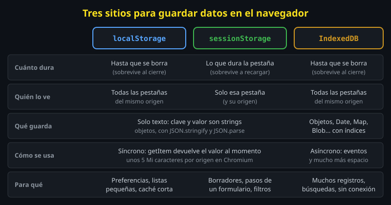

# 🗄️ localStorage y sessionStorage

## 🎯 Objetivos

- Guardar, leer y borrar datos con `setItem`, `getItem` y `removeItem`.
- Explicar por qué todo lo que guardas vuelve como texto y qué pasa con una clave que no existe.
- Distinguir `localStorage` de `sessionStorage`: cuánto duran y quién los ve.
- Usar un prefijo para no pisar las claves de otras páginas y borrar solo las tuyas.
- Enterarte con el evento `storage` de los cambios que hace otra pestaña.

Hasta ahora, todo lo que tu página sabía desaparecía al recargar: las variables viven en la memoria de la pestaña. El navegador tiene varios sitios donde guardar datos que sobreviven a la recarga. Esta teoría trata de los dos más sencillos, `localStorage` y `sessionStorage`, que juntos se llaman **Web Storage**.

---

## 📋 Contenido

### 1. Un almacén de clave y valor

`localStorage` es un objeto global, como `document`. Guarda parejas **clave → valor**, igual que un `Map`, con estos métodos:

| Método o propiedad | Qué hace |
|---|---|
| `setItem(clave, valor)` | Guarda el valor; si la clave ya existía, lo sobrescribe |
| `getItem(clave)` | Devuelve el valor, o `null` si la clave no existe |
| `removeItem(clave)` | Borra la clave (si no existe, no pasa nada) |
| `clear()` | Borra **todas** las claves del origen |
| `length` y `key(i)` | Cuántas claves hay y la clave número `i` |

```javascript
localStorage.setItem('lab19:demo:tank', 'Arrecife');
console.log(localStorage.getItem('lab19:demo:tank'));
// Arrecife
console.log(localStorage.getItem('lab19:demo:nada'));
// null
```

Los datos se ven en las DevTools: pestaña **Application** (en Firefox, **Almacenamiento**) → **Local storage**. Desde ahí también puedes editarlos y borrarlos a mano.

Usa siempre los métodos. `localStorage.tank = 'Arrecife'` también guarda, pero una clave como `length` o `getItem` chocaría con las propiedades del objeto.

### 2. Solo guarda texto

La clave y el valor son siempre **strings**. Si le pasas otra cosa, `setItem` la convierte con `String(valor)`:

```text
price: "12.5" (string)
open: "false" (string)
tanks: "Arrecife,Medusas" (string)
ticket: "[object Object]" (string)
```

Dos consecuencias:

- `'false'` es un texto no vacío, así que en un `if` cuenta como verdadero. Compara con el texto: `valor === 'true'`.
- Un objeto se guarda como `"[object Object]"` y sus datos se pierden. Para guardar objetos hay que convertirlos a texto con `JSON.stringify`: es la [teoría 02](02-serializacion.md).

### 3. La clave que no existe: `null`

`getItem` devuelve `null` cuando la clave no existe. Cuidado al convertirlo: `Number(null)` vale `0`, así que un contador sin guardar «funciona» por casualidad. Es más claro dar el valor por defecto con `??` (semana 1), que solo actúa con `null` y `undefined`:

```javascript
const visits = Number(localStorage.getItem('lab19:visits') ?? '0') + 1;
localStorage.setItem('lab19:visits', String(visits));
```

Recarga la página y el contador sube: el dato ya no vive en una variable, sino en el almacén.

### 4. `localStorage` frente a `sessionStorage`

Los dos tienen exactamente los mismos métodos. Cambia cuánto dura lo que guardas y quién lo ve:

| | `localStorage` | `sessionStorage` |
|---|---|---|
| Cuánto dura | Hasta que lo borre el código, la persona o el navegador | Hasta que se cierra la pestaña; sobrevive a recargar |
| Quién lo ve | Todas las pestañas del mismo origen | Solo esa pestaña |
| Para qué | Preferencias, listas pequeñas, una caché corta | Un borrador, los pasos de un formulario, un filtro |



El **origen** es la combinación de protocolo, dominio y puerto: `http://localhost:3000` y `http://localhost:4000` son orígenes distintos y no comparten datos. Las páginas que abres con doble clic (`file://`) comparten en Chromium un único almacén: por eso todas las claves de los labs empiezan por `lab19:`.

### 5. Prefijos: borra solo lo tuyo

`clear()` borra todo el origen, también lo que guardan otras partes de la página (o, con `file://`, otros labs). Pon un prefijo a tus claves y borra solo las que empiezan por él:

```javascript
const removeByPrefix = (storage, prefix) => {
  for (const key of Object.keys(storage)) {
    if (key.startsWith(prefix)) storage.removeItem(key);
  }
};
removeByPrefix(localStorage, 'lab19:demo:');
```

`Object.keys(localStorage)` devuelve las claves guardadas en un array nuevo, así que se pueden borrar mientras se recorre. Con `length` y `key(i)` el orden de las claves no está garantizado, y al borrar dentro del bucle los índices se mueven.

### 6. El evento `storage`

Cuando una pestaña cambia `localStorage`, **las otras pestañas** del mismo origen reciben un evento `storage` en `window`. La que hizo el cambio no lo recibe.

```javascript
window.addEventListener('storage', (event) => {
  if (event.storageArea !== localStorage || event.key !== 'lab19:visits') return;
  console.log(`storage: ${event.key} ${event.oldValue} → ${event.newValue}`);
});
```

Con la página abierta en una pestaña, abre otra igual: la segunda suma una visita y la primera escribe `storage: lab19:visits 1 → 2`. El evento trae `key`, `oldValue`, `newValue` y `storageArea`. Tras un `clear()`, `key` vale `null`. Así se sincronizan dos pestañas de la misma aplicación sin servidor.

### 7. Lo que no debe ir aquí

- **Secretos.** Cualquier script de la página puede leer `localStorage`, también uno inyectado con un ataque XSS (semana 17). Un token de sesión (semana 16) guardado aquí lo puede robar ese script.
- **Mucho volumen.** Hay un límite de unos pocos megas por origen ([teoría 04](04-cuotas-y-errores.md)).
- **Trabajo pesado.** `getItem` y `setItem` son síncronos: la página espera mientras leen o escriben. Con datos pequeños no se nota; con muchos, mejor IndexedDB ([teoría 03](03-indexeddb.md)).

---

## 🧪 Pruébalo

El [lab 01](../2-practicas/lab-01-local-session-storage/README.md) guarda, lee y borra claves, comprueba que todo vuelve como texto, cuenta visitas que sobreviven a la recarga, compara `localStorage` con `sessionStorage` en dos pestañas, borra por prefijo y escucha el evento `storage`.

## ✅ Checklist de aprendizaje

- [ ] Uso `setItem`, `getItem` y `removeItem`, y sé qué devuelve una clave que no existe.
- [ ] Sé por qué `'false'` cuenta como verdadero y qué guarda `setItem` con un objeto.
- [ ] Elijo entre `localStorage` y `sessionStorage` según cuánto debe durar el dato.
- [ ] Pongo un prefijo a mis claves y borro solo las mías.
- [ ] Sincronizo dos pestañas con el evento `storage`.

<!-- nav -->
---

## 🔗 Navegación

| Anterior | Siguiente |
|---|---|
| ← [Semana 19 - Web Storage APIs](../README.md) | [Teoría — 🔁 Serialización con JSON](02-serializacion.md) → |

[↑ Semana 19](../README.md)
