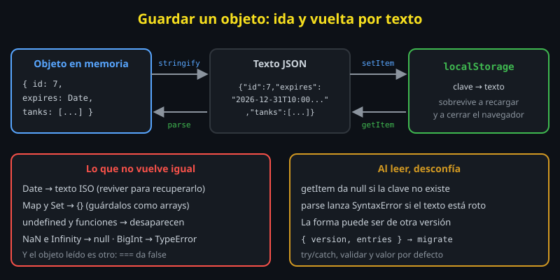

# 🔁 Serialización con JSON

## 🎯 Objetivos

- Guardar objetos y arrays convirtiéndolos a texto con `JSON.stringify` y de vuelta con `JSON.parse`.
- Saber qué valores no sobreviven al viaje: fechas, `Map`, `Set`, `undefined`, funciones, `NaN`.
- Recuperar fechas con un *reviver* y guardar `Map` y `Set` como arrays.
- Leer sin romper la página cuando el texto falta, está roto o tiene otra forma.
- Guardar con un número de versión y migrar los datos antiguos.

Web Storage solo guarda texto ([teoría 01](01-web-storage.md)). Para guardar un objeto hay que **serializarlo**: convertirlo en un texto del que se pueda reconstruir. En JavaScript, ese formato es JSON, el mismo que viaja en las peticiones `fetch` de la semana 15.

---

## 📋 Contenido

### 1. Ida y vuelta

`JSON.stringify(valor)` convierte un valor en texto JSON; `JSON.parse(texto)` hace lo contrario.

```javascript
const pass = { id: 7, holder: 'Lucía', adults: 2, kids: 0, active: true, tanks: ['Arrecife', 'Medusas'] };
localStorage.setItem('lab19:demo:pass', JSON.stringify(pass));
const back = JSON.parse(localStorage.getItem('lab19:demo:pass'));
```

```text
Guardado: {"id":7,"holder":"Lucía","adults":2,"kids":0,"active":true,"tanks":["Arrecife","Medusas"]}
Leído: Lucía, 2 adultos, tanques 2 · ¿mismo objeto? false
```

`back` tiene los mismos datos, pero es **otro objeto**: `back === pass` es `false`. Lo que guardas es una copia; cambiar `back` no cambia lo guardado hasta que vuelvas a llamar a `setItem`.

### 2. Lo que no vuelve igual

JSON solo conoce textos, números, booleanos, `null`, arrays y objetos simples. Todo lo demás se transforma o se pierde:

| Valor | Lo que guarda `JSON.stringify` |
|---|---|
| `undefined` y funciones en un objeto | Desaparece la propiedad |
| `undefined` y funciones en un array | `null` |
| `NaN`, `Infinity` | `null` |
| `Date` | Un texto ISO: `"2026-12-31T10:00:00.000Z"` |
| `Map`, `Set` | `{}`: los datos se pierden |
| `BigInt` | Lanza `TypeError: Do not know how to serialize a BigInt` |



### 3. Fechas: el *reviver*

Una fecha se guarda como texto ISO (porque `Date` tiene un método `toJSON`), pero `JSON.parse` no sabe que ese texto era una fecha. Le puedes pasar una función, el **reviver**, que recibe cada clave y su valor y devuelve el valor que quieres:

```javascript
const revive = (key, value) => (key === 'expires' ? new Date(value) : value);
const revived = JSON.parse(text, revive);
```

```text
Sin reviver: string · ¿tiene getFullYear? undefined
Con reviver: true · año 2026
```

Otra forma, más explícita, es convertir después de leer: `{ ...data, expires: new Date(data.expires) }`. Es la que usa el proyecto.

### 4. `Map` y `Set`: guárdalos como arrays

`[...map]` da un array de parejas `[clave, valor]` y `[...set]` un array de valores. Los dos se guardan bien en JSON, y `new Map(array)` y `new Set(array)` los reconstruyen:

```text
Tal cual: {"capacity":{},"favorites":{}}
Como arrays: {"capacity":[["Arrecife",40],["Medusas",15]],"favorites":["Medusas"]}
```

### 5. Al leer, desconfía

Lo que hay guardado puede no ser lo que esperas: la persona lo editó en las DevTools, lo escribió una versión anterior de tu código o se cortó a medias. Hay tres casos que tratar:

1. **No hay nada**: `getItem` devuelve `null`. Ojo: `JSON.parse(null)` no falla, devuelve `null`, porque convierte el argumento en el texto `"null"`.
2. **Texto roto**: `JSON.parse` lanza `SyntaxError`. Captúralo con `try/catch` (semana 11) y usa un valor por defecto.
3. **Forma inesperada**: el JSON es válido pero no es lo que tu código espera (`[1,2,3]`, `"hola"`, un objeto sin `id`). Comprueba la forma antes de usarlo.

```javascript
const readJSON = (key, fallback) => {
  const text = localStorage.getItem(key);
  if (text === null) return fallback;
  try {
    return JSON.parse(text);
  } catch {
    return fallback;
  }
};
```

`catch` sin `(error)` es válido cuando no vas a usar el error.

### 6. Versionar lo que guardas

Tu código cambia, pero los datos que guardó la versión anterior siguen en el navegador de cada persona. Si mañana una entrada necesita un campo nuevo, el código nuevo leerá datos viejos. La solución es guardar dentro de un **sobre** con un número de versión:

```json
{ "version": 2, "entries": [ ... ] }
```

Al leer, una función `migrate` lleva los datos de cualquier versión conocida a la actual, y lanza un error si la versión no la conoce. Después de migrar, guarda los datos con la versión nueva para no tener que migrarlos otra vez.

```text
Migrado y guardado: {"version":2,"passes":[{"id":1,"holder":"Lucía","adults":1},{"id":2,"holder":"Omar","adults":1}]}
Versión desconocida: 3
```

### 7. ¿Y `structuredClone`?

`structuredClone(valor)` copia un valor conservando `Date`, `Map`, `Set` y más tipos, pero devuelve un objeto, no un texto: no sirve para Web Storage. Es el algoritmo que usa IndexedDB para guardar, y por eso allí las fechas vuelven como `Date` ([teoría 03](03-indexeddb.md)).

---

## 🧪 Pruébalo

El [lab 02](../2-practicas/lab-02-serializacion/README.md) guarda y lee un objeto, mira qué pierde JSON, recupera fechas con un *reviver*, guarda `Map` y `Set`, lee datos rotos sin romper la página, valida la forma y migra un formato antiguo.

## ✅ Checklist de aprendizaje

- [ ] Guardo y leo objetos con `JSON.stringify` y `JSON.parse`.
- [ ] Sé qué pasa con `Date`, `Map`, `Set`, `undefined` y `NaN` al serializar.
- [ ] Recupero una fecha con un *reviver* o después de leer.
- [ ] Leo con `try/catch`, un valor por defecto y una comprobación de la forma.
- [ ] Guardo los datos con una versión y sé migrarlos.

<!-- nav -->
---

## 🔗 Navegación

| Anterior | Siguiente |
|---|---|
| ← [Teoría — 🗄️ localStorage y sessionStorage](01-web-storage.md) | [Teoría — 🗃️ IndexedDB](03-indexeddb.md) → |

[↑ Semana 19](../README.md)
