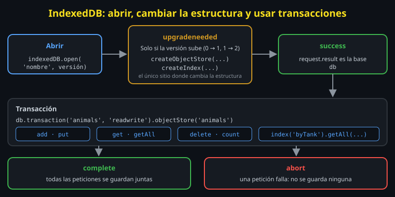

# 🗃️ IndexedDB

## 🎯 Objetivos

- Saber cuándo compensa IndexedDB frente a Web Storage.
- Abrir una base con versión y crear almacenes e índices en `upgradeneeded`.
- Leer y escribir dentro de transacciones con `add`, `put`, `get`, `getAll`, `delete` y `count`.
- Convertir las peticiones en promesas para usar `await`.
- Buscar con un índice y con un rango de claves, y entender qué pasa cuando una transacción falla.

Web Storage es cómodo, pero solo guarda texto, tiene poco espacio y bloquea la página mientras lee o escribe. **IndexedDB** es una base de datos dentro del navegador: guarda objetos (también `Date`, `Map` o archivos), tiene mucho más espacio, busca por índices y trabaja sin bloquear. A cambio, su API es más larga.

---

## 📋 Contenido

### 1. Cuándo usar cada uno

| Necesitas | Usa |
|---|---|
| Unas pocas preferencias o una lista pequeña | `localStorage` |
| Algo que solo debe durar lo que dura la pestaña | `sessionStorage` |
| Cientos o miles de registros, buscar por un campo, guardar archivos, trabajar sin conexión | IndexedDB |

Esta semana el proyecto usa Web Storage, porque guarda una lista pequeña. IndexedDB se ve en el lab para que lo reconozcas cuando lo necesites.

### 2. Piezas de una base

- La **base** tiene un nombre y un número de **versión** entero.
- Dentro hay **almacenes** (*object stores*), parecidos a tablas. Cada uno guarda objetos con una clave única: con `keyPath: 'id'`, la clave es la propiedad `id` de cada objeto.
- Un **índice** permite buscar por otra propiedad, por ejemplo todos los animales de un tanque.
- Todo se lee y se escribe dentro de una **transacción**.



### 3. Peticiones y promesas

Casi todo en IndexedDB devuelve una **petición** (`IDBRequest`). El resultado llega después, con un evento `success` (y el valor en `request.result`) o `error` (y el fallo en `request.error`). Con dos funciones pequeñas puedes convertirlas en promesas (semana 13) y usar `await` (semana 14):

```javascript
const done = (request) =>
  new Promise((resolve, reject) => {
    request.onsuccess = () => resolve(request.result);
    request.onerror = () => reject(request.error);
  });

const finished = (transaction) =>
  new Promise((resolve, reject) => {
    transaction.oncomplete = () => resolve();
    transaction.onabort = () => reject(transaction.error);
  });
```

Aquí se usa `onsuccess` en lugar de `addEventListener` porque cada petición tiene un solo receptor. Las dos formas valen.

### 4. Abrir y crear la estructura

`indexedDB.open(nombre, versión)` abre la base. Si no existe o la versión es mayor que la guardada, antes de `success` llega `upgradeneeded`: es **el único momento** en el que se pueden crear o borrar almacenes e índices.

```javascript
const request = indexedDB.open('lab19-acuario', 1);
request.onupgradeneeded = (event) => {
  console.log(`upgradeneeded: versión ${event.oldVersion} → ${event.newVersion}`);
  const store = request.result.createObjectStore('animals', { keyPath: 'id' });
  store.createIndex('byTank', 'tank');
};
const db = await done(request);
```

```text
upgradeneeded: versión 0 → 1
Abierta: lab19-acuario v1 · almacenes: animals
```

La versión `0` significa que la base no existía. Para cambiar la estructura más adelante, abre con la versión siguiente y añade lo nuevo en `upgradeneeded` según `oldVersion`. Si hay otra pestaña con la versión anterior abierta, recibe `versionchange` y debe cerrar su conexión con `db.close()`.

### 5. Transacciones

`db.transaction(almacenes, modo)` crea una transacción: `'readonly'` (el modo por defecto) para leer y `'readwrite'` para escribir.

```javascript
const tx = db.transaction('animals', 'readwrite');
tx.objectStore('animals').add({ id: 1, name: 'Coral', tank: 'Arrecife', arrived: new Date('2026-03-02') });
await finished(tx);
```

| Método del almacén | Qué hace |
|---|---|
| `add(objeto)` | Añade; falla con `ConstraintError` si la clave ya existe |
| `put(objeto)` | Añade o sustituye el que tenga esa clave |
| `get(clave)` | Devuelve el objeto, o `undefined` si no existe |
| `getAll(rango?)` | Devuelve todos, o los de un rango de claves |
| `delete(clave)` y `count()` | Borra uno y cuenta |
| `index(nombre).getAll(valor)` | Devuelve los que tienen ese valor en el índice |

Los objetos se guardan con el algoritmo de `structuredClone`, no con JSON, así que una fecha vuelve como `Date`:

```text
get(2): Luna · arrived es Date: true (2026-04-15)
```

Un rango de claves se crea con `IDBKeyRange`: `IDBKeyRange.bound(2, 3)` son las claves de 2 a 3, ambas incluidas.

### 6. Todo o nada

Las peticiones de una transacción se guardan juntas. Si una falla y nadie gestiona el error, la transacción se **aborta** y se deshacen también las que habían ido bien:

```text
La transacción se deshace: ConstraintError
¿Está Perla (id 5)? undefined
```

El `add` de Perla funcionó, pero el `add` siguiente repetía una clave: no se guarda ninguno de los dos. Así, una operación de varios pasos nunca deja los datos a medias.

Una transacción se cierra sola cuando no le quedan peticiones pendientes. Si entre dos peticiones esperas otra cosa (un `fetch`, un `setTimeout`), se habrá cerrado y la siguiente lanza `TransactionInactiveError`: haz las esperas fuera de la transacción.

---

## 🧪 Pruébalo

El [lab 03](../2-practicas/lab-03-indexeddb/README.md) abre una base, crea un almacén con un índice, guarda y lee animales, busca por tanque y por rango, ve cómo una transacción con un error se deshace entera y sube la base a la versión 2.

## ✅ Checklist de aprendizaje

- [ ] Sé cuándo usar IndexedDB en lugar de `localStorage`.
- [ ] Abro una base con versión y creo almacenes e índices en `upgradeneeded`.
- [ ] Convierto peticiones y transacciones en promesas.
- [ ] Uso `add`, `put`, `get`, `getAll`, `delete`, un índice y un rango.
- [ ] Sé qué pasa con todas las peticiones de una transacción cuando una falla.

<!-- nav -->
---

## 🔗 Navegación

| Anterior | Siguiente |
|---|---|
| ← [Teoría — 🔁 Serialización con JSON](02-serializacion.md) | [Teoría — 📏 Cuotas, errores y caducidad](04-cuotas-y-errores.md) → |

[↑ Semana 19](../README.md)
