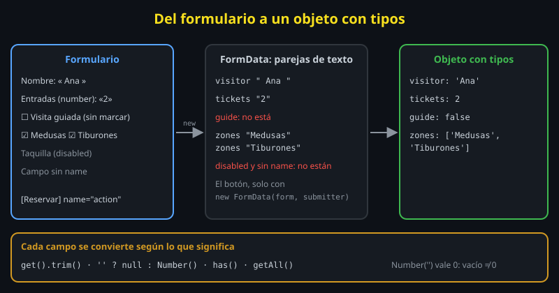

# 📝 Formularios y FormData

## 🎯 Objetivos

- Reconocer las partes de un formulario: `<form>`, campos con `name`, `<label>` y botón de envío.
- Leer y cambiar los campos con `form.elements` y sus propiedades `value` y `checked`.
- Atender el envío con el evento `submit` y decidir tú qué pasa.
- Leer todo el formulario de una vez con `FormData`: `get`, `getAll` y `Object.fromEntries`.
- Convertir lo que llega como texto en los tipos que necesita tu código.

Un formulario es la forma más antigua que tiene una página de pedir datos, y sigue siendo la mejor: el navegador ya sabe mostrar los campos, moverse entre ellos con el teclado, recordar lo que escribiste y avisar de errores. Esta teoría trata de leer lo que la persona escribe. Las tres siguientes, de comprobar que es correcto.

---

## 📋 Contenido

### 1. Las piezas de un formulario

```html
<form id="booking">
  <label for="visitor">Nombre</label>
  <input id="visitor" name="visitor">

  <label for="tickets">Entradas</label>
  <input id="tickets" name="tickets" type="number" value="1">

  <label><input name="guide" type="checkbox" value="yes"> Con visita guiada</label>

  <button>Reservar</button>
</form>
```

- **`name`** es el nombre del dato. Un campo sin `name` no se envía ni aparece en `FormData`.
- **`<label>`** da nombre visible al campo. Con `for` igual al `id` del campo (o con el campo dentro), pulsar la etiqueta lleva el foco al campo y los lectores de pantalla leen la etiqueta al llegar a él. Un `placeholder` no la sustituye: desaparece al escribir.
- **`type`** elige el teclado y el control: `text` (el de por defecto), `email`, `number`, `date`, `checkbox`, `radio`... Los tipos también validan, y eso es la [teoría 02](02-validacion-html.md).
- **Un `<button>` dentro de un formulario envía** (`type="submit"` es su tipo por defecto). Para un botón que no envíe, escribe `type="button"`.

### 2. `form.elements`: los campos por su nombre

`form.elements` reúne los campos del formulario. Se accede a cada uno por su `name` (o su `id`):

```javascript
const form = document.querySelector('#booking');
const { visitor, tickets, guide } = form.elements;

visitor.value = 'Ana';
console.log(visitor.value, typeof tickets.value, guide.checked);
// Ana string false
```

| Propiedad | En qué campos | Qué es |
|---|---|---|
| `value` | Todos | El texto actual. **Siempre un string**, también en `type="number"` |
| `checked` | `checkbox` y `radio` | Si está marcado (`true` o `false`) |
| `valueAsNumber` | `number`, `range`, `date` | El valor como número, o `NaN` si está vacío |
| `defaultValue` | `input` y `textarea` | El valor inicial del HTML (su atributo `value`); `form.reset()` vuelve a él |

Para un `checkbox`, `value` no cambia al marcarlo: es el texto que se envía **si** está marcado. Lo que cambia es `checked`.

### 3. El evento `submit`

Enviar un formulario (con el botón o con `Enter` en un campo de texto) lanza `submit` en el `<form>`. Si nadie lo impide, el navegador manda los datos a la dirección de `action` y carga otra página. En la [semana 18](../../week-18-event_handling_avanzado/1-teoria/04-acciones-eventos-propios.md) viste cómo cancelarlo con `preventDefault()`. Es lo que hace una página que trata los datos con JavaScript:

```javascript
form.addEventListener('submit', (event) => {
  event.preventDefault();
  console.log('Enviado con:', event.submitter.textContent);
});
```

- Escucha `submit` en el formulario, no `click` en el botón: así también atiendes el envío con `Enter`.
- `event.submitter` es el botón que lo envió (o `null` si se envió desde código sin botón). Sirve cuando un formulario tiene dos botones, como «Guardar borrador» y «Enviar».
- Desde código, `form.requestSubmit(boton)` envía como si se pulsara ese botón: lanza `submit` y antes valida. Sin argumento, envía sin botón. `form.submit()` envía **sin** lanzar `submit` y sin validar, así que tu listener no se entera. Usa `requestSubmit`.

### 4. `FormData`: todo el formulario de una vez

Leer campo a campo se hace largo. `new FormData(form)` toma una foto del formulario con lo que **se enviaría**: una lista de parejas `[name, value]`.

```javascript
const data = new FormData(form);
console.log([...data]);
// [["visitor","Ana"],["tickets","1"]]
console.log(data.get('tickets'), data.get('guide'), data.has('guide'));
// 1 null false
```



Las reglas de esa foto:

- Solo entran los campos con `name` que no estén desactivados (`disabled`).
- Todos los valores son **texto** (o `File` en un `<input type="file">`).
- Un `checkbox` sin marcar **no entra**. Marcado, entra con su `value` (`'on'` si no tiene). Por eso `get('guide')` da `null` y `has('guide')` dice si se marcó.
- Varios campos con el mismo `name` (casillas de una lista, un `<select multiple>`) entran uno por cada valor. `get` devuelve el primero; `getAll`, un array con todos.
- `new FormData(form, event.submitter)` añade también el `name` y el `value` del botón que envió.

| Método | Devuelve |
|---|---|
| `get(name)` | El primer valor, o `null` si no está |
| `getAll(name)` | Un array con todos los valores (vacío si no está) |
| `has(name)` | Si está |
| `set(name, value)` y `append(name, value)` | Cambia el valor o añade otro |
| `entries()` (o `[...data]`) | Las parejas `[name, value]` |

### 5. De `FormData` a un objeto con tipos

`Object.fromEntries(data)` convierte las parejas en un objeto. Es cómodo, pero con un `name` repetido **solo se queda el último valor**, y todo sigue siendo texto:

```javascript
// Con las casillas «Medusas» y «Tiburones» marcadas:
console.log(Object.fromEntries(data));
// { visitor: 'Ana', tickets: '1', zones: 'Tiburones' }
```

Lo robusto es convertir cada campo según lo que significa:

```javascript
const readBooking = (data) => ({
  visitor: (data.get('visitor') ?? '').trim(),
  tickets: data.get('tickets') === '' ? null : Number(data.get('tickets')),
  guide: data.has('guide'),
  zones: data.getAll('zones'),
});
```

- **Texto:** `trim()` quita los espacios de los extremos, para que `'  '` cuente como vacío.
- **Número:** `Number('')` vale `0`, y un campo vacío no es un cero. Distingue el vacío antes de convertir, y deja que la validación decida si falta.
- **Casilla:** `has` da `true` o `false`.
- **Lista:** `getAll` da un array, quizá vacío.

Separar la lectura (`FormData` → objeto) de lo que haces con el objeto tiene premio: una función que recibe un `FormData` se puede probar con Node, que también tiene `FormData`, sin abrir el navegador. Es lo que hace el proyecto de la semana.

### 6. Un `FormData` también se envía

`fetch` acepta un `FormData` como `body` y lo manda como formulario (`multipart/form-data`), archivos incluidos. Si el servidor espera JSON (como la API de la [semana 15](../../week-15-fetch_api/README.md)), envía el objeto convertido con `JSON.stringify`. Y `new URLSearchParams(data).toString()` lo escribe como en una dirección: `visitor=Ana&tickets=1`.

---

## 🧪 Pruébalo

El [lab 01](../2-practicas/lab-01-formularios-formdata/README.md) lee los campos con `form.elements`, atiende `submit`, compara `submit()` con `requestSubmit()`, recorre un `FormData` con casillas y botones con nombre, y lo convierte en un objeto con tipos.

## ✅ Checklist de aprendizaje

- [ ] Doy `name` a cada campo y una `<label>` asociada.
- [ ] Sé que `value` es siempre texto y que una casilla se lee con `checked`.
- [ ] Escucho `submit` en el formulario y lo cancelo con `preventDefault()`.
- [ ] Sé por qué una casilla sin marcar no aparece en `FormData` y cuándo usar `getAll`.
- [ ] Convierto lo que llega de `FormData` en un objeto con tipos, sin confundir vacío con cero.

<!-- nav -->
---

## 🔗 Navegación

| Anterior | Siguiente |
|---|---|
| ← [Semana 20 - Formularios y Validación](../README.md) | [Teoría — ✅ Validación con atributos HTML](02-validacion-html.md) → |

[↑ Semana 20](../README.md)
