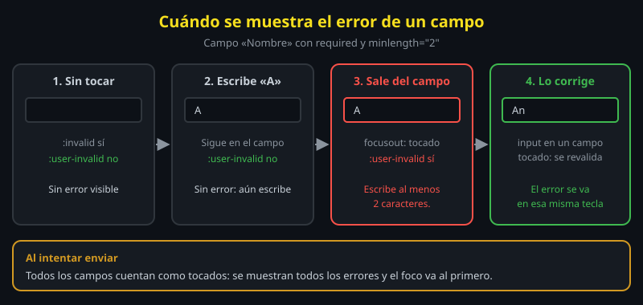

# ✅ Validación con atributos HTML

## 🎯 Objetivos

- Pedir datos correctos con atributos: `required`, `type`, `min`, `max`, `step`, `minlength`, `maxlength` y `pattern`.
- Saber qué comprueba cada uno y qué deja pasar.
- Entender cuándo valida el navegador: al enviar, no al escribir, y nunca un valor puesto desde código con `minlength`.
- Dar estilo a los campos con errores con `:invalid` y `:user-invalid`.
- Desactivar la validación del navegador con `novalidate` sin perder lo que da.

Antes de escribir una línea de JavaScript, el HTML ya puede validar. Con un atributo en el campo, el navegador impide el envío, lleva el foco al primer campo incorrecto y muestra un mensaje en el idioma de la persona. Esta teoría repasa esos atributos. La [teoría 03](03-constraint-validation.md) los lee desde JavaScript.

---

## 📋 Contenido

### 1. Las restricciones

Cada atributo es una **restricción**: una condición que el valor tiene que cumplir.

| Atributo | En qué campos | El valor no es válido si... |
|---|---|---|
| `required` | Casi todos | Está vacío, la casilla no está marcada o el `<select>` tiene elegida una opción con `value=""` |
| `type="email"` | `input` | No tiene forma de correo (`algo@algo`) |
| `type="url"` | `input` | No es una dirección completa, con `https://` |
| `type="number"` | `input` | No es un número. Entonces `value` vale `''` y `validity.badInput` es `true` |
| `min` y `max` | `number`, `date`, `range`... | Es menor que `min` o mayor que `max` |
| `step` | `number`, `date`, `range`... | No es `min` (o 0) más un múltiplo de `step`. Por defecto, `step` es 1: solo enteros |
| `minlength` y `maxlength` | Texto y `textarea` | Tiene menos caracteres que `minlength`. `maxlength`, en cambio, no deja escribir más |
| `pattern` | Texto, `email`, `tel`... | No encaja **entero** con la expresión regular |

```html
<input name="visitor" required minlength="2" maxlength="40">
<input name="email" type="email" required>
<input name="tickets" type="number" required min="1" max="10">
<input name="card" pattern="AC-\d{4}" title="AC- y cuatro cifras, como AC-0420">
```

Detalles que confunden:

- **Vacío no es inválido** salvo con `required`. Un `type="email"` vacío y sin `required` es válido: el campo es opcional.
- **`type="email"` acepta `ana@acuario`**, sin punto, porque es una dirección válida en una red interna. Si necesitas un dominio con punto, añade un `pattern`.
- **`pattern` encaja con el valor entero**: `AC-\d{4}` rechaza `AC-12345`, aunque contenga `AC-1234`. No escribas `^` ni `$`. El navegador muestra el `title` en la burbuja, debajo de su mensaje (no forma parte de `validationMessage`): úsalo para explicar el formato.
- **`step` decide si se aceptan decimales.** Con `step` por defecto, `8.5` no es válido. Para precios, `step="0.01"`; para cualquier decimal, `step="any"`.

### 2. Cuándo valida el navegador

El navegador comprueba las restricciones **al enviar**. Si alguna falla, cancela el envío (no llega el evento `submit`), lleva el foco al primer campo incorrecto y muestra su mensaje en una burbuja. Ese mensaje lo escribe el navegador, en su idioma:

```text
Completa este campo
Selecciona esta casilla de verificación si quieres continuar
El valor debe ser inferior o igual a 10
Incluye un signo "@" en la dirección de correo electrónico. La dirección "ana" no incluye el signo "@".
```

Son los de Chromium en español; Firefox y Safari usan otras frases. Si los quieres iguales en todos, escríbelos tú: es la [teoría 03](03-constraint-validation.md).

Un valor que pone el código (`input.value = 'ab'`) se valida con casi todas las restricciones, pero **no con `minlength` ni `maxlength`**: esas solo cuentan cuando la persona escribe. Es una regla del estándar, pensada para no marcar como erróneo un valor que vino del servidor. Si cargas datos con código, valida su longitud en JavaScript.

### 3. `:invalid` y `:user-invalid`

Hay pseudoclases de CSS para los campos que no cumplen sus restricciones:

```css
input:user-invalid {
  border-color: #f85149;
}
```



- `:invalid` marca el campo desde que se carga la página. Un formulario vacío con `required` aparece entero en rojo antes de que la persona haya escrito nada: es una mala experiencia.
- `:user-invalid` solo marca el campo después de que la persona lo haya tocado: cuando sale de él tras cambiarlo, o al intentar enviar. Úsala para los estilos de error. Está en todos los navegadores actuales desde 2023.
- `:valid` y `:user-valid` son las contrarias, y `:required` y `:optional` marcan los campos con y sin `required`.

### 4. `novalidate`: tú decides cuándo y cómo

Con `<form novalidate>` (o `form.noValidate = true`), el navegador **no comprueba nada al enviar**: llega `submit` siempre. Las restricciones siguen ahí y siguen sirviendo para:

- Elegir el teclado del móvil (`type="email"`, `inputmode="numeric"`).
- Las pseudoclases `:invalid` y `:user-invalid`.
- Que JavaScript pregunte por ellas con la API de la [teoría 03](03-constraint-validation.md).

Es el punto de partida habitual cuando quieres mensajes propios junto a cada campo en lugar de la burbuja del navegador.

### 5. El navegador no es el único que valida

Cualquiera puede abrir las DevTools, borrar el `required` y enviar, o mandar datos al servidor sin pasar por el formulario. La validación en la página es para ayudar a la persona: **el servidor tiene que validar otra vez** todo lo que recibe. Por eso el proyecto de la semana separa las reglas en funciones que no dependen del DOM: son las mismas que podría usar un servidor con Node.

---

## 🧪 Pruébalo

El [lab 02](../2-practicas/lab-02-validacion-html/README.md) prueba cada restricción con valores buenos y malos, muestra qué cambia al escribir y al salir del campo, compara `:invalid` con `:user-invalid` y envía con `novalidate`.

## ✅ Checklist de aprendizaje

- [ ] Elijo el `type` adecuado y añado `required`, `min`, `max`, `step`, `minlength`, `maxlength` o `pattern` según el dato.
- [ ] Sé que un campo vacío sin `required` es válido y que `pattern` encaja con el valor entero.
- [ ] Sé que `minlength` no cuenta con valores puestos desde código.
- [ ] Uso `:user-invalid` en lugar de `:invalid` para marcar errores.
- [ ] Sé qué hace `novalidate` y por qué el servidor tiene que validar igualmente.

<!-- nav -->
---

## 🔗 Navegación

| Anterior | Siguiente |
|---|---|
| ← [Teoría — 📝 Formularios y FormData](01-formularios-formdata.md) | [Teoría — 🔍 La API de validación](03-constraint-validation.md) → |

[↑ Semana 20](../README.md)
