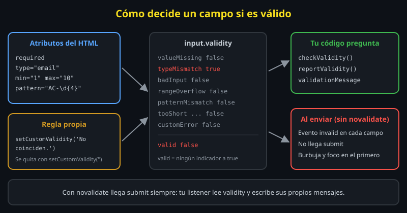

# 🔍 La API de validación

## 🎯 Objetivos

- Preguntar a un campo por qué no es válido con `validity` y sus indicadores.
- Comprobar un campo o un formulario entero con `checkValidity()` y `reportValidity()`.
- Enterarte de los campos inválidos con el evento `invalid`.
- Añadir reglas propias con `setCustomValidity()` y quitarlas a tiempo.
- Escribir tus propios mensajes a partir de `validity`.

Los atributos de la [teoría 02](02-validacion-html.md) dan una validación completa, pero con mensajes que no eliges y en una burbuja que desaparece. La **API de validación** (en inglés, *Constraint Validation API*) es lo que el navegador usa por dentro, y también está disponible para tu código: puedes preguntar, comprobar y añadir reglas.

---

## 📋 Contenido

### 1. `validity`: por qué un campo no es válido

Cada campo tiene la propiedad `validity`, un objeto `ValidityState` con un indicador por cada restricción. Solo están a `true` los que fallan; `valid` es `true` cuando no falla ninguno.

| Indicador | Se activa con | Ejemplo |
|---|---|---|
| `valueMissing` | `required` | Campo vacío |
| `typeMismatch` | `type="email"` o `type="url"` | `ana` en un correo |
| `badInput` | Un valor que el navegador no sabe convertir | Texto que no es un número en `type="number"` |
| `rangeUnderflow` y `rangeOverflow` | `min` y `max` | `0` con `min="1"` |
| `stepMismatch` | `step` | `2.5` con el `step` por defecto |
| `tooShort` y `tooLong` | `minlength` y `maxlength` | Solo con texto que escribe la persona |
| `patternMismatch` | `pattern` | `AC-12` con `AC-\d{4}` |
| `customError` | `setCustomValidity()` | Una regla tuya (apartado 4) |

```javascript
const { tickets } = form.elements;
tickets.value = '12';
console.log(tickets.validity.valid, tickets.validity.rangeOverflow);
// false true
console.log(tickets.validationMessage);
// El valor debe ser inferior o igual a 10
```

`validationMessage` es el mensaje que mostraría el navegador, o `''` si el campo es válido.

### 2. `checkValidity()` y `reportValidity()`

Los dos existen en cada campo y en el formulario, que comprueba todos sus campos:

| Método | Devuelve | Además... |
|---|---|---|
| `checkValidity()` | `true` o `false` | Lanza `invalid` en cada campo que falla |
| `reportValidity()` | `true` o `false` | Lo mismo, y muestra la burbuja del primero y le lleva el foco |

```javascript
console.log(form.checkValidity());
// false
```

Sirven también con `novalidate`: el formulario deja de comprobar al enviar, pero tú puedes llamar a `checkValidity()` en tu listener de `submit` y decidir qué hacer.

### 3. El evento `invalid`

Cada campo que falla recibe un evento `invalid`, al enviar o al llamar a `checkValidity()`. Ese evento **no sube** por el árbol (no tiene fase de burbuja), así que no lo puedes delegar como un `click`. Para escucharlo en el formulario, usa la fase de captura de la [semana 18](../../week-18-event_handling_avanzado/1-teoria/02-propagacion.md):

```javascript
form.addEventListener('invalid', (event) => {
  console.log('No es válido:', event.target.name);
}, { capture: true });
```

`event.preventDefault()` en `invalid` evita la burbuja del navegador, para mostrar tus propios mensajes.

### 4. Reglas propias: `setCustomValidity()`

Hay reglas que no caben en un atributo: que dos campos coincidan, que una fecha sea posterior a otra, que un correo no esté ya inscrito. `setCustomValidity(mensaje)` marca el campo como inválido con ese mensaje; `setCustomValidity('')` lo vuelve a dejar válido.

```javascript
const { email, confirmEmail } = form.elements;
const checkSame = () => {
  confirmEmail.setCustomValidity(
    confirmEmail.value === email.value ? '' : 'Los dos correos no coinciden.',
  );
};
email.addEventListener('input', checkSame);
confirmEmail.addEventListener('input', checkSame);
```



El fallo más común: **el error propio no se quita solo**. Mientras el mensaje no sea `''`, el campo sigue inválido aunque la persona lo corrija. Por eso la regla se vuelve a comprobar en cada `input`, y en los **dos** campos: si cambia el correo, también puede dejar de coincidir la confirmación.

### 5. Mensajes propios a partir de `validity`

Para escribir tus mensajes, recorre los indicadores y elige el texto del primero que falle:

```javascript
const messageFor = (input) => {
  const { validity } = input;
  if (validity.valueMissing) return 'Rellena este campo.';
  if (validity.typeMismatch) return 'Escribe un correo como nombre@ejemplo.com.';
  if (validity.rangeOverflow) return `Como máximo ${input.max}.`;
  if (validity.customError) return input.validationMessage;
  return '';
};
```

El orden importa: un campo vacío y con `pattern` solo activa `valueMissing`, pero un campo con texto puede fallar a la vez `patternMismatch` y `tooShort`. Pon primero el mensaje que más ayuda.

Con `novalidate`, este patrón da mensajes propios, iguales en todos los navegadores, sin perder lo que el navegador ya sabe comprobar.

---

## 🧪 Pruébalo

El [lab 03](../2-practicas/lab-03-api-validacion/README.md) lee los indicadores de `validity`, compara `checkValidity()` con `reportValidity()`, escucha `invalid` en captura, compara dos correos con `setCustomValidity()` y escribe mensajes propios junto a cada campo.

## ✅ Checklist de aprendizaje

- [ ] Leo `validity` para saber qué restricción falla.
- [ ] Sé la diferencia entre `checkValidity()` y `reportValidity()`.
- [ ] Escucho `invalid` en captura, porque no sube.
- [ ] Uso `setCustomValidity()` y lo vuelvo a dejar en `''` cuando la regla se cumple.
- [ ] Escribo mis propios mensajes a partir de `validity`.

<!-- nav -->
---

## 🔗 Navegación

| Anterior | Siguiente |
|---|---|
| ← [Teoría — ✅ Validación con atributos HTML](02-validacion-html.md) | [Teoría — 🚦 Validación propia y envío](04-validacion-propia-envio.md) → |

[↑ Semana 20](../README.md)
