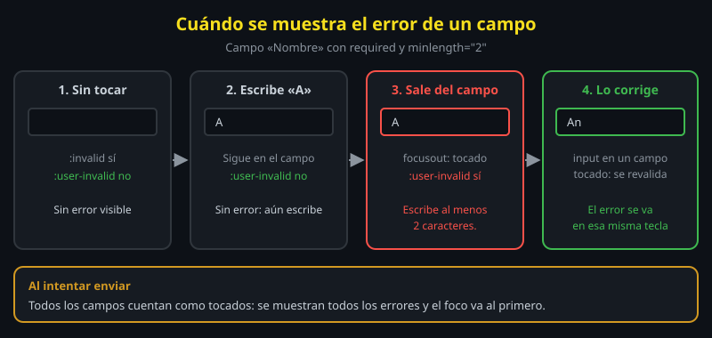
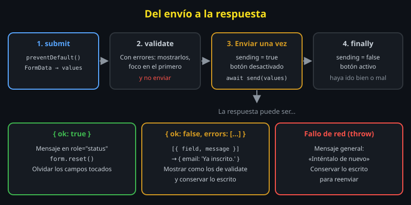

# 🚦 Validación propia y envío

## 🎯 Objetivos

- Escribir las reglas como datos y comprobarlas con funciones puras, sin DOM.
- Mostrar cada error junto a su campo de forma accesible, con `aria-invalid` y `aria-describedby`.
- Elegir cuándo aparece un error: al salir del campo, al escribir después o al enviar.
- Enviar sin envíos dobles: botón desactivado, estado «enviando» y errores del servidor en su campo.
- Dejar el formulario listo después de un envío correcto.

La API de la [teoría 03](03-constraint-validation.md) da mensajes propios, pero cada regla vive en un listener distinto y solo se puede probar en el navegador. Cuando el formulario crece, compensa otro reparto: **las reglas en funciones puras**, que reciben los valores y devuelven los errores, y **el DOM solo para mostrarlos**. Es el mismo reparto de `logic.js` y `main.js` de los proyectos anteriores.

---

## 📋 Contenido

### 1. Las reglas como datos

Describe cada campo con un objeto, y escribe una función que compruebe un campo con esas reglas:

```javascript
const FIELDS = [
  { name: 'visitor', label: 'Nombre', required: true, minLength: 2 },
  { name: 'tickets', label: 'Entradas', type: 'number', required: true, min: 1, max: 10 },
  { name: 'card', label: 'Carné', pattern: 'AC-\\d{4}', patternMessage: 'Escribe AC- y cuatro cifras.' },
];

const checkField = (field, value) => {
  const empty = value === '' || value === null;
  if (empty) return field.required ? 'Rellena este campo.' : null;
  if (field.minLength && value.length < field.minLength) return `Escribe al menos ${field.minLength} caracteres.`;
  if (field.min !== undefined && value < field.min) return `El mínimo es ${field.min}.`;
  if (field.max !== undefined && value > field.max) return `El máximo es ${field.max}.`;
  if (field.pattern && !new RegExp(`^(?:${field.pattern})$`).test(value)) return field.patternMessage;
  return null;
};
```

- **Un campo opcional vacío no tiene error**: la función sale antes de mirar las demás reglas, igual que el navegador.
- **`pattern` se ancla con `^(?:...)$`**, para que encaje con el valor entero como en el HTML.
- **Devuelve el primer error o `null`**: un mensaje cada vez, el más útil.

Validar el formulario es aplicarla a cada campo y quedarse con los que fallan:

```javascript
const validate = (fields, values) => {
  const errors = {};
  for (const field of fields) {
    const message = checkField(field, values[field.name]);
    if (message) errors[field.name] = message;
  }
  return { valid: Object.keys(errors).length === 0, errors };
};

console.log(validate(FIELDS, { visitor: 'A', tickets: 12, card: '' }));
// {
//   valid: false,
//   errors: {
//     visitor: 'Escribe al menos 2 caracteres.',
//     tickets: 'El máximo es 10.'
//   }
// }
```

`validate` no sabe nada de la página: recibe el objeto de la [teoría 01](01-formularios-formdata.md) (el que sale de `FormData`) y se prueba con Node. Las mismas reglas pueden generar los atributos del HTML (`required`, `min`, `pattern`), así que el navegador ayuda con el teclado y `:user-invalid` sin que escribas cada regla dos veces.

### 2. Cada error junto a su campo

Un mensaje tiene que estar junto al campo, y los lectores de pantalla tienen que leerlo al llegar a él:

```html
<label for="visitor">Nombre</label>
<input id="visitor" name="visitor" aria-describedby="visitor-error">
<p id="visitor-error" class="error"></p>
```

```javascript
const showError = (input, message) => {
  input.setAttribute('aria-invalid', message ? 'true' : 'false');
  document.querySelector(`#${input.id}-error`).textContent = message ?? '';
};
```

- **`aria-invalid="true"`** dice al lector de pantalla que el campo tiene un error.
- **`aria-describedby`** enlaza el campo con el párrafo del mensaje: se lee después de la etiqueta.
- **`textContent`**, no `innerHTML` ([semana 17](../../week-17-dom_manipulation_moderna/README.md)): los errores del servidor también pueden traer texto peligroso.
- **No dependas solo del color.** El texto del error explica qué pasa; el borde rojo es un apoyo.

Al enviar con errores, lleva el foco al primer campo que falla (`input.focus()`). Con muchos campos, un **resumen** al principio del formulario, con un enlace a cada campo, ayuda a saber cuántos errores hay.

### 3. Cuándo mostrar un error

Si el error aparece con la primera letra, la persona lee «Escribe un correo válido» antes de haber terminado de escribirlo. Si solo aparece al enviar, descubre todos los errores al final. El patrón que mejor funciona:



1. **Antes de tocar el campo:** ningún error.
2. **Al salir del campo** (evento `blur` o `focusout`, que sí sube): el campo pasa a **tocado** y, si tiene error, se muestra.
3. **Mientras escribe en un campo tocado** (`input`): el error se actualiza en cada tecla, para que desaparezca en cuanto se corrige.
4. **Al enviar:** todos los campos cuentan como tocados y se muestran todos los errores.

Es lo mismo que hace `:user-invalid` en CSS. En código basta con un conjunto de nombres tocados y un indicador de «ya se intentó enviar»: un error se ve si su campo está en el conjunto o si ya se intentó enviar.

### 4. Enviar: una vez y con respuesta

Con los datos válidos, el envío al servidor es asíncrono ([semana 14](../../week-14-async_await/README.md)) y puede tardar. Mientras tanto:

- **Desactiva el botón** (`button.disabled = true`) y cambia su texto a «Enviando…». Un doble clic no debe crear dos inscripciones.
- **Guarda en el código que hay un envío en marcha**, además del botón: `Enter` en un campo también envía.
- **Vuelve a activarlo al terminar**, haya ido bien o mal, en un `finally`.

```javascript
let sending = false;
form.addEventListener('submit', async (event) => {
  event.preventDefault();
  if (sending) return;
  sending = true;
  button.disabled = true;
  try {
    const result = await send(values);
    // ...
  } finally {
    sending = false;
    button.disabled = false;
  }
});
```



El servidor puede rechazar datos que la página no puede comprobar, como un correo ya inscrito. Si responde con los errores por campo (`{ ok: false, errors: [{ field: 'email', message: 'Ese correo ya está inscrito.' }] }`), conviértelos al mismo objeto `errors` que da `validate` y muéstralos igual. Si la petición falla por la red, muestra un mensaje general y **conserva lo que escribió la persona**: que lo vuelva a enviar sin reescribirlo.

### 5. Después de enviar

Con la respuesta correcta, avisa (un mensaje con `role="status"` lo lee también el lector de pantalla), y vacía el formulario con `form.reset()`: vuelve cada campo a su `defaultValue`. Vacía también el conjunto de campos tocados y el indicador de envío, o los errores aparecerán en el formulario recién vacío.

---

## 🧪 Pruébalo

El [lab 04](../2-practicas/lab-04-validacion-propia-envio/README.md) comprueba reglas con funciones puras, muestra errores accesibles, los enseña al salir del campo y al enviar, envía a un servidor simulado sin envíos dobles y coloca sus errores en el campo que corresponde.

## ✅ Checklist de aprendizaje

- [ ] Escribo las reglas como datos y las compruebo con una función que no usa el DOM.
- [ ] Enlazo cada error con su campo con `aria-describedby` y marco `aria-invalid`.
- [ ] Muestro los errores al salir del campo, los actualizo al escribir y los muestro todos al enviar.
- [ ] Evito los envíos dobles y reactivo el botón en un `finally`.
- [ ] Coloco los errores del servidor en su campo y conservo los datos si el envío falla.

<!-- nav -->
---

## 🔗 Navegación

| Anterior | Siguiente |
|---|---|
| ← [Teoría — 🔍 La API de validación](03-constraint-validation.md) | [Índice de labs](../2-practicas/README.md) → |

[↑ Semana 20](../README.md)
