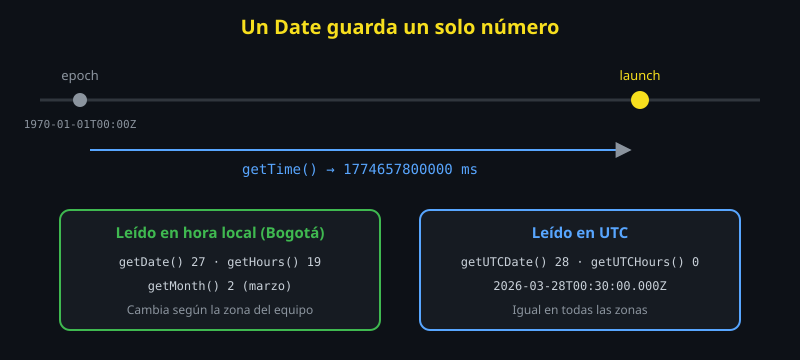

# 🕰️ El objeto Date

## 🎯 Objetivos

- Entender qué guarda un `Date`: un instante, contado en milisegundos desde 1970 en UTC.
- Crear fechas desde el reloj, desde un texto ISO 8601 y desde sus componentes.
- Leer los componentes en hora local y en UTC, y saber por qué los meses empiezan en 0.
- Detectar una fecha inválida y la trampa de `'2026-03-27'` sin hora.
- Copiar un `Date` antes de cambiarlo, compararlo y guardarlo en JSON.

Una página necesita fechas para casi todo: cuándo empieza una sesión, cuánto falta, qué día de la semana cae. JavaScript las representa con `Date`, un objeto que existe desde la primera versión del lenguaje y que tiene varias trampas conocidas. Esta teoría te enseña qué hay dentro para que las evites.

Los ejemplos se ejecutaron con Node 24.19.0 y la zona horaria de Bogotá (UTC−5, sin horario de verano), con `TZ=America/Bogota node archivo.js`. En otra zona verás otras horas locales; los valores en UTC (los que acaban en `Z`) son iguales en todas partes. La [teoría 04](04-zonas-horarias-temporal.md) explica las zonas a fondo.

---

## 📋 Contenido

### 1. Un `Date` es un instante

Un `Date` guarda **un solo número**: los milisegundos que han pasado desde el 1 de enero de 1970 a las 00:00 en UTC, la hora de referencia mundial. A ese número se le llama *timestamp* (marca de tiempo) y a ese origen, *epoch*.



```javascript
const launch = new Date('2026-03-27T19:30:00');

console.log(launch.getTime());
// 1774657800000
console.log(launch.toISOString());
// 2026-03-28T00:30:00.000Z
console.log(new Date(0).toISOString());
// 1970-01-01T00:00:00.000Z
```

- **`getTime()`** devuelve el timestamp. Dos `Date` son el mismo instante si su `getTime()` coincide.
- **`toISOString()`** escribe el instante en UTC, en el formato ISO 8601. La `Z` final significa «UTC». Las 19:30 en Bogotá son las 00:30 del día siguiente en UTC: es el mismo instante, leído en dos zonas.
- **`new Date(0)`** es el epoch.

`Date.now()` devuelve el timestamp de este momento, sin crear un objeto, y `new Date()` crea un `Date` con este momento. Su valor cambia en cada ejecución, así que los ejemplos y los labs usan fechas fijas para que la salida coincida con la tuya.

```javascript
console.log(typeof Date.now());
// number
```

### 2. Crear un `Date`

Hay cuatro formas, según lo que tengas:

| Tienes | Escribe | Ejemplo |
|---|---|---|
| Nada: quieres «ahora» | `new Date()` | `new Date()` |
| Un timestamp | `new Date(ms)` | `new Date(1774657800000)` |
| Un texto ISO 8601 | `new Date(texto)` | `new Date('2026-03-27T19:30:00')` |
| Los componentes | `new Date(año, mes, día, hora, minuto)` | `new Date(2026, 2, 27, 19, 30)` |

Con componentes, **el mes empieza en 0**: enero es `0` y diciembre es `11`. El día del mes sí empieza en 1. Es la trampa más famosa de `Date`, heredada de Java en 1995.

```javascript
const session = new Date(2026, 2, 27, 19, 30); // 2 = marzo

console.log(session.toISOString());
// 2026-03-28T00:30:00.000Z
```

Los componentes se interpretan en **hora local**. El texto ISO depende de cómo esté escrito:

```javascript
console.log(new Date('2026-03-27T19:30:00Z').toISOString());   // Z: es UTC
// 2026-03-27T19:30:00.000Z
console.log(new Date('2026-03-27T19:30:00+01:00').toISOString()); // desfase: es UTC+1
// 2026-03-27T18:30:00.000Z
console.log(new Date('2026-03-27T00:00').toISOString());       // con hora y sin Z: hora local
// 2026-03-27T05:00:00.000Z
```

Usa solo el formato ISO (`AAAA-MM-DDTHH:mm:ss`, con `T` entre fecha y hora). Otros textos, como `'27/03/2026'` o `'March 27, 2026'`, dependen del motor: unos los entienden y otros no.

### 3. La trampa de la fecha sin hora

Un texto con **solo la fecha** se interpreta en **UTC**, no en hora local:

```javascript
const day = new Date('2026-03-27');

console.log(day.toISOString());
// 2026-03-27T00:00:00.000Z
console.log(day.getDate());
// 26
```

La medianoche UTC del 27 son las 19:00 del **26** en Bogotá, y `getDate()` lee en hora local. Es una regla del estándar, no un error de Node. Un `<input type="date">` da justo ese formato (`'2026-03-27'`), así que la trampa aparece en cuanto lees un formulario de la [semana 20](../../week-20-formularios_validacion/README.md).

La salida: si el texto es una fecha de calendario local, añade la hora (`'2026-03-27T00:00'`) o crea el `Date` con componentes. La [teoría 03](03-operaciones.md#1-leer-una-fecha-local) lo convierte en una función.

### 4. Leer los componentes

Cada componente tiene dos lecturas: en hora local (`getHours`) y en UTC (`getUTCHours`).

```javascript
console.log(session.getFullYear(), session.getMonth(), session.getDate(), session.getDay(), session.getHours());
// 2026 2 27 5 19
console.log(session.getUTCHours(), session.getUTCDate());
// 0 28
```

| Método | Devuelve | Ojo |
|---|---|---|
| `getFullYear()` | El año, `2026` | Nunca `getYear()`, que está obsoleto |
| `getMonth()` | El mes, de `0` (enero) a `11` (diciembre) | Suma 1 para mostrarlo |
| `getDate()` | El día del mes, de `1` a `31` | No confundir con `getDay` |
| `getDay()` | El día de la semana, de `0` (domingo) a `6` (sábado) | La semana empieza en domingo |
| `getHours()`, `getMinutes()`, `getSeconds()` | La hora local | |
| `getUTCHours()`, `getUTCDate()`... | Lo mismo, leído en UTC | Igual en todas las zonas |

Cada `get` tiene su `set` (`setDate`, `setHours`, `setUTCHours`...), que cambia el objeto. La [teoría 03](03-operaciones.md) los usa para sumar días.

### 5. Fechas inválidas

Si el texto no se entiende, `new Date` no lanza un error: crea un `Date` inválido, cuyo timestamp es `NaN`.

```javascript
const bad = new Date('27/03/2026');

console.log(String(bad), bad.getTime(), Number.isNaN(bad.getTime()));
// Invalid Date NaN true
```

Compruébalo siempre con `Number.isNaN(date.getTime())` antes de usar una fecha que viene de fuera. `bad.toISOString()` sí lanza un `RangeError: Invalid time value`.

Con componentes pasa algo distinto: **los valores fuera de rango se desbordan** al mes o al año siguiente, sin avisar.

```javascript
console.log(new Date(2026, 1, 30).toISOString()); // 30 de febrero
// 2026-03-02T05:00:00.000Z
console.log(new Date(2026, 12, 1).toISOString()); // mes 12
// 2027-01-01T05:00:00.000Z
```

El 30 de febrero se convierte en el 2 de marzo. Eso es útil para sumar días (teoría 03), pero significa que para validar una fecha escrita por una persona hay que comprobar que el día y el mes no cambiaron.

### 6. `Date` es mutable: copia antes de cambiar

Los `set` cambian el objeto original, igual que `sort` cambia un array. Si otra parte del código guarda ese `Date`, verá el cambio. Copia primero con `new Date(fecha)`:

```javascript
const copy = new Date(launch);
copy.setHours(21);

console.log(launch.getHours(), copy.getHours());
// 19 21
```

- **Qué:** `new Date(otroDate)` crea un objeto nuevo con el mismo instante.
- **Para qué:** cambiar la copia sin tocar el original, como haces con `toSorted` o `with` en los arrays desde la [semana 5](../../week-05-arrays_avanzados/README.md).
- **Impacto:** las funciones de fechas de esta semana nunca cambian el `Date` que reciben: devuelven uno nuevo.

### 7. Comparar, mostrar y guardar

- **Comparar:** `<` y `>` funcionan, porque convierten los `Date` en su timestamp. `===` y `==` comparan objetos, no instantes: dos `Date` con la misma hora son objetos distintos. Para saber si son iguales, compara `getTime()`.

  ```javascript
  console.log(new Date('2026-03-27T19:30') < new Date('2026-03-28T08:00'));
  // true
  console.log(launch === new Date(launch), launch.getTime() === new Date(launch).getTime());
  // false true
  ```

- **Mostrar:** `String(fecha)` da un texto en inglés con la zona, pensado para depurar. En la consola de Node, `console.log(fecha)` muestra el ISO en UTC; en la del navegador, el texto local. Para una interfaz, usa `Intl` ([teoría 02](02-formatear-intl.md)).

  ```javascript
  console.log(String(launch));
  // Fri Mar 27 2026 19:30:00 GMT-0500 (Colombia Standard Time)
  ```

- **Guardar:** `JSON.stringify` convierte un `Date` en su texto ISO, pero `JSON.parse` no lo convierte de vuelta: devuelve el texto. Créalo otra vez con `new Date(texto)`, como en la [semana 19](../../week-19-web_storage_apis/README.md).

  ```javascript
  const json = JSON.stringify({ launch });
  console.log(json);
  // {"launch":"2026-03-28T00:30:00.000Z"}
  console.log(new Date(JSON.parse(json).launch).getTime() === launch.getTime());
  // true
  ```

---

## 🧪 Pruébalo

El [lab 01](../2-practicas/lab-01-objeto-date/README.md) crea fechas de las cuatro formas, lee sus componentes, cae en la trampa de la fecha sin hora, detecta fechas inválidas y desbordadas, y copia, compara y guarda en JSON.

## ✅ Checklist de aprendizaje

- [ ] Explico qué número guarda un `Date` y qué significa la `Z` de un texto ISO.
- [ ] Creo una fecha desde componentes recordando que el mes empieza en 0.
- [ ] Sé por qué `new Date('2026-03-27').getDate()` puede dar 26.
- [ ] Detecto una fecha inválida con `Number.isNaN(fecha.getTime())`.
- [ ] Copio un `Date` antes de usar un `set` y comparo instantes con `getTime()`.

<!-- nav -->
---

## 🔗 Navegación

| Anterior | Siguiente |
|---|---|
| ← [Semana 21 - Fechas y Tiempos (Date API)](../README.md) | [Teoría — 🗣️ Formatear fechas con Intl](02-formatear-intl.md) → |

[↑ Semana 21](../README.md)
