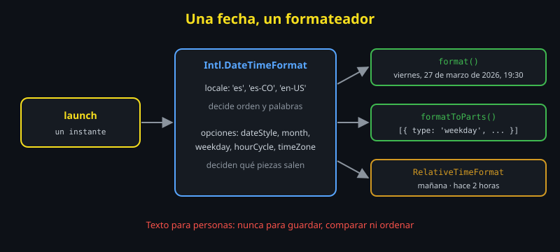

# 🗣️ Formatear fechas con Intl

## 🎯 Objetivos

- Mostrar una fecha con `toLocaleDateString` y `toLocaleTimeString` en el idioma y la región que elijas.
- Crear un formateador con `Intl.DateTimeFormat` y elegir sus opciones: estilos o componentes sueltos.
- Sacar las piezas de una fecha formateada con `formatToParts`.
- Escribir «mañana» o «hace 2 horas» con `Intl.RelativeTimeFormat`.
- Distinguir el texto para personas del texto para máquinas (ISO y claves `AAAA-MM-DD`).

Construir el texto de una fecha a mano (`día + '/' + (mes + 1) + '/' + año`) parece fácil, pero cada país la escribe distinto: Colombia pone el día primero, Estados Unidos el mes, Alemania usa puntos. Los nombres de los meses cambian con el idioma, y la hora puede ser de 12 o de 24. `Intl`, la API de internacionalización que traen el navegador y Node, sabe todo eso.

Los ejemplos se ejecutaron con Node 24.19.0 y `TZ=America/Bogota`, con `launch = new Date('2026-03-27T19:30:00')`, como en la [teoría 01](01-objeto-date.md).

---

## 📋 Contenido

### 1. `toLocale...String`: lo rápido

Los tres métodos `toLocale` de `Date` reciben un **locale** (la etiqueta de idioma y región, como `'es-CO'`, `'es-ES'` o `'en-US'`) y devuelven un texto:

```javascript
console.log(launch.toLocaleDateString('es-CO'));
// 27/3/2026
console.log(launch.toLocaleDateString('en-US'), launch.toLocaleDateString('de-DE'));
// 3/27/2026 27.3.2026
console.log(launch.toLocaleTimeString('es-CO'), launch.toLocaleTimeString('es-ES'));
// 7:30:00 p. m. 19:30:00
console.log(launch.toLocaleString('es-CO'));
// 27/3/2026, 7:30:00 p. m.
```

- **Qué:** el locale decide el orden, los separadores y el reloj de 12 o 24 horas. En Colombia la hora va con `p. m.`; en España, de 0 a 23.
- **Para qué:** mostrar la fecha como la espera quien la lee, sin escribir una regla por país.
- **Impacto:** sin locale (`launch.toLocaleDateString()`), se usa el del sistema. Node sin configurar usa `en-US`, así que escribe siempre el locale para que la salida no dependa del equipo.

### 2. `Intl.DateTimeFormat`: un formateador con opciones

`new Intl.DateTimeFormat(locale, opciones)` crea un formateador que puedes reutilizar con muchas fechas. Su método `format(fecha)` devuelve el texto. Las opciones más cómodas son los estilos:

```javascript
const full = new Intl.DateTimeFormat('es', { dateStyle: 'full', timeStyle: 'short' });
console.log(full.format(launch));
// viernes, 27 de marzo de 2026, 19:30
```

| `dateStyle` | Resultado en `'es'` |
|---|---|
| `'full'` | viernes, 27 de marzo de 2026 |
| `'long'` | 27 de marzo de 2026 |
| `'medium'` | 27 mar 2026 |
| `'short'` | 27/3/26 |

`timeStyle` acepta los mismos valores para la hora. Con `'es'`, sin región, la hora sale en 24 horas.

Si ningún estilo te sirve, pide los componentes sueltos. No se pueden mezclar con `dateStyle` ni `timeStyle`:

```javascript
console.log(new Intl.DateTimeFormat('es', { weekday: 'short', day: 'numeric', month: 'short' }).format(launch));
// vie, 27 mar
console.log(new Intl.DateTimeFormat('es', { month: 'long', year: 'numeric' }).format(launch));
// marzo de 2026
console.log(new Intl.DateTimeFormat('es', { hour: 'numeric', minute: '2-digit', hourCycle: 'h12' }).format(launch));
// 7:30 p. m.
```

| Opción | Valores |
|---|---|
| `weekday` | `'long'` (viernes), `'short'` (vie), `'narrow'` (V) |
| `day`, `hour`, `minute` | `'numeric'` (7), `'2-digit'` (07) |
| `month` | `'numeric'`, `'2-digit'`, `'long'` (marzo), `'short'` (mar) |
| `year` | `'numeric'` (2026), `'2-digit'` (26) |
| `hourCycle` | `'h23'` (de 0 a 23), `'h12'` (de 1 a 12, con a. m. y p. m.) |
| `timeZone` | Una zona, como `'Europe/Madrid'`: escribe la hora de esa zona ([teoría 04](04-zonas-horarias-temporal.md)) |

Tú eliges qué componentes aparecen; el locale decide el orden y las palabras de enlace («de»). Por eso no escribas nunca `'de'` a mano.



### 3. `formatToParts`: las piezas por separado

A veces quieres el texto por trozos: el día en grande, el mes debajo. `formatToParts` devuelve un array de objetos `{ type, value }`, con las mismas palabras que `format`:

```javascript
const parts = new Intl.DateTimeFormat('es', { weekday: 'long', day: 'numeric', month: 'long' }).formatToParts(launch);
console.log(parts);
// [
//   { type: 'weekday', value: 'viernes' },
//   { type: 'literal', value: ', ' },
//   { type: 'day', value: '27' },
//   { type: 'literal', value: ' de ' },
//   { type: 'month', value: 'marzo' }
// ]
console.log(parts.find((part) => part.type === 'weekday').value);
// viernes
```

Los trozos `literal` son los separadores. Busca las piezas por su `type`, nunca por su posición: en otro idioma cambian de orden.

### 4. `Intl.RelativeTimeFormat`: «mañana», «hace 2 horas»

Para decir cuánto falta o cuánto hace, `Intl.RelativeTimeFormat` recibe un número y una unidad (`'minute'`, `'hour'`, `'day'`, `'week'`, `'month'`, `'year'`). Positivo es futuro y negativo, pasado:

```javascript
const rtf = new Intl.RelativeTimeFormat('es', { numeric: 'auto' });

console.log(rtf.format(1, 'day'), rtf.format(2, 'day'), rtf.format(-1, 'day'), rtf.format(0, 'day'));
// mañana pasado mañana ayer hoy
console.log(rtf.format(3, 'day'), rtf.format(-2, 'hour'), rtf.format(15, 'minute'));
// dentro de 3 días hace 2 horas dentro de 15 minutos
console.log(new Intl.RelativeTimeFormat('es').format(1, 'day'));
// dentro de 1 día
```

- **Qué:** `numeric: 'auto'` usa palabras cuando existen («mañana», «ayer»). Sin esa opción, siempre escribe el número.
- **Para qué:** textos naturales en una agenda o en una lista de avisos.
- **Impacto:** `RelativeTimeFormat` **no calcula** la diferencia: solo escribe el número que le das. Elegir la unidad y contar los días es trabajo tuyo, y la [teoría 03](03-operaciones.md#4-cuántos-días-faltan) explica cómo contarlos bien.

### 5. Texto para personas, texto para máquinas

`Intl` escribe para personas: el texto cambia con el idioma, la región y hasta con la versión de los datos de idioma del navegador. **Nunca lo uses para guardar, comparar ni ordenar.** Para eso hay dos formatos fijos:

- **El ISO en UTC** de `toISOString()`, para guardar un instante: `2026-03-28T00:30:00.000Z`.
- **Una clave `AAAA-MM-DD` local**, para agrupar por día o para un `<input type="date">`. Se escribe con los componentes locales y `padStart`, que rellena con ceros por la izquierda:

  ```javascript
  const pad = (n) => String(n).padStart(2, '0');
  console.log(`${launch.getFullYear()}-${pad(launch.getMonth() + 1)}-${pad(launch.getDate())}`);
  // 2026-03-27
  console.log(launch.toISOString().slice(0, 10));
  // 2026-03-28
  ```

  `toISOString().slice(0, 10)` parece lo mismo, pero da el día **en UTC**: a las 19:30 en Bogotá ya es el 28 en UTC. Para la clave local, usa los `get` locales.

Las claves `AAAA-MM-DD` tienen otra ventaja: ordenadas como texto, quedan en orden cronológico, porque van del año al día y con ceros.

---

## 🧪 Pruébalo

El [lab 02](../2-practicas/lab-02-formatear-intl/README.md) formatea la misma fecha en varios locales, compara estilos y componentes, monta una tarjeta con `formatToParts`, escribe tiempos relativos y construye claves `AAAA-MM-DD`.

## ✅ Checklist de aprendizaje

- [ ] Escribo siempre el locale al formatear, para no depender del equipo.
- [ ] Elijo entre `dateStyle`/`timeStyle` y componentes sueltos, sin mezclarlos.
- [ ] Saco piezas de una fecha con `formatToParts` buscándolas por su `type`.
- [ ] Escribo tiempos relativos con `RelativeTimeFormat` y `numeric: 'auto'`.
- [ ] Guardo y ordeno con ISO o claves `AAAA-MM-DD`, nunca con texto de `Intl`.

<!-- nav -->
---

## 🔗 Navegación

| Anterior | Siguiente |
|---|---|
| ← [Teoría — 🕰️ El objeto Date](01-objeto-date.md) | [Teoría — ➕ Operaciones con fechas](03-operaciones.md) → |

[↑ Semana 21](../README.md)
