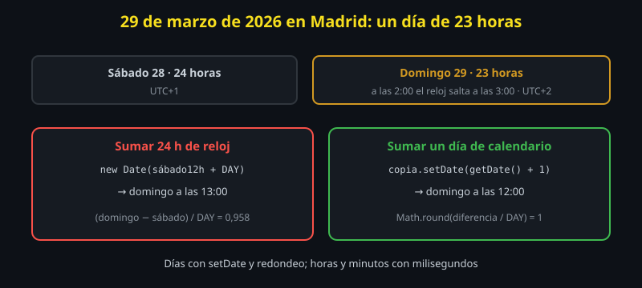

# ➕ Operaciones con fechas

## 🎯 Objetivos

- Leer una fecha local de un formulario y rechazar las que no existen.
- Sumar días y meses sin cambiar el `Date` original, aprovechando el desbordamiento.
- Contar días de calendario entre dos fechas sin que el horario de verano lo estropee.
- Ordenar, filtrar y comparar fechas con los métodos de array de ES2023.
- Calcular cuándo termina algo, si está en curso, y cuántos días tiene un mes.

Con un `Date` y `Intl` ya puedes mostrar una fecha. Una agenda necesita más: «dentro de 5 días», «¿esta sesión ya empezó?», «ordena por fecha». Esta teoría escribe esas operaciones como funciones pequeñas y puras, las mismas que usarás en el proyecto.

Los ejemplos se ejecutaron con Node 24.19.0 y `TZ=America/Bogota`, salvo los de la sección 4, que usan `TZ=Europe/Madrid` porque Bogotá no cambia la hora en verano.

---

## 📋 Contenido

### 1. Leer una fecha local

Un `<input type="date">` da `'2026-03-27'` y un `<input type="time">`, `'19:30'`. La [teoría 01](01-objeto-date.md#3-la-trampa-de-la-fecha-sin-hora) mostró que `new Date('2026-03-27')` lo lee en UTC. Con componentes se lee en hora local, y comprobar que los componentes no cambiaron detecta las fechas que no existen:

```javascript
const parseLocal = (dateText, timeText = '00:00') => {
  const [year, month, day] = dateText.split('-').map(Number);
  const [hours, minutes] = timeText.split(':').map(Number);
  const date = new Date(year, month - 1, day, hours, minutes);
  const same = date.getFullYear() === year && date.getMonth() === month - 1 && date.getDate() === day
    && date.getHours() === hours && date.getMinutes() === minutes;
  return same ? date : null;
};

console.log(parseLocal('2026-03-27', '19:30').toISOString());
// 2026-03-28T00:30:00.000Z
console.log(parseLocal('2026-02-30'));
// null
console.log(parseLocal('2026-03-27').getDate());
// 27
```

- **`split('-').map(Number)`** convierte `'2026-03-27'` en `[2026, 3, 27]`. El mes llega de 1 a 12, así que se resta 1 para `Date`.
- **El 30 de febrero se desborda** al 2 de marzo, el día deja de coincidir y la función devuelve `null`.
- **La hora también se comprueba**, porque hay horas locales que no existen (sección 4).

### 2. Sumar días y meses

El desbordamiento de la teoría 01 es la forma correcta de sumar días: cambia `getDate()` y deja que `Date` pase al mes siguiente.

```javascript
const addDays = (date, days) => {
  const result = new Date(date);
  result.setDate(result.getDate() + days);
  return result;
};

const session = new Date(2026, 2, 27, 19, 30);
console.log(addDays(session, 5).toISOString());
// 2026-04-02T00:30:00.000Z
console.log(addDays(session, -27).toISOString());
// 2026-03-01T00:30:00.000Z
console.log(session.getDate());
// 27
```

`new Date(date)` copia el original: `session` sigue en el 27. Restar es sumar un número negativo.

Con los meses, el desbordamiento sorprende: el 31 de enero más un mes es el 31 de febrero, que pasa al 3 de marzo.

```javascript
const addMonths = (date, months) => {
  const result = new Date(date);
  result.setMonth(result.getMonth() + months);
  return result;
};

console.log(addMonths(new Date(2026, 0, 31), 1).toISOString());
// 2026-03-03T05:00:00.000Z
```

No hay una respuesta única («¿un mes después del 31 de enero?»): decide qué quieres y escríbelo. Con `Temporal` ([teoría 04](04-zonas-horarias-temporal.md#5-temporal-la-api-nueva)), el resultado es el 28 de febrero.

### 3. Restar fechas

Restar dos `Date` da los milisegundos entre ellos, porque `-` los convierte en su timestamp:

```javascript
const DAY = 24 * 60 * 60 * 1000;
const start = new Date(2026, 2, 27, 19, 30);
const later = new Date(2026, 2, 30, 8, 0);

console.log((later - start) / DAY);
// 2.5208333333333335
console.log(Math.round((later - start) / (60 * 60 * 1000)));
// 61
```

Para horas y minutos, divide y redondea. Para **días de calendario** («¿cuántos días faltan?»), esa cuenta no sirve: del viernes a las 19:30 al lunes a las 8:00 hay 2,52 días de reloj, pero el lunes está a 3 días del viernes. Compara los inicios de los dos días:

```javascript
const startOfDay = (date) => new Date(date.getFullYear(), date.getMonth(), date.getDate());
const daysBetween = (from, to) => Math.round((startOfDay(to) - startOfDay(from)) / DAY);

console.log(daysBetween(start, later));
// 3
```

`Math.round` está ahí por la sección siguiente.

### 4. El horario de verano

En las zonas con horario de verano, un día al año tiene 23 horas y otro, 25. En Madrid, el 29 de marzo de 2026 el reloj salta de las 2:00 a las 3:00. Con `TZ=Europe/Madrid`:

```javascript
const saturday = new Date(2026, 2, 28, 12);
const sunday = new Date(2026, 2, 29, 12);
console.log((sunday - saturday) / DAY, (sunday - saturday) / (60 * 60 * 1000));
// 0.9583333333333334 23

console.log(new Date(saturday.getTime() + DAY).getHours());
// 13
console.log(addDays(saturday, 1).getHours());
// 12

console.log(new Date(2026, 2, 29, 2, 30).getHours());
// 3
```



- **Sumar `DAY` milisegundos** da las 13:00: se suman 24 horas de reloj, pero el día solo tenía 23. **`addDays`** con `setDate` mantiene las 12:00, que es lo que quiere una agenda.
- **Dividir entre `DAY`** da 0,96 en lugar de 1: por eso `daysBetween` redondea. Sin `Math.round`, `Math.floor` de 1,96 daría 1 día entre el sábado y el lunes.
- **Las 2:30 de ese domingo no existen**: `Date` las pasa a las 3:30. `parseLocal` lo detecta porque la hora deja de coincidir, y devuelve `null`.

La regla: para días, usa `setDate` y compara inicios de día con redondeo; para horas y minutos, resta milisegundos. Tu código no sabe en qué zona se ejecutará, así que escríbelo como si siempre hubiera horario de verano.

### 5. Ordenar, filtrar y comparar

Como `-` convierte las fechas en números, `(a, b) => a - b` las ordena de la más antigua a la más reciente. `toSorted` devuelve un array nuevo:

```javascript
const sessions = [new Date(2026, 3, 2, 18), new Date(2026, 2, 27, 19, 30), new Date(2026, 2, 28, 11)];
const sorted = sessions.toSorted((a, b) => a - b);

console.log(sorted.map((date) => date.getDate()), sessions.map((date) => date.getDate()));
// [ 27, 28, 2 ] [ 2, 27, 28 ]

const now = new Date(2026, 2, 28, 9);
console.log(sessions.filter((date) => date > now).length, sessions.findLast((date) => date < now).getDate());
// 2 27
```

Si los objetos tienen la fecha en una propiedad, ordena por ella: `events.toSorted((a, b) => a.start - b.start)`. Si la fecha está como texto ISO, conviértela primero con `new Date`, o compara las claves `AAAA-MM-DD` como texto ([teoría 02](02-formatear-intl.md#5-texto-para-personas-texto-para-máquinas)).

Para saber si dos fechas caen el mismo día, compara los tres componentes, no los timestamps:

```javascript
const isSameDay = (a, b) => a.getFullYear() === b.getFullYear() && a.getMonth() === b.getMonth() && a.getDate() === b.getDate();

console.log(isSameDay(start, new Date(2026, 2, 27, 8)), isSameDay(start, later));
// true false
```

### 6. Duraciones, intervalos y meses

- **Cuándo termina:** suma minutos en milisegundos. Una sesión de 90 minutos que empieza a las 19:30 termina a las 21:00.

  ```javascript
  const end = new Date(start.getTime() + 90 * 60 * 1000);
  console.log(end.getHours(), end.getMinutes(), now >= start && now < end);
  // 21 0 false
  ```

  `now >= start && now < end` dice si la sesión está en curso: empieza incluida y termina excluida, para que una sesión que acaba a las 21:00 y otra que empieza a las 21:00 no se solapen.

- **Cuántos días tiene un mes:** el día 0 de un mes es el último del anterior. `new Date(año, mes + 1, 0)` es el último día de `mes`.

  ```javascript
  const daysInMonth = (year, monthIndex) => new Date(year, monthIndex + 1, 0).getDate();
  console.log(daysInMonth(2026, 1), daysInMonth(2028, 1), daysInMonth(2026, 2));
  // 28 29 31
  ```

- **En qué día de la semana empieza un mes:** `getDay()` cuenta desde el domingo. Para un calendario que empieza en lunes, `(getDay() + 6) % 7` da 0 para el lunes y 6 para el domingo. El 1 de marzo de 2026 es domingo:

  ```javascript
  const first = new Date(2026, 2, 1);
  console.log(first.getDay(), (first.getDay() + 6) % 7);
  // 0 6
  ```

Con `daysInMonth` y ese desplazamiento se dibuja la cuadrícula de un mes, como en el proyecto.

---

## 🧪 Pruébalo

El [lab 03](../2-practicas/lab-03-operaciones/README.md) lee fechas de un formulario simulado, suma días y meses, cuenta días de calendario, ve el horario de verano de Madrid, ordena una lista de sesiones y dibuja un mes en la terminal.

## ✅ Checklist de aprendizaje

- [ ] Leo `'AAAA-MM-DD'` y `'HH:mm'` en hora local y rechazo las fechas que no existen.
- [ ] Sumo días con `setDate` sobre una copia, nunca sumando `24 * 60 * 60 * 1000`.
- [ ] Cuento días de calendario comparando inicios de día y redondeando.
- [ ] Ordeno fechas con `toSorted((a, b) => a - b)` y compruebo si dos caen el mismo día.
- [ ] Calculo el final de un intervalo y los días de un mes con el día 0.

<!-- nav -->
---

## 🔗 Navegación

| Anterior | Siguiente |
|---|---|
| ← [Teoría — 🗣️ Formatear fechas con Intl](02-formatear-intl.md) | [Teoría — 🌍 Zonas horarias y Temporal](04-zonas-horarias-temporal.md) → |

[↑ Semana 21](../README.md)
