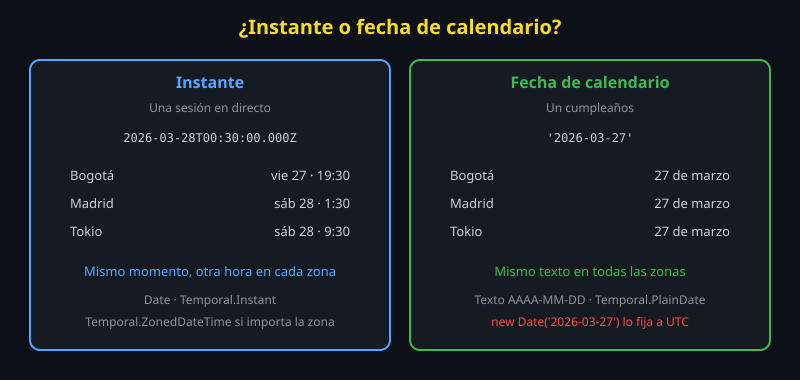

# 🌍 Zonas horarias y Temporal

## 🎯 Objetivos

- Distinguir un instante (un momento en todo el mundo) de una fecha de calendario (un día en una agenda).
- Mostrar el mismo instante en varias zonas con la opción `timeZone` de `Intl`.
- Leer el desfase de una zona y saber por qué cambia a lo largo del año.
- Seguir la regla: guarda en UTC, calcula con fechas de calendario, muestra en la zona de quien lee.
- Conocer `Temporal`, la API que resuelve los problemas de `Date`, y dónde se puede usar ya.

Una sesión del planetario de Madrid empieza a las 19:30 de Madrid. Quien la sigue en directo desde Bogotá quiere ver «13:30». Quien guarda su cumpleaños, el 27 de marzo, quiere verlo el 27 viaje a donde viaje. Son dos tipos de fecha distintos, y `Date` solo representa bien uno.

Los ejemplos con `Date` e `Intl` se ejecutaron con Node 24.19.0 y `TZ=America/Bogota`. Los de `Temporal`, en Chromium 156, porque Node 24 no lo trae.

---

## 📋 Contenido

### 1. Instantes y fechas de calendario

| Tipo | Ejemplo | Igual en todo el mundo | Se guarda como |
|---|---|---|---|
| **Instante** | El lanzamiento empieza ya, la sesión en directo empieza a las 00:30 UTC | Sí: es el mismo momento, aunque cada zona lo lea con otra hora | Texto ISO en UTC (`2026-03-28T00:30:00.000Z`) o timestamp |
| **Fecha y hora de calendario** | Un cumpleaños, un festivo, «abrimos a las 9:00» | No: el 27 de marzo empieza antes en Tokio que en Bogotá | Texto sin zona (`'2026-03-27'`, `'09:00'`) más la zona si importa |

Un `Date` es siempre un instante ([teoría 01](01-objeto-date.md#1-un-date-es-un-instante)). Cuando lo usas para un día de calendario, lo fijas a la medianoche de **tu** zona: en otra zona puede ser otro día. Por eso la [teoría 03](03-operaciones.md) guarda las fechas del formulario como texto (`'2026-03-27'`) y solo las convierte en `Date` para calcular.



### 2. El mismo instante en varias zonas

Las zonas tienen nombres de la base de datos IANA: `Continente/Ciudad`, como `'America/Bogota'` o `'Europe/Madrid'`. La opción `timeZone` de `Intl.DateTimeFormat` escribe el instante en esa zona:

```javascript
const launch = new Date('2026-03-28T00:30:00Z');
const zones = ['America/Bogota', 'America/Mexico_City', 'Europe/Madrid', 'Asia/Tokyo', 'UTC'];

for (const timeZone of zones) {
  const text = new Intl.DateTimeFormat('es', { dateStyle: 'medium', timeStyle: 'short', timeZone }).format(launch);
  console.log(timeZone.padEnd(20), text);
}
// America/Bogota       27 mar 2026, 19:30
// America/Mexico_City  27 mar 2026, 18:30
// Europe/Madrid        28 mar 2026, 1:30
// Asia/Tokyo           28 mar 2026, 9:30
// UTC                  28 mar 2026, 0:30
```

- **Qué:** `timeZone` cambia la zona en la que se lee el instante, no el instante.
- **Para qué:** mostrar una hora de otra zona sin hacer cuentas, que es donde se cuelan los errores.
- **Impacto:** el día también cambia: en Madrid ya es sábado. Si muestras la hora en otra zona, muestra también el día.

Sin `timeZone`, `Intl` y los `get` usan la zona del equipo. Puedes leerla, y comprobar si existe una zona:

```javascript
console.log(Intl.DateTimeFormat().resolvedOptions().timeZone);
// America/Bogota
console.log(Intl.supportedValuesOf('timeZone').length, Intl.supportedValuesOf('timeZone').includes('America/Bogota'));
// 418 true
```

Una zona que no existe lanza `RangeError: Invalid time zone specified: Marte/Olympus`.

### 3. El desfase cambia con la fecha

El desfase es la diferencia con UTC: Bogotá está a UTC−5 todo el año. Madrid está a UTC+1 en invierno y a UTC+2 en verano. Por eso **una zona no es un desfase**: guarda `'Europe/Madrid'`, no `+01:00`.

`timeZoneName: 'shortOffset'` escribe el desfase de ese instante; `getTimezoneOffset()` da el de la zona del equipo, en minutos y con el signo al revés (UTC menos local):

```javascript
for (const iso of ['2026-03-28T12:00Z', '2026-03-29T12:00Z']) {
  console.log(new Intl.DateTimeFormat('es', { timeZone: 'Europe/Madrid', hour: 'numeric', timeZoneName: 'shortOffset' }).format(new Date(iso)));
}
// 13 GMT+1
// 14 GMT+2
console.log(launch.getTimezoneOffset());
// 300
```

El 29 de marzo, Madrid pasa al horario de verano: el mismo mediodía UTC son las 13:00 un día y las 14:00 al siguiente. Los países también cambian sus reglas (México dejó el horario de verano en 2022): la base de datos IANA lo recoge y el navegador la actualiza, así que nunca escribas un desfase a mano.

### 4. La regla de las tres capas

1. **Guarda** los instantes en UTC: `toISOString()` al guardar, `new Date(texto)` al leer ([semana 19](../../week-19-web_storage_apis/README.md)). Las fechas de calendario, como texto `AAAA-MM-DD`.
2. **Calcula** días con fechas locales y las funciones de la [teoría 03](03-operaciones.md): `setDate`, inicios de día y redondeo.
3. **Muestra** con `Intl`, en la zona de quien lee. Si la hora pertenece a otra zona (un evento en directo en Madrid), muéstrala con `timeZone` y escribe la zona al lado.

Lo que `Date` no hace bien es el paso contrario: «las 19:30 de Madrid» a un instante, si tu equipo está en Bogotá. Los constructores solo entienden la zona del equipo o UTC, y calcular el desfase de Madrid para esa fecha a mano es frágil. Para eso existe `Temporal`.

### 5. Temporal, la API nueva

`Temporal` es la API de fechas que se ha diseñado para sustituir a `Date`. Es un objeto global, como `Math`, con un tipo distinto para cada idea:

| Tipo | Representa | Ejemplo |
|---|---|---|
| `Temporal.Instant` | Un instante, como `Date` | `2026-03-28T00:30:00Z` |
| `Temporal.PlainDate` | Una fecha de calendario, sin hora ni zona | `2026-03-27` |
| `Temporal.PlainTime` | Una hora de reloj | `19:30` |
| `Temporal.ZonedDateTime` | Fecha y hora en una zona concreta | `2026-03-27T19:30+01:00[Europe/Madrid]` |
| `Temporal.Duration` | Una duración | `PT1H30M` (1 hora y 30 minutos) |

Sus objetos **no se pueden cambiar**: `add` devuelve uno nuevo, como `toSorted`. Los meses empiezan en 1, y el texto sin hora es una fecha de calendario, no la medianoche UTC:

```javascript
const day = Temporal.PlainDate.from('2026-03-27');
console.log(day.toString(), day.month, day.dayOfWeek, day.daysInMonth);
// 2026-03-27 3 5 31
console.log(day.add({ days: 5 }).toString(), Temporal.PlainDate.from('2026-01-31').add({ months: 1 }).toString());
// 2026-04-01 2026-02-28
console.log(day.until(Temporal.PlainDate.from('2026-04-02')).days);
// 6
```

`dayOfWeek` va de 1 (lunes) a 7 (domingo). Sumar un mes al 31 de enero da el 28 de febrero, sin desbordarse. El 30 de febrero escrito como texto lanza un `RangeError` en lugar de convertirse en marzo.

`ZonedDateTime` resuelve lo que `Date` no podía: crear las 19:30 de Madrid y verlas en Bogotá, y sumar un día sin que el cambio de hora lo estropee:

```javascript
const talk = Temporal.ZonedDateTime.from({ timeZone: 'Europe/Madrid', year: 2026, month: 3, day: 27, hour: 19, minute: 30 });
console.log(talk.toInstant().toString(), talk.withTimeZone('America/Bogota').toPlainTime().toString());
// 2026-03-27T18:30:00Z 13:30:00

const noon = Temporal.ZonedDateTime.from('2026-03-28T12:00[Europe/Madrid]');
console.log(noon.add({ days: 1 }).toString());
// 2026-03-29T12:00:00+02:00[Europe/Madrid]
console.log(noon.add({ hours: 24 }).toString());
// 2026-03-29T13:00:00+02:00[Europe/Madrid]
```

`add({ days: 1 })` es un día de calendario; `add({ hours: 24 })`, 24 horas de reloj. Es la misma diferencia que había entre `setDate` y sumar milisegundos, pero escrita con palabras.

Para pasar de uno a otro: `fecha.toTemporalInstant()` convierte un `Date` en un `Instant`, y `new Date(instant.epochMilliseconds)` hace lo contrario.

**¿Dónde funciona?** En Chrome, Edge y Firefox actuales. Node 24 y Safari todavía no lo traen: consulta la tabla de compatibilidad de [MDN, en inglés](https://developer.mozilla.org/en-US/docs/Web/JavaScript/Reference/Global_Objects/Temporal) antes de usarlo en una página real. Mientras tanto, el código de esta semana usa `Date` e `Intl`, que funcionan en todas partes, con las reglas de la teoría 03. Saber qué resuelve `Temporal` te ayuda a reconocer los problemas de `Date` y a no caer en ellos.

---

## 🧪 Pruébalo

El [lab 04](../2-practicas/lab-04-zonas-temporal/README.md) es una página: muestra un instante en varias zonas, lee desfases antes y después del cambio de hora, aplica la regla de las tres capas y repite con `Temporal` las operaciones de la teoría 03.

## ✅ Checklist de aprendizaje

- [ ] Distingo un instante de una fecha de calendario y sé cómo se guarda cada uno.
- [ ] Muestro un instante en otra zona con `timeZone` y escribo también el día.
- [ ] Guardo zonas con su nombre IANA, nunca como un desfase fijo.
- [ ] Aplico la regla: guardar en UTC, calcular con fechas locales, mostrar en la zona de quien lee.
- [ ] Explico qué tipo de `Temporal` usaría para un cumpleaños, un evento en directo y una duración.

<!-- nav -->
---

## 🔗 Navegación

| Anterior | Siguiente |
|---|---|
| ← [Teoría — ➕ Operaciones con fechas](03-operaciones.md) | [Índice de labs](../2-practicas/README.md) → |

[↑ Semana 21](../README.md)
