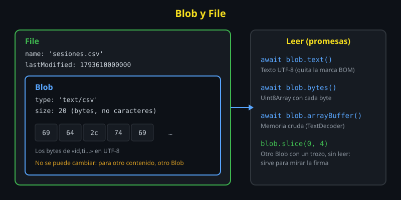

# 📦 Blob y File

## 🎯 Objetivos

- Entender qué es un `Blob`: un bloque de bytes con un tipo, que no se puede cambiar.
- Crear un `Blob` desde textos y bytes, y saber por qué `size` cuenta bytes y no caracteres.
- Leer su contenido con `text()`, `bytes()` y `arrayBuffer()`, y cortarlo con `slice`.
- Reconocer un `File`: un `Blob` con nombre y fecha de modificación.
- Desconfiar del nombre y del `type` de un archivo, y comprobar sus primeros bytes cuando importa.

Hasta ahora tus programas trabajaban con datos que escribías en el código o que llegaban de una API en JSON. Esta semana los datos llegan **en archivos**: una hoja de cálculo exportada a CSV, una foto, un JSON guardado en otro equipo. JavaScript representa cualquier archivo con dos objetos, `Blob` y `File`. Esta teoría explica qué guardan; la [teoría 02](02-leer-archivos.md) explica cómo llegan a la página.

`Blob` y `File` existen igual en el navegador y en Node 24, así que los ejemplos de esta teoría se ejecutan con Node 24.19.0 (`node archivo.js`) y dan la misma salida en la consola de las DevTools.

---

## 📋 Contenido

### 1. Un Blob es un bloque de bytes

Un **`Blob`** (*Binary Large OBject*, objeto binario grande) guarda una secuencia de **bytes** y un **tipo MIME** que dice qué son esos bytes: `text/plain`, `text/csv`, `image/png`... Un byte es un número de 0 a 255; cualquier archivo, sea texto, imagen o vídeo, es al final una lista de bytes.



Se crea con `new Blob(partes, opciones)`:

```javascript
const note = new Blob(['Cúpula'], { type: 'text/plain' });

console.log(note.size, note.type);
// 7 text/plain
console.log('Cúpula'.length);
// 6
```

- **`partes`** es un array. Cada parte puede ser un texto, otro `Blob` o bytes (`Uint8Array`, `ArrayBuffer`). El `Blob` las une en orden.
- **`type`** es opcional. Sin él, `type` es un texto vacío: el `Blob` no sabe qué contiene.
- **`size`** cuenta **bytes**, no caracteres. `'Cúpula'` tiene 6 caracteres y ocupa 7 bytes, porque los textos se guardan en **UTF-8**, la codificación de la web, en la que `ú` ocupa 2 bytes. Por eso un límite de tamaño de archivo se comprueba con `size`, nunca con la longitud del texto.

Un `Blob` **no se puede cambiar**: no tiene métodos para escribir dentro. Para «modificarlo», creas otro con las partes que quieras:

```javascript
const csv = new Blob(['id,title\n', 'S1,La Luna\n', new Uint8Array([79, 75])], { type: 'text/csv' });

console.log(csv.size);
// 22
```

Los bytes 79 y 75 son las letras `O` y `K` en UTF-8: un `Blob` no distingue entre partes de texto y partes de bytes, todo acaba siendo bytes.

### 2. Leer un Blob

Leer el contenido tarda: un archivo puede pesar cientos de megas y estar en disco. Por eso los métodos de lectura devuelven **promesas** ([semana 13](../../week-13-programacion_asincronica_callbacks_promises/README.md)):

| Método | Devuelve la promesa de | Úsalo para |
|---|---|---|
| `text()` | un texto, decodificado como UTF-8 | CSV, JSON, TXT, SVG |
| `bytes()` | un `Uint8Array` con los bytes | Mirar bytes concretos |
| `arrayBuffer()` | un `ArrayBuffer`, la memoria cruda | APIs que lo piden (audio, criptografía) |

```javascript
console.log(await csv.text());
// id,title
// S1,La Luna
// OK
console.log((await note.bytes()).join(' '));
// 67 195 186 112 117 108 97
```

Los bytes 195 y 186 son la `ú`. Un `ArrayBuffer` no se lee directamente: se mira a través de un `Uint8Array` o se convierte en texto con un **`TextDecoder`**. Su pareja, **`TextEncoder`**, hace lo contrario: convierte un texto en bytes UTF-8.

```javascript
const buffer = await note.arrayBuffer();
console.log(new TextDecoder().decode(buffer));
// Cúpula
console.log(new TextEncoder().encode('ú'));
// Uint8Array(2) [ 195, 186 ]
```

El `await` fuera de una función funciona en un módulo ES (en Node, un archivo con `import` o `await` arriba del todo). En un script clásico del navegador, como los de los labs, va dentro de una función `async`.

### 3. Cortar un Blob con slice

`blob.slice(inicio, fin, type)` devuelve un `Blob` **nuevo** con los bytes de `inicio` a `fin` (sin incluir `fin`), igual que el `slice` de los arrays. Acepta posiciones negativas, contadas desde el final, y no cambia el original.

```javascript
console.log(JSON.stringify(await csv.slice(0, 9).text()));
// "id,title\n"
console.log(await csv.slice(-2).text());
// OK
```

`slice` no lee nada: solo marca un trozo. Sirve para mirar el principio de un archivo grande sin leerlo entero (sección 5) o para enviarlo por partes. Como corta **bytes**, puede partir un carácter por la mitad:

```javascript
console.log(await note.slice(0, 2).text());
// C�
console.log(await note.slice(0, 3).text());
// Cú
```

El byte 2 es la primera mitad de la `ú`; al decodificarlo sola, `text()` pone el carácter de sustitución `�`.

### 4. Un File es un Blob con nombre

Un **`File`** es un `Blob` con dos datos más: **`name`**, el nombre del archivo, y **`lastModified`**, el timestamp de su última modificación ([semana 21](../../week-21-fechas_tiempos_date_api/1-teoria/01-objeto-date.md)). Todo lo que funciona con un `Blob` funciona con un `File`.

```javascript
const file = new File(['id,title\nS1,La Luna\n'], 'sesiones.csv', {
  type: 'text/csv',
  lastModified: Date.UTC(2026, 10, 2, 9, 0),
});

console.log(file.name, file.size, file.type);
// sesiones.csv 20 text/csv
console.log(new Date(file.lastModified).toISOString());
// 2026-11-02T09:00:00.000Z
console.log(file instanceof Blob);
// true
```

En una página casi nunca creas un `File`: te los da el navegador cuando la persona elige o arrastra archivos ([teoría 02](02-leer-archivos.md)). Crearlos a mano sirve para dos cosas: preparar un archivo para descargar ([teoría 03](03-urls-descargas.md)) y **probar** funciones con Node, como hace `scripts/verificar-semana.sh` con el proyecto.

La extensión se saca del nombre, desde el último punto, en minúsculas para que `.CSV` y `.csv` cuenten igual:

```javascript
const extensionOf = (name) => (name.includes('.') ? name.slice(name.lastIndexOf('.')).toLowerCase() : '');

console.log(extensionOf('Datos.CSV'), extensionOf('foto.final.png'), JSON.stringify(extensionOf('LEEME')));
// .csv .png ""
```

### 5. El nombre y el type no son el contenido

El `type` de un `File` elegido por una persona lo pone el navegador a partir de la **extensión**, con ayuda del sistema operativo; no mira el contenido. Dos consecuencias:

- **El mismo archivo puede tener otro `type` en otro equipo.** Un `.csv` suele llegar como `text/csv`, pero en algunos Windows con Excel instalado llega como `application/vnd.ms-excel`, y una extensión que el sistema no conoce llega con `type` vacío. Por eso, para decidir si aceptas un archivo, la extensión es más fiable que el `type`.
- **Una extensión no garantiza nada.** Cualquiera puede renombrar `notas.txt` a `foto.png`.

Cuando el contenido importa (vas a mostrar una imagen o enviarla a un servidor), se comprueban sus **primeros bytes**. Muchos formatos empiezan por una secuencia fija, su **firma** o *magic number*: un PNG empieza por `89 50 4E 47` (`‰PNG`), un PDF por `25 50 44 46` (`%PDF`).

```javascript
const PNG = [0x89, 0x50, 0x4e, 0x47];
const isPng = async (blob) => {
  const head = await blob.slice(0, 4).bytes();
  return PNG.every((byte, i) => head[i] === byte);
};

console.log(await isPng(new File(['no soy una imagen'], 'falsa.png', { type: 'image/png' })));
// false
```

`slice(0, 4)` lee solo 4 bytes, aunque el archivo pese 20 MB. Comprobarlo en la página mejora los mensajes para la persona, pero **no es seguridad**: quien quiera engañar a tu página puede saltarse tu JavaScript. Un servidor que recibe archivos los vuelve a comprobar siempre.

### 6. Texto, JSON y la marca BOM

Un archivo CSV o JSON es texto: se lee con `text()` y se convierte en datos con `JSON.parse` o separando líneas y columnas ([teoría 02](02-leer-archivos.md#5-convertir-el-texto-en-datos)). Si el texto no es JSON válido, `JSON.parse` lanza un `SyntaxError`, que hay que atrapar con `try...catch` ([semana 11](../../week-11-manejo_errores_moderno/README.md)).

Algunos programas, como Excel al guardar «CSV UTF-8», ponen al principio del archivo tres bytes invisibles, `EF BB BF`: la **marca BOM** (*Byte Order Mark*), el carácter ``. Avisa de que el archivo está en UTF-8.

```javascript
const BOM = '';
const withBom = new Blob([BOM, 'id,title\n']);

console.log(withBom.size);
// 12
const text = await withBom.text();
console.log(text.startsWith(BOM), text.length);
// false 9
```

`text()` y `TextDecoder` **quitan la marca** al leer, así que normalmente no la ves. Pero otras formas de leer, como `TextDecoder` con `ignoreBOM: true` o algunos lectores antiguos, la dejan en el texto y la primera columna pasa a llamarse `id` en lugar de `id`. Un lector de CSV robusto la quita él mismo con `text.replace(/^/, '')`, que no hace nada si no está.

Al revés, al **crear** un CSV para que alguien lo abra con Excel, se añade la marca: sin ella, Excel lee las tildes mal (`Cúpula` en lugar de `Cúpula`). Lo verás en la [teoría 03](03-urls-descargas.md#5-exportar-csv-y-json).

---

## 🧪 Pruébalo

El [lab 01](../2-practicas/lab-01-blob-file/README.md) crea, lee y corta Blobs con Node, crea Files, detecta archivos por su firma y lee JSON y CSV con marca BOM.

## ✅ Checklist de aprendizaje

- [ ] Creo un `Blob` desde textos y bytes, y explico por qué `size` no es la longitud del texto.
- [ ] Leo un `Blob` con `text()`, `bytes()` o `arrayBuffer()`, y uso `await` con ellos.
- [ ] Corto un `Blob` con `slice` sin leerlo entero y sé por qué puede partir un carácter.
- [ ] Explico qué añade un `File` a un `Blob` y saco la extensión de su nombre.
- [ ] Sé por qué el `type` y la extensión no garantizan el contenido, y compruebo la firma de un archivo.
- [ ] Sé qué es la marca BOM, cuándo la quito y cuándo la pongo.

<!-- nav -->
---

## 🔗 Navegación

| Anterior | Siguiente |
|---|---|
| ← [Semana 22 - Trabajo con Archivos](../README.md) | [Teoría — 📂 Leer archivos del usuario](02-leer-archivos.md) → |

[↑ Semana 22](../README.md)
