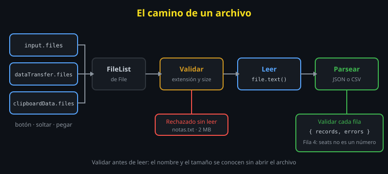

# 📂 Leer archivos del usuario

## 🎯 Objetivos

- Pedir archivos con `<input type="file">` y recibirlos en `input.files` con el evento `change`.
- Validar extensión y tamaño antes de leer, sin fiarte de `accept`.
- Leer el texto con `file.text()` y conocer `FileReader`, la API anterior, y sus eventos.
- Convertir el texto en datos: JSON con `JSON.parse` y CSV con sus reglas de comillas.
- Validar cada fila y avisar de todos los errores, con su número de fila.

Una página no puede leer los archivos del equipo cuando quiera: solo los que la persona le da, uno a uno, eligiéndolos o arrastrándolos. Esta teoría sigue el camino completo de un archivo elegido con un botón: llegar, validarse, leerse y convertirse en datos.



Los ejemplos de esta teoría usan el DOM, así que se ejecutan en el navegador. Las salidas son las del [lab 02](../2-practicas/lab-02-leer-archivos/README.md) en Chromium 156, con los archivos de su carpeta `muestras/`.

---

## 📋 Contenido

### 1. `<input type="file">`

```html
<label for="files">Archivos de sesiones (CSV o JSON)</label>
<input id="files" type="file" accept=".csv,.json" multiple />
```

- **`type="file"`** muestra un botón que abre el diálogo del sistema para elegir archivos.
- **`accept`** filtra el diálogo: extensiones (`.csv`), tipos MIME (`text/csv`) o familias (`image/*`), separados por comas.
- **`multiple`** deja elegir varios a la vez (Ctrl o Mayús + clic en el diálogo). Sin él, solo uno.
- El **`<label>`** con `for` da un nombre al botón para los lectores de pantalla, como en cualquier campo de formulario ([semana 20](../../week-20-formularios_validacion/README.md)).

Cuando la persona elige, el input lanza el evento **`change`** y deja los archivos en **`input.files`**, una **`FileList`**: una lista de objetos `File` ([teoría 01](01-blob-file.md#4-un-file-es-un-blob-con-nombre)) que se recorre con `for...of` o se convierte en array con `[...input.files]`.

```javascript
const input = document.querySelector('#files');

input.addEventListener('change', () => {
  const files = [...input.files].toSorted((a, b) => a.name.localeCompare(b.name));
  for (const file of files) {
    console.log(file.name, file.size, file.type || '(sin type)');
  }
});
// catalogo-grande.csv 2162 text/csv
// notas.txt 50 text/plain
// roto.json 38 application/json
// sesiones.csv 128 text/csv
// sesiones.json 170 application/json
```

El orden de `input.files` depende del sistema y del diálogo; si lo necesitas estable, ordénalos tú con `toSorted`, como aquí.

Tres detalles de este input que sorprenden la primera vez:

- **La página no ve la ruta.** `file.name` es solo el nombre (`sesiones.csv`), y `input.value` devuelve `C:\fakepath\sesiones.csv` en todos los sistemas. Es una protección: la carpeta de un usuario dice cosas de él.
- **No se puede rellenar desde JavaScript.** `input.value = 'algo'` lanza un error; la única asignación permitida es `input.value = ''`, que lo vacía. Una página no puede elegir archivos por la persona.
- **Elegir el mismo archivo otra vez no lanza `change`**, porque el valor no cambia. Si quieres que se pueda volver a importar, vacía el input al terminar con `input.value = ''`.

### 2. Validar antes de leer

`accept` solo es una sugerencia: en el diálogo, la persona puede cambiar el filtro a «Todos los archivos» y elegir un `.txt`. Por eso la página valida cada archivo **antes de leerlo**, con lo que sabe sin abrirlo: su nombre y su tamaño.

```javascript
const MAX_BYTES = 1024;
const ACCEPTED = ['.csv', '.json'];
const extensionOf = (name) => (name.includes('.') ? name.slice(name.lastIndexOf('.')).toLowerCase() : '');

const checkFile = (file) => {
  const extension = extensionOf(file.name);
  if (!ACCEPTED.includes(extension)) return `la extensión ${extension || '(ninguna)'} no se admite`;
  if (file.size === 0) return 'está vacío';
  if (file.size > MAX_BYTES) return `pesa ${file.size} B y el máximo es ${MAX_BYTES} B`;
  return null;
};
// ✘ catalogo-grande.csv: pesa 2162 B y el máximo es 1024 B
// ✘ notas.txt: la extensión .txt no se admite
// ✔ roto.json
```

- **Qué:** una función que devuelve `null` si el archivo vale o el motivo si no.
- **Para qué:** leer un archivo de 2 GB en memoria puede colgar la pestaña; comprobar `size` antes no cuesta nada.
- **Impacto:** cada archivo rechazado tiene un mensaje que la persona entiende. `roto.json` pasa esta validación: lo que tiene mal está **dentro**, y eso solo se sabe al leerlo (sección 5).

Se usa la extensión y no `file.type` porque el `type` cambia según el sistema ([teoría 01](01-blob-file.md#5-el-nombre-y-el-type-no-son-el-contenido)).

### 3. Leer con `file.text()`

Para un archivo de texto basta con `await file.text()`. Dentro de un listener, la función se marca como `async`:

```javascript
input.addEventListener('change', async () => {
  for (const file of [...input.files].filter((file) => checkFile(file) === null)) {
    const text = await file.text();
    const lines = text.trimEnd().split('\n');
    console.log(`${file.name}: ${lines.length} líneas · primera: ${lines[0]}`);
  }
});
// roto.json: 2 líneas · primera: [
// sesiones.csv: 4 líneas · primera: id,title,room,seats
// sesiones.json: 4 líneas · primera: [
```

El `for...of` con `await` lee los archivos **uno detrás de otro**, en orden. Para leerlos a la vez, se lanza una lectura por archivo y se espera a todas con `Promise.all` ([semana 14](../../week-14-async_await/README.md)): `const texts = await Promise.all(files.map((file) => file.text()))`. Para unos pocos archivos pequeños no hay diferencia; leerlos en orden hace que los mensajes salgan en orden.

### 4. `FileReader`: la API anterior

Antes de que `Blob` tuviera `text()`, los archivos se leían con **`FileReader`**, que avisa con eventos en lugar de devolver una promesa. Lo seguirás viendo en código y tutoriales, y tiene dos usos propios: el evento `progress` para mostrar el avance de un archivo grande y `readAsDataURL` ([teoría 03](03-urls-descargas.md#2-data-urls)).

```javascript
const reader = new FileReader();
reader.addEventListener('load', () => console.log(reader.result.length, 'caracteres'));
reader.addEventListener('error', () => console.log('No se pudo leer:', reader.error.name));
reader.readAsText(file);
```

- **`readAsText(file)`**, `readAsArrayBuffer(file)` y `readAsDataURL(file)` empiezan la lectura y vuelven enseguida, sin resultado.
- Al terminar llega **`load`** (bien) o **`error`** (mal, por ejemplo si el archivo se borró mientras tanto), y el resultado queda en **`reader.result`**.
- La secuencia completa de eventos es `loadstart → progress → load → loadend`. El evento `progress` lleva `loaded` y `total` en bytes; con un archivo pequeño llega una sola vez, con uno grande, varias.

Para usarlo con `await`, se envuelve en una promesa, como hiciste con los temporizadores en la [semana 13](../../week-13-programacion_asincronica_callbacks_promises/README.md):

```javascript
const readAsText = (file) => new Promise((resolve, reject) => {
  const reader = new FileReader();
  reader.addEventListener('load', () => resolve(reader.result));
  reader.addEventListener('error', () => reject(reader.error));
  reader.readAsText(file);
});
// eventos: loadstart → progress 128/128 → load → loadend
// ¿mismo texto que file.text()? true
```

`FileReader` solo existe en el navegador; Node 24 no lo trae. Para código nuevo que no necesita el progreso, usa `file.text()`.

### 5. Convertir el texto en datos

Un archivo leído es un texto. Para trabajar con sus datos hay que **parsearlo**: convertirlo en arrays y objetos.

**JSON.** `JSON.parse` lanza un `SyntaxError` si el texto no es JSON válido. Atrápalo y comprueba también la forma: un JSON válido puede ser un objeto cuando esperabas una lista.

```javascript
try {
  const data = JSON.parse(text);
  if (!Array.isArray(data)) throw new TypeError('el JSON no es una lista');
  console.log(data.length, 'registros');
} catch (error) {
  console.log(`${file.name}: ${error.name}`);
}
// roto.json: SyntaxError
```

**CSV.** Un CSV (*Comma-Separated Values*) es una tabla en texto: una fila por línea y las columnas separadas por comas, con la primera fila como cabecera. Parece que basta con `split`:

```javascript
const rows = text.trimEnd().split('\n').map((line) => line.split(','));
// ⚠ S3 tiene 5 columnas en lugar de 4: S3 | "Constelaciones |  mitos y mapas" | Cúpula | 80
```

Falla en cuanto un valor lleva una coma. Las reglas del formato (la [RFC 4180](https://www.rfc-editor.org/rfc/rfc4180)) resuelven esos casos con comillas:

| En el archivo | Valor | Regla |
|---|---|---|
| `S1,La Luna` | `S1` y `La Luna` | La coma separa columnas |
| `"Constelaciones, mitos"` | `Constelaciones, mitos` | Entre comillas, la coma es texto |
| `"El ""Sol"""` | `El "Sol"` | Una comilla dentro se escribe dos veces |
| `"línea 1⏎línea 2"` | Un valor con un salto de línea | Entre comillas, el salto también es texto |
| `id,title⏎` o `id,title␍⏎` | Fin de fila | Las filas terminan en `\n` o en `\r\n` (Windows) |

Como un salto de línea puede estar dentro de un valor, un CSV no se puede partir primero en líneas y luego en comas. Se recorre **carácter a carácter**, recordando si estás dentro o fuera de unas comillas:

- **Fuera de comillas:** una `,` cierra la celda; un `\n` (o `\r\n`) cierra la celda y la fila; una `"` abre comillas; cualquier otro carácter se añade a la celda.
- **Dentro de comillas:** `""` añade una comilla a la celda; una `"` sola cierra las comillas; cualquier otro carácter, incluidas comas y saltos, se añade a la celda.

Es lo que hace `parseCsv` en el proyecto de la semana. Antes de empezar, quita la marca BOM ([teoría 01](01-blob-file.md#6-texto-json-y-la-marca-bom)), y al terminar, sáltate las líneas vacías: muchos archivos acaban con un salto de línea.

### 6. Validar cada fila

Un archivo real casi siempre tiene alguna fila mal: una celda vacía, una palabra donde iba un número. Rechazar el archivo entero por una fila frustra a quien lo sube; aceptar la fila rota estropea los datos. La solución habitual:

1. Comprueba que la cabecera tiene las columnas que necesitas. Si falta una, ninguna fila sirve: un solo error.
2. Valida cada fila por separado y guarda sus errores con el **número de fila**, como `{ row: 4, message: 'seats no es un número' }`.
3. Las filas buenas pasan; las malas se quedan fuera y se informan **todas** juntas, no solo la primera.

```javascript
const seats = Number(cell.trim());
if (cell.trim() === '' || !Number.isFinite(seats)) errors.push({ row, message: 'seats no es un número' });
```

`Number('')` vale `0` y `Number('muchas')` vale `NaN`: por eso se comprueba el vacío aparte y se usa `Number.isFinite`, que es `false` para `NaN` e `Infinity`. Contar las filas desde 1, con la cabecera como fila 1, hace que el número coincida con el que la persona ve en su hoja de cálculo.

---

## 🧪 Pruébalo

El [lab 02](../2-practicas/lab-02-leer-archivos/README.md) elige cinco archivos de muestra, los valida, los lee con `file.text()` y con `FileReader`, los parsea y descubre por qué `split(',')` no sirve para CSV.

## ✅ Checklist de aprendizaje

- [ ] Pido archivos con `<input type="file">`, `accept`, `multiple` y un `<label>`.
- [ ] Recorro `input.files` en el evento `change` y vacío el input para poder elegir otra vez el mismo archivo.
- [ ] Valido extensión, vacío y tamaño antes de leer, sin fiarme de `accept` ni de `type`.
- [ ] Leo con `await file.text()` y sé envolver `FileReader` en una promesa.
- [ ] Atrapo el `SyntaxError` de `JSON.parse` y compruebo que el JSON es una lista.
- [ ] Explico las reglas de comillas de un CSV y por qué no basta con `split`.
- [ ] Valido cada fila y devuelvo todos los errores con su número de fila.

<!-- nav -->
---

## 🔗 Navegación

| Anterior | Siguiente |
|---|---|
| ← [Teoría — 📦 Blob y File](01-blob-file.md) | [Teoría — 🔗 URLs de objeto y descargas](03-urls-descargas.md) → |

[↑ Semana 22](../README.md)
