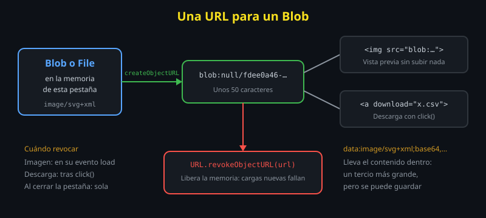

# 🔗 URLs de objeto y descargas

## 🎯 Objetivos

- Dar una dirección a un `Blob` con `URL.createObjectURL` y usarla en `` o `<a>`.
- Distinguir una URL de objeto (`blob:`) de una data URL (`data:`) y saber cuándo usar cada una.
- Liberar la memoria con `URL.revokeObjectURL` en el momento correcto.
- Descargar un archivo creado en la página con `<a download>`.
- Exportar datos a CSV, con sus comillas y la marca BOM, y a JSON.
- Mostrar la vista previa de una imagen elegida por la persona.

Leer archivos es la mitad del trabajo. La otra mitad es **devolverlos**: mostrar una imagen que la persona acaba de elegir sin subirla a ningún servidor, o dejarle descargar los datos de la página como un archivo. Los dos casos necesitan lo mismo: que un `Blob` que solo existe en la memoria de la página tenga una **URL**, porque `` y `<a>` solo entienden direcciones.

Los ejemplos se ejecutan en el navegador; las salidas son las del [lab 03](../2-practicas/lab-03-urls-descargas/README.md) en Chromium 156.

---

## 📋 Contenido

### 1. `URL.createObjectURL`

`URL.createObjectURL(blob)` devuelve una dirección que empieza por **`blob:`** y apunta a ese `Blob` mientras la página esté abierta. Cualquier atributo que espere una URL la acepta: `src` de ``, `<video>` o `<audio>`, `href` de `<a>`.



```javascript
const svg = `<svg xmlns="http://www.w3.org/2000/svg" width="160" height="90">
  <rect width="160" height="90" fill="#161b22"/>
  <circle cx="80" cy="45" r="30" fill="#F7DF1E"/>
</svg>`;
const image = new Blob([svg], { type: 'image/svg+xml' });
const imageUrl = URL.createObjectURL(image);

console.log(imageUrl);
// blob:null/fdee0a46-f434-4634-bd43-502d81f0dc9e
document.querySelector('#preview').src = imageUrl;
```

- La URL lleva el **origen** de la página (`null` si la abres con doble clic, `http://localhost:3000` si la sirve un servidor) y un identificador aleatorio. Cada llamada crea una URL distinta, aunque el `Blob` sea el mismo.
- **Solo vale en esta pestaña.** Si la copias en otra pestaña o la guardas en `localStorage`, no funciona: el `Blob` está en la memoria de esta página, y al cerrarla desaparece.
- **El `type` del `Blob` importa.** El navegador lo usa para saber qué es: un SVG con `type: 'text/plain'` no se dibuja como imagen.

### 2. Data URLs

Una **data URL** lleva el contenido **dentro** de la propia dirección, codificado en **base64**, un formato que escribe cualquier byte con 64 caracteres de texto seguros:

```javascript
const reader = new FileReader();
reader.addEventListener('load', () => console.log(reader.result.slice(0, 40)));
reader.readAsDataURL(image);
// data:image/svg+xml;base64,PHN2ZyB4bWxucz
// longitud: 254 · el Blob: 170 bytes
```

| | URL de objeto `blob:` | Data URL `data:` |
|---|---|---|
| Qué contiene | Un identificador; el contenido sigue en el `Blob` | El contenido entero, en base64 |
| Tamaño | Unos 50 caracteres, pese lo que pese el archivo | Un tercio más que el archivo |
| Cuánto dura | Hasta `revokeObjectURL` o hasta cerrar la página | Lo que dure el texto: se puede guardar y copiar |
| Cómo se crea | Al momento, sin leer el archivo | Leyendo el archivo entero con `FileReader` |

Para mostrar o descargar un archivo en la página, usa una URL de objeto: es inmediata y no copia el contenido. Una data URL solo compensa con datos **pequeños** que tienen que sobrevivir a la página, como un icono guardado en `localStorage` ([semana 19](../../week-19-web_storage_apis/README.md)).

### 3. `URL.revokeObjectURL`

Mientras una URL de objeto exista, el navegador guarda su `Blob` en memoria, aunque ya no lo use nadie. Con una imagen no se nota; con una galería de cien fotos de 5 MB, sí. **`URL.revokeObjectURL(url)`** anula la URL y deja que el navegador libere el `Blob`.

```javascript
URL.revokeObjectURL(imageUrl);
// la imagen ya cargada sigue visible: true 160
// una imagen nueva con la URL revocada: error
```

Lo que ya se cargó sigue en pantalla; lo que intente cargar la URL después falla, y la consola muestra `Not allowed to load local resource: blob:...`. Por eso se revoca **cuando ya no hace falta**:

- **Una imagen:** en su evento `load`, cuando ya está dibujada.
- **Una descarga:** justo después de empezarla (sección 4).
- **Una URL que se sustituye:** antes de crear la nueva, revoca la anterior.

### 4. Descargar un archivo

Un enlace con el atributo **`download`** le dice al navegador que guarde el destino como archivo en lugar de abrirlo, y su valor es el nombre propuesto. Con una URL de objeto, el archivo puede ser cualquier `Blob` creado en la página:

```javascript
const download = (blob, filename) => {
  const url = URL.createObjectURL(blob);
  const link = document.createElement('a');
  link.href = url;
  link.download = filename;
  link.click();
  setTimeout(() => URL.revokeObjectURL(url), 0);
};

download(new Blob(['La Luna de cerca: 80 plazas\n'], { type: 'text/plain' }), 'plazas.txt');
```

- **Qué:** crea un enlace que no se añade a la página, lo pulsa con `click()` y revoca la URL.
- **Para qué:** no hace falta un servidor para generar el archivo; todo ocurre en el navegador.
- **Impacto:** el `setTimeout(..., 0)` espera a que termine el código actual antes de revocar, para que el navegador ya haya empezado la descarga.

El navegador decide el resto: según su configuración guarda en la carpeta de descargas o pregunta dónde, y si ya existe un archivo con ese nombre añade un número (`plazas (1).txt`). Llama a `download` desde un clic de la persona: algunos navegadores bloquean descargas que la página lanza sola, y a nadie le gusta recibir archivos sin pedirlos.

### 5. Exportar CSV y JSON

**JSON** es el formato más directo para guardar datos y volver a abrirlos en la página: `JSON.stringify(data, null, 2)` los escribe con sangría de 2 espacios, legibles para una persona.

```javascript
download(new Blob([JSON.stringify(sessions, null, 2)], { type: 'application/json' }), 'sesiones.json');
```

**CSV** es el formato para quien va a abrir los datos con una hoja de cálculo. Escribirlo es el camino inverso de leerlo ([teoría 02](02-leer-archivos.md#5-convertir-el-texto-en-datos)): cada valor con coma, comillas o salto de línea va entre comillas, con sus comillas escritas dos veces.

```javascript
const csvCell = (value) => {
  const text = String(value);
  return /[",\r\n]/.test(text) ? `"${text.replaceAll('"', '""')}"` : text;
};
console.log(['S2', 'Constelaciones, mitos y mapas', 'El "Gran Telescopio"'].map(csvCell).join(','));
// S2,"Constelaciones, mitos y mapas","El ""Gran Telescopio"""
```

Para que Excel lo abra bien, dos detalles más:

- **Las filas terminan en `\r\n`**, el salto de línea de Windows, que entienden todos los programas.
- **Empieza por la marca BOM** (`''`, [teoría 01](01-blob-file.md#6-texto-json-y-la-marca-bom)). Sin ella, Excel supone otra codificación y escribe `Cúpula` en lugar de `Cúpula`. Se añade como primera parte del `Blob`: `new Blob(['', csvText], { type: 'text/csv' })`.

Un archivo exportado por tu página debería poder **importarse otra vez** sin cambios: con la misma cabecera, las mismas reglas y la marca BOM que el lector sabe quitar. Es la prueba de ida y vuelta del paso 6 del lab 03 y del proyecto.

### 6. Vista previa de una imagen

Para enseñar una foto que la persona acaba de elegir no hace falta leerla: un `File` es un `Blob`, así que tiene URL de objeto directamente.

```javascript
input.addEventListener('change', () => {
  const [file] = input.files;
  if (!file?.type.startsWith('image/')) return;
  const url = URL.createObjectURL(file);
  preview.addEventListener('load', () => URL.revokeObjectURL(url), { once: true });
  preview.src = url;
  preview.alt = `Vista previa de ${file.name}`;
});
```

- Se comprueba `type` para no intentar mostrar un PDF en un ``. Aquí el `type` basta, porque si mintiera, lo peor que pasa es que la imagen no carga ([teoría 01](01-blob-file.md#5-el-nombre-y-el-type-no-son-el-contenido)).
- Un **SVG** en un `` es seguro: el navegador no ejecuta los scripts que pueda llevar dentro. Insertar el **texto** de un SVG del usuario con `innerHTML` no lo es: sería el XSS de la [semana 17](../../week-17-dom_manipulation_moderna/README.md).
- `{ once: true }` quita el listener después de la primera vez, para no revocar la URL de la siguiente imagen.

---

## 🧪 Pruébalo

El [lab 03](../2-practicas/lab-03-urls-descargas/README.md) crea una imagen en memoria y la muestra con una URL de objeto, la compara con una data URL, revoca la URL, descarga un TXT y un CSV y guarda un JSON para volver a abrirlo.

## ✅ Checklist de aprendizaje

- [ ] Creo una URL de objeto para un `Blob` y la uso en `src` o `href`.
- [ ] Explico la diferencia entre una URL `blob:` y una data URL, y elijo la adecuada.
- [ ] Revoco cada URL de objeto cuando ya no hace falta.
- [ ] Descargo un `Blob` con un enlace `download` creado desde un clic.
- [ ] Exporto CSV con comillas, `\r\n` y marca BOM, y JSON con sangría.
- [ ] Muestro la vista previa de una imagen elegida sin leerla.

<!-- nav -->
---

## 🔗 Navegación

| Anterior | Siguiente |
|---|---|
| ← [Teoría — 📂 Leer archivos del usuario](02-leer-archivos.md) | [Teoría — 🖐️ Arrastrar y soltar archivos](04-arrastrar-soltar.md) → |

[↑ Semana 22](../README.md)
