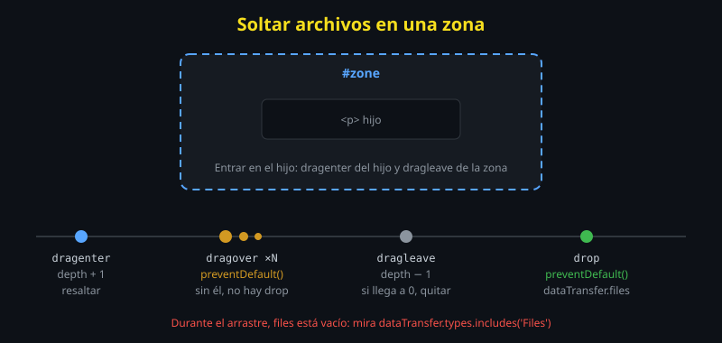

# 🖐️ Arrastrar y soltar archivos

## 🎯 Objetivos

- Conocer los cuatro eventos de una zona de soltar: `dragenter`, `dragover`, `dragleave` y `drop`.
- Entender por qué hay que llamar a `preventDefault` en `dragover` y en `drop`.
- Leer los archivos soltados en `event.dataTransfer.files` y saber qué se puede mirar antes de soltar.
- Resaltar la zona mientras se arrastra sin que parpadee al pasar por sus elementos hijos.
- Ofrecer el mismo camino con el botón, el arrastre y el pegado, y que funcione con teclado.

Arrastrar un archivo desde el explorador hasta la página es más rápido que buscarlo en un diálogo, y la gente lo espera en cualquier página que recibe archivos. El navegador ya sabe recibir archivos arrastrados: si nadie lo impide, **abre** el archivo y la página desaparece. Esta teoría enseña a quedarte con él.

Los ejemplos se ejecutan en el navegador; las salidas son las del [lab 04](../2-practicas/lab-04-arrastrar-soltar/README.md) en Chromium 156.

---

## 📋 Contenido

### 1. Los eventos de arrastre

Mientras arrastras algo sobre la página, el elemento que está debajo del puntero recibe estos eventos, que suben por el árbol como cualquier otro ([semana 18](../../week-18-event_handling_avanzado/README.md)):

| Evento | Cuándo llega | Qué haces |
|---|---|---|
| `dragenter` | El puntero entra en el elemento | Resaltar la zona |
| `dragover` | Mientras está encima, varias veces por segundo | `preventDefault()` para aceptar el soltado |
| `dragleave` | El puntero sale del elemento | Quitar el resaltado |
| `drop` | Se suelta encima | `preventDefault()` y leer los archivos |



Hay más eventos (`dragstart`, `drag`, `dragend`), pero llegan al elemento que **se arrastra**, y aquí lo que se arrastra es un archivo del sistema, fuera de la página.

### 2. `preventDefault`: aceptar el archivo

Por defecto, ningún elemento acepta que le suelten cosas, y soltar un archivo hace que el navegador lo abra o lo descargue. Dos llamadas a `preventDefault` cambian eso ([semana 18](../../week-18-event_handling_avanzado/README.md), acciones por defecto):

```javascript
const zone = document.querySelector('#zone');

zone.addEventListener('dragover', (event) => {
  event.preventDefault();
  event.dataTransfer.dropEffect = 'copy';
});
zone.addEventListener('drop', (event) => {
  event.preventDefault();
  console.log(event.dataTransfer.files.length, 'archivos');
});
```

- **En `dragover`**, `preventDefault` le dice al navegador «esta zona acepta lo que traes». Sin él, `drop` **nunca llega**. Es el error más común: escuchar solo `drop` y que no pase nada.
- **En `drop`**, evita que el navegador abra el archivo después de tu código.
- **`dropEffect = 'copy'`** cambia el cursor para indicar que se va a copiar, no a mover.

Fuera de la zona, la acción por defecto sigue activa: si la persona falla por unos píxeles, el navegador abre el archivo y pierde lo que había en la página. Para evitarlo, se cancela también en `window`, salvo dentro de la zona:

```javascript
for (const type of ['dragover', 'drop']) {
  window.addEventListener(type, (event) => {
    if (!zone.contains(event.target)) event.preventDefault();
  });
}
// soltado fuera de la zona: ignorado
```

### 3. `dataTransfer`: qué se arrastra

Cada evento de arrastre lleva un **`event.dataTransfer`**, el objeto con lo que se está arrastrando. Un arrastre puede traer archivos, pero también un texto seleccionado o un enlace de otra pestaña. Dos propiedades importan:

- **`dataTransfer.types`**: los tipos de lo que se arrastra. Si incluye `'Files'`, son archivos.
- **`dataTransfer.files`**: una `FileList`, como la de `input.files`. **Solo tiene contenido en `drop`**: durante `dragenter` y `dragover` está vacía, por privacidad, para que una página no pueda leer un archivo por el que el puntero solo ha pasado.

Por eso los listeners miran `types` y no `files` para decidir si reaccionar:

```javascript
const hasFiles = (event) => event.dataTransfer?.types.includes('Files') ?? false;

zone.addEventListener('drop', (event) => {
  if (!hasFiles(event)) return console.log('soltado algo que no son archivos:', event.dataTransfer.types.join(', '));
  event.preventDefault();
  handleFiles(event.dataTransfer.files);
});
// soltado algo que no son archivos: text/plain
```

Durante el arrastre tampoco se sabe el nombre ni el tamaño, así que la validación de la [teoría 02](02-leer-archivos.md#2-validar-antes-de-leer) se hace al soltar, igual que con el botón.

### 4. Resaltar la zona sin parpadeos

Resaltar la zona mientras se arrastra encima le dice a la persona «suéltalo aquí». La idea obvia, añadir una clase en `dragenter` y quitarla en `dragleave`, parpadea: cuando el puntero pasa de la zona a un elemento **hijo** (un párrafo, un icono), la zona recibe `dragleave` aunque el puntero siga dentro, y enseguida el hijo lanza un `dragenter` que sube hasta ella.

```text
eventos: dragenter, dragover, dragenter, dragleave, dragover ×2, drop
```

La solución es **contar**: cada `dragenter` suma uno y cada `dragleave` resta uno. Mientras el contador sea mayor que 0, el puntero está en la zona o en alguno de sus hijos.

```javascript
let depth = 0;
zone.addEventListener('dragenter', (event) => {
  if (!hasFiles(event)) return;
  depth += 1;
  zone.classList.add('is-over');
});
zone.addEventListener('dragleave', () => {
  depth = Math.max(0, depth - 1);
  if (depth === 0) zone.classList.remove('is-over');
});
zone.addEventListener('drop', () => {
  depth = 0;
  zone.classList.remove('is-over');
});
```

`Math.max(0, ...)` evita que el contador baje de 0 si se pierde algún evento, y `drop` lo pone a 0 porque, al soltar, no llega el último `dragleave`. El aspecto de `.is-over` va en CSS: un borde de otro color basta.

### 5. Un solo camino para todos

Arrastrar no sirve a todo el mundo: con teclado, con un lector de pantalla o en un móvil no hay nada que arrastrar. Una zona de soltar **siempre** lleva también un `<input type="file">` visible, y los dos caminos acaban en la misma función:

```html
<div id="zone">
  <p>Suelta aquí tus archivos, pégalos con Ctrl+V o
    <input id="files" type="file" multiple />
    <label for="files">elígelos desde tu equipo</label>
  </p>
</div>
```

```javascript
const handleFiles = (fileList) => {
  const files = [...fileList];
  // validar, leer y mostrar: igual venga de donde venga
};

input.addEventListener('change', () => {
  handleFiles(input.files);
  input.value = '';
});
zone.addEventListener('drop', (event) => {
  if (!hasFiles(event)) return;
  event.preventDefault();
  handleFiles(event.dataTransfer.files);
});
document.addEventListener('paste', (event) => {
  if (event.clipboardData.files.length === 0) return;
  event.preventDefault();
  handleFiles(event.clipboardData.files);
});
// 3 archivos por arrastre: cupula.svg (384 B), notas.txt (50 B), sesiones.csv (128 B)
// 3 archivos por pegado: cupula.svg (384 B), notas.txt (50 B), sesiones.csv (128 B)
```

- El tercer camino, **pegar**, llega con el evento `paste` y sus archivos están en `event.clipboardData.files`. Funciona al copiar un archivo en el explorador o una captura de pantalla.
- Para que el input no se vea como el botón gris del sistema, se oculta **visualmente** (tamaño de 1 píxel y `opacity: 0`) y se muestra su `<label>`, que también abre el diálogo al pulsarlo. Con `display: none` dejaría de recibir el foco del teclado. Un estilo `:focus-visible` en el label indica dónde está el foco.

### 6. Vista previa de lo soltado

Los archivos soltados son `File`, como los del botón, así que todo lo de la [teoría 03](03-urls-descargas.md#6-vista-previa-de-una-imagen) vale igual. Para una galería, se filtran las imágenes y cada una recibe su URL de objeto, que se revoca al cargar:

```javascript
for (const file of files.filter((file) => file.type.startsWith('image/'))) {
  const img = document.createElement('img');
  const url = URL.createObjectURL(file);
  img.addEventListener('load', () => URL.revokeObjectURL(url), { once: true });
  img.src = url;
  img.alt = file.name;
  gallery.append(img);
}
// vista previa de cupula.svg: 160×90, URL liberada
```

---

## 🧪 Pruébalo

El [lab 04](../2-practicas/lab-04-arrastrar-soltar/README.md) protege la página de soltados fuera de la zona, registra los eventos, resalta la zona con un contador, lee los archivos soltados, añade el botón y el pegado, y muestra la vista previa de las imágenes.

## ✅ Checklist de aprendizaje

- [ ] Explico cuándo llega cada uno de `dragenter`, `dragover`, `dragleave` y `drop`.
- [ ] Llamo a `preventDefault` en `dragover` y en `drop`, y protejo el resto de la página.
- [ ] Miro `dataTransfer.types` durante el arrastre y leo `dataTransfer.files` al soltar.
- [ ] Resalto la zona con un contador para que no parpadee.
- [ ] Ofrezco botón, arrastre y pegado con una sola función, y el botón funciona con teclado.

<!-- nav -->
---

## 🔗 Navegación

| Anterior | Siguiente |
|---|---|
| ← [Teoría — 🔗 URLs de objeto y descargas](03-urls-descargas.md) | [Índice de labs](../2-practicas/README.md) → |

[↑ Semana 22](../README.md)
