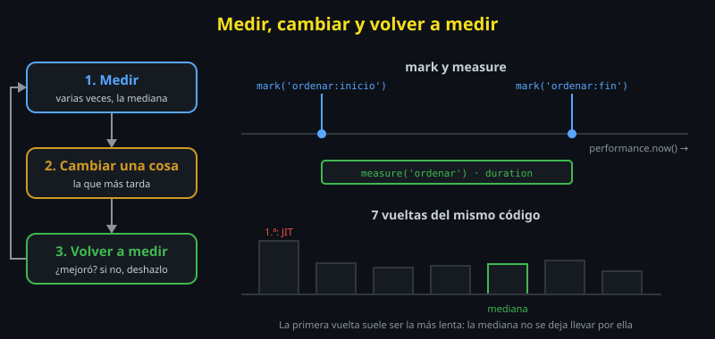

# ⏱️ Medir antes de optimizar

## 🎯 Objetivos

- Saber qué nota una persona cuando una página es lenta y qué cifras sirven de referencia.
- Medir tiempos con `performance.now()` y saber por qué no basta `Date.now()`.
- Poner nombre a lo que mides con `performance.mark()` y `performance.measure()`.
- Repetir una medida y quedarte con la mediana, en lugar de fiarte de una sola ejecución.
- Comparar dos formas de hacer lo mismo y ver cómo crece su coste con el tamaño de los datos.
- Conocer las herramientas del navegador que miden por ti.

Hasta ahora has escrito código que funciona. Esta semana vas a escribir código que, además, **responde rápido**: una búsqueda que no se atasca al teclear, una lista de miles de fichas que no congela la página, una pestaña que no ocupa más memoria cada minuto. La primera regla de la optimización es no adivinar: casi siempre, lo que parece lento no es lo que tarda. Por eso esta teoría va primero: **mide, cambia y vuelve a medir**.

Los ejemplos se ejecutan con Node 24.19.0 (`node archivo.js`), que trae la misma API `performance` que el navegador. Los tiempos que ves en este documento son los de un equipo concreto: los tuyos serán otros. Lo que debe coincidir es la conclusión.

---

## 📋 Contenido

### 1. Qué es «lento» para una persona

Una página no se mide en operaciones por segundo, sino en lo que nota quien la usa. Tres cifras sirven de referencia:

| Cifra | Qué significa |
|---|---|
| **16 ms** | La pantalla se redibuja unas 60 veces por segundo: un fotograma cada 16 ms. Una animación o un scroll que necesita más trabajo por fotograma se ve a saltos |
| **50 ms** | Una **tarea larga**: mientras el código de JavaScript se ejecuta, la página no responde a clics ni teclas. Más de 50 ms seguidos ya se pueden notar |
| **100 ms** | Una respuesta por debajo de 100 ms (al pulsar, al teclear) se percibe como inmediata. Por encima, la persona nota la espera |

JavaScript en el navegador se ejecuta en **un solo hilo**, el mismo que pinta la página y atiende los eventos ([semana 13](../../week-13-programacion_asincronica_callbacks_promises/README.md)). Mientras una función tarda 300 ms, nada más ocurre: ni el scroll, ni el cursor del input, ni las animaciones.



### 2. performance.now()

`Date.now()` ([semana 21](../../week-21-fechas_tiempos_date_api/README.md)) da milisegundos enteros desde 1970, y su valor puede saltar si el reloj del sistema se ajusta. Para medir, usa **`performance.now()`**: milisegundos **con decimales** desde que empezó la página (o el programa de Node), con un reloj que solo avanza.

```javascript
const start = performance.now();
let total = 0;
for (let i = 0; i < 1_000_000; i += 1) total += i;
const elapsed = performance.now() - start;

console.log(`${elapsed.toFixed(2)} ms`);
// 4.54 ms
```

- **Qué:** restas dos lecturas de `performance.now()`, antes y después del trabajo.
- **Para qué:** saber cuánto tarda exactamente ese trozo de código.
- **Impacto:** el resultado incluye todo lo que pase entre las dos lecturas; mide solo lo que quieres medir.

El guion bajo de `1_000_000` es un separador de miles: el número es el mismo, solo se lee mejor.

> **En el navegador, la precisión se reduce a propósito.** Para dificultar ciertos ataques que miden tiempos, los navegadores redondean `performance.now()` a pasos de 0,1 ms en una página normal. Por eso, en el proyecto, una búsqueda puede medir `0.60 ms` o `0.00 ms`. Para tiempos tan cortos, repite la operación muchas veces y divide.

### 3. Marcas y medidas con nombre

Restar a mano sirve para una medida suelta. Cuando mides varias partes de un programa, ponles nombre con **`performance.mark(nombre)`**, que guarda un instante, y **`performance.measure(nombre, inicio, fin)`**, que guarda la duración entre dos marcas:

```javascript
performance.mark('ordenar:inicio');
const names = Array.from({ length: 20000 }, (_, i) => `ficha ${(i * 7919) % 20000}`);
names.toSorted();
performance.mark('ordenar:fin');

const entry = performance.measure('ordenar', 'ordenar:inicio', 'ordenar:fin');
console.log(entry.name, entry.entryType, entry.duration.toFixed(2));
// ordenar measure 11.10
console.log(performance.getEntriesByType('mark').map((mark) => `${mark.name} ${mark.startTime.toFixed(1)}`));
// [ 'ordenar:inicio 37.2', 'ordenar:fin 48.3' ]
```

- Las marcas y las medidas se guardan en una lista de **entradas** (*entries*) que se lee con `performance.getEntriesByType('mark')`, `getEntriesByType('measure')` o `getEntriesByName('ordenar')`.
- `startTime` es el `performance.now()` del momento de la marca; `duration` es la duración de la medida.
- Sin el tercer argumento, `measure` mide desde la marca de inicio hasta ahora.
- Se acumulan: bórralas con `performance.clearMarks()` y `performance.clearMeasures()` cuando ya no te sirvan.

En el navegador, las medidas aparecen además en la pestaña **Performance** de las DevTools, en la fila *Timings*, junto a todo lo que hizo la página en ese momento.

### 4. Una sola medida engaña

Ejecuta lo mismo siete veces y mide cada vuelta:

```javascript
const median = (values) => {
  const sorted = values.toSorted((a, b) => a - b);
  const middle = Math.floor(sorted.length / 2);
  return sorted.length % 2 ? sorted[middle] : (sorted[middle - 1] + sorted[middle]) / 2;
};

const timeIt = (fn, runs = 7) => {
  const times = [];
  for (let i = 0; i < runs; i += 1) {
    const begin = performance.now();
    fn();
    times.push(performance.now() - begin);
  }
  return times;
};

const times = timeIt(() => names.toSorted());
console.log(times.map((time) => time.toFixed(2)).join(' · '));
// 4.69 · 3.95 · 4.18 · 5.44 · 4.63 · 4.49 · 4.22
console.log(median(times).toFixed(2));
// 4.49
```

Las vueltas no tardan lo mismo, por varias razones:

- **El motor optimiza sobre la marcha.** V8, el motor de JavaScript de Chrome y de Node, compila primero el código de forma rápida y, cuando una función se repite, la vuelve a compilar optimizada (*JIT*, *just in time*). Por eso la primera vuelta suele ser la más lenta.
- **El recolector de basura** ([teoría 04](04-fugas-memoria.md)) puede ponerse a limpiar en mitad de una vuelta.
- **El equipo hace otras cosas**: otras pestañas, otros programas.

La **mediana** es el valor del medio de los tiempos ordenados (con un número par, la media de los dos del medio). A diferencia de la media, una vuelta anormalmente lenta no la mueve. Mide siempre varias veces, quédate con la mediana y compara en el mismo equipo y en las mismas condiciones.

### 5. Comparar dos formas de hacer lo mismo

Medir sirve sobre todo para **comparar**. Buscar 1000 ids con `includes` en un array, o con `has` en un `Set` ([semana 07](../../week-07-sets_maps/README.md)), con listas cada vez más grandes:

```javascript
for (const size of [1_000, 10_000, 100_000]) {
  const ids = Array.from({ length: size }, (_, i) => i);
  const set = new Set(ids);
  const wanted = Array.from({ length: 1000 }, (_, i) => i * 97);
  const withArray = median(timeIt(() => wanted.filter((id) => ids.includes(id))));
  const withSet = median(timeIt(() => wanted.filter((id) => set.has(id))));
  console.log(`${size}: includes ${withArray.toFixed(2)} ms · has ${withSet.toFixed(2)} ms`);
}
// 1000: includes 0.75 ms · has 0.04 ms
// 10000: includes 6.66 ms · has 0.02 ms
// 100000: includes 32.91 ms · has 0.05 ms
```

`includes` recorre el array desde el principio hasta encontrar el valor: con diez veces más elementos, tarda unas diez veces más. `has` va directo al valor, tenga el `Set` mil elementos o cien mil. Lo importante no es cuánto tarda hoy con tus datos de prueba, sino **cómo crece** el tiempo cuando los datos crecen: una función que tarda 1 ms con 100 fichas puede tardar 10 s con 10 000 si en cada ficha recorre todas las demás.

Las mejoras que más se notan suelen ser de este tipo: **no repetir trabajo** (calcular una vez y guardar, [teoría 03](03-menos-trabajo.md)) y **elegir la estructura adecuada** (un `Set` o un `Map` para buscar por clave). Cambiar un `for` por un `forEach`, o al revés, casi nunca importa.

### 6. Las herramientas que miden por ti

| Herramienta | Para qué |
|---|---|
| `console.time('etiqueta')` y `console.timeEnd('etiqueta')` | Medir rápido sin variables: escribe `etiqueta: 0.623ms` |
| Pestaña **Performance** de las DevTools | Grabar unos segundos de uso y ver qué funciones tardan, cuándo se recalcula el diseño y cuándo se pinta |
| Pestaña **Lighthouse** | Un informe de la carga de la página con puntuación y consejos |
| `PerformanceObserver` | Recibir las entradas (`measure`, `longtask`...) a medida que se producen |

`PerformanceObserver` avisa cuando aparecen entradas nuevas de un tipo, sin tener que preguntar:

```javascript
const observer = new PerformanceObserver((list) => {
  for (const entry of list.getEntries()) console.log(entry.name, entry.duration);
});
observer.observe({ type: 'longtask' });
```

En Chromium, el tipo `'longtask'` avisa de cada tarea de más de 50 ms. Firefox y Safari no lo tienen: `PerformanceObserver.supportedEntryTypes` dice qué tipos admite tu navegador. En el [lab 03](../2-practicas/lab-03-menos-trabajo/README.md) verás cómo partir una tarea larga en trozos.

Cuando busques más información verás las **Core Web Vitals**, tres medidas que Google usa para valorar páginas: cuánto tarda en verse el contenido principal (LCP), cuánto tarda la página en responder a una interacción (INP) y cuánto se mueve el contenido mientras carga (CLS). Esta semana trabajas sobre todo la segunda.

---

## 🧪 Pruébalo

El [lab 01](../2-practicas/lab-01-medir/README.md) mide con `performance.now()`, `mark` y `measure`, repite medidas para sacar la mediana, compara `includes` con `has` y prepara textos una vez para buscar muchas.

## ✅ Checklist de aprendizaje

- [ ] Sé qué significan 16 ms, 50 ms y 100 ms para una persona que usa la página.
- [ ] Mido con `performance.now()` y explico por qué no uso `Date.now()`.
- [ ] Pongo nombre a lo que mido con `mark` y `measure`, y leo las entradas.
- [ ] Repito una medida y uso la mediana, y sé por qué la primera vuelta suele ser más lenta.
- [ ] Comparo dos soluciones y explico cómo crece el tiempo de cada una con el tamaño de los datos.
- [ ] Sé qué herramienta del navegador uso para grabar lo que hace la página.

<!-- nav -->
---

## 🔗 Navegación

| Anterior | Siguiente |
|---|---|
| ← [Semana 23 - Performance y Optimización](../README.md) | [Teoría — 🚦 Debounce y throttle](02-debounce-throttle.md) → |

[↑ Semana 23](../README.md)
