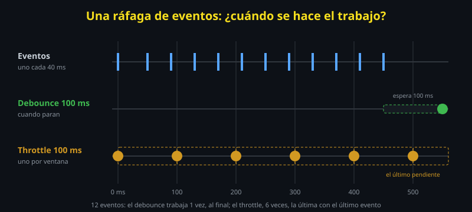

# 🚦 Debounce y throttle

## 🎯 Objetivos

- Reconocer los eventos que llegan en ráfagas: `input`, `scroll`, `resize`, `pointermove`.
- Escribir un *debounce*, que espera a que paren los eventos para hacer el trabajo una vez.
- Escribir un *throttle*, que hace el trabajo como mucho una vez cada cierto tiempo, sin perder el último evento.
- Cancelar un trabajo pendiente.
- Limitar los cambios visuales a uno por fotograma con `requestAnimationFrame`.
- Saber cuándo usar cada técnica, y qué hace `{ passive: true }`.

En la [teoría 01](01-medir.md) viste que una respuesta por debajo de 100 ms parece inmediata. El problema es que hay eventos que llegan muchas veces por segundo: si cada uno lanza una búsqueda, una petición o un repintado, el trabajo se amontona y la página se atasca. Esta teoría explica dos formas de hacer **menos veces** el trabajo caro sin que la persona note la diferencia.

Los ejemplos con tiempos son los del [lab 02](../2-practicas/lab-02-debounce-throttle/README.md), ejecutado con Node 24.19.0: en lugar de teclear, programa «eventos» con `setTimeout` en momentos fijos.

---

## 📋 Contenido

### 1. Eventos en ráfaga

| Evento | Cuántos llegan |
|---|---|
| `input` | Uno por tecla: escribir «nebulosa orion» son 14 |
| `scroll` | Hasta uno por fotograma (unos 60 por segundo) mientras la página se desplaza |
| `resize` | Muchos seguidos mientras se arrastra el borde de la ventana |
| `pointermove` | Uno por cada movimiento del ratón o del dedo |

Si el *listener* de cada uno hace algo caro (buscar en miles de fichas, pedir datos a una API, recalcular el diseño), la página hace decenas de trabajos de los que solo importa el último. En el lab 02, con una búsqueda por tecla:

```text
--- Paso 1: Buscar en cada tecla ---
     0 ms busco: o
   100 ms busco: or
   200 ms busco: ori
   300 ms busco: orio
   400 ms busco: orion
  5 teclas, 5 búsquedas
```

Cuatro de esas cinco búsquedas no le sirven a nadie: la persona todavía estaba escribiendo.



### 2. Debounce: esperar a que paren

Un **debounce** retrasa el trabajo hasta que los eventos dejan de llegar durante un tiempo. Cada evento nuevo reinicia la espera:

```javascript
const debounce = (fn, ms) => {
  let timer;
  return (...args) => {
    clearTimeout(timer);
    timer = setTimeout(() => fn(...args), ms);
  };
};

const searchLater = debounce((text) => console.log('busco:', text), 250);
input.addEventListener('input', (event) => searchLater(event.target.value));
```

- **Qué:** `debounce` recibe una función y devuelve otra. Cada llamada a la nueva cancela el temporizador anterior con `clearTimeout` ([semana 13](../../week-13-programacion_asincronica_callbacks_promises/README.md)) y programa uno nuevo.
- **Para qué:** solo el último temporizador llega a cumplirse, y lo hace con los argumentos de la última llamada.
- **Impacto:** la función devuelta recuerda las variables de la función que la creó aunque esa ya haya terminado (un *closure*). Por eso `timer` sobrevive entre llamadas, y cada función creada por `debounce` tiene el suyo.

`...args` (parámetros rest, [semana 02](../../week-02-operadores_metodos_modernos_arrays/README.md)) recoge los argumentos, sean cuantos sean, y `fn(...args)` se los pasa a la función original. Con las mismas cinco teclas, cada 100 ms:

```text
--- Paso 2: debounce de 250 ms ---
   650 ms busco: orion
  5 teclas, 1 búsqueda
```

La última tecla llega a los 400 ms; 250 ms después, sin teclas nuevas, se busca una vez. Si la persona se para a mitad de palabra más tiempo que la espera, se busca también en esa pausa:

```text
--- Paso 3: Escribir, parar y seguir ---
   350 ms busco: or
   950 ms busco: orion
  5 teclas, 2 búsquedas
```

**Cuánto esperar:** entre 150 y 500 ms. Menos, y casi cada tecla busca; más, y la página parece lenta. El debounce sirve para todo lo que solo importa cuando la persona **ha terminado**: buscar mientras escribe, guardar un borrador, recalcular un diseño cuando la ventana deja de cambiar de tamaño, validar un campo.

### 3. Throttle: como mucho una vez cada tanto

Con el scroll, esperar a que pare no sirve: un botón «Volver arriba» o una barra de progreso tienen que cambiar **mientras** la persona se desplaza. Un **throttle** deja pasar un evento y descarta los siguientes durante un tiempo:

```javascript
const throttleSimple = (fn, ms) => {
  let last = -Infinity;
  return (...args) => {
    const now = performance.now();
    if (now - last < ms) return;
    last = now;
    fn(...args);
  };
};
```

Doce eventos de scroll en 450 ms, con throttle de 100 ms:

```text
--- Paso 4: throttle sencillo ---
     0 ms pinto en: 0
   130 ms pinto en: 260
   250 ms pinto en: 500
   370 ms pinto en: 740
  12 eventos, 4 actualizaciones · último scroll en 900
```

Cuatro actualizaciones en lugar de doce, pero hay un fallo: la página se quedó en la posición 900 y lo último que se pintó fue 740. Los eventos del final cayeron dentro de la ventana y se descartaron. La solución es **recordar el último evento descartado** y ejecutarlo cuando la ventana se cierra:

```javascript
const throttle = (fn, ms) => {
  let timer = null;
  let pending = null;
  const close = () => {
    if (pending) {
      fn(...pending);
      pending = null;
      timer = setTimeout(close, ms);
    } else {
      timer = null;
    }
  };
  return (...args) => {
    if (timer) {
      pending = args;
      return;
    }
    fn(...args);
    timer = setTimeout(close, ms);
  };
};
```

- La primera llamada se ejecuta enseguida y abre una **ventana** de `ms` (el temporizador `timer`).
- Las llamadas durante la ventana solo guardan sus argumentos en `pending`: la última sustituye a las anteriores.
- Al cerrarse la ventana, si hay algo pendiente, se ejecuta y se abre otra ventana. Si no, la ventana se cierra y la próxima llamada vuelve a ser inmediata.

```text
--- Paso 5: throttle con llamada final ---
     0 ms pinto en: 0
   100 ms pinto en: 180
   200 ms pinto en: 340
   300 ms pinto en: 580
   400 ms pinto en: 740
   500 ms pinto en: 900
  12 eventos, 6 actualizaciones · último scroll en 900
```

Una actualización cada 100 ms, y la última con la posición real.

### 4. Cancelar lo que está pendiente

A veces el trabajo pendiente ya no hace falta: la persona pulsa Enter y quieres buscar **ya**, o el componente que iba a actualizarse se ha quitado de la página. Para eso, la función devuelta puede llevar un método `cancel` que limpie su temporizador:

```javascript
const searchLater = debounce(search, 250);

form.addEventListener('submit', (event) => {
  event.preventDefault();
  searchLater.cancel();
  search(input.value);
});
```

Una función es un objeto, así que se le pueden añadir propiedades: `debounced.cancel = () => clearTimeout(timer)`. Sin `cancel`, al pulsar Enter se buscaría dos veces: ahora y cuando venciera el temporizador. Un temporizador pendiente también mantiene vivos los datos que usa su función: cancelarlo al quitar un componente evita fugas de memoria ([teoría 04](04-fugas-memoria.md)).

Hay otra variante útil para botones: ejecutar **la primera** llamada y descartar las que llegan seguidas. Así, un doble clic en «Enviar» no envía dos veces ([lab 02, paso 6](../2-practicas/lab-02-debounce-throttle/README.md#paso-6-evitar-el-doble-clic)).

### 5. Un cambio por fotograma: requestAnimationFrame

Para cambios **visuales** (mover un elemento, cambiar un ancho, actualizar una barra) el mejor ritmo no es «cada 100 ms», sino «una vez antes de cada pintado». **`requestAnimationFrame(fn)`** pide al navegador que ejecute `fn` justo antes del próximo fotograma, y devuelve un número para cancelarlo con `cancelAnimationFrame`:

```javascript
let lastX = 0;
let frame = null;

const paint = () => {
  frame = null;
  box.style.width = `${20 + lastX / 10}px`;
};

area.addEventListener('pointermove', (event) => {
  lastX = event.clientX;
  if (frame === null) frame = requestAnimationFrame(paint);
});
```

El listener solo guarda el dato y, si no hay un pintado pedido, lo pide. Lleguen 100 eventos o uno entre fotograma y fotograma, se pinta una vez con el último valor. En el [lab 03](../2-practicas/lab-03-menos-trabajo/README.md), 100 eventos seguidos producen un solo pintado. `requestAnimationFrame` solo existe en el navegador y no se ejecuta en pestañas ocultas, lo que ahorra trabajo cuando nadie mira.

### 6. Listeners pasivos

Un listener de `scroll`, `wheel` o `touchmove` puede llamar a `preventDefault` ([semana 18](../../week-18-event_handling_avanzado/README.md)) para impedir el desplazamiento. Por eso, en algunos casos, el navegador espera a que el listener termine antes de desplazar la página. La opción **`{ passive: true }`** promete que no lo vas a llamar:

```javascript
window.addEventListener('scroll', onScroll, { passive: true });
```

Así el navegador desplaza sin esperar a tu código. Si dentro de un listener pasivo llamas a `preventDefault`, no hace nada y la consola muestra un aviso.

### 7. Cuál elegir

| Situación | Técnica | Por qué |
|---|---|---|
| Buscar mientras se escribe, guardar un borrador | Debounce (200–500 ms) | Solo importa el resultado final |
| Recalcular al cambiar el tamaño de la ventana | Debounce (150–300 ms) | El tamaño intermedio no importa |
| Posición del scroll, carga infinita, enviar la posición del ratón | Throttle (100–250 ms) | Hay que responder mientras dura, sin perder el último |
| Mover o redimensionar algo en pantalla | `requestAnimationFrame` | Un cambio por fotograma, al ritmo de la pantalla |
| Botón que no debe ejecutarse dos veces seguidas | Ejecutar la primera y descartar las siguientes | La primera es la que vale |

---

## 🧪 Pruébalo

El [lab 02](../2-practicas/lab-02-debounce-throttle/README.md) ejecuta con Node una búsqueda por tecla, un debounce, un throttle sencillo, un throttle con llamada final y un botón que solo vale una vez. El paso 5 del [lab 03](../2-practicas/lab-03-menos-trabajo/README.md) usa `requestAnimationFrame` en el navegador.

## ✅ Checklist de aprendizaje

- [ ] Nombro eventos que llegan en ráfagas y explico qué problema causan.
- [ ] Escribo un debounce y explico por qué cada llamada reinicia la espera.
- [ ] Escribo un throttle que no pierde el último evento.
- [ ] Añado un `cancel` a la función devuelta y sé cuándo llamarlo.
- [ ] Uso `requestAnimationFrame` para hacer un cambio visual por fotograma.
- [ ] Elijo entre debounce, throttle y `requestAnimationFrame` según la situación.

<!-- nav -->
---

## 🔗 Navegación

| Anterior | Siguiente |
|---|---|
| ← [Teoría — ⏱️ Medir antes de optimizar](01-medir.md) | [Teoría — 🪶 Hacer menos trabajo](03-menos-trabajo.md) → |

[↑ Semana 23](../README.md)
