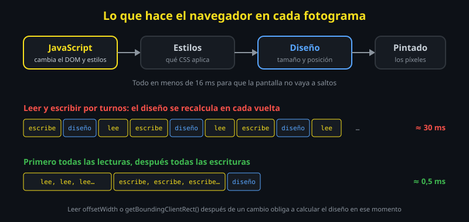

# 🪶 Hacer menos trabajo

## 🎯 Objetivos

- Guardar resultados caros con *memoize* y limitar el tamaño de la caché.
- Preparar una vez lo que no cambia, en lugar de repetirlo en cada búsqueda.
- Pintar solo lo que se ve: paginar y cargar más al llegar al final con `IntersectionObserver`.
- Cargar las imágenes cuando se van a ver, con `loading="lazy"` o con un observador.
- Entender las fases con las que el navegador pinta y evitar leer medidas justo después de cambiarlas.
- Partir una tarea larga en trozos y cargar código solo cuando hace falta.

La forma más segura de que algo vaya rápido es **no hacerlo**: no calcular dos veces lo mismo, no pintar mil fichas cuando se ven diez, no descargar imágenes que nadie va a mirar. Esta teoría reúne las técnicas que más se notan en una página como la del [proyecto](../3-proyecto/README.md), un buscador sobre miles de fichas. Mide antes y después de aplicarlas ([teoría 01](01-medir.md)): si no hay diferencia, no compensan el código de más.

Los ejemplos de los apartados 1 y 2 se ejecutan con Node 24.19.0; los demás son del navegador, con las salidas del [lab 03](../2-practicas/lab-03-menos-trabajo/README.md) en Chromium 156.

---

## 📋 Contenido

### 1. Recordar resultados: memoize

Si una función tarda y la llamas muchas veces con los mismos argumentos, guarda cada resultado la primera vez y devuélvelo las siguientes. Esa técnica se llama **memoización** (*memoize*):

```javascript
const memoize = (fn) => {
  const cache = new Map();
  return (key) => {
    if (!cache.has(key)) cache.set(key, fn(key));
    return cache.get(key);
  };
};

const fastCount = memoize(countPrimes);
for (const limit of [500_000, 500_000]) {
  const start = performance.now();
  const result = fastCount(limit);
  console.log(`${result} en ${(performance.now() - start).toFixed(2)} ms`);
}
// 41538 en 32.94 ms
// 41538 en 0.00 ms
```

`countPrimes(limit)` cuenta los números primos hasta `limit` probando divisores, un cálculo lento a propósito. La segunda llamada no calcula: lee el `Map` ([semana 07](../../week-07-sets_maps/README.md)).

Memoizar solo es correcto con **funciones puras**: el mismo argumento da siempre el mismo resultado y la función no cambia nada fuera de ella. Una función que lee la hora, el DOM o datos que cambian devolvería un resultado viejo.

**Una caché sin límite es una fuga de memoria** ([teoría 04](04-fugas-memoria.md)): en un buscador, cada texto distinto que se escribe añade una entrada que nunca se borra. Ponle un máximo y, al pasarlo, borra la entrada **que lleva más tiempo sin usarse** (una caché *LRU*, *least recently used*). Un `Map` recuerda el orden en que se insertaron sus claves, así que:

- `cache.keys().next().value` es la clave más antigua: la primera del `Map`.
- Para marcar una clave como recién usada, bórrala y vuelve a insertarla: pasa al final.

### 2. Preparar una vez lo que no cambia

Para que «orion» encuentre «Nebulosa de Orión», hay que comparar los textos sin tildes y en minúsculas:

```javascript
const clean = (text) => text.normalize('NFD').replace(/\p{Diacritic}/gu, '').toLowerCase();

console.log(clean('Nebulosa de Orión'), clean('Pingüino'));
// nebulosa de orion pinguino
```

- `normalize('NFD')` separa cada letra con tilde en dos caracteres: la letra y la tilde (`ó` pasa a ser `o` más `́`).
- `/\p{Diacritic}/gu` es una expresión regular que encuentra esas marcas: `\p{...}` busca caracteres por su categoría de Unicode y necesita la bandera `u`; la `g` las encuentra todas. `replace` las cambia por nada.

Buscar «orion» en 2000 fichas obliga a limpiar así cada nombre. Si se hace dentro de cada búsqueda, se repite el mismo trabajo con cada tecla. Si se hace una vez al cargar, cada búsqueda solo compara textos ya preparados:

```javascript
// Limpia en cada búsqueda
const searchSlow = (query) => records.filter((record) => clean(record.name).includes(query));

// Limpia una vez: un índice con el texto ya preparado de cada ficha
const prepared = records.map((record) => ({ record, text: clean(record.name) }));
const searchFast = (query) => prepared.filter((item) => item.text.includes(query)).map((item) => item.record);
```

En el [lab 01](../2-practicas/lab-01-medir/README.md), cinco búsquedas tardan unos 3 ms limpiando cada vez y 0,2 ms con el índice. Las bases de datos y los buscadores hacen lo mismo a gran escala: un **índice** es trabajo hecho por adelantado para que las consultas sean rápidas. El precio es memoria (el índice ocupa) y que hay que rehacerlo si los datos cambian.

### 3. Pintar solo lo que se ve

Crear 2000 elementos `<li>` lleva su tiempo, y la persona ve una decena. Muestra los resultados **por páginas** y añade la siguiente cuando la persona llega al final de la lista (*scroll infinito*). Para saber cuándo llega, en lugar de escuchar `scroll` y calcular posiciones, usa **`IntersectionObserver`**: avisa cuando un elemento entra o sale de la pantalla.

```javascript
const sentinel = document.querySelector('#sentinel');

const observer = new IntersectionObserver(
  ([entry]) => {
    if (entry.isIntersecting) showNextPage();
  },
  { rootMargin: '200px' },
);

observer.observe(sentinel);
```

- **Qué:** `sentinel` (centinela) es un elemento vacío al final de la lista. El observador llama a la función con una lista de *entries*, una por elemento observado que cambió; `isIntersecting` dice si está a la vista.
- **Para qué:** `rootMargin: '200px'` agranda la zona de la pantalla 200 px por cada lado, así que la página siguiente se pinta un poco **antes** de llegar al final.
- **Impacto:** el navegador calcula las intersecciones por su cuenta, sin ejecutar tu código en cada evento de scroll. `observer.unobserve(elemento)` deja de observar uno y `observer.disconnect()`, todos.

El observador avisa cuando el centinela **cambia** de estado. Si después de pintar una página sigue a la vista, no vuelve a avisar: el `main.js` del proyecto lo deja de observar y lo vuelve a observar después de cada página, y así recibe un aviso nuevo.

Las listas enormes (decenas de miles de filas) usan una técnica más avanzada, la **virtualización**: solo existen en el DOM las filas que están a la vista, y se reutilizan al desplazarse.

### 4. Imágenes cuando se van a ver

Una imagen fuera de la pantalla se descarga igual que una visible. El atributo **`loading="lazy"`** le dice al navegador que espere a que se acerque a la pantalla:

```html

```

- No necesita JavaScript y lo entienden todos los navegadores actuales.
- No lo pongas en las imágenes que se ven al cargar (la cabecera, la primera foto): se retrasarían.
- Indica siempre `width` y `height`: el navegador reserva el hueco y el contenido no salta cuando llega la imagen.

Con `IntersectionObserver` puedes hacer lo mismo para cualquier cosa: dejar la dirección en un atributo `data-src` y pasarla a `src` cuando el elemento entra en pantalla. En el [lab 03](../2-practicas/lab-03-menos-trabajo/README.md), de 30 imágenes solo 2 se cargan al empezar; el resto, a medida que bajas.

### 5. Cómo pinta el navegador

Después de que tu código cambia el DOM o los estilos, el navegador sigue unos pasos antes de que veas el cambio:



1. **JavaScript**: tu código cambia elementos, clases o estilos.
2. **Estilos**: calcula qué reglas de CSS aplican a cada elemento.
3. **Diseño** (*layout*): calcula el tamaño y la posición de cada caja.
4. **Pintado**: dibuja los píxeles.

Normalmente el navegador acumula todos los cambios y recalcula **una vez**, al terminar tu código. Pero si después de cambiar algo **lees** una medida (`offsetWidth`, `offsetHeight`, `scrollHeight`, `getBoundingClientRect()`), necesita el diseño actualizado para responder, y lo recalcula en ese momento. Leer y escribir por turnos dentro de un bucle obliga a recalcular en cada vuelta (*layout thrashing*):

```javascript
// Mal: cada lectura de offsetWidth recalcula el diseño que cambió la escritura anterior
for (const box of boxes) box.style.width = `${box.offsetWidth + 1}px`;

// Bien: primero todas las lecturas y después todas las escrituras
const widths = boxes.map((box) => box.offsetWidth);
boxes.forEach((box, i) => (box.style.width = `${widths[i] + 1}px`));
```

Con 300 cajas, en el lab 03, la primera versión tarda unos 30 ms y la segunda 0,5 ms. Lo mismo pasa al insertar 2000 elementos: uno a uno o reunidos antes en un `DocumentFragment` ([semana 17](../../week-17-dom_manipulation_moderna/README.md)) tardan parecido (unos 20 ms), porque el navegador recalcula una vez al final; pero si lees la altura de la lista después de cada inserción, pasa a 500 ms.

### 6. Partir las tareas largas y cargar código cuando hace falta

Si un cálculo tarda 150 ms, durante 150 ms la página no responde ([teoría 01](01-medir.md#1-qué-es-lento-para-una-persona)). Cuando no puedes hacerlo más rápido, pártelo en trozos y deja que el navegador atienda los eventos entre uno y otro:

```javascript
const wait = (ms) => new Promise((resolve) => setTimeout(resolve, ms));

for (const chunk of chunks) {
  processChunk(chunk);
  await wait(0);
}
```

`await wait(0)` termina la tarea actual y continúa en otra: entre las dos, el navegador puede pintar y atender clics. En el lab 03, un bucle de 150 ms seguidos genera una tarea larga, y diez trozos de 15 ms, ninguna.

Con el código pasa algo parecido: un módulo grande que solo se usa al pulsar un botón no tiene por qué descargarse al abrir la página. **`import()`** ([semana 12](../../week-12-proyecto_integrador_fundamentos/2-practicas/lab-03-modulos/README.md)) lo carga cuando se llama:

```javascript
exportButton.addEventListener('click', async () => {
  const { toPdf } = await import('./export-pdf.js');
  toPdf(results);
});
```

---

## 🧪 Pruébalo

El [lab 03](../2-practicas/lab-03-menos-trabajo/README.md) compara en el navegador leer y escribir medidas por turnos o por lotes, inserta 2000 elementos de tres formas, memoiza un cálculo, carga imágenes con `IntersectionObserver`, agrupa eventos con `requestAnimationFrame` y parte una tarea larga.

## ✅ Checklist de aprendizaje

- [ ] Memoizo una función pura con un `Map` y explico por qué la caché necesita un límite.
- [ ] Preparo una vez los datos que no cambian (un índice) en lugar de repetir el trabajo.
- [ ] Pinto una lista por páginas y cargo la siguiente con `IntersectionObserver`.
- [ ] Uso `loading="lazy"` en las imágenes que no se ven al cargar, con `width` y `height`.
- [ ] Explico las fases del pintado y por qué leer una medida después de escribir es caro.
- [ ] Parto una tarea larga con `await` entre trozos y cargo un módulo con `import()` cuando hace falta.

<!-- nav -->
---

## 🔗 Navegación

| Anterior | Siguiente |
|---|---|
| ← [Teoría — 🚦 Debounce y throttle](02-debounce-throttle.md) | [Teoría — 🧹 Fugas de memoria](04-fugas-memoria.md) → |

[↑ Semana 23](../README.md)
