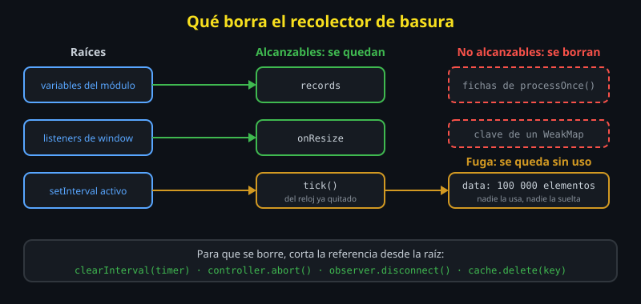

# 🧹 Fugas de memoria

## 🎯 Objetivos

- Entender cómo libera memoria JavaScript: el recolector de basura y la idea de «alcanzable».
- Reconocer una fuga de memoria y sus síntomas.
- Evitar las fugas más comunes: listeners, temporizadores, observadores, cachés, nodos desconectados y closures.
- Usar `WeakMap` para asociar datos a objetos sin impedir que se borren.
- Buscar fugas con las DevTools y medir memoria en Node.

Una página que va bien al abrirla y cada vez más lenta tras una hora de uso suele tener una **fuga de memoria**: algo que ya no se usa sigue ocupando memoria, y cada vez hay más. En una página que se recarga a menudo apenas se nota; en una aplicación que pasa el día abierta (un correo, un panel, el buscador del proyecto) acaba ocupando cientos de megas y atascando la pestaña.

Las salidas de esta teoría son las del [lab 04](../2-practicas/lab-04-fugas-memoria/README.md), ejecutado con `node --expose-gc` en Node 24.19.0.

---

## 📋 Contenido

### 1. El recolector de basura

En JavaScript no liberas memoria a mano. El motor tiene un **recolector de basura** (*garbage collector*, GC) que, de vez en cuando, busca los objetos que ya no se pueden usar y libera su memoria. Para saber cuáles se pueden usar, parte de unas **raíces** y sigue todas las referencias:

- Las variables globales y las de los módulos.
- Las variables locales de las funciones que se están ejecutando.
- Los listeners registrados, los temporizadores pendientes y los observadores activos, con todo lo que usan sus funciones.

Un objeto al que se puede llegar desde una raíz siguiendo referencias es **alcanzable** y se queda. El resto se borra.



```javascript
const processOnce = () => makeData().length;   // 200 000 fichas en una variable local
processOnce();
// tras una variable local: 0 MB de más

const history = [];
history.push(makeData());                      // las mismas fichas, guardadas en un array del módulo
// tras guardarlas en history: 8 MB de más

history.length = 0;
// tras vaciar history: 0 MB de más
```

Al terminar `processOnce`, nada apunta a las fichas y el recolector las borra. Guardadas en `history`, que es alcanzable desde el módulo, se quedan hasta que se vacía.

Una **fuga de memoria** es justo eso: una referencia que nadie quita, desde algo alcanzable, a datos que ya no se usan. El recolector no puede adivinar que ya no los quieres.

### 2. Listeners que se acumulan

Cada `addEventListener` guarda una referencia a la función, y la función a todo lo que usa. Si un trozo de interfaz se monta varias veces (al cambiar de vista, al repintar) y en cada montaje añade un listener sin quitar el anterior, se acumulan:

```text
montado 5 veces sin quitar: listeners 5 · llamadas por evento 5
```

Además de la memoria, cada evento ejecuta cinco veces el mismo código. La solución es la de la [semana 18](../../week-18-event_handling_avanzado/README.md): un `AbortController` por montaje, y `abort()` antes de montar otra vez o al quitar la interfaz:

```javascript
let controller = null;

const mount = () => {
  controller?.abort();
  controller = new AbortController();
  bus.addEventListener('refresh', onRefresh, { signal: controller.signal });
};
```

```text
con AbortController: listeners 1 · llamadas por evento 1
tras abort(): 0
```

Un listener en un elemento que se borra del DOM se va con el elemento, siempre que nada más apunte a él. Los peligrosos son los que se añaden a algo que **no** se borra: `window`, `document` o un objeto compartido como `bus`.

### 3. Temporizadores y observadores olvidados

Un `setInterval` se ejecuta para siempre hasta que llamas a `clearInterval`. Mientras tanto, su función y todo lo que usa siguen alcanzables:

```javascript
const createClock = (label) => {
  const data = new Array(100_000).fill(label);
  let ticks = 0;
  const timer = setInterval(() => (ticks += data.length > 0 ? 1 : 0), 20);
  return { ticks: () => ticks, destroy: () => clearInterval(timer) };
};
```

```text
el limpio se paró en 5 ticks y sigue en 5
el olvidado sigue contando: true
```

Lo mismo con los `setTimeout` de un debounce pendiente ([teoría 02](02-debounce-throttle.md#4-cancelar-lo-que-está-pendiente)), con `requestAnimationFrame` (`cancelAnimationFrame`) y con los observadores (`observer.disconnect()`). La regla: **todo lo que se crea al montar se limpia al desmontar**. Una forma cómoda es que cada función que monta algo devuelva la función que lo limpia, como `destroy` en el ejemplo.

### 4. Cachés y listas que solo crecen

Una caché sin límite guarda una entrada por cada argumento distinto, para siempre:

```text
50000 búsquedas distintas: sin límite 50000 · con límite 100
```

Con un máximo y borrando la entrada más antigua ([teoría 03](03-menos-trabajo.md#1-recordar-resultados-memoize)), la caché se queda en 100 entradas por muchas búsquedas que se hagan. Lo mismo vale para historiales, registros de errores o listas de notificaciones: decide cuántos elementos guardas y borra los más antiguos.

### 5. Nodos desconectados

Un elemento quitado del DOM con `remove()` o `replaceChildren()` ya no se ve, pero si una variable, un array o un `Map` siguen apuntando a él, no se borra. Además, un elemento apunta a su padre y a sus hijos: si quitas una sección entera y guardas uno de sus elementos, ese elemento retiene **toda la sección**. Las DevTools los llaman *Detached* (desconectados).

```javascript
const cards = [];

const render = (records) => {
  list.replaceChildren();
  for (const record of records) {
    const card = createCard(record);
    cards.push(card);       // fuga: cards nunca se vacía
    list.append(card);
  }
};
```

Si necesitas tener a mano los elementos pintados, vacía la lista cuando los quitas (`cards.length = 0`) o, mejor, búscalos en el DOM cuando los necesites (`list.children`).

### 6. Closures que guardan de más

Una función recuerda las variables de la función que la creó (un *closure*). Si usa una variable que contiene un array enorme, mantiene vivo el array entero, aunque solo le interese su longitud:

```javascript
const makeReportLeaky = (rows) => () => `${rows.length} filas`;

const makeReport = (rows) => {
  const count = rows.length;
  return () => `${count} filas`;
};
```

```text
5 informes que guardan sus filas: 19 MB · 100000 filas
5 informes que guardan solo el número: 0 MB · 100000 filas
```

Las dos dan el mismo texto. La segunda copia el dato que necesita a una variable propia, y las filas se pueden borrar.

### 7. WeakMap: datos asociados sin retener

A veces quieres guardar información **sobre** objetos que no controlas: cuántas veces se ha mostrado una ficha, el elemento del DOM que le corresponde. Con un `Map`, la ficha usada como clave queda alcanzable desde el `Map` y no se borra nunca. Un **`WeakMap`** ([semana 07](../../week-07-sets_maps/README.md)) guarda sus claves de forma **débil**: no cuentan para que el objeto sea alcanzable. Cuando nada más apunta a la clave, el recolector borra la clave y su valor.

```text
borradas por el recolector: ficha en un WeakMap
el Map todavía tiene: 1 ficha
```

Las dos fichas se dejaron de usar (`= null`); la del `Map` sigue en memoria. A cambio, un `WeakMap` no tiene `size` ni se puede recorrer: solo `get`, `set`, `has` y `delete` con una clave que ya tienes.

El lab usa además `FinalizationRegistry`, que avisa cuando un objeto se ha borrado, y la función `gc()` que crea `node --expose-gc`. Los dos sirven para **observar** el recolector mientras aprendes; el momento en que limpia no está garantizado, así que un programa no debe depender de ellos. Existe también `WeakRef`, una referencia débil a un único objeto, para casos muy concretos.

### 8. Encontrar fugas

En el navegador, la pestaña **Memory** de las DevTools:

1. Elige **Heap snapshot** y pulsa **Take snapshot**: es una foto de todos los objetos de la página.
2. Repite varias veces la acción sospechosa (abrir y cerrar un panel, buscar, cambiar de vista).
3. Pulsa el icono de la papelera (*Collect garbage*) y haz otra foto.
4. En la segunda foto, cambia la vista a **Comparison**: muestra qué objetos han aparecido. Si crecen con cada repetición, hay fuga. Escribe `Detached` en el filtro para ver los nodos desconectados.

Para un vistazo rápido sin fotos, el **Performance monitor** (menú ⋮ › More tools) muestra en directo el tamaño del *JS heap* y el número de nodos del DOM y de listeners. En Node, `process.memoryUsage().heapUsed` da los bytes ocupados por los objetos de JavaScript, que es lo que mide el lab 04.

No todo crecimiento es una fuga: el recolector trabaja cuando le conviene, y la memoria sube y baja. La señal de una fuga es que **después de limpiar** queda cada vez más memoria al repetir la misma acción.

---

## 🧪 Pruébalo

El [lab 04](../2-practicas/lab-04-fugas-memoria/README.md) mide con Node la memoria de datos alcanzables y no alcanzables, acumula y limpia listeners, olvida un `setInterval`, compara una caché con y sin límite, un `Map` con un `WeakMap` y dos closures.

## ✅ Checklist de aprendizaje

- [ ] Explico qué es un objeto alcanzable y cuándo lo borra el recolector.
- [ ] Defino una fuga de memoria y sé cómo se nota.
- [ ] Limpio listeners con `AbortController`, temporizadores con `clearInterval` y observadores con `disconnect`.
- [ ] Pongo un límite a cachés, historiales y listas que crecen.
- [ ] Explico por qué un nodo quitado del DOM puede seguir en memoria, y por qué un closure puede retener datos.
- [ ] Uso `WeakMap` para asociar datos a objetos y sé qué no puede hacer.
- [ ] Busco una fuga comparando dos fotos de memoria en las DevTools.

<!-- nav -->
---

## 🔗 Navegación

| Anterior | Siguiente |
|---|---|
| ← [Teoría — 🪶 Hacer menos trabajo](03-menos-trabajo.md) | [Índice de labs](../2-practicas/README.md) → |

[↑ Semana 23](../README.md)
