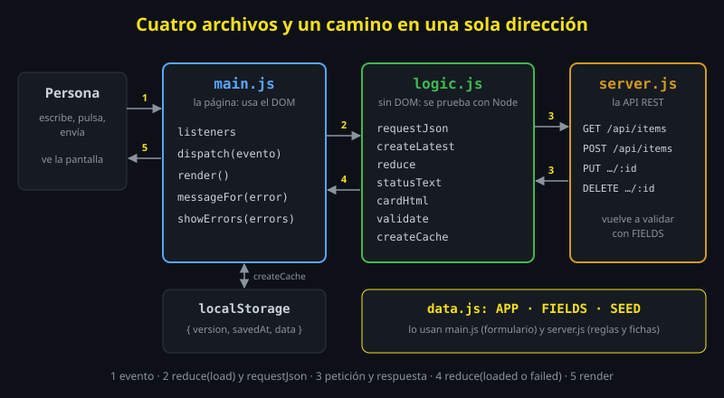

# 🏗️ Arquitectura de una aplicación asíncrona

## 🎯 Objetivos

- Saber qué hace cada archivo del proyecto y por qué está separado así.
- Seguir el camino de un evento: de un clic a la red, al estado y de vuelta a la pantalla.
- Saber dónde va cada cosa nueva que añadas.

En la [semana 12](../../week-12-proyecto_integrador_fundamentos/1-teoria/02-arquitectura-aplicacion.md) repartiste una aplicación en tres archivos: datos, lógica sin DOM y página. El proyecto de esta semana tiene la misma forma, con dos piezas nuevas: un servidor al otro lado de la red y una copia local en el navegador. Lo que lo complica todo es el tiempo: las respuestas tardan, llegan desordenadas o no llegan.

---

## 📋 Contenido

### 1. Cuatro archivos, una responsabilidad cada uno



| Archivo | Qué hace | Usa el DOM | Usa la red | Se prueba con Node |
|---|---|:---:|:---:|:---:|
| `src/data.js` | Describe el dominio: textos (`APP`), campos y reglas (`FIELDS`), fichas iniciales (`SEED`) | No | No | Sí |
| `src/logic.js` | Funciones que reciben datos y devuelven datos: pedir, cambiar el estado, describirlo, pintar texto, validar, guardar | No | Solo `requestJson`, a través de `fetchFn` | Sí |
| `src/main.js` | Conecta lo anterior con la página: escucha eventos, llama a la lógica y pinta | Sí | A través de `requestJson` | No |
| `server.js` | La API REST y los archivos de la página | No | Es la red | Sí |

- **Qué:** `logic.js` no toca `document` ni `localStorage` directamente: recibe lo que necesita como argumento (`fetchFn`, `storage`, `now`).
- **Para qué:** así cada función se prueba con Node pasándole un `fetch` falso, un almacén hecho con un `Map` o una hora fija. Es lo que hacen las comprobaciones del proyecto.
- **Impacto:** `main.js` queda como una lista de conexiones corta, y casi todos los errores aparecen en una función que se puede probar sola.

`data.js` lo usan a la vez la página y el servidor: si cambias `FIELDS`, cambian el formulario, las fichas y las reglas que comprueba la API.

### 2. El camino de un evento

Todo cambio en la pantalla sigue el mismo camino, en una sola dirección:

1. **Evento.** La persona escribe en el buscador, pulsa «Siguiente» o envía el formulario. `main.js` lo escucha.
2. **Evento de estado.** `main.js` llama a `dispatch({ type: 'load', query })`: el estado pasa a `loading` y la página se repinta con «Cargando…».
3. **Petición.** `main.js` pide los datos con `requestJson` (a través de `createLatest`, que cancela la búsqueda anterior).
4. **Respuesta.** Con la respuesta, `dispatch({ type: 'loaded', items, meta })`; con un error, `dispatch({ type: 'failed', message })`.
5. **Pintar.** `render` lee el estado y lo pinta todo: la línea de estado (`statusText`), las fichas (`cardHtml`), los botones de página.

```javascript
let state = INITIAL_STATE;
const dispatch = (event) => {
  state = reduce(state, event); // la única línea que cambia el estado
  render();                      // la pantalla siempre refleja el estado
};
```

- **Qué:** nadie escribe en la pantalla salvo `render`, y nadie cambia el estado salvo `reduce`.
- **Para qué:** si algo se ve mal, el error está en el estado (mira `reduce`) o en cómo se pinta (mira `render`), nunca en un `textContent` perdido en un listener.
- **Impacto:** `render` repinta toda la lista con cada cambio. Con 6 fichas por página no se nota; con miles, habría que pintar solo lo que cambia ([semana 17](../../week-17-dom_manipulation_moderna/1-teoria/04-plantillas-render.md)) o solo lo que se ve ([semana 23](../../week-23-performance_optimizacion/1-teoria/03-menos-trabajo.md)).

### 3. La copia local al arrancar

Al abrir la página, antes de pedir nada a la red, `main.js` lee la copia local:

```javascript
const saved = cache.read();
if (saved) dispatch({ type: 'cached', ...saved.data, savedAt: saved.savedAt });
load();
```

Si hay copia, las fichas aparecen al instante con el aviso «Mostrando la copia guardada hace 5 minutos · actualizando…», y la respuesta de la red las sustituye cuando llega. Si la red falla, la copia se queda con el error al lado. Solo se guarda la primera página sin búsqueda: es lo que se ve al abrir.

### 4. Los cambios: crear, editar y borrar

Al guardar o borrar, la página no vuelve a pedir la lista: con la respuesta del servidor, `reduce` aplica el cambio (`saved` o `removed`) sobre lo que ya hay. Es una actualización **pesimista** ([semana 16](../../week-16-apis_rest_crud/1-teoria/04-estados-carga.md#5-actualizaciones-optimistas-y-pesimistas)): la pantalla cambia cuando el servidor confirma, no antes. Si el servidor responde con un error, la pantalla no ha cambiado y no hay nada que deshacer.

La validación ocurre **dos veces**: `validate` en la página, para avisar enseguida y sin red, y el servidor, que nunca se fía de lo que le llega (cualquiera puede llamar a la API sin pasar por tu formulario). Por eso los dos usan las mismas reglas de `FIELDS`, y los errores 422 del servidor se enseñan en los mismos campos.

### 5. Dónde va cada cosa nueva

| Quieres... | Va en | Por qué |
|---|---|---|
| Un campo más en las fichas | `data.js` (`FIELDS` y `SEED`) | El formulario, las fichas y el servidor salen de `FIELDS` |
| Un estado nuevo (por ejemplo, `saving`) | `reduce` y `statusText` en `logic.js` | Se prueba sin página |
| Un mensaje nuevo para un tipo de error | `messageFor` en `main.js` | Depende de lo que vea la persona |
| Un botón nuevo | `index.html` y su listener en `main.js` | Es la conexión con la página |
| Una regla de validación nueva | `validate` en `logic.js` y en `server.js` | Las dos validaciones tienen que coincidir |

---

## ✅ Checklist de aprendizaje

- [ ] Sé qué archivo usa el DOM, cuál la red y cuál se prueba con Node.
- [ ] Sé explicar los cinco pasos del camino de un evento.
- [ ] Sé por qué solo `reduce` cambia el estado y solo `render` pinta.
- [ ] Sé por qué la validación ocurre en la página y en el servidor.

<!-- nav -->
---

## 🔗 Navegación

| Anterior | Siguiente |
|---|---|
| ← [Teoría — 🔁 Repaso de las semanas 13 a 23](01-repaso-semanas-13-23.md) | [Teoría — ⏳ Estados de carga y experiencia de uso](03-estados-carga.md) → |

[↑ Semana 24](../README.md)
