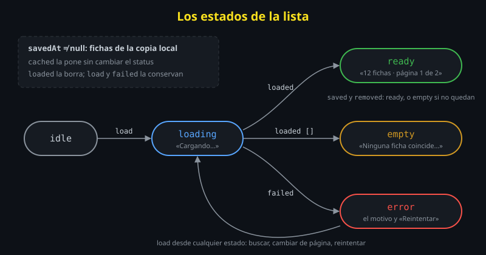

# ⏳ Estados de carga y experiencia de uso

## 🎯 Objetivos

- Conocer los estados por los que pasa la lista del proyecto y qué enseña la página en cada uno.
- Saber qué hace una página bien hecha mientras espera, cuando no hay resultados y cuando falla.
- Hacer que esos estados también los perciba quien usa un lector de pantalla.

La [semana 16](../../week-16-apis_rest_crud/1-teoria/04-estados-carga.md) explicó por qué un estado vale más que varios booleanos. Aquí se aplica a una página completa, con una pieza más: la copia local. La pregunta de esta teoría es otra: **qué ve la persona** en cada momento.

---

## 📋 Contenido

### 1. Cinco estados y una copia

| `status` | Cuándo | Qué enseña la página |
|---|---|---|
| `idle` | Antes de la primera petición | Nada (o la copia local, si la hay) |
| `loading` | Mientras llega la respuesta | Lo que ya había, más tenue, y «Cargando…» o «Actualizando…» |
| `ready` | Llegaron fichas | Las fichas y «12 fichas · página 1 de 2» |
| `empty` | Llegó una lista vacía | «Ninguna ficha coincide con «vega»», o «Todavía no hay fichas» |
| `error` | La petición falló | El motivo, un botón **Reintentar** y lo que ya había |

`savedAt` no es un estado más, sino un dato al lado: si no es `null`, las fichas en pantalla vienen de la copia local y la línea de estado lo dice («Mostrando la copia guardada hace 5 minutos · actualizando…»). Así una sola variable (`status`) dice qué está pasando, y otra (`savedAt`) dice de dónde vienen los datos.

`statusText(state, now)` convierte el estado en la frase de la línea de estado. Recibe `now` como argumento, y no llama a `Date.now()` por dentro, para poder probarla con una hora fija.

### 2. Mientras espera: no dejar la pantalla en blanco

- **Enseña lo que ya tienes.** Al buscar o cambiar de página, las fichas anteriores se quedan hasta que llegan las nuevas, marcadas con `aria-busy="true"` y más tenues. Vaciar la lista hace parpadear la página y pierde el sitio del scroll ([lab 03](../2-practicas/lab-03-estados-pagina/README.md), paso 2).
- **Di qué está pasando.** «Cargando…» la primera vez; «Actualizando…» cuando ya hay algo en pantalla.
- **Evita las acciones que no tienen sentido.** Mientras carga, los botones de página están desactivados: un segundo clic lanzaría otra petición. El buscador sigue activo, porque una búsqueda nueva cancela la anterior.
- **Pon un tiempo máximo.** Un servidor que no responde no puede dejar la página en «Cargando…» para siempre: `requestJson` corta a los 5 segundos con un `TimeoutError`, y la página lo dice.

Si la espera es corta (menos de 1 segundo), un texto basta. Para esperas más largas, muchas páginas pintan un **esqueleto**: cajas grises con la forma de las fichas, que dicen «aquí va a aparecer algo» sin que la página salte cuando llega.

### 3. Sin resultados: decir qué ha pasado

Una lista vacía sin explicación parece un error. `empty` distingue dos casos:

- Con búsqueda: «Ninguna ficha coincide con «zzz»». Repite lo que la persona escribió, para que vea si se equivocó.
- Sin búsqueda: «Todavía no hay fichas». El formulario de al lado invita a crear la primera.

### 4. Cuando falla: qué pasó y qué puede hacer

Un buen mensaje de error dice **qué pasó** con palabras de la persona y **qué puede hacer**:

| Error | Mensaje | Qué puede hacer |
|---|---|---|
| Sin red (`TypeError` de `fetch`) | «No se pudo conectar con el servidor» | Reintentar cuando vuelva la conexión |
| `TimeoutError` | «El servidor tarda demasiado en responder» | Reintentar más tarde |
| `HttpError` 409 | «Ya existe la ficha «Vega»» | Cambiar el nombre |
| `HttpError` 422 | «Revisa los campos marcados», con cada error en su campo | Corregir los campos |
| `AbortError` | Ninguno: la cancelaste tú con una búsqueda más nueva | Nada |

`messageFor` en `main.js` elige el mensaje. Nunca enseñes `error.message` de un `TypeError` («fetch failed», «Failed to fetch»): está en inglés, cambia de un navegador a otro y no dice nada a la persona.

Con un error, las fichas que ya había se quedan, igual que la copia local: es mejor información vieja con un aviso que una pantalla vacía. El botón **Reintentar** repite la última petición.

### 5. Estados que también se oyen

Una persona que usa un lector de pantalla no ve que la lista se pone tenue ni que aparece un texto nuevo. Tres atributos se lo cuentan ([semana 16](../../week-16-apis_rest_crud/1-teoria/04-estados-carga.md#6-estados-accesibles)):

- **`role="status"`** en la línea de estado y en el mensaje del formulario: el lector lee cada texto nuevo cuando termina lo que estaba diciendo, sin mover el foco.
- **`aria-busy="true"`** en la lista mientras carga: avisa de que el contenido va a cambiar.
- **`aria-invalid="true"`** en cada campo con error, con el mensaje enlazado por `aria-describedby`, y el foco en el primer campo con error.

Prueba el proyecto solo con el teclado: `Tab` para moverte, `Enter` para pulsar. Todo debería poder hacerse sin ratón.

---

## ✅ Checklist de aprendizaje

- [ ] Sé qué enseña la página en cada uno de los cinco estados.
- [ ] Sé para qué sirve `savedAt` y por qué no es un estado más.
- [ ] Sé por qué no conviene vaciar la lista mientras carga.
- [ ] Sé escribir un mensaje de error que diga qué pasó y qué hacer.
- [ ] Sé qué hacen `role="status"`, `aria-busy` y `aria-invalid`.

<!-- nav -->
---

## 🔗 Navegación

| Anterior | Siguiente |
|---|---|
| ← [Teoría — 🏗️ Arquitectura de una aplicación asíncrona](02-arquitectura.md) | [Índice de labs](../2-practicas/README.md) → |

[↑ Semana 24](../README.md)
